# 🤖 AI PROJECT CONTEXT & HANDSHAKE REPORT
> Mode: COMPLETE PROJECT | Views: ALL

=== 0. PROJECT METRICS & STATISTICS ===
 • Total Files Scanned : 1715
 • Python (.py) Files  : 1681
 • Total Lines of Code : 8096 lines

---
=== 1. TREE VIEW STRUCTURE ===
# django_python/
- `.env.example`
- `.gitignore`
- `admin.py  [Lines: 0]`
- `AI_PROJECT_CONTEXT.md`
- `clean_project.py  [Lines: 40]`
- `db.sqlite3`
- `file.py  [Lines: 63]`
- `git_manager.py  [Lines: 81]`
- `inspector.py  [Lines: 354]`
- `manage.py  [Lines: 14]`
- `project_tree_path_view.txt`
- `README.md`
- `SECURITY.md`
- `structure.py  [Lines: 67]`
- **apps/**
    - `__init__.py  [Lines: 0]`
    - **catalogs/**
        - `urls.py  [Lines: 36]`
        - `__init__.py  [Lines: 0]`
        - **attributes/**
            - `admin.py  [Lines: 0]`
            - `apps.py  [Lines: 7]`
            - `choices.py  [Lines: 0]`
            - `conf.py  [Lines: 0]`
            - `constants.py  [Lines: 0]`
            - `urls.py  [Lines: 3]`
            - `__init__.py  [Lines: 0]`
            - **dtos/**
                - `__init__.py  [Lines: 0]`
            - **exceptions/**
                - `__init__.py  [Lines: 0]`
            - **filters/**
                - `__init__.py  [Lines: 0]`
            - **forms/**
                - `__init__.py  [Lines: 0]`
            - **interfaces/**
                - `__init__.py  [Lines: 0]`
            - **listeners/**
                - `__init__.py  [Lines: 0]`
            - **managers/**
                - `__init__.py  [Lines: 0]`
            - **middleware/**
                - `__init__.py  [Lines: 0]`
            - **migrations/**
                - `__init__.py  [Lines: 0]`
            - **models/**
                - `attribute_profile.py  [Lines: 14]`
                - `__init__.py  [Lines: 0]`
            - **permissions/**
                - `__init__.py  [Lines: 0]`
            - **presenters/**
                - `__init__.py  [Lines: 0]`
            - **selectors/**
                - `attribute_selectors.py  [Lines: 82]`
                - `__init__.py  [Lines: 0]`
            - **serializers/**
                - `attribute_serializer.py  [Lines: 10]`
                - `__init__.py  [Lines: 0]`
            - **services/**
                - `attribute_service.py  [Lines: 253]`
                - `__init__.py  [Lines: 0]`
            - **signals/**
                - `__init__.py  [Lines: 0]`
            - **tasks/**
                - `__init__.py  [Lines: 0]`
            - **templates/**
                - `__init__.py  [Lines: 0]`
            - **tests/**
                - `__init__.py  [Lines: 0]`
            - **utils/**
                - `__init__.py  [Lines: 0]`
            - **validators/**
                - `__init__.py  [Lines: 0]`
            - **views/**
                - `__init__.py  [Lines: 0]`
        - **bundles_kits/**
            - `admin.py  [Lines: 0]`
            - `apps.py  [Lines: 7]`
            - `choices.py  [Lines: 0]`
            - `conf.py  [Lines: 0]`
            - `constants.py  [Lines: 0]`
            - `urls.py  [Lines: 7]`
            - `__init__.py  [Lines: 0]`
            - **dtos/**
                - `bundles_kits_dtos.py  [Lines: 7]`
                - `__init__.py  [Lines: 0]`
            - **exceptions/**
                - `__init__.py  [Lines: 0]`
            - **filters/**
                - `__init__.py  [Lines: 0]`
            - **forms/**
                - `__init__.py  [Lines: 0]`
            - **interfaces/**
                - `__init__.py  [Lines: 0]`
            - **listeners/**
                - `__init__.py  [Lines: 0]`
            - **managers/**
                - `__init__.py  [Lines: 0]`
            - **middleware/**
                - `__init__.py  [Lines: 0]`
            - **migrations/**
                - `0001_initial.py  [Lines: 29]`
                - `__init__.py  [Lines: 0]`
            - **models/**
                - `bundles_kits_profile.py  [Lines: 22]`
                - `bundle_profile.py  [Lines: 16]`
                - `__init__.py  [Lines: 0]`
            - **permissions/**
                - `__init__.py  [Lines: 0]`
            - **presenters/**
                - `__init__.py  [Lines: 0]`
            - **selectors/**
                - `bundles_kits_selectors.py  [Lines: 6]`
                - `__init__.py  [Lines: 0]`
            - **serializers/**
                - `bundles_kits_serializer.py  [Lines: 7]`
                - `bundle_serializer.py  [Lines: 10]`
                - `__init__.py  [Lines: 0]`
            - **services/**
                - `bundles_kits_service.py  [Lines: 12]`
                - `bundle_service.py  [Lines: 31]`
                - `__init__.py  [Lines: 0]`
            - **signals/**
                - `__init__.py  [Lines: 0]`
            - **tasks/**
                - `__init__.py  [Lines: 0]`
            - **templates/**
                - `__init__.py  [Lines: 0]`
            - **tests/**
                - `__init__.py  [Lines: 0]`
            - **utils/**
                - `__init__.py  [Lines: 0]`
            - **validators/**
                - `__init__.py  [Lines: 0]`
            - **views/**
                - `bundles_kits_views.py  [Lines: 18]`
                - `__init__.py  [Lines: 0]`
        - **catalog_medias/**
            - `admin.py  [Lines: 0]`
            - `apps.py  [Lines: 7]`
            - `choices.py  [Lines: 0]`
            - `conf.py  [Lines: 0]`
            - `constants.py  [Lines: 0]`
            - `urls.py  [Lines: 7]`
            - `__init__.py  [Lines: 0]`
            - **dtos/**
                - `catalog_media_dtos.py  [Lines: 13]`
                - `__init__.py  [Lines: 0]`
            - **exceptions/**
                - `__init__.py  [Lines: 0]`
            - **filters/**
                - `__init__.py  [Lines: 0]`
            - **forms/**
                - `__init__.py  [Lines: 0]`
            - **interfaces/**
                - `__init__.py  [Lines: 0]`
            - **listeners/**
                - `__init__.py  [Lines: 0]`
            - **managers/**
                - `__init__.py  [Lines: 0]`
            - **middleware/**
                - `__init__.py  [Lines: 0]`
            - **migrations/**
                - `0001_initial.py  [Lines: 35]`
                - `__init__.py  [Lines: 0]`
            - **models/**
                - `catalog_media_profile.py  [Lines: 35]`
                - `media_profile.py  [Lines: 14]`
                - `__init__.py  [Lines: 0]`
            - **permissions/**
                - `__init__.py  [Lines: 0]`
            - **presenters/**
                - `__init__.py  [Lines: 0]`
            - **selectors/**
                - `catalog_media_selectors.py  [Lines: 6]`
                - `__init__.py  [Lines: 0]`
            - **serializers/**
                - `catalog_media_serializer.py  [Lines: 7]`
                - `media_serializer.py  [Lines: 10]`
                - `__init__.py  [Lines: 0]`
            - **services/**
                - `catalog_media_service.py  [Lines: 11]`
                - `media_service.py  [Lines: 33]`
                - `__init__.py  [Lines: 0]`
            - **signals/**
                - `__init__.py  [Lines: 0]`
            - **tasks/**
                - `__init__.py  [Lines: 0]`
            - **templates/**
                - `__init__.py  [Lines: 0]`
            - **tests/**
                - `__init__.py  [Lines: 0]`
            - **utils/**
                - `__init__.py  [Lines: 0]`
            - **validators/**
                - `__init__.py  [Lines: 0]`
            - **views/**
                - `catalog_media_views.py  [Lines: 18]`
                - `__init__.py  [Lines: 0]`
        - **catalog_statuses/**
            - `admin.py  [Lines: 0]`
            - `apps.py  [Lines: 7]`
            - `choices.py  [Lines: 0]`
            - `conf.py  [Lines: 0]`
            - `constants.py  [Lines: 0]`
            - `urls.py  [Lines: 7]`
            - `__init__.py  [Lines: 0]`
            - **dtos/**
                - `catalog_status_dtos.py  [Lines: 9]`
                - `__init__.py  [Lines: 0]`
            - **exceptions/**
                - `__init__.py  [Lines: 0]`
            - **filters/**
                - `__init__.py  [Lines: 0]`
            - **forms/**
                - `__init__.py  [Lines: 0]`
            - **interfaces/**
                - `__init__.py  [Lines: 0]`
            - **listeners/**
                - `__init__.py  [Lines: 0]`
            - **managers/**
                - `__init__.py  [Lines: 0]`
            - **middleware/**
                - `__init__.py  [Lines: 0]`
            - **migrations/**
                - `0001_initial.py  [Lines: 31]`
                - `__init__.py  [Lines: 0]`
            - **models/**
                - `catalog_status_profile.py  [Lines: 28]`
                - `status_profile.py  [Lines: 21]`
                - `__init__.py  [Lines: 0]`
            - **permissions/**
                - `__init__.py  [Lines: 0]`
            - **presenters/**
                - `__init__.py  [Lines: 0]`
            - **selectors/**
                - `catalog_status_selectors.py  [Lines: 6]`
                - `core_catalog_selectors.py  [Lines: 24]`
                - `__init__.py  [Lines: 0]`
            - **serializers/**
                - `catalog_status_serializer.py  [Lines: 7]`
                - `core_catalog_serializer.py  [Lines: 15]`
                - `status_serializer.py  [Lines: 12]`
                - `__init__.py  [Lines: 0]`
            - **services/**
                - `catalog_status_service.py  [Lines: 11]`
                - `core_catalog_service.py  [Lines: 31]`
                - `status_service.py  [Lines: 19]`
                - `__init__.py  [Lines: 0]`
            - **signals/**
                - `__init__.py  [Lines: 0]`
            - **tasks/**
                - `__init__.py  [Lines: 0]`
            - **templates/**
                - `__init__.py  [Lines: 0]`
            - **tests/**
                - `__init__.py  [Lines: 0]`
            - **utils/**
                - `__init__.py  [Lines: 0]`
            - **validators/**
                - `__init__.py  [Lines: 0]`
            - **views/**
                - `catalog_status_views.py  [Lines: 18]`
                - `__init__.py  [Lines: 0]`
        - **categories/**
            - `admin.py  [Lines: 0]`
            - `apps.py  [Lines: 7]`
            - `choices.py  [Lines: 0]`
            - `conf.py  [Lines: 0]`
            - `constants.py  [Lines: 0]`
            - `urls.py  [Lines: 3]`
            - `__init__.py  [Lines: 0]`
            - **dtos/**
                - `__init__.py  [Lines: 0]`
            - **exceptions/**
                - `__init__.py  [Lines: 0]`
            - **filters/**
                - `__init__.py  [Lines: 0]`
            - **forms/**
                - `__init__.py  [Lines: 0]`
            - **interfaces/**
                - `__init__.py  [Lines: 0]`
            - **listeners/**
                - `__init__.py  [Lines: 0]`
            - **managers/**
                - `__init__.py  [Lines: 0]`
            - **middleware/**
                - `__init__.py  [Lines: 0]`
            - **migrations/**
                - `__init__.py  [Lines: 0]`
            - **models/**
                - `__init__.py  [Lines: 0]`
            - **permissions/**
                - `__init__.py  [Lines: 0]`
            - **presenters/**
                - `__init__.py  [Lines: 0]`
            - **selectors/**
                - `__init__.py  [Lines: 0]`
            - **serializers/**
                - `category_profile.py  [Lines: 10]`
                - `__init__.py  [Lines: 0]`
            - **services/**
                - `category_service.py  [Lines: 21]`
                - `__init__.py  [Lines: 0]`
            - **signals/**
                - `__init__.py  [Lines: 0]`
            - **tasks/**
                - `__init__.py  [Lines: 0]`
            - **templates/**
                - `__init__.py  [Lines: 0]`
            - **tests/**
                - `__init__.py  [Lines: 0]`
            - **utils/**
                - `__init__.py  [Lines: 0]`
            - **validators/**
                - `__init__.py  [Lines: 0]`
            - **views/**
                - `__init__.py  [Lines: 0]`
        - **core_catalogs/**
            - `admin.py  [Lines: 9]`
            - `apps.py  [Lines: 7]`
            - `choices.py  [Lines: 0]`
            - `conf.py  [Lines: 0]`
            - `constants.py  [Lines: 0]`
            - `urls.py  [Lines: 7]`
            - `__init__.py  [Lines: 0]`
            - **dtos/**
                - `core_catalog_dtos.py  [Lines: 123]`
                - `__init__.py  [Lines: 0]`
            - **exceptions/**
                - `__init__.py  [Lines: 0]`
            - **filters/**
                - `__init__.py  [Lines: 0]`
            - **forms/**
                - `__init__.py  [Lines: 0]`
            - **interfaces/**
                - `__init__.py  [Lines: 0]`
            - **listeners/**
                - `__init__.py  [Lines: 0]`
            - **managers/**
                - `__init__.py  [Lines: 0]`
            - **middleware/**
                - `__init__.py  [Lines: 0]`
            - **migrations/**
                - `0001_initial.py  [Lines: 27]`
                - `0002_corecatalog_price_corecatalog_stock_quantity_and_more.py  [Lines: 61]`
                - `__init__.py  [Lines: 0]`
            - **models/**
                - `core_catalog_profile.py  [Lines: 34]`
                - `__init__.py  [Lines: 0]`
            - **permissions/**
                - `__init__.py  [Lines: 0]`
            - **presenters/**
                - `__init__.py  [Lines: 0]`
            - **selectors/**
                - `__init__.py  [Lines: 0]`
            - **serializers/**
                - `core_catalog_serializer.py  [Lines: 10]`
                - `__init__.py  [Lines: 0]`
            - **services/**
                - `core_catalog_service.py  [Lines: 21]`
                - `__init__.py  [Lines: 0]`
            - **signals/**
                - `__init__.py  [Lines: 0]`
            - **tasks/**
                - `__init__.py  [Lines: 0]`
            - **templates/**
                - `__init__.py  [Lines: 0]`
            - **tests/**
                - `__init__.py  [Lines: 0]`
            - **utils/**
                - `__init__.py  [Lines: 0]`
            - **validators/**
                - `__init__.py  [Lines: 0]`
            - **views/**
                - `core_catalog_views.py  [Lines: 29]`
                - `__init__.py  [Lines: 0]`
        - **inventories/**
            - `admin.py  [Lines: 0]`
            - `apps.py  [Lines: 7]`
            - `choices.py  [Lines: 0]`
            - `conf.py  [Lines: 0]`
            - `constants.py  [Lines: 0]`
            - `urls.py  [Lines: 8]`
            - `__init__.py  [Lines: 0]`
            - **dtos/**
                - `inventory_dtos.py  [Lines: 8]`
                - `__init__.py  [Lines: 0]`
            - **exceptions/**
                - `__init__.py  [Lines: 0]`
            - **filters/**
                - `__init__.py  [Lines: 0]`
            - **forms/**
                - `__init__.py  [Lines: 0]`
            - **interfaces/**
                - `__init__.py  [Lines: 0]`
            - **listeners/**
                - `__init__.py  [Lines: 0]`
            - **managers/**
                - `__init__.py  [Lines: 0]`
            - **middleware/**
                - `__init__.py  [Lines: 0]`
            - **migrations/**
                - `0001_initial.py  [Lines: 27]`
                - `__init__.py  [Lines: 0]`
            - **models/**
                - `inventory_profile.py  [Lines: 14]`
                - `__init__.py  [Lines: 0]`
            - **permissions/**
                - `__init__.py  [Lines: 0]`
            - **presenters/**
                - `__init__.py  [Lines: 0]`
            - **selectors/**
                - `__init__.py  [Lines: 0]`
            - **serializers/**
                - `inventory_serializer.py  [Lines: 10]`
                - `__init__.py  [Lines: 0]`
            - **services/**
                - `inventory_service.py  [Lines: 26]`
                - `__init__.py  [Lines: 0]`
            - **signals/**
                - `__init__.py  [Lines: 0]`
            - **tasks/**
                - `__init__.py  [Lines: 0]`
            - **templates/**
                - `__init__.py  [Lines: 0]`
            - **tests/**
                - `__init__.py  [Lines: 0]`
            - **utils/**
                - `__init__.py  [Lines: 0]`
            - **validators/**
                - `__init__.py  [Lines: 0]`
            - **views/**
                - `inventory_views.py  [Lines: 25]`
                - `__init__.py  [Lines: 0]`
        - **pricing_tiers/**
            - `admin.py  [Lines: 0]`
            - `apps.py  [Lines: 7]`
            - `choices.py  [Lines: 0]`
            - `conf.py  [Lines: 0]`
            - `constants.py  [Lines: 0]`
            - `urls.py  [Lines: 8]`
            - `__init__.py  [Lines: 0]`
            - **dtos/**
                - `pricing_dtos.py  [Lines: 14]`
                - `__init__.py  [Lines: 0]`
            - **exceptions/**
                - `__init__.py  [Lines: 0]`
            - **filters/**
                - `__init__.py  [Lines: 0]`
            - **forms/**
                - `__init__.py  [Lines: 0]`
            - **interfaces/**
                - `__init__.py  [Lines: 0]`
            - **listeners/**
                - `__init__.py  [Lines: 0]`
            - **managers/**
                - `__init__.py  [Lines: 0]`
            - **middleware/**
                - `__init__.py  [Lines: 0]`
            - **migrations/**
                - `0001_initial.py  [Lines: 29]`
                - `__init__.py  [Lines: 0]`
            - **models/**
                - `pricing_profile.py  [Lines: 16]`
                - `__init__.py  [Lines: 0]`
            - **permissions/**
                - `__init__.py  [Lines: 0]`
            - **presenters/**
                - `__init__.py  [Lines: 0]`
            - **selectors/**
                - `pricing_selectors.py  [Lines: 76]`
                - `__init__.py  [Lines: 0]`
            - **serializers/**
                - `pricing_serializer.py  [Lines: 10]`
                - `__init__.py  [Lines: 0]`
            - **services/**
                - `pricing_service.py  [Lines: 19]`
                - `__init__.py  [Lines: 0]`
            - **signals/**
                - `__init__.py  [Lines: 0]`
            - **tasks/**
                - `__init__.py  [Lines: 0]`
            - **templates/**
                - `__init__.py  [Lines: 0]`
            - **tests/**
                - `__init__.py  [Lines: 0]`
            - **utils/**
                - `__init__.py  [Lines: 0]`
            - **validators/**
                - `__init__.py  [Lines: 0]`
            - **views/**
                - `pricing_views.py  [Lines: 18]`
                - `__init__.py  [Lines: 0]`
        - **reviews_ratings/**
            - `admin.py  [Lines: 0]`
            - `apps.py  [Lines: 7]`
            - `choices.py  [Lines: 0]`
            - `conf.py  [Lines: 0]`
            - `constants.py  [Lines: 0]`
            - `urls.py  [Lines: 7]`
            - `__init__.py  [Lines: 0]`
            - **dtos/**
                - `reviews_ratings_dtos.py  [Lines: 10]`
                - `__init__.py  [Lines: 0]`
            - **exceptions/**
                - `__init__.py  [Lines: 0]`
            - **filters/**
                - `__init__.py  [Lines: 0]`
            - **forms/**
                - `__init__.py  [Lines: 0]`
            - **interfaces/**
                - `__init__.py  [Lines: 0]`
            - **listeners/**
                - `__init__.py  [Lines: 0]`
            - **managers/**
                - `__init__.py  [Lines: 0]`
            - **middleware/**
                - `__init__.py  [Lines: 0]`
            - **migrations/**
                - `0001_initial.py  [Lines: 32]`
                - `__init__.py  [Lines: 0]`
            - **models/**
                - `reviews_ratings_profile.py  [Lines: 26]`
                - `review_profile.py  [Lines: 15]`
                - `__init__.py  [Lines: 0]`
            - **permissions/**
                - `__init__.py  [Lines: 0]`
            - **presenters/**
                - `__init__.py  [Lines: 0]`
            - **selectors/**
                - `reviews_ratings_selectors.py  [Lines: 6]`
                - `__init__.py  [Lines: 0]`
            - **serializers/**
                - `reviews_ratings_serializer.py  [Lines: 7]`
                - `review_serializer.py  [Lines: 10]`
                - `__init__.py  [Lines: 0]`
            - **services/**
                - `reviews_ratings_service.py  [Lines: 11]`
                - `review_service.py  [Lines: 21]`
                - `__init__.py  [Lines: 0]`
            - **signals/**
                - `__init__.py  [Lines: 0]`
            - **tasks/**
                - `__init__.py  [Lines: 0]`
            - **templates/**
                - `__init__.py  [Lines: 0]`
            - **tests/**
                - `__init__.py  [Lines: 0]`
            - **utils/**
                - `__init__.py  [Lines: 0]`
            - **validators/**
                - `__init__.py  [Lines: 0]`
            - **views/**
                - `reviews_ratings_views.py  [Lines: 18]`
                - `__init__.py  [Lines: 0]`
        - **search_filters/**
            - `admin.py  [Lines: 0]`
            - `apps.py  [Lines: 7]`
            - `choices.py  [Lines: 0]`
            - `conf.py  [Lines: 0]`
            - `constants.py  [Lines: 0]`
            - `urls.py  [Lines: 7]`
            - `__init__.py  [Lines: 0]`
            - **dtos/**
                - `search_filters_dtos.py  [Lines: 9]`
                - `__init__.py  [Lines: 0]`
            - **exceptions/**
                - `__init__.py  [Lines: 0]`
            - **filters/**
                - `__init__.py  [Lines: 0]`
            - **forms/**
                - `__init__.py  [Lines: 0]`
            - **interfaces/**
                - `__init__.py  [Lines: 0]`
            - **listeners/**
                - `__init__.py  [Lines: 0]`
            - **managers/**
                - `__init__.py  [Lines: 0]`
            - **middleware/**
                - `__init__.py  [Lines: 0]`
            - **migrations/**
                - `0001_initial.py  [Lines: 30]`
                - `__init__.py  [Lines: 0]`
            - **models/**
                - `filter_profile.py  [Lines: 15]`
                - `search_filters_profile.py  [Lines: 24]`
                - `__init__.py  [Lines: 0]`
            - **permissions/**
                - `__init__.py  [Lines: 0]`
            - **presenters/**
                - `__init__.py  [Lines: 0]`
            - **selectors/**
                - `search_filters_selectors.py  [Lines: 6]`
                - `__init__.py  [Lines: 0]`
            - **serializers/**
                - `filter_serializer.py  [Lines: 10]`
                - `search_filters_serializer.py  [Lines: 7]`
                - `__init__.py  [Lines: 0]`
            - **services/**
                - `filter_service.py  [Lines: 21]`
                - `search_filters_service.py  [Lines: 11]`
                - `__init__.py  [Lines: 0]`
            - **signals/**
                - `__init__.py  [Lines: 0]`
            - **tasks/**
                - `__init__.py  [Lines: 0]`
            - **templates/**
                - `__init__.py  [Lines: 0]`
            - **tests/**
                - `__init__.py  [Lines: 0]`
            - **utils/**
                - `__init__.py  [Lines: 0]`
            - **validators/**
                - `__init__.py  [Lines: 0]`
            - **views/**
                - `search_filters_views.py  [Lines: 62]`
                - `__init__.py  [Lines: 0]`
        - **specifications/**
            - `admin.py  [Lines: 0]`
            - `apps.py  [Lines: 7]`
            - `choices.py  [Lines: 0]`
            - `conf.py  [Lines: 0]`
            - `constants.py  [Lines: 0]`
            - `urls.py  [Lines: 7]`
            - `__init__.py  [Lines: 0]`
            - **dtos/**
                - `specifications_dtos.py  [Lines: 12]`
                - `__init__.py  [Lines: 0]`
            - **exceptions/**
                - `__init__.py  [Lines: 0]`
            - **filters/**
                - `__init__.py  [Lines: 0]`
            - **forms/**
                - `__init__.py  [Lines: 0]`
            - **interfaces/**
                - `__init__.py  [Lines: 0]`
            - **listeners/**
                - `__init__.py  [Lines: 0]`
            - **managers/**
                - `__init__.py  [Lines: 0]`
            - **middleware/**
                - `__init__.py  [Lines: 0]`
            - **migrations/**
                - `0001_initial.py  [Lines: 27]`
                - `__init__.py  [Lines: 0]`
            - **models/**
                - `specifications_profile.py  [Lines: 14]`
                - `__init__.py  [Lines: 0]`
            - **permissions/**
                - `__init__.py  [Lines: 0]`
            - **presenters/**
                - `__init__.py  [Lines: 0]`
            - **selectors/**
                - `specifications_selectors.py  [Lines: 6]`
                - `__init__.py  [Lines: 0]`
            - **serializers/**
                - `specifications_serializer.py  [Lines: 10]`
                - `__init__.py  [Lines: 0]`
            - **services/**
                - `specifications_service.py  [Lines: 17]`
                - `__init__.py  [Lines: 0]`
            - **signals/**
                - `__init__.py  [Lines: 0]`
            - **tasks/**
                - `__init__.py  [Lines: 0]`
            - **templates/**
                - `__init__.py  [Lines: 0]`
            - **tests/**
                - `__init__.py  [Lines: 0]`
            - **utils/**
                - `__init__.py  [Lines: 0]`
            - **validators/**
                - `__init__.py  [Lines: 0]`
            - **views/**
                - `specifications_views.py  [Lines: 15]`
                - `__init__.py  [Lines: 0]`
        - **variants/**
            - `admin.py  [Lines: 9]`
            - `apps.py  [Lines: 7]`
            - `choices.py  [Lines: 0]`
            - `conf.py  [Lines: 0]`
            - `constants.py  [Lines: 0]`
            - `urls.py  [Lines: 3]`
            - `__init__.py  [Lines: 0]`
            - **dtos/**
                - `__init__.py  [Lines: 0]`
            - **exceptions/**
                - `__init__.py  [Lines: 0]`
            - **filters/**
                - `__init__.py  [Lines: 0]`
            - **forms/**
                - `__init__.py  [Lines: 0]`
            - **interfaces/**
                - `__init__.py  [Lines: 0]`
            - **listeners/**
                - `__init__.py  [Lines: 0]`
            - **managers/**
                - `__init__.py  [Lines: 0]`
            - **middleware/**
                - `__init__.py  [Lines: 0]`
            - **migrations/**
                - `0001_initial.py  [Lines: 29]`
                - `__init__.py  [Lines: 0]`
            - **models/**
                - `variant_profile.py  [Lines: 16]`
                - `__init__.py  [Lines: 0]`
            - **permissions/**
                - `__init__.py  [Lines: 0]`
            - **presenters/**
                - `__init__.py  [Lines: 0]`
            - **selectors/**
                - `__init__.py  [Lines: 0]`
            - **serializers/**
                - `variant_serializer.py  [Lines: 10]`
                - `__init__.py  [Lines: 0]`
            - **services/**
                - `variant_service.py  [Lines: 21]`
                - `__init__.py  [Lines: 0]`
            - **signals/**
                - `__init__.py  [Lines: 0]`
            - **tasks/**
                - `__init__.py  [Lines: 0]`
            - **templates/**
                - `__init__.py  [Lines: 0]`
            - **tests/**
                - `__init__.py  [Lines: 0]`
            - **utils/**
                - `__init__.py  [Lines: 0]`
            - **validators/**
                - `__init__.py  [Lines: 0]`
            - **views/**
                - `__init__.py  [Lines: 0]`
    - **customer_supports/**
        - `urls.py  [Lines: 0]`
        - `__init__.py  [Lines: 0]`
        - **faqs/**
            - `admin.py  [Lines: 0]`
            - `apps.py  [Lines: 0]`
            - `choices.py  [Lines: 0]`
            - `conf.py  [Lines: 0]`
            - `constants.py  [Lines: 0]`
            - `urls.py  [Lines: 0]`
            - `__init__.py  [Lines: 0]`
            - **dtos/**
                - `__init__.py  [Lines: 0]`
            - **exceptions/**
                - `__init__.py  [Lines: 0]`
            - **filters/**
                - `__init__.py  [Lines: 0]`
            - **forms/**
                - `__init__.py  [Lines: 0]`
            - **interfaces/**
                - `__init__.py  [Lines: 0]`
            - **listeners/**
                - `__init__.py  [Lines: 0]`
            - **managers/**
                - `__init__.py  [Lines: 0]`
            - **middleware/**
                - `__init__.py  [Lines: 0]`
            - **migrations/**
                - `__init__.py  [Lines: 0]`
            - **models/**
                - `faq_profile.py  [Lines: 11]`
                - `__init__.py  [Lines: 0]`
            - **permissions/**
                - `__init__.py  [Lines: 0]`
            - **presenters/**
                - `__init__.py  [Lines: 0]`
            - **selectors/**
                - `__init__.py  [Lines: 0]`
            - **serializers/**
                - `__init__.py  [Lines: 0]`
            - **services/**
                - `__init__.py  [Lines: 0]`
            - **signals/**
                - `__init__.py  [Lines: 0]`
            - **tasks/**
                - `__init__.py  [Lines: 0]`
            - **templates/**
                - `__init__.py  [Lines: 0]`
            - **tests/**
                - `__init__.py  [Lines: 0]`
            - **utils/**
                - `__init__.py  [Lines: 0]`
            - **validators/**
                - `__init__.py  [Lines: 0]`
            - **views/**
                - `__init__.py  [Lines: 0]`
        - **helpdesk_tickets/**
            - `admin.py  [Lines: 0]`
            - `apps.py  [Lines: 0]`
            - `choices.py  [Lines: 0]`
            - `conf.py  [Lines: 0]`
            - `constants.py  [Lines: 0]`
            - `urls.py  [Lines: 0]`
            - `__init__.py  [Lines: 0]`
            - **dtos/**
                - `__init__.py  [Lines: 0]`
            - **exceptions/**
                - `__init__.py  [Lines: 0]`
            - **filters/**
                - `__init__.py  [Lines: 0]`
            - **forms/**
                - `__init__.py  [Lines: 0]`
            - **interfaces/**
                - `__init__.py  [Lines: 0]`
            - **listeners/**
                - `__init__.py  [Lines: 0]`
            - **managers/**
                - `__init__.py  [Lines: 0]`
            - **middleware/**
                - `__init__.py  [Lines: 0]`
            - **migrations/**
                - `__init__.py  [Lines: 0]`
            - **models/**
                - `ticket_profile.py  [Lines: 20]`
                - `__init__.py  [Lines: 0]`
            - **permissions/**
                - `__init__.py  [Lines: 0]`
            - **presenters/**
                - `__init__.py  [Lines: 0]`
            - **selectors/**
                - `__init__.py  [Lines: 0]`
            - **serializers/**
                - `__init__.py  [Lines: 0]`
            - **services/**
                - `__init__.py  [Lines: 0]`
            - **signals/**
                - `__init__.py  [Lines: 0]`
            - **tasks/**
                - `__init__.py  [Lines: 0]`
            - **templates/**
                - `__init__.py  [Lines: 0]`
            - **tests/**
                - `__init__.py  [Lines: 0]`
            - **utils/**
                - `__init__.py  [Lines: 0]`
            - **validators/**
                - `__init__.py  [Lines: 0]`
            - **views/**
                - `__init__.py  [Lines: 0]`
        - **live_chats/**
            - `admin.py  [Lines: 0]`
            - `apps.py  [Lines: 0]`
            - `choices.py  [Lines: 0]`
            - `conf.py  [Lines: 0]`
            - `constants.py  [Lines: 0]`
            - `consumers.py  [Lines: 46]`
            - `urls.py  [Lines: 0]`
            - `__init__.py  [Lines: 0]`
            - **dtos/**
                - `__init__.py  [Lines: 0]`
            - **exceptions/**
                - `__init__.py  [Lines: 0]`
            - **filters/**
                - `__init__.py  [Lines: 0]`
            - **forms/**
                - `__init__.py  [Lines: 0]`
            - **interfaces/**
                - `__init__.py  [Lines: 0]`
            - **listeners/**
                - `__init__.py  [Lines: 0]`
            - **managers/**
                - `__init__.py  [Lines: 0]`
            - **middleware/**
                - `__init__.py  [Lines: 0]`
            - **migrations/**
                - `__init__.py  [Lines: 0]`
            - **models/**
                - `chat_profile.p`
                - `__init__.py  [Lines: 0]`
            - **permissions/**
                - `__init__.py  [Lines: 0]`
            - **presenters/**
                - `__init__.py  [Lines: 0]`
            - **selectors/**
                - `__init__.py  [Lines: 0]`
            - **serializers/**
                - `__init__.py  [Lines: 0]`
            - **services/**
                - `__init__.py  [Lines: 0]`
            - **signals/**
                - `__init__.py  [Lines: 0]`
            - **tasks/**
                - `__init__.py  [Lines: 0]`
            - **templates/**
                - `__init__.py  [Lines: 0]`
            - **tests/**
                - `__init__.py  [Lines: 0]`
            - **utils/**
                - `__init__.py  [Lines: 0]`
            - **validators/**
                - `__init__.py  [Lines: 0]`
            - **views/**
                - `__init__.py  [Lines: 0]`
        - **return_refunds/**
            - `admin.py  [Lines: 0]`
            - `apps.py  [Lines: 0]`
            - `choices.py  [Lines: 0]`
            - `conf.py  [Lines: 0]`
            - `constants.py  [Lines: 0]`
            - `urls.py  [Lines: 0]`
            - `__init__.py  [Lines: 0]`
            - **dtos/**
                - `__init__.py  [Lines: 0]`
            - **exceptions/**
                - `__init__.py  [Lines: 0]`
            - **filters/**
                - `__init__.py  [Lines: 0]`
            - **forms/**
                - `__init__.py  [Lines: 0]`
            - **interfaces/**
                - `__init__.py  [Lines: 0]`
            - **listeners/**
                - `__init__.py  [Lines: 0]`
            - **managers/**
                - `__init__.py  [Lines: 0]`
            - **middleware/**
                - `__init__.py  [Lines: 0]`
            - **migrations/**
                - `__init__.py  [Lines: 0]`
            - **models/**
                - `refund_profile.py  [Lines: 21]`
                - `__init__.py  [Lines: 0]`
            - **permissions/**
                - `__init__.py  [Lines: 0]`
            - **presenters/**
                - `__init__.py  [Lines: 0]`
            - **selectors/**
                - `__init__.py  [Lines: 0]`
            - **serializers/**
                - `__init__.py  [Lines: 0]`
            - **services/**
                - `__init__.py  [Lines: 0]`
            - **signals/**
                - `__init__.py  [Lines: 0]`
            - **tasks/**
                - `__init__.py  [Lines: 0]`
            - **templates/**
                - `__init__.py  [Lines: 0]`
            - **tests/**
                - `__init__.py  [Lines: 0]`
            - **utils/**
                - `__init__.py  [Lines: 0]`
            - **validators/**
                - `__init__.py  [Lines: 0]`
            - **views/**
                - `__init__.py  [Lines: 0]`
    - **finances/**
        - `urls.py  [Lines: 0]`
        - `__init__.py  [Lines: 0]`
        - **bank_accounts/**
            - `admin.py  [Lines: 0]`
            - `apps.py  [Lines: 0]`
            - `choices.py  [Lines: 0]`
            - `conf.py  [Lines: 0]`
            - `constants.py  [Lines: 0]`
            - `urls.py  [Lines: 0]`
            - `__init__.py  [Lines: 0]`
            - **dtos/**
                - `__init__.py  [Lines: 0]`
            - **exceptions/**
                - `__init__.py  [Lines: 0]`
            - **filters/**
                - `__init__.py  [Lines: 0]`
            - **forms/**
                - `__init__.py  [Lines: 0]`
            - **interfaces/**
                - `__init__.py  [Lines: 0]`
            - **listeners/**
                - `__init__.py  [Lines: 0]`
            - **managers/**
                - `__init__.py  [Lines: 0]`
            - **middleware/**
                - `__init__.py  [Lines: 0]`
            - **migrations/**
                - `__init__.py  [Lines: 0]`
            - **models/**
                - `bank_account_profile.py  [Lines: 15]`
                - `__init__.py  [Lines: 0]`
            - **permissions/**
                - `__init__.py  [Lines: 0]`
            - **presenters/**
                - `__init__.py  [Lines: 0]`
            - **selectors/**
                - `__init__.py  [Lines: 0]`
            - **serializers/**
                - `__init__.py  [Lines: 0]`
            - **services/**
                - `__init__.py  [Lines: 0]`
            - **signals/**
                - `__init__.py  [Lines: 0]`
            - **tasks/**
                - `__init__.py  [Lines: 0]`
            - **templates/**
                - `__init__.py  [Lines: 0]`
            - **tests/**
                - `__init__.py  [Lines: 0]`
            - **utils/**
                - `__init__.py  [Lines: 0]`
            - **validators/**
                - `__init__.py  [Lines: 0]`
            - **views/**
                - `bank_account_views.py  [Lines: 8]`
                - `__init__.py  [Lines: 0]`
        - **commissions/**
            - `admin.py  [Lines: 0]`
            - `apps.py  [Lines: 5]`
            - `choices.py  [Lines: 0]`
            - `conf.py  [Lines: 0]`
            - `constants.py  [Lines: 0]`
            - `urls.py  [Lines: 0]`
            - `__init__.py  [Lines: 0]`
            - **dtos/**
                - `__init__.py  [Lines: 0]`
            - **exceptions/**
                - `__init__.py  [Lines: 0]`
            - **filters/**
                - `__init__.py  [Lines: 0]`
            - **forms/**
                - `__init__.py  [Lines: 0]`
            - **interfaces/**
                - `__init__.py  [Lines: 0]`
            - **listeners/**
                - `__init__.py  [Lines: 0]`
            - **managers/**
                - `__init__.py  [Lines: 0]`
            - **middleware/**
                - `__init__.py  [Lines: 0]`
            - **migrations/**
                - `__init__.py  [Lines: 0]`
            - **models/**
                - `commission_profile.py  [Lines: 14]`
                - `__init__.py  [Lines: 0]`
            - **permissions/**
                - `__init__.py  [Lines: 0]`
            - **presenters/**
                - `__init__.py  [Lines: 0]`
            - **selectors/**
                - `__init__.py  [Lines: 0]`
            - **serializers/**
                - `__init__.py  [Lines: 0]`
            - **services/**
                - `__init__.py  [Lines: 0]`
            - **signals/**
                - `__init__.py  [Lines: 0]`
            - **tasks/**
                - `__init__.py  [Lines: 0]`
            - **templates/**
                - `__init__.py  [Lines: 0]`
            - **tests/**
                - `__init__.py  [Lines: 0]`
            - **utils/**
                - `__init__.py  [Lines: 0]`
            - **validators/**
                - `__init__.py  [Lines: 0]`
            - **views/**
                - `__init__.py  [Lines: 0]`
        - **payment_gateways/**
            - `admin.py  [Lines: 0]`
            - `apps.py  [Lines: 0]`
            - `choices.py  [Lines: 0]`
            - `conf.py  [Lines: 0]`
            - `constants.py  [Lines: 0]`
            - `urls.py  [Lines: 10]`
            - `__init__.py  [Lines: 0]`
            - **dtos/**
                - `__init__.py  [Lines: 0]`
            - **exceptions/**
                - `__init__.py  [Lines: 0]`
            - **filters/**
                - `__init__.py  [Lines: 0]`
            - **forms/**
                - `__init__.py  [Lines: 0]`
            - **interfaces/**
                - `__init__.py  [Lines: 0]`
            - **listeners/**
                - `__init__.py  [Lines: 0]`
            - **managers/**
                - `__init__.py  [Lines: 0]`
            - **middleware/**
                - `__init__.py  [Lines: 0]`
            - **migrations/**
                - `0001_initial.py  [Lines: 26]`
                - `__init__.py  [Lines: 0]`
            - **models/**
                - `gateway_profile.py  [Lines: 12]`
                - `__init__.py  [Lines: 1]`
            - **permissions/**
                - `__init__.py  [Lines: 0]`
            - **presenters/**
                - `__init__.py  [Lines: 0]`
            - **selectors/**
                - `__init__.py  [Lines: 0]`
            - **serializers/**
                - `gateway_serializer.py  [Lines: 8]`
                - `__init__.py  [Lines: 1]`
            - **services/**
                - `escrow_service.py  [Lines: 61]`
                - `gateway_service.py  [Lines: 16]`
                - `__init__.py  [Lines: 1]`
            - **signals/**
                - `__init__.py  [Lines: 0]`
            - **tasks/**
                - `__init__.py  [Lines: 0]`
            - **templates/**
                - `__init__.py  [Lines: 0]`
            - **tests/**
                - `__init__.py  [Lines: 0]`
            - **utils/**
                - `__init__.py  [Lines: 0]`
            - **validators/**
                - `__init__.py  [Lines: 0]`
            - **views/**
                - `gateway_views.py  [Lines: 8]`
                - `__init__.py  [Lines: 1]`
        - **payouts/**
            - `admin.py  [Lines: 0]`
            - `apps.py  [Lines: 0]`
            - `choices.py  [Lines: 0]`
            - `conf.py  [Lines: 0]`
            - `constants.py  [Lines: 0]`
            - `urls.py  [Lines: 10]`
            - `__init__.py  [Lines: 0]`
            - **dtos/**
                - `__init__.py  [Lines: 0]`
            - **exceptions/**
                - `__init__.py  [Lines: 0]`
            - **filters/**
                - `__init__.py  [Lines: 0]`
            - **forms/**
                - `__init__.py  [Lines: 0]`
            - **interfaces/**
                - `__init__.py  [Lines: 0]`
            - **listeners/**
                - `__init__.py  [Lines: 0]`
            - **managers/**
                - `__init__.py  [Lines: 0]`
            - **middleware/**
                - `__init__.py  [Lines: 0]`
            - **migrations/**
                - `0001_initial.py  [Lines: 29]`
                - `__init__.py  [Lines: 0]`
            - **models/**
                - `payout_profile.py  [Lines: 13]`
                - `__init__.py  [Lines: 1]`
            - **permissions/**
                - `__init__.py  [Lines: 0]`
            - **presenters/**
                - `__init__.py  [Lines: 0]`
            - **selectors/**
                - `__init__.py  [Lines: 0]`
            - **serializers/**
                - `payout_serializer.py  [Lines: 8]`
                - `__init__.py  [Lines: 1]`
            - **services/**
                - `payout_service.py  [Lines: 14]`
                - `__init__.py  [Lines: 1]`
            - **signals/**
                - `__init__.py  [Lines: 0]`
            - **tasks/**
                - `__init__.py  [Lines: 0]`
            - **templates/**
                - `__init__.py  [Lines: 0]`
            - **tests/**
                - `__init__.py  [Lines: 0]`
            - **utils/**
                - `__init__.py  [Lines: 0]`
            - **validators/**
                - `__init__.py  [Lines: 0]`
            - **views/**
                - `payout_views.py  [Lines: 8]`
                - `__init__.py  [Lines: 1]`
        - **taxes/**
            - `admin.py  [Lines: 0]`
            - `apps.py  [Lines: 0]`
            - `choices.py  [Lines: 0]`
            - `conf.py  [Lines: 0]`
            - `constants.py  [Lines: 0]`
            - `urls.py  [Lines: 10]`
            - `__init__.py  [Lines: 0]`
            - **dtos/**
                - `__init__.py  [Lines: 0]`
            - **exceptions/**
                - `__init__.py  [Lines: 0]`
            - **filters/**
                - `__init__.py  [Lines: 0]`
            - **forms/**
                - `__init__.py  [Lines: 0]`
            - **interfaces/**
                - `__init__.py  [Lines: 0]`
            - **listeners/**
                - `__init__.py  [Lines: 0]`
            - **managers/**
                - `__init__.py  [Lines: 0]`
            - **middleware/**
                - `__init__.py  [Lines: 0]`
            - **migrations/**
                - `0001_initial.py  [Lines: 24]`
                - `__init__.py  [Lines: 0]`
            - **models/**
                - `tax_profile.py  [Lines: 10]`
                - `__init__.py  [Lines: 1]`
            - **permissions/**
                - `__init__.py  [Lines: 0]`
            - **presenters/**
                - `__init__.py  [Lines: 0]`
            - **selectors/**
                - `__init__.py  [Lines: 0]`
            - **serializers/**
                - `tax_serializer.py  [Lines: 7]`
                - `__init__.py  [Lines: 1]`
            - **services/**
                - `tax_service.py  [Lines: 11]`
                - `zoho_service.py  [Lines: 42]`
                - `__init__.py  [Lines: 1]`
            - **signals/**
                - `__init__.py  [Lines: 0]`
            - **tasks/**
                - `__init__.py  [Lines: 0]`
            - **templates/**
                - `__init__.py  [Lines: 0]`
            - **tests/**
                - `__init__.py  [Lines: 0]`
            - **utils/**
                - `__init__.py  [Lines: 0]`
            - **validators/**
                - `__init__.py  [Lines: 0]`
            - **views/**
                - `tax_views.py  [Lines: 8]`
                - `__init__.py  [Lines: 1]`
    - **logistics/**
        - `urls.py  [Lines: 0]`
        - `__init__.py  [Lines: 0]`
        - **logistics_partners/**
            - `admin.py  [Lines: 0]`
            - `apps.py  [Lines: 0]`
            - `choices.py  [Lines: 0]`
            - `conf.py  [Lines: 0]`
            - `constants.py  [Lines: 0]`
            - `urls.py  [Lines: 0]`
            - `__init__.py  [Lines: 0]`
            - **dtos/**
                - `__init__.py  [Lines: 0]`
            - **exceptions/**
                - `__init__.py  [Lines: 0]`
            - **filters/**
                - `__init__.py  [Lines: 0]`
            - **forms/**
                - `__init__.py  [Lines: 0]`
            - **interfaces/**
                - `__init__.py  [Lines: 0]`
            - **listeners/**
                - `__init__.py  [Lines: 0]`
            - **managers/**
                - `__init__.py  [Lines: 0]`
            - **middleware/**
                - `__init__.py  [Lines: 0]`
            - **migrations/**
                - `0001_initial.py  [Lines: 25]`
                - `__init__.py  [Lines: 0]`
            - **models/**
                - `partner_profile.py  [Lines: 11]`
                - `__init__.py  [Lines: 1]`
            - **permissions/**
                - `__init__.py  [Lines: 0]`
            - **presenters/**
                - `__init__.py  [Lines: 0]`
            - **selectors/**
                - `__init__.py  [Lines: 0]`
            - **serializers/**
                - `__init__.py  [Lines: 0]`
            - **services/**
                - `__init__.py  [Lines: 0]`
            - **signals/**
                - `__init__.py  [Lines: 0]`
            - **tasks/**
                - `__init__.py  [Lines: 0]`
            - **templates/**
                - `__init__.py  [Lines: 0]`
            - **tests/**
                - `__init__.py  [Lines: 0]`
            - **utils/**
                - `__init__.py  [Lines: 0]`
            - **validators/**
                - `__init__.py  [Lines: 0]`
            - **views/**
                - `__init__.py  [Lines: 0]`
        - **returns/**
            - `admin.py  [Lines: 0]`
            - `apps.py  [Lines: 0]`
            - `choices.py  [Lines: 0]`
            - `conf.py  [Lines: 0]`
            - `constants.py  [Lines: 0]`
            - `urls.py  [Lines: 0]`
            - `__init__.py  [Lines: 0]`
            - **dtos/**
                - `__init__.py  [Lines: 0]`
            - **exceptions/**
                - `__init__.py  [Lines: 0]`
            - **filters/**
                - `__init__.py  [Lines: 0]`
            - **forms/**
                - `__init__.py  [Lines: 0]`
            - **interfaces/**
                - `__init__.py  [Lines: 0]`
            - **listeners/**
                - `__init__.py  [Lines: 0]`
            - **managers/**
                - `__init__.py  [Lines: 0]`
            - **middleware/**
                - `__init__.py  [Lines: 0]`
            - **migrations/**
                - `0001_initial.py  [Lines: 28]`
                - `__init__.py  [Lines: 0]`
            - **models/**
                - `return_profile.py  [Lines: 20]`
                - `__init__.py  [Lines: 1]`
            - **permissions/**
                - `__init__.py  [Lines: 0]`
            - **presenters/**
                - `__init__.py  [Lines: 0]`
            - **selectors/**
                - `__init__.py  [Lines: 0]`
            - **serializers/**
                - `__init__.py  [Lines: 0]`
            - **services/**
                - `__init__.py  [Lines: 0]`
            - **signals/**
                - `__init__.py  [Lines: 0]`
            - **tasks/**
                - `__init__.py  [Lines: 0]`
            - **templates/**
                - `__init__.py  [Lines: 0]`
            - **tests/**
                - `__init__.py  [Lines: 0]`
            - **utils/**
                - `__init__.py  [Lines: 0]`
            - **validators/**
                - `__init__.py  [Lines: 0]`
            - **views/**
                - `__init__.py  [Lines: 0]`
        - **shipments/**
            - `admin.py  [Lines: 0]`
            - `apps.py  [Lines: 0]`
            - `choices.py  [Lines: 0]`
            - `conf.py  [Lines: 0]`
            - `constants.py  [Lines: 0]`
            - `urls.py  [Lines: 0]`
            - `views.py  [Lines: 25]`
            - `__init__.py  [Lines: 0]`
            - **dtos/**
                - `__init__.py  [Lines: 0]`
            - **exceptions/**
                - `__init__.py  [Lines: 0]`
            - **filters/**
                - `__init__.py  [Lines: 0]`
            - **forms/**
                - `__init__.py  [Lines: 0]`
            - **interfaces/**
                - `__init__.py  [Lines: 0]`
            - **listeners/**
                - `__init__.py  [Lines: 0]`
            - **managers/**
                - `__init__.py  [Lines: 0]`
            - **middleware/**
                - `__init__.py  [Lines: 0]`
            - **migrations/**
                - `0001_initial.py  [Lines: 29]`
                - `__init__.py  [Lines: 0]`
            - **models/**
                - `shipment_profile.py  [Lines: 21]`
                - `__init__.py  [Lines: 1]`
            - **permissions/**
                - `__init__.py  [Lines: 0]`
            - **presenters/**
                - `__init__.py  [Lines: 0]`
            - **selectors/**
                - `__init__.py  [Lines: 0]`
            - **serializers/**
                - `__init__.py  [Lines: 0]`
            - **services/**
                - `__init__.py  [Lines: 0]`
            - **signals/**
                - `__init__.py  [Lines: 0]`
            - **tasks/**
                - `__init__.py  [Lines: 0]`
            - **templates/**
                - `__init__.py  [Lines: 0]`
            - **tests/**
                - `__init__.py  [Lines: 0]`
            - **utils/**
                - `__init__.py  [Lines: 0]`
            - **validators/**
                - `__init__.py  [Lines: 0]`
            - **views/**
                - `management_views.py  [Lines: 22]`
                - `tracking_views.py  [Lines: 16]`
                - `__init__.py  [Lines: 3]`
        - **warehouse_transfers/**
            - `admin.py  [Lines: 0]`
            - `apps.py  [Lines: 0]`
            - `choices.py  [Lines: 0]`
            - `conf.py  [Lines: 0]`
            - `constants.py  [Lines: 0]`
            - `urls.py  [Lines: 0]`
            - `views.py  [Lines: 28]`
            - `__init__.py  [Lines: 0]`
            - **dtos/**
                - `__init__.py  [Lines: 0]`
            - **exceptions/**
                - `__init__.py  [Lines: 0]`
            - **filters/**
                - `__init__.py  [Lines: 0]`
            - **forms/**
                - `__init__.py  [Lines: 0]`
            - **interfaces/**
                - `__init__.py  [Lines: 0]`
            - **listeners/**
                - `__init__.py  [Lines: 0]`
            - **managers/**
                - `__init__.py  [Lines: 0]`
            - **middleware/**
                - `__init__.py  [Lines: 0]`
            - **migrations/**
                - `0001_initial.py  [Lines: 26]`
                - `__init__.py  [Lines: 0]`
            - **models/**
                - `transfer_profile.py  [Lines: 18]`
                - `__init__.py  [Lines: 1]`
            - **permissions/**
                - `__init__.py  [Lines: 0]`
            - **presenters/**
                - `__init__.py  [Lines: 0]`
            - **selectors/**
                - `__init__.py  [Lines: 0]`
            - **serializers/**
                - `__init__.py  [Lines: 0]`
            - **services/**
                - `__init__.py  [Lines: 0]`
            - **signals/**
                - `__init__.py  [Lines: 0]`
            - **tasks/**
                - `__init__.py  [Lines: 0]`
            - **templates/**
                - `__init__.py  [Lines: 0]`
            - **tests/**
                - `__init__.py  [Lines: 0]`
            - **utils/**
                - `__init__.py  [Lines: 0]`
            - **validators/**
                - `__init__.py  [Lines: 0]`
            - **views/**
                - `approval_views.py  [Lines: 15]`
                - `transfer_views.py  [Lines: 17]`
                - `__init__.py  [Lines: 3]`
    - **marketing_leads/**
        - `conf.py  [Lines: 0]`
        - `urls.py  [Lines: 19]`
        - `__init__.py  [Lines: 0]`
        - **ads_campaigns/**
            - `admin.py  [Lines: 0]`
            - `apps.py  [Lines: 0]`
            - `choices.py  [Lines: 0]`
            - `conf.py  [Lines: 0]`
            - `constants.py  [Lines: 0]`
            - `urls.py  [Lines: 0]`
            - `__init__.py  [Lines: 0]`
            - **dtos/**
                - `__init__.py  [Lines: 0]`
            - **exceptions/**
                - `__init__.py  [Lines: 0]`
            - **filters/**
                - `__init__.py  [Lines: 0]`
            - **forms/**
                - `__init__.py  [Lines: 0]`
            - **interfaces/**
                - `__init__.py  [Lines: 0]`
            - **listeners/**
                - `__init__.py  [Lines: 0]`
            - **managers/**
                - `__init__.py  [Lines: 0]`
            - **middleware/**
                - `__init__.py  [Lines: 0]`
            - **migrations/**
                - `0001_initial.py  [Lines: 30]`
                - `__init__.py  [Lines: 0]`
            - **models/**
                - `campaign_profile.py  [Lines: 25]`
                - `__init__.py  [Lines: 1]`
            - **permissions/**
                - `__init__.py  [Lines: 0]`
            - **presenters/**
                - `__init__.py  [Lines: 0]`
            - **selectors/**
                - `__init__.py  [Lines: 0]`
            - **serializers/**
                - `__init__.py  [Lines: 0]`
            - **services/**
                - `__init__.py  [Lines: 0]`
            - **signals/**
                - `__init__.py  [Lines: 0]`
            - **tasks/**
                - `__init__.py  [Lines: 0]`
            - **templates/**
                - `__init__.py  [Lines: 0]`
            - **tests/**
                - `__init__.py  [Lines: 0]`
            - **utils/**
                - `__init__.py  [Lines: 0]`
            - **validators/**
                - `__init__.py  [Lines: 0]`
            - **views/**
                - `__init__.py  [Lines: 0]`
        - **carts/**
            - `admin.py  [Lines: 0]`
            - `apps.py  [Lines: 0]`
            - `choices.py  [Lines: 0]`
            - `conf.py  [Lines: 0]`
            - `constants.py  [Lines: 0]`
            - `urls.py  [Lines: 12]`
            - `__init__.py  [Lines: 0]`
            - **dtos/**
                - `__init__.py  [Lines: 0]`
            - **exceptions/**
                - `__init__.py  [Lines: 0]`
            - **filters/**
                - `__init__.py  [Lines: 0]`
            - **forms/**
                - `__init__.py  [Lines: 0]`
            - **interfaces/**
                - `__init__.py  [Lines: 0]`
            - **listeners/**
                - `__init__.py  [Lines: 0]`
            - **managers/**
                - `__init__.py  [Lines: 0]`
            - **middleware/**
                - `__init__.py  [Lines: 0]`
            - **migrations/**
                - `0001_initial.py  [Lines: 38]`
                - `__init__.py  [Lines: 0]`
            - **models/**
                - `cart_profile.py  [Lines: 25]`
                - `__init__.py  [Lines: 1]`
            - **permissions/**
                - `__init__.py  [Lines: 0]`
            - **presenters/**
                - `__init__.py  [Lines: 0]`
            - **selectors/**
                - `__init__.py  [Lines: 0]`
            - **serializers/**
                - `cart_serializer.py  [Lines: 18]`
                - `__init__.py  [Lines: 1]`
            - **services/**
                - `cart_service.py  [Lines: 30]`
                - `__init__.py  [Lines: 1]`
            - **signals/**
                - `__init__.py  [Lines: 0]`
            - **tasks/**
                - `__init__.py  [Lines: 0]`
            - **templates/**
                - `__init__.py  [Lines: 0]`
            - **tests/**
                - `__init__.py  [Lines: 0]`
            - **utils/**
                - `__init__.py  [Lines: 0]`
            - **validators/**
                - `__init__.py  [Lines: 0]`
            - **views/**
                - `cart_views.py  [Lines: 19]`
                - `__init__.py  [Lines: 1]`
        - **checkout_flows/**
            - `admin.py  [Lines: 0]`
            - `apps.py  [Lines: 0]`
            - `choices.py  [Lines: 0]`
            - `conf.py  [Lines: 0]`
            - `constants.py  [Lines: 0]`
            - `urls.py  [Lines: 12]`
            - `__init__.py  [Lines: 0]`
            - **dtos/**
                - `__init__.py  [Lines: 0]`
            - **exceptions/**
                - `__init__.py  [Lines: 0]`
            - **filters/**
                - `__init__.py  [Lines: 0]`
            - **forms/**
                - `__init__.py  [Lines: 0]`
            - **interfaces/**
                - `__init__.py  [Lines: 0]`
            - **listeners/**
                - `__init__.py  [Lines: 0]`
            - **managers/**
                - `__init__.py  [Lines: 0]`
            - **middleware/**
                - `__init__.py  [Lines: 0]`
            - **migrations/**
                - `0001_initial.py  [Lines: 31]`
                - `__init__.py  [Lines: 0]`
            - **models/**
                - `checkout_profile.py  [Lines: 25]`
                - `__init__.py  [Lines: 1]`
            - **permissions/**
                - `__init__.py  [Lines: 0]`
            - **presenters/**
                - `__init__.py  [Lines: 0]`
            - **selectors/**
                - `__init__.py  [Lines: 0]`
            - **serializers/**
                - `checkout_serializer.py  [Lines: 10]`
                - `__init__.py  [Lines: 1]`
            - **services/**
                - `checkout_service.py  [Lines: 26]`
                - `__init__.py  [Lines: 1]`
            - **signals/**
                - `__init__.py  [Lines: 0]`
            - **tasks/**
                - `__init__.py  [Lines: 0]`
            - **templates/**
                - `__init__.py  [Lines: 0]`
            - **tests/**
                - `__init__.py  [Lines: 0]`
            - **utils/**
                - `__init__.py  [Lines: 0]`
            - **validators/**
                - `__init__.py  [Lines: 0]`
            - **views/**
                - `checkout_views.py  [Lines: 10]`
                - `__init__.py  [Lines: 1]`
        - **coupons_discounts/**
            - `admin.py  [Lines: 0]`
            - `apps.py  [Lines: 0]`
            - `choices.py  [Lines: 0]`
            - `conf.py  [Lines: 0]`
            - `constants.py  [Lines: 0]`
            - `urls.py  [Lines: 12]`
            - `__init__.py  [Lines: 0]`
            - **dtos/**
                - `__init__.py  [Lines: 0]`
            - **exceptions/**
                - `__init__.py  [Lines: 0]`
            - **filters/**
                - `__init__.py  [Lines: 0]`
            - **forms/**
                - `__init__.py  [Lines: 0]`
            - **interfaces/**
                - `__init__.py  [Lines: 0]`
            - **listeners/**
                - `__init__.py  [Lines: 0]`
            - **managers/**
                - `__init__.py  [Lines: 0]`
            - **middleware/**
                - `__init__.py  [Lines: 0]`
            - **migrations/**
                - `0001_initial.py  [Lines: 28]`
                - `__init__.py  [Lines: 0]`
            - **models/**
                - `coupon_profile.py  [Lines: 21]`
                - `__init__.py  [Lines: 1]`
            - **permissions/**
                - `__init__.py  [Lines: 0]`
            - **presenters/**
                - `__init__.py  [Lines: 0]`
            - **selectors/**
                - `__init__.py  [Lines: 0]`
            - **serializers/**
                - `coupon_serializer.py  [Lines: 10]`
                - `__init__.py  [Lines: 1]`
            - **services/**
                - `coupon_service.py  [Lines: 27]`
                - `__init__.py  [Lines: 1]`
            - **signals/**
                - `__init__.py  [Lines: 0]`
            - **tasks/**
                - `__init__.py  [Lines: 0]`
            - **templates/**
                - `__init__.py  [Lines: 0]`
            - **tests/**
                - `__init__.py  [Lines: 0]`
            - **utils/**
                - `__init__.py  [Lines: 0]`
            - **validators/**
                - `__init__.py  [Lines: 0]`
            - **views/**
                - `coupon_views.py  [Lines: 10]`
                - `__init__.py  [Lines: 1]`
        - **customer_leads/**
            - `admin.py  [Lines: 0]`
            - `apps.py  [Lines: 0]`
            - `choices.py  [Lines: 0]`
            - `conf.py  [Lines: 0]`
            - `constants.py  [Lines: 0]`
            - `urls.py  [Lines: 12]`
            - `__init__.py  [Lines: 0]`
            - **dtos/**
                - `__init__.py  [Lines: 0]`
            - **exceptions/**
                - `__init__.py  [Lines: 0]`
            - **filters/**
                - `__init__.py  [Lines: 0]`
            - **forms/**
                - `__init__.py  [Lines: 0]`
            - **interfaces/**
                - `__init__.py  [Lines: 0]`
            - **listeners/**
                - `__init__.py  [Lines: 0]`
            - **managers/**
                - `__init__.py  [Lines: 0]`
            - **middleware/**
                - `__init__.py  [Lines: 0]`
            - **migrations/**
                - `0001_initial.py  [Lines: 27]`
                - `__init__.py  [Lines: 0]`
            - **models/**
                - `lead_profile.py  [Lines: 23]`
                - `__init__.py  [Lines: 1]`
            - **permissions/**
                - `__init__.py  [Lines: 0]`
            - **presenters/**
                - `__init__.py  [Lines: 0]`
            - **selectors/**
                - `__init__.py  [Lines: 0]`
            - **serializers/**
                - `lead_serializer.py  [Lines: 10]`
                - `__init__.py  [Lines: 1]`
            - **services/**
                - `lead_service.py  [Lines: 19]`
                - `__init__.py  [Lines: 1]`
            - **signals/**
                - `__init__.py  [Lines: 0]`
            - **tasks/**
                - `__init__.py  [Lines: 0]`
            - **templates/**
                - `__init__.py  [Lines: 0]`
            - **tests/**
                - `__init__.py  [Lines: 0]`
            - **utils/**
                - `__init__.py  [Lines: 0]`
            - **validators/**
                - `__init__.py  [Lines: 0]`
            - **views/**
                - `lead_views.py  [Lines: 10]`
                - `__init__.py  [Lines: 1]`
        - **orders/**
            - `admin.py  [Lines: 0]`
            - `apps.py  [Lines: 0]`
            - `choices.py  [Lines: 0]`
            - `conf.py  [Lines: 0]`
            - `constants.py  [Lines: 0]`
            - `urls.py  [Lines: 12]`
            - `__init__.py  [Lines: 0]`
            - **dtos/**
                - `__init__.py  [Lines: 0]`
            - **exceptions/**
                - `__init__.py  [Lines: 0]`
            - **filters/**
                - `__init__.py  [Lines: 0]`
            - **forms/**
                - `__init__.py  [Lines: 0]`
            - **interfaces/**
                - `__init__.py  [Lines: 0]`
            - **listeners/**
                - `__init__.py  [Lines: 0]`
            - **managers/**
                - `__init__.py  [Lines: 0]`
            - **middleware/**
                - `__init__.py  [Lines: 0]`
            - **migrations/**
                - `0001_initial.py  [Lines: 42]`
                - `__init__.py  [Lines: 0]`
            - **models/**
                - `order_profile.py  [Lines: 37]`
                - `__init__.py  [Lines: 1]`
            - **permissions/**
                - `__init__.py  [Lines: 0]`
            - **presenters/**
                - `__init__.py  [Lines: 0]`
            - **selectors/**
                - `__init__.py  [Lines: 0]`
            - **serializers/**
                - `order_serializer.py  [Lines: 18]`
                - `__init__.py  [Lines: 1]`
            - **services/**
                - `order_service.py  [Lines: 30]`
                - `__init__.py  [Lines: 1]`
            - **signals/**
                - `__init__.py  [Lines: 0]`
            - **tasks/**
                - `__init__.py  [Lines: 0]`
            - **templates/**
                - `__init__.py  [Lines: 0]`
            - **tests/**
                - `__init__.py  [Lines: 0]`
            - **utils/**
                - `__init__.py  [Lines: 0]`
            - **validators/**
                - `__init__.py  [Lines: 0]`
            - **views/**
                - `order_views.py  [Lines: 15]`
                - `__init__.py  [Lines: 1]`
        - **push_notifications/**
            - `admin.py  [Lines: 0]`
            - `apps.py  [Lines: 0]`
            - `choices.py  [Lines: 0]`
            - `conf.py  [Lines: 0]`
            - `constants.py  [Lines: 0]`
            - `urls.py  [Lines: 12]`
            - `__init__.py  [Lines: 0]`
            - **dtos/**
                - `__init__.py  [Lines: 0]`
            - **exceptions/**
                - `__init__.py  [Lines: 0]`
            - **filters/**
                - `__init__.py  [Lines: 0]`
            - **forms/**
                - `__init__.py  [Lines: 0]`
            - **interfaces/**
                - `__init__.py  [Lines: 0]`
            - **listeners/**
                - `__init__.py  [Lines: 0]`
            - **managers/**
                - `__init__.py  [Lines: 0]`
            - **middleware/**
                - `__init__.py  [Lines: 0]`
            - **migrations/**
                - `0001_initial.py  [Lines: 28]`
                - `__init__.py  [Lines: 0]`
            - **models/**
                - `notification_profile.py  [Lines: 15]`
                - `__init__.py  [Lines: 1]`
            - **permissions/**
                - `__init__.py  [Lines: 0]`
            - **presenters/**
                - `__init__.py  [Lines: 0]`
            - **selectors/**
                - `__init__.py  [Lines: 0]`
            - **serializers/**
                - `notification_serializer.py  [Lines: 10]`
                - `__init__.py  [Lines: 1]`
            - **services/**
                - `notification_service.py  [Lines: 23]`
                - `whatsapp_service.py  [Lines: 50]`
                - `__init__.py  [Lines: 1]`
            - **signals/**
                - `__init__.py  [Lines: 0]`
            - **tasks/**
                - `__init__.py  [Lines: 0]`
            - **templates/**
                - `__init__.py  [Lines: 0]`
            - **tests/**
                - `__init__.py  [Lines: 0]`
            - **utils/**
                - `__init__.py  [Lines: 0]`
            - **validators/**
                - `__init__.py  [Lines: 0]`
            - **views/**
                - `notification_views.py  [Lines: 15]`
                - `__init__.py  [Lines: 1]`
        - **wishlists/**
            - `admin.py  [Lines: 0]`
            - `apps.py  [Lines: 5]`
            - `choices.py  [Lines: 0]`
            - `conf .py  [Lines: 0]`
            - `conf.py  [Lines: 0]`
            - `constants.py  [Lines: 0]`
            - `urls.py  [Lines: 7]`
            - `__init__.py  [Lines: 0]`
            - **dtos/**
                - `wishlists_dtos.py  [Lines: 6]`
                - `__init__.py  [Lines: 0]`
            - **exceptions/**
                - `__init__.py  [Lines: 0]`
            - **filters/**
                - `__init__.py  [Lines: 0]`
            - **forms/**
                - `__init__.py  [Lines: 0]`
            - **interfaces/**
                - `__init__.py  [Lines: 0]`
            - **listeners/**
                - `__init__.py  [Lines: 0]`
            - **managers/**
                - `__init__.py  [Lines: 0]`
            - **middleware/**
                - `__init__.py  [Lines: 0]`
            - **migrations/**
                - `0001_initial.py  [Lines: 29]`
                - `__init__.py  [Lines: 0]`
            - **models/**
                - `wishlists_profile.py  [Lines: 15]`
                - `__init__.py  [Lines: 1]`
            - **permissions/**
                - `__init__.py  [Lines: 0]`
            - **presenters/**
                - `__init__.py  [Lines: 0]`
            - **selectors/**
                - `wishlists_selectors.py  [Lines: 6]`
                - `__init__.py  [Lines: 0]`
            - **serializers/**
                - `wishlists_serializer.py  [Lines: 10]`
                - `__init__.py  [Lines: 1]`
            - **services/**
                - `wishlists_service.py  [Lines: 16]`
                - `__init__.py  [Lines: 1]`
            - **signals/**
                - `__init__.py  [Lines: 0]`
            - **tasks/**
                - `__init__.py  [Lines: 0]`
            - **templates/**
                - `__init__.py  [Lines: 0]`
            - **tests/**
                - `__init__.py  [Lines: 0]`
            - **utils/**
                - `__init__.py  [Lines: 0]`
            - **validators/**
                - `__init__.py  [Lines: 0]`
            - **views/**
                - `wishlists_views.py  [Lines: 15]`
                - `__init__.py  [Lines: 1]`
    - **professional_network/**
        - `apps.py  [Lines: 5]`
        - `urls.py  [Lines: 11]`
        - `__init__.py  [Lines: 0]`
        - **enquiries/**
            - `admin.py  [Lines: 0]`
            - `apps.py  [Lines: 0]`
            - `choices.py  [Lines: 0]`
            - `conf.py  [Lines: 0]`
            - `constants.py  [Lines: 0]`
            - `urls.py  [Lines: 9]`
            - `__init__.py  [Lines: 0]`
            - **dtos/**
                - `__init__.py  [Lines: 0]`
            - **exceptions/**
                - `__init__.py  [Lines: 0]`
            - **filters/**
                - `__init__.py  [Lines: 0]`
            - **forms/**
                - `__init__.py  [Lines: 0]`
            - **interfaces/**
                - `__init__.py  [Lines: 0]`
            - **listeners/**
                - `__init__.py  [Lines: 0]`
            - **managers/**
                - `__init__.py  [Lines: 0]`
            - **middleware/**
                - `__init__.py  [Lines: 0]`
            - **migrations/**
                - `__init__.py  [Lines: 0]`
            - **models/**
                - `enquiry.py  [Lines: 15]`
                - `__init__.py  [Lines: 1]`
            - **permissions/**
                - `__init__.py  [Lines: 0]`
            - **presenters/**
                - `__init__.py  [Lines: 0]`
            - **selectors/**
                - `__init__.py  [Lines: 0]`
            - **serializers/**
                - `__init__.py  [Lines: 0]`
            - **services/**
                - `__init__.py  [Lines: 0]`
            - **signals/**
                - `__init__.py  [Lines: 0]`
            - **tasks/**
                - `__init__.py  [Lines: 0]`
            - **templates/**
                - `__init__.py  [Lines: 0]`
                - **enquiries/**
                    - `inbox.html`
                    - `send_modal.html`
            - **tests/**
                - `__init__.py  [Lines: 0]`
            - **utils/**
                - `__init__.py  [Lines: 0]`
            - **validators/**
                - `__init__.py  [Lines: 0]`
            - **views/**
                - `inbox_views.py  [Lines: 13]`
                - `send_enquiry.py  [Lines: 17]`
                - `__init__.py  [Lines: 2]`
        - **management/**
            - `__init__.py  [Lines: 0]`
            - **commands/**
                - `import_service_categories.py  [Lines: 213]`
                - `__init__.py  [Lines: 0]`
        - **profiles/**
            - `admin.py  [Lines: 0]`
            - `apps.py  [Lines: 0]`
            - `choices.py  [Lines: 0]`
            - `conf.py  [Lines: 0]`
            - `constants.py  [Lines: 0]`
            - `urls.py  [Lines: 9]`
            - `__init__.py  [Lines: 0]`
            - **dtos/**
                - `__init__.py  [Lines: 0]`
            - **exceptions/**
                - `__init__.py  [Lines: 0]`
            - **filters/**
                - `__init__.py  [Lines: 0]`
            - **forms/**
                - `__init__.py  [Lines: 0]`
            - **interfaces/**
                - `__init__.py  [Lines: 0]`
            - **listeners/**
                - `__init__.py  [Lines: 0]`
            - **managers/**
                - `__init__.py  [Lines: 0]`
            - **middleware/**
                - `__init__.py  [Lines: 0]`
            - **migrations/**
                - `__init__.py  [Lines: 0]`
            - **models/**
                - `availability.py  [Lines: 13]`
                - `skill_profile.py  [Lines: 49]`
                - `__init__.py  [Lines: 2]`
            - **permissions/**
                - `__init__.py  [Lines: 0]`
            - **presenters/**
                - `__init__.py  [Lines: 0]`
            - **selectors/**
                - `__init__.py  [Lines: 0]`
            - **serializers/**
                - `__init__.py  [Lines: 0]`
            - **services/**
                - `__init__.py  [Lines: 0]`
            - **signals/**
                - `__init__.py  [Lines: 0]`
            - **tasks/**
                - `__init__.py  [Lines: 0]`
            - **templates/**
                - `__init__.py  [Lines: 0]`
                - **profiles/**
                    - `create_skill.html`
                    - `manage_schedule.html`
            - **tests/**
                - `__init__.py  [Lines: 0]`
            - **utils/**
                - `__init__.py  [Lines: 0]`
            - **validators/**
                - `__init__.py  [Lines: 0]`
            - **views/**
                - `leave_management.py  [Lines: 13]`
                - `profile_create.py  [Lines: 33]`
                - `__init__.py  [Lines: 2]`
        - **ratings/**
            - `admin.py  [Lines: 0]`
            - `apps.py  [Lines: 0]`
            - `choices.py  [Lines: 0]`
            - `conf.py  [Lines: 0]`
            - `constants.py  [Lines: 0]`
            - `urls.py  [Lines: 8]`
            - `__init__.py  [Lines: 0]`
            - **dtos/**
                - `__init__.py  [Lines: 0]`
            - **exceptions/**
                - `__init__.py  [Lines: 0]`
            - **filters/**
                - `__init__.py  [Lines: 0]`
            - **forms/**
                - `__init__.py  [Lines: 0]`
            - **interfaces/**
                - `__init__.py  [Lines: 0]`
            - **listeners/**
                - `__init__.py  [Lines: 0]`
            - **managers/**
                - `__init__.py  [Lines: 0]`
            - **middleware/**
                - `__init__.py  [Lines: 0]`
            - **migrations/**
                - `__init__.py  [Lines: 0]`
            - **models/**
                - `review.py  [Lines: 24]`
                - `__init__.py  [Lines: 1]`
            - **permissions/**
                - `__init__.py  [Lines: 0]`
            - **presenters/**
                - `__init__.py  [Lines: 0]`
            - **selectors/**
                - `__init__.py  [Lines: 0]`
            - **serializers/**
                - `__init__.py  [Lines: 0]`
            - **services/**
                - `__init__.py  [Lines: 0]`
            - **signals/**
                - `__init__.py  [Lines: 0]`
            - **tasks/**
                - `__init__.py  [Lines: 0]`
            - **templates/**
                - `__init__.py  [Lines: 0]`
                - **ratings/**
                    - `review_form.html`
            - **tests/**
                - `__init__.py  [Lines: 0]`
            - **utils/**
                - `__init__.py  [Lines: 0]`
            - **validators/**
                - `__init__.py  [Lines: 0]`
            - **views/**
                - `rating_views.py  [Lines: 20]`
                - `__init__.py  [Lines: 1]`
        - **search_engine/**
            - `admin.py  [Lines: 0]`
            - `apps.py  [Lines: 0]`
            - `choices.py  [Lines: 0]`
            - `conf.py  [Lines: 0]`
            - `constants.py  [Lines: 0]`
            - `urls.py  [Lines: 9]`
            - `__init__.py  [Lines: 0]`
            - **dtos/**
                - `__init__.py  [Lines: 0]`
            - **exceptions/**
                - `__init__.py  [Lines: 0]`
            - **filters/**
                - `__init__.py  [Lines: 0]`
            - **forms/**
                - `__init__.py  [Lines: 0]`
            - **interfaces/**
                - `__init__.py  [Lines: 0]`
            - **listeners/**
                - `__init__.py  [Lines: 0]`
            - **managers/**
                - `__init__.py  [Lines: 0]`
            - **middleware/**
                - `__init__.py  [Lines: 0]`
            - **migrations/**
                - `__init__.py  [Lines: 0]`
            - **models/**
                - `search_log.py  [Lines: 10]`
                - `__init__.py  [Lines: 1]`
            - **permissions/**
                - `__init__.py  [Lines: 0]`
            - **presenters/**
                - `__init__.py  [Lines: 0]`
            - **selectors/**
                - `__init__.py  [Lines: 0]`
            - **serializers/**
                - `__init__.py  [Lines: 0]`
            - **services/**
                - `__init__.py  [Lines: 0]`
            - **signals/**
                - `__init__.py  [Lines: 0]`
            - **tasks/**
                - `__init__.py  [Lines: 0]`
            - **templates/**
                - `__init__.py  [Lines: 0]`
                - **search_engine/**
                    - `directory_home.html`
                    - `search_results.html`
            - **tests/**
                - `__init__.py  [Lines: 0]`
            - **utils/**
                - `__init__.py  [Lines: 0]`
            - **validators/**
                - `__init__.py  [Lines: 0]`
            - **views/**
                - `search_views.py  [Lines: 40]`
                - `__init__.py  [Lines: 1]`
        - **service_categries/**
            - `admin.py  [Lines: 38]`
            - `apps.py  [Lines: 7]`
            - `choices.py  [Lines: 0]`
            - `conf.py  [Lines: 0]`
            - `constants.py  [Lines: 0]`
            - `urls.py  [Lines: 18]`
            - `__init__.py  [Lines: 0]`
            - **dtos/**
                - `service_categries_dtos.py  [Lines: 0]`
                - `__init__.py  [Lines: 0]`
            - **exceptions/**
                - `service_categries_exceptions.py  [Lines: 0]`
                - `__init__.py  [Lines: 0]`
            - **filters/**
                - `service_categries_filters.py  [Lines: 0]`
                - `__init__.py  [Lines: 0]`
            - **forms/**
                - `service_categries_forms.py  [Lines: 0]`
                - `__init__.py  [Lines: 0]`
            - **interfaces/**
                - `__init__.py  [Lines: 0]`
            - **listeners/**
                - `__init__.py  [Lines: 0]`
            - **managers/**
                - `service_categries_managers.py  [Lines: 0]`
                - `__init__.py  [Lines: 0]`
            - **middleware/**
                - `__init__.py  [Lines: 0]`
            - **migrations/**
                - `0001_initial.py  [Lines: 55]`
                - `__init__.py  [Lines: 0]`
            - **models/**
                - `service_categries_model.py  [Lines: 58]`
                - `__init__.py  [Lines: 6]`
            - **permissions/**
                - `service_categries_permissions.py  [Lines: 0]`
                - `__init__.py  [Lines: 0]`
            - **presenters/**
                - `__init__.py  [Lines: 0]`
            - **selectors/**
                - `service_categries_selectors.py  [Lines: 0]`
                - `__init__.py  [Lines: 0]`
            - **serializers/**
                - `service_categries_serializer.py  [Lines: 40]`
                - `__init__.py  [Lines: 6]`
            - **services/**
                - `service_categries_service.py  [Lines: 0]`
                - `__init__.py  [Lines: 0]`
            - **signals/**
                - `service_categries_signals.py  [Lines: 0]`
                - `__init__.py  [Lines: 0]`
            - **tasks/**
                - `service_categries_tasks.py  [Lines: 0]`
                - `__init__.py  [Lines: 0]`
            - **templates/**
                - `__init__.py  [Lines: 0]`
                - **service_categries/**
                    - `service_categries_dashboard.html`
                    - `service_categries_manage.html`
            - **tests/**
                - `test_service_categries.py  [Lines: 0]`
                - `__init__.py  [Lines: 0]`
            - **utils/**
                - `service_categries_utils.py  [Lines: 0]`
                - `__init__.py  [Lines: 0]`
            - **validators/**
                - `service_categries_validators.py  [Lines: 0]`
                - `__init__.py  [Lines: 0]`
            - **views/**
                - `service_categries_views.py  [Lines: 50]`
                - `__init__.py  [Lines: 0]`
    - **systems/**
        - `urls.py  [Lines: 0]`
        - `__init__.py  [Lines: 0]`
        - **analytics/**
            - `admin.py  [Lines: 0]`
            - `apps.py  [Lines: 0]`
            - `choices.py  [Lines: 0]`
            - `conf.py  [Lines: 0]`
            - `constants.py  [Lines: 0]`
            - `urls.py  [Lines: 12]`
            - `__init__.py  [Lines: 0]`
            - **dtos/**
                - `__init__.py  [Lines: 0]`
            - **exceptions/**
                - `__init__.py  [Lines: 0]`
            - **filters/**
                - `__init__.py  [Lines: 0]`
            - **forms/**
                - `__init__.py  [Lines: 0]`
            - **interfaces/**
                - `__init__.py  [Lines: 0]`
            - **listeners/**
                - `__init__.py  [Lines: 0]`
            - **managers/**
                - `__init__.py  [Lines: 0]`
            - **middleware/**
                - `__init__.py  [Lines: 0]`
            - **migrations/**
                - `0001_initial.py  [Lines: 25]`
                - `__init__.py  [Lines: 0]`
            - **models/**
                - `analytics_profile.py  [Lines: 13]`
                - `__init__.py  [Lines: 1]`
            - **permissions/**
                - `__init__.py  [Lines: 0]`
            - **presenters/**
                - `__init__.py  [Lines: 0]`
            - **selectors/**
                - `__init__.py  [Lines: 0]`
            - **serializers/**
                - `analytics_serializer.py  [Lines: 10]`
                - `__init__.py  [Lines: 1]`
            - **services/**
                - `analytics_service.py  [Lines: 19]`
                - `forecasting_service.py  [Lines: 41]`
                - `__init__.py  [Lines: 1]`
            - **signals/**
                - `__init__.py  [Lines: 0]`
            - **tasks/**
                - `__init__.py  [Lines: 0]`
            - **templates/**
                - `__init__.py  [Lines: 0]`
            - **tests/**
                - `__init__.py  [Lines: 0]`
            - **utils/**
                - `__init__.py  [Lines: 0]`
            - **validators/**
                - `__init__.py  [Lines: 0]`
            - **views/**
                - `analytics_views.py  [Lines: 10]`
                - `__init__.py  [Lines: 1]`
        - **audits/**
            - `admin.py  [Lines: 0]`
            - `apps.py  [Lines: 0]`
            - `choices.py  [Lines: 0]`
            - `conf.py  [Lines: 0]`
            - `constants.py  [Lines: 0]`
            - `urls.py  [Lines: 12]`
            - `__init__.py  [Lines: 0]`
            - **dtos/**
                - `__init__.py  [Lines: 0]`
            - **exceptions/**
                - `__init__.py  [Lines: 0]`
            - **filters/**
                - `__init__.py  [Lines: 0]`
            - **forms/**
                - `__init__.py  [Lines: 0]`
            - **interfaces/**
                - `__init__.py  [Lines: 0]`
            - **listeners/**
                - `__init__.py  [Lines: 0]`
            - **managers/**
                - `__init__.py  [Lines: 0]`
            - **middleware/**
                - `__init__.py  [Lines: 0]`
            - **migrations/**
                - `0001_initial.py  [Lines: 29]`
                - `__init__.py  [Lines: 0]`
            - **models/**
                - `audit_profile.py  [Lines: 16]`
                - `__init__.py  [Lines: 1]`
            - **permissions/**
                - `__init__.py  [Lines: 0]`
            - **presenters/**
                - `__init__.py  [Lines: 0]`
            - **selectors/**
                - `__init__.py  [Lines: 0]`
            - **serializers/**
                - `audit_serializer.py  [Lines: 10]`
                - `__init__.py  [Lines: 1]`
            - **services/**
                - `audit_service.py  [Lines: 15]`
                - `__init__.py  [Lines: 1]`
            - **signals/**
                - `__init__.py  [Lines: 0]`
            - **tasks/**
                - `__init__.py  [Lines: 0]`
            - **templates/**
                - `__init__.py  [Lines: 0]`
            - **tests/**
                - `__init__.py  [Lines: 0]`
            - **utils/**
                - `__init__.py  [Lines: 0]`
            - **validators/**
                - `__init__.py  [Lines: 0]`
            - **views/**
                - `audit_views.py  [Lines: 10]`
                - `__init__.py  [Lines: 1]`
        - **integrations/**
            - `admin.py  [Lines: 0]`
            - `apps.py  [Lines: 0]`
            - `choices.py  [Lines: 0]`
            - `conf.py  [Lines: 0]`
            - `constants.py  [Lines: 0]`
            - `urls.py  [Lines: 12]`
            - `__init__.py  [Lines: 0]`
            - **dtos/**
                - `__init__.py  [Lines: 0]`
            - **exceptions/**
                - `__init__.py  [Lines: 0]`
            - **filters/**
                - `__init__.py  [Lines: 0]`
            - **forms/**
                - `__init__.py  [Lines: 0]`
            - **interfaces/**
                - `__init__.py  [Lines: 0]`
            - **listeners/**
                - `__init__.py  [Lines: 0]`
            - **managers/**
                - `__init__.py  [Lines: 0]`
            - **middleware/**
                - `__init__.py  [Lines: 0]`
            - **migrations/**
                - `0001_initial.py  [Lines: 27]`
                - `__init__.py  [Lines: 0]`
            - **models/**
                - `integration_profile.py  [Lines: 15]`
                - `__init__.py  [Lines: 1]`
            - **permissions/**
                - `__init__.py  [Lines: 0]`
            - **presenters/**
                - `__init__.py  [Lines: 0]`
            - **selectors/**
                - `__init__.py  [Lines: 0]`
            - **serializers/**
                - `integration_serializer.py  [Lines: 13]`
                - `__init__.py  [Lines: 0]`
            - **services/**
                - `integration_service.py  [Lines: 19]`
                - `notebooklm_service.py  [Lines: 36]`
                - `__init__.py  [Lines: 1]`
            - **signals/**
                - `__init__.py  [Lines: 0]`
            - **tasks/**
                - `__init__.py  [Lines: 0]`
            - **templates/**
                - `__init__.py  [Lines: 0]`
            - **tests/**
                - `__init__.py  [Lines: 0]`
            - **utils/**
                - `__init__.py  [Lines: 0]`
            - **validators/**
                - `__init__.py  [Lines: 0]`
            - **views/**
                - `integration_views.py  [Lines: 10]`
                - `__init__.py  [Lines: 1]`
    - **users/**
        - `admin.py  [Lines: 46]`
        - `urls.py  [Lines: 10]`
        - `__init__.py  [Lines: 0]`
        - **executives/**
            - `admin.py  [Lines: 8]`
            - `apps.py  [Lines: 5]`
            - `choices.py  [Lines: 0]`
            - `conf.py  [Lines: 0]`
            - `constants.py  [Lines: 0]`
            - `urls.py  [Lines: 9]`
            - `__init__.py  [Lines: 0]`
            - **docs/**
                - `executives_plan.txt`
            - **dtos/**
                - `__init__.py  [Lines: 0]`
            - **exceptions/**
                - `__init__.py  [Lines: 0]`
            - **filters/**
                - `__init__.py  [Lines: 0]`
            - **forms/**
                - `__init__.py  [Lines: 0]`
            - **interfaces/**
                - `__init__.py  [Lines: 0]`
            - **listeners/**
                - `__init__.py  [Lines: 0]`
            - **managers/**
                - `__init__.py  [Lines: 0]`
            - **middleware/**
                - `__init__.py  [Lines: 0]`
            - **migrations/**
                - `0001_initial.py  [Lines: 26]`
                - `0002_initial.py  [Lines: 23]`
                - `__init__.py  [Lines: 0]`
            - **models/**
                - `executive_profile.py  [Lines: 20]`
                - `__init__.py  [Lines: 1]`
            - **permissions/**
                - `__init__.py  [Lines: 0]`
            - **presenters/**
                - `__init__.py  [Lines: 0]`
            - **selectors/**
                - `__init__.py  [Lines: 0]`
            - **serializers/**
                - `executive_serializer.py  [Lines: 8]`
                - `__init__.py  [Lines: 1]`
            - **services/**
                - `executive_service.py  [Lines: 20]`
                - `__init__.py  [Lines: 1]`
            - **signals/**
                - `__init__.py  [Lines: 0]`
            - **tasks/**
                - `__init__.py  [Lines: 0]`
            - **templates/**
                - `__init__.py  [Lines: 0]`
                - **executives/**
                    - `dashboard.html`
            - **tests/**
                - `__init__.py  [Lines: 0]`
            - **utils/**
                - `__init__.py  [Lines: 0]`
            - **validators/**
                - `__init__.py  [Lines: 0]`
            - **views/**
                - `executive_views.py  [Lines: 34]`
                - `__init__.py  [Lines: 1]`
        - **guests/**
            - `admin.py  [Lines: 27]`
            - `apps.py  [Lines: 5]`
            - `choices.py  [Lines: 15]`
            - `conf.py  [Lines: 0]`
            - `constants.py  [Lines: 3]`
            - `urls.py  [Lines: 16]`
            - `user_models.py  [Lines: 62]`
            - `__init__.py  [Lines: 2]`
            - **docs/**
                - `guests_plan.txt`
            - **dtos/**
                - `core_users_dtos.py  [Lines: 0]`
                - `__init__.py  [Lines: 0]`
            - **exceptions/**
                - `security_exceptions.py  [Lines: 26]`
                - `__init__.py  [Lines: 0]`
            - **filters/**
                - `__init__.py  [Lines: 0]`
            - **forms/**
                - `core_users_forms.py  [Lines: 26]`
                - `inquiry_form.py  [Lines: 18]`
                - `__init__.py  [Lines: 1]`
            - **interfaces/**
                - `__init__.py  [Lines: 0]`
            - **listeners/**
                - `__init__.py  [Lines: 0]`
            - **managers/**
                - `core_users_managers.py  [Lines: 0]`
                - `__init__.py  [Lines: 0]`
            - **middleware/**
                - `__init__.py  [Lines: 0]`
            - **migrations/**
                - `0001_initial.py  [Lines: 123]`
                - `0002_customuser.py  [Lines: 35]`
                - `__init__.py  [Lines: 0]`
            - **models/**
                - `address_profile.py  [Lines: 52]`
                - `basic_profile.py  [Lines: 60]`
                - `business_profile.py  [Lines: 39]`
                - `guest_inquiry.py  [Lines: 25]`
                - `security_profile.py  [Lines: 47]`
                - `user_models.py  [Lines: 40]`
                - `__init__.py  [Lines: 6]`
            - **permissions/**
                - `security_permissions.py  [Lines: 29]`
                - `__init__.py  [Lines: 0]`
            - **presenters/**
                - `__init__.py  [Lines: 0]`
            - **selectors/**
                - `core_users_selectors.py  [Lines: 28]`
                - `core_users_selectors1.py  [Lines: 23]`
                - `core_users_selectors2.py  [Lines: 26]`
                - `user_selectors.py  [Lines: 11]`
                - `__init__.py  [Lines: 0]`
            - **serializers/**
                - `core_users_serializer.py  [Lines: 29]`
                - `core_users_serializer1.py  [Lines: 43]`
                - `__init__.py  [Lines: 0]`
            - **services/**
                - `address_service.py  [Lines: 60]`
                - `auth_service.py  [Lines: 21]`
                - `tree_service.py  [Lines: 53]`
                - `workflow_service.py  [Lines: 19]`
                - `__init__.py  [Lines: 0]`
            - **signals/**
                - `core_users_signals.py  [Lines: 0]`
                - `__init__.py  [Lines: 0]`
            - **tasks/**
                - `__init__.py  [Lines: 0]`
            - **templates/**
                - `__init__.py  [Lines: 0]`
                - **guests/**
                    - `guest_home.html`
                    - `login.html`
                    - `register.html`
            - **tests/**
                - `test_models.py  [Lines: 0]`
                - `test_selectors.py  [Lines: 0]`
                - `test_services.py  [Lines: 0]`
                - `__init__.py  [Lines: 0]`
            - **utils/**
                - `core_users_utils.py  [Lines: 0]`
                - `__init__.py  [Lines: 0]`
            - **validators/**
                - `security_validators.py  [Lines: 15]`
                - `__init__.py  [Lines: 0]`
            - **views/**
                - `core_users_views.py  [Lines: 45]`
                - `guest_views.py  [Lines: 11]`
                - `__init__.py  [Lines: 2]`
        - **members/**
            - `admin.py  [Lines: 8]`
            - `apps.py  [Lines: 5]`
            - `choices.py  [Lines: 0]`
            - `conf.py  [Lines: 0]`
            - `constants.py  [Lines: 0]`
            - `urls.py  [Lines: 9]`
            - `__init__.py  [Lines: 0]`
            - **docs/**
                - `members_plan.txt`
            - **dtos/**
                - `__init__.py  [Lines: 0]`
            - **exceptions/**
                - `__init__.py  [Lines: 0]`
            - **filters/**
                - `__init__.py  [Lines: 0]`
            - **forms/**
                - `__init__.py  [Lines: 0]`
            - **interfaces/**
                - `__init__.py  [Lines: 0]`
            - **listeners/**
                - `__init__.py  [Lines: 0]`
            - **managers/**
                - `__init__.py  [Lines: 0]`
            - **middleware/**
                - `__init__.py  [Lines: 0]`
            - **migrations/**
                - `0001_initial.py  [Lines: 30]`
                - `__init__.py  [Lines: 0]`
            - **models/**
                - `member_profile.py  [Lines: 20]`
                - `__init__.py  [Lines: 1]`
            - **permissions/**
                - `__init__.py  [Lines: 0]`
            - **presenters/**
                - `__init__.py  [Lines: 0]`
            - **selectors/**
                - `__init__.py  [Lines: 0]`
            - **serializers/**
                - `member_serializer.py  [Lines: 8]`
                - `__init__.py  [Lines: 1]`
            - **services/**
                - `member_service.py  [Lines: 20]`
                - `__init__.py  [Lines: 1]`
            - **signals/**
                - `__init__.py  [Lines: 0]`
            - **tasks/**
                - `__init__.py  [Lines: 0]`
            - **templates/**
                - `__init__.py  [Lines: 0]`
                - **members/**
                    - `dashboard.html`
                    - `member_profile.html`
            - **tests/**
                - `__init__.py  [Lines: 0]`
            - **utils/**
                - `__init__.py  [Lines: 0]`
            - **validators/**
                - `__init__.py  [Lines: 0]`
            - **views/**
                - `member_views.py  [Lines: 18]`
                - `__init__.py  [Lines: 1]`
        - **merchant/**
            - `admin.py  [Lines: 8]`
            - `apps.py  [Lines: 5]`
            - `choices.py  [Lines: 0]`
            - `conf.py  [Lines: 0]`
            - `constants.py  [Lines: 0]`
            - `urls.py  [Lines: 9]`
            - `__init__.py  [Lines: 0]`
            - **docs/**
                - `merchants_plan.txt`
            - **dtos/**
                - `__init__.py  [Lines: 0]`
            - **exceptions/**
                - `__init__.py  [Lines: 0]`
            - **filters/**
                - `__init__.py  [Lines: 0]`
            - **forms/**
                - `__init__.py  [Lines: 0]`
            - **interfaces/**
                - `__init__.py  [Lines: 0]`
            - **listeners/**
                - `__init__.py  [Lines: 0]`
            - **managers/**
                - `__init__.py  [Lines: 0]`
            - **middleware/**
                - `__init__.py  [Lines: 0]`
            - **migrations/**
                - `0001_initial.py  [Lines: 30]`
                - `__init__.py  [Lines: 0]`
            - **models/**
                - `merchant_profile.py  [Lines: 19]`
                - `__init__.py  [Lines: 1]`
            - **permissions/**
                - `__init__.py  [Lines: 0]`
            - **presenters/**
                - `__init__.py  [Lines: 0]`
            - **selectors/**
                - `__init__.py  [Lines: 0]`
            - **serializers/**
                - `merchant_serializer.py  [Lines: 8]`
                - `__init__.py  [Lines: 1]`
            - **services/**
                - `merchant_service.py  [Lines: 20]`
                - `__init__.py  [Lines: 1]`
            - **signals/**
                - `__init__.py  [Lines: 0]`
            - **tasks/**
                - `__init__.py  [Lines: 0]`
            - **templates/**
                - `__init__.py  [Lines: 0]`
                - **merchant/**
                    - `dashboard.html`
            - **tests/**
                - `__init__.py  [Lines: 0]`
            - **utils/**
                - `__init__.py  [Lines: 0]`
            - **validators/**
                - `__init__.py  [Lines: 0]`
            - **views/**
                - `merchant_views.py  [Lines: 31]`
                - `__init__.py  [Lines: 1]`
        - **sellers/**
            - `admin.py  [Lines: 8]`
            - `apps.py  [Lines: 5]`
            - `choices.py  [Lines: 0]`
            - `conf.py  [Lines: 0]`
            - `constants.py  [Lines: 0]`
            - `urls.py  [Lines: 9]`
            - `__init__.py  [Lines: 0]`
            - **docs/**
                - `sellers_plan.txt`
            - **dtos/**
                - `__init__.py  [Lines: 0]`
            - **exceptions/**
                - `__init__.py  [Lines: 0]`
            - **filters/**
                - `__init__.py  [Lines: 0]`
            - **forms/**
                - `__init__.py  [Lines: 0]`
            - **interfaces/**
                - `__init__.py  [Lines: 0]`
            - **listeners/**
                - `__init__.py  [Lines: 0]`
            - **managers/**
                - `__init__.py  [Lines: 0]`
            - **middleware/**
                - `__init__.py  [Lines: 0]`
            - **migrations/**
                - `0001_initial.py  [Lines: 30]`
                - `__init__.py  [Lines: 0]`
            - **models/**
                - `seller_profile.py  [Lines: 20]`
                - `__init__.py  [Lines: 1]`
            - **permissions/**
                - `__init__.py  [Lines: 0]`
            - **presenters/**
                - `__init__.py  [Lines: 0]`
            - **selectors/**
                - `__init__.py  [Lines: 0]`
            - **serializers/**
                - `seller_serializer.py  [Lines: 8]`
                - `__init__.py  [Lines: 1]`
            - **services/**
                - `seller_service.py  [Lines: 20]`
                - `__init__.py  [Lines: 1]`
            - **signals/**
                - `__init__.py  [Lines: 0]`
            - **tasks/**
                - `__init__.py  [Lines: 0]`
            - **templates/**
                - `__init__.py  [Lines: 0]`
                - **sellers/**
                    - `dashboard.html`
            - **tests/**
                - `__init__.py  [Lines: 0]`
            - **utils/**
                - `__init__.py  [Lines: 0]`
            - **validators/**
                - `__init__.py  [Lines: 0]`
            - **views/**
                - `seller_views.py  [Lines: 34]`
                - `__init__.py  [Lines: 1]`
        - **superusers/**
            - `admin.py  [Lines: 14]`
            - `apps.py  [Lines: 5]`
            - `choices.py  [Lines: 0]`
            - `conf.py  [Lines: 0]`
            - `constants.py  [Lines: 0]`
            - `urls.py  [Lines: 9]`
            - `__init__.py  [Lines: 0]`
            - **docs/**
                - `superusers_plan.txt`
            - **dtos/**
                - `__init__.py  [Lines: 0]`
            - **exceptions/**
                - `__init__.py  [Lines: 0]`
            - **filters/**
                - `__init__.py  [Lines: 0]`
            - **forms/**
                - `role_forms.py  [Lines: 13]`
                - `__init__.py  [Lines: 1]`
            - **interfaces/**
                - `__init__.py  [Lines: 0]`
            - **listeners/**
                - `__init__.py  [Lines: 0]`
            - **managers/**
                - `__init__.py  [Lines: 0]`
            - **middleware/**
                - `__init__.py  [Lines: 0]`
            - **migrations/**
                - `0001_initial.py  [Lines: 37]`
                - `0002_superuserprofile.py  [Lines: 26]`
                - `__init__.py  [Lines: 0]`
            - **models/**
                - `role_request.py  [Lines: 17]`
                - `role_requirement.py  [Lines: 21]`
                - `superuser_models.py  [Lines: 11]`
                - `__init__.py  [Lines: 3]`
            - **permissions/**
                - `__init__.py  [Lines: 0]`
            - **presenters/**
                - `__init__.py  [Lines: 0]`
            - **selectors/**
                - `__init__.py  [Lines: 0]`
            - **serializers/**
                - `role_serializers.py  [Lines: 14]`
                - `superuser_serializers.py  [Lines: 8]`
                - `__init__.py  [Lines: 2]`
            - **services/**
                - `role_service.py  [Lines: 15]`
                - `__init__.py  [Lines: 1]`
            - **signals/**
                - `__init__.py  [Lines: 0]`
            - **tasks/**
                - `__init__.py  [Lines: 0]`
            - **templates/**
                - `__init__.py  [Lines: 0]`
                - **superusers/**
                    - `dashboard.html`
                    - `network_tree.html`
                    - `update_requirement.html`
            - **tests/**
                - `__init__.py  [Lines: 0]`
            - **utils/**
                - `__init__.py  [Lines: 0]`
            - **validators/**
                - `__init__.py  [Lines: 0]`
            - **views/**
                - `role_views.py  [Lines: 72]`
                - `superuser_views.py  [Lines: 34]`
                - `__init__.py  [Lines: 1]`
- **core/**
    - `asgi.py  [Lines: 16]`
    - `urls.py  [Lines: 46]`
    - `wsgi.py  [Lines: 16]`
    - `__init__.py  [Lines: 0]`
- **settings/**
    - `base.py  [Lines: 145]`
    - `local.py  [Lines: 43]`
    - `production.py  [Lines: 11]`
    - `testing.py  [Lines: 0]`
    - `__init__.py  [Lines: 0]`
- **static/**

=== 2. FULL PATH VIEWS ===
E:\django_python\.env.example
E:\django_python\.gitignore
E:\django_python\AI_PROJECT_CONTEXT.md
E:\django_python\README.md
E:\django_python\SECURITY.md
E:\django_python\admin.py
E:\django_python\apps\__init__.py
E:\django_python\apps\catalogs\__init__.py
E:\django_python\apps\catalogs\attributes\__init__.py
E:\django_python\apps\catalogs\attributes\admin.py
E:\django_python\apps\catalogs\attributes\apps.py
E:\django_python\apps\catalogs\attributes\choices.py
E:\django_python\apps\catalogs\attributes\conf.py
E:\django_python\apps\catalogs\attributes\constants.py
E:\django_python\apps\catalogs\attributes\dtos\__init__.py
E:\django_python\apps\catalogs\attributes\exceptions\__init__.py
E:\django_python\apps\catalogs\attributes\filters\__init__.py
E:\django_python\apps\catalogs\attributes\forms\__init__.py
E:\django_python\apps\catalogs\attributes\interfaces\__init__.py
E:\django_python\apps\catalogs\attributes\listeners\__init__.py
E:\django_python\apps\catalogs\attributes\managers\__init__.py
E:\django_python\apps\catalogs\attributes\middleware\__init__.py
E:\django_python\apps\catalogs\attributes\migrations\__init__.py
E:\django_python\apps\catalogs\attributes\models\__init__.py
E:\django_python\apps\catalogs\attributes\models\attribute_profile.py
E:\django_python\apps\catalogs\attributes\permissions\__init__.py
E:\django_python\apps\catalogs\attributes\presenters\__init__.py
E:\django_python\apps\catalogs\attributes\selectors\__init__.py
E:\django_python\apps\catalogs\attributes\selectors\attribute_selectors.py
E:\django_python\apps\catalogs\attributes\serializers\__init__.py
E:\django_python\apps\catalogs\attributes\serializers\attribute_serializer.py
E:\django_python\apps\catalogs\attributes\services\__init__.py
E:\django_python\apps\catalogs\attributes\services\attribute_service.py
E:\django_python\apps\catalogs\attributes\signals\__init__.py
E:\django_python\apps\catalogs\attributes\tasks\__init__.py
E:\django_python\apps\catalogs\attributes\templates\__init__.py
E:\django_python\apps\catalogs\attributes\tests\__init__.py
E:\django_python\apps\catalogs\attributes\urls.py
E:\django_python\apps\catalogs\attributes\utils\__init__.py
E:\django_python\apps\catalogs\attributes\validators\__init__.py
E:\django_python\apps\catalogs\attributes\views\__init__.py
E:\django_python\apps\catalogs\bundles_kits\__init__.py
E:\django_python\apps\catalogs\bundles_kits\admin.py
E:\django_python\apps\catalogs\bundles_kits\apps.py
E:\django_python\apps\catalogs\bundles_kits\choices.py
E:\django_python\apps\catalogs\bundles_kits\conf.py
E:\django_python\apps\catalogs\bundles_kits\constants.py
E:\django_python\apps\catalogs\bundles_kits\dtos\__init__.py
E:\django_python\apps\catalogs\bundles_kits\dtos\bundles_kits_dtos.py
E:\django_python\apps\catalogs\bundles_kits\exceptions\__init__.py
E:\django_python\apps\catalogs\bundles_kits\filters\__init__.py
E:\django_python\apps\catalogs\bundles_kits\forms\__init__.py
E:\django_python\apps\catalogs\bundles_kits\interfaces\__init__.py
E:\django_python\apps\catalogs\bundles_kits\listeners\__init__.py
E:\django_python\apps\catalogs\bundles_kits\managers\__init__.py
E:\django_python\apps\catalogs\bundles_kits\middleware\__init__.py
E:\django_python\apps\catalogs\bundles_kits\migrations\0001_initial.py
E:\django_python\apps\catalogs\bundles_kits\migrations\__init__.py
E:\django_python\apps\catalogs\bundles_kits\models\__init__.py
E:\django_python\apps\catalogs\bundles_kits\models\bundle_profile.py
E:\django_python\apps\catalogs\bundles_kits\models\bundles_kits_profile.py
E:\django_python\apps\catalogs\bundles_kits\permissions\__init__.py
E:\django_python\apps\catalogs\bundles_kits\presenters\__init__.py
E:\django_python\apps\catalogs\bundles_kits\selectors\__init__.py
E:\django_python\apps\catalogs\bundles_kits\selectors\bundles_kits_selectors.py
E:\django_python\apps\catalogs\bundles_kits\serializers\__init__.py
E:\django_python\apps\catalogs\bundles_kits\serializers\bundle_serializer.py
E:\django_python\apps\catalogs\bundles_kits\serializers\bundles_kits_serializer.py
E:\django_python\apps\catalogs\bundles_kits\services\__init__.py
E:\django_python\apps\catalogs\bundles_kits\services\bundle_service.py
E:\django_python\apps\catalogs\bundles_kits\services\bundles_kits_service.py
E:\django_python\apps\catalogs\bundles_kits\signals\__init__.py
E:\django_python\apps\catalogs\bundles_kits\tasks\__init__.py
E:\django_python\apps\catalogs\bundles_kits\templates\__init__.py
E:\django_python\apps\catalogs\bundles_kits\tests\__init__.py
E:\django_python\apps\catalogs\bundles_kits\urls.py
E:\django_python\apps\catalogs\bundles_kits\utils\__init__.py
E:\django_python\apps\catalogs\bundles_kits\validators\__init__.py
E:\django_python\apps\catalogs\bundles_kits\views\__init__.py
E:\django_python\apps\catalogs\bundles_kits\views\bundles_kits_views.py
E:\django_python\apps\catalogs\catalog_medias\__init__.py
E:\django_python\apps\catalogs\catalog_medias\admin.py
E:\django_python\apps\catalogs\catalog_medias\apps.py
E:\django_python\apps\catalogs\catalog_medias\choices.py
E:\django_python\apps\catalogs\catalog_medias\conf.py
E:\django_python\apps\catalogs\catalog_medias\constants.py
E:\django_python\apps\catalogs\catalog_medias\dtos\__init__.py
E:\django_python\apps\catalogs\catalog_medias\dtos\catalog_media_dtos.py
E:\django_python\apps\catalogs\catalog_medias\exceptions\__init__.py
E:\django_python\apps\catalogs\catalog_medias\filters\__init__.py
E:\django_python\apps\catalogs\catalog_medias\forms\__init__.py
E:\django_python\apps\catalogs\catalog_medias\interfaces\__init__.py
E:\django_python\apps\catalogs\catalog_medias\listeners\__init__.py
E:\django_python\apps\catalogs\catalog_medias\managers\__init__.py
E:\django_python\apps\catalogs\catalog_medias\middleware\__init__.py
E:\django_python\apps\catalogs\catalog_medias\migrations\0001_initial.py
E:\django_python\apps\catalogs\catalog_medias\migrations\__init__.py
E:\django_python\apps\catalogs\catalog_medias\models\__init__.py
E:\django_python\apps\catalogs\catalog_medias\models\catalog_media_profile.py
E:\django_python\apps\catalogs\catalog_medias\models\media_profile.py
E:\django_python\apps\catalogs\catalog_medias\permissions\__init__.py
E:\django_python\apps\catalogs\catalog_medias\presenters\__init__.py
E:\django_python\apps\catalogs\catalog_medias\selectors\__init__.py
E:\django_python\apps\catalogs\catalog_medias\selectors\catalog_media_selectors.py
E:\django_python\apps\catalogs\catalog_medias\serializers\__init__.py
E:\django_python\apps\catalogs\catalog_medias\serializers\catalog_media_serializer.py
E:\django_python\apps\catalogs\catalog_medias\serializers\media_serializer.py
E:\django_python\apps\catalogs\catalog_medias\services\__init__.py
E:\django_python\apps\catalogs\catalog_medias\services\catalog_media_service.py
E:\django_python\apps\catalogs\catalog_medias\services\media_service.py
E:\django_python\apps\catalogs\catalog_medias\signals\__init__.py
E:\django_python\apps\catalogs\catalog_medias\tasks\__init__.py
E:\django_python\apps\catalogs\catalog_medias\templates\__init__.py
E:\django_python\apps\catalogs\catalog_medias\tests\__init__.py
E:\django_python\apps\catalogs\catalog_medias\urls.py
E:\django_python\apps\catalogs\catalog_medias\utils\__init__.py
E:\django_python\apps\catalogs\catalog_medias\validators\__init__.py
E:\django_python\apps\catalogs\catalog_medias\views\__init__.py
E:\django_python\apps\catalogs\catalog_medias\views\catalog_media_views.py
E:\django_python\apps\catalogs\catalog_statuses\__init__.py
E:\django_python\apps\catalogs\catalog_statuses\admin.py
E:\django_python\apps\catalogs\catalog_statuses\apps.py
E:\django_python\apps\catalogs\catalog_statuses\choices.py
E:\django_python\apps\catalogs\catalog_statuses\conf.py
E:\django_python\apps\catalogs\catalog_statuses\constants.py
E:\django_python\apps\catalogs\catalog_statuses\dtos\__init__.py
E:\django_python\apps\catalogs\catalog_statuses\dtos\catalog_status_dtos.py
E:\django_python\apps\catalogs\catalog_statuses\exceptions\__init__.py
E:\django_python\apps\catalogs\catalog_statuses\filters\__init__.py
E:\django_python\apps\catalogs\catalog_statuses\forms\__init__.py
E:\django_python\apps\catalogs\catalog_statuses\interfaces\__init__.py
E:\django_python\apps\catalogs\catalog_statuses\listeners\__init__.py
E:\django_python\apps\catalogs\catalog_statuses\managers\__init__.py
E:\django_python\apps\catalogs\catalog_statuses\middleware\__init__.py
E:\django_python\apps\catalogs\catalog_statuses\migrations\0001_initial.py
E:\django_python\apps\catalogs\catalog_statuses\migrations\__init__.py
E:\django_python\apps\catalogs\catalog_statuses\models\__init__.py
E:\django_python\apps\catalogs\catalog_statuses\models\catalog_status_profile.py
E:\django_python\apps\catalogs\catalog_statuses\models\status_profile.py
E:\django_python\apps\catalogs\catalog_statuses\permissions\__init__.py
E:\django_python\apps\catalogs\catalog_statuses\presenters\__init__.py
E:\django_python\apps\catalogs\catalog_statuses\selectors\__init__.py
E:\django_python\apps\catalogs\catalog_statuses\selectors\catalog_status_selectors.py
E:\django_python\apps\catalogs\catalog_statuses\selectors\core_catalog_selectors.py
E:\django_python\apps\catalogs\catalog_statuses\serializers\__init__.py
E:\django_python\apps\catalogs\catalog_statuses\serializers\catalog_status_serializer.py
E:\django_python\apps\catalogs\catalog_statuses\serializers\core_catalog_serializer.py
E:\django_python\apps\catalogs\catalog_statuses\serializers\status_serializer.py
E:\django_python\apps\catalogs\catalog_statuses\services\__init__.py
E:\django_python\apps\catalogs\catalog_statuses\services\catalog_status_service.py
E:\django_python\apps\catalogs\catalog_statuses\services\core_catalog_service.py
E:\django_python\apps\catalogs\catalog_statuses\services\status_service.py
E:\django_python\apps\catalogs\catalog_statuses\signals\__init__.py
E:\django_python\apps\catalogs\catalog_statuses\tasks\__init__.py
E:\django_python\apps\catalogs\catalog_statuses\templates\__init__.py
E:\django_python\apps\catalogs\catalog_statuses\tests\__init__.py
E:\django_python\apps\catalogs\catalog_statuses\urls.py
E:\django_python\apps\catalogs\catalog_statuses\utils\__init__.py
E:\django_python\apps\catalogs\catalog_statuses\validators\__init__.py
E:\django_python\apps\catalogs\catalog_statuses\views\__init__.py
E:\django_python\apps\catalogs\catalog_statuses\views\catalog_status_views.py
E:\django_python\apps\catalogs\categories\__init__.py
E:\django_python\apps\catalogs\categories\admin.py
E:\django_python\apps\catalogs\categories\apps.py
E:\django_python\apps\catalogs\categories\choices.py
E:\django_python\apps\catalogs\categories\conf.py
E:\django_python\apps\catalogs\categories\constants.py
E:\django_python\apps\catalogs\categories\dtos\__init__.py
E:\django_python\apps\catalogs\categories\exceptions\__init__.py
E:\django_python\apps\catalogs\categories\filters\__init__.py
E:\django_python\apps\catalogs\categories\forms\__init__.py
E:\django_python\apps\catalogs\categories\interfaces\__init__.py
E:\django_python\apps\catalogs\categories\listeners\__init__.py
E:\django_python\apps\catalogs\categories\managers\__init__.py
E:\django_python\apps\catalogs\categories\middleware\__init__.py
E:\django_python\apps\catalogs\categories\migrations\__init__.py
E:\django_python\apps\catalogs\categories\models\__init__.py
E:\django_python\apps\catalogs\categories\permissions\__init__.py
E:\django_python\apps\catalogs\categories\presenters\__init__.py
E:\django_python\apps\catalogs\categories\selectors\__init__.py
E:\django_python\apps\catalogs\categories\serializers\__init__.py
E:\django_python\apps\catalogs\categories\serializers\category_profile.py
E:\django_python\apps\catalogs\categories\services\__init__.py
E:\django_python\apps\catalogs\categories\services\category_service.py
E:\django_python\apps\catalogs\categories\signals\__init__.py
E:\django_python\apps\catalogs\categories\tasks\__init__.py
E:\django_python\apps\catalogs\categories\templates\__init__.py
E:\django_python\apps\catalogs\categories\tests\__init__.py
E:\django_python\apps\catalogs\categories\urls.py
E:\django_python\apps\catalogs\categories\utils\__init__.py
E:\django_python\apps\catalogs\categories\validators\__init__.py
E:\django_python\apps\catalogs\categories\views\__init__.py
E:\django_python\apps\catalogs\core_catalogs\__init__.py
E:\django_python\apps\catalogs\core_catalogs\admin.py
E:\django_python\apps\catalogs\core_catalogs\apps.py
E:\django_python\apps\catalogs\core_catalogs\choices.py
E:\django_python\apps\catalogs\core_catalogs\conf.py
E:\django_python\apps\catalogs\core_catalogs\constants.py
E:\django_python\apps\catalogs\core_catalogs\dtos\__init__.py
E:\django_python\apps\catalogs\core_catalogs\dtos\core_catalog_dtos.py
E:\django_python\apps\catalogs\core_catalogs\exceptions\__init__.py
E:\django_python\apps\catalogs\core_catalogs\filters\__init__.py
E:\django_python\apps\catalogs\core_catalogs\forms\__init__.py
E:\django_python\apps\catalogs\core_catalogs\interfaces\__init__.py
E:\django_python\apps\catalogs\core_catalogs\listeners\__init__.py
E:\django_python\apps\catalogs\core_catalogs\managers\__init__.py
E:\django_python\apps\catalogs\core_catalogs\middleware\__init__.py
E:\django_python\apps\catalogs\core_catalogs\migrations\0001_initial.py
E:\django_python\apps\catalogs\core_catalogs\migrations\0002_corecatalog_price_corecatalog_stock_quantity_and_more.py
E:\django_python\apps\catalogs\core_catalogs\migrations\__init__.py
E:\django_python\apps\catalogs\core_catalogs\models\__init__.py
E:\django_python\apps\catalogs\core_catalogs\models\core_catalog_profile.py
E:\django_python\apps\catalogs\core_catalogs\permissions\__init__.py
E:\django_python\apps\catalogs\core_catalogs\presenters\__init__.py
E:\django_python\apps\catalogs\core_catalogs\selectors\__init__.py
E:\django_python\apps\catalogs\core_catalogs\serializers\__init__.py
E:\django_python\apps\catalogs\core_catalogs\serializers\core_catalog_serializer.py
E:\django_python\apps\catalogs\core_catalogs\services\__init__.py
E:\django_python\apps\catalogs\core_catalogs\services\core_catalog_service.py
E:\django_python\apps\catalogs\core_catalogs\signals\__init__.py
E:\django_python\apps\catalogs\core_catalogs\tasks\__init__.py
E:\django_python\apps\catalogs\core_catalogs\templates\__init__.py
E:\django_python\apps\catalogs\core_catalogs\tests\__init__.py
E:\django_python\apps\catalogs\core_catalogs\urls.py
E:\django_python\apps\catalogs\core_catalogs\utils\__init__.py
E:\django_python\apps\catalogs\core_catalogs\validators\__init__.py
E:\django_python\apps\catalogs\core_catalogs\views\__init__.py
E:\django_python\apps\catalogs\core_catalogs\views\core_catalog_views.py
E:\django_python\apps\catalogs\inventories\__init__.py
E:\django_python\apps\catalogs\inventories\admin.py
E:\django_python\apps\catalogs\inventories\apps.py
E:\django_python\apps\catalogs\inventories\choices.py
E:\django_python\apps\catalogs\inventories\conf.py
E:\django_python\apps\catalogs\inventories\constants.py
E:\django_python\apps\catalogs\inventories\dtos\__init__.py
E:\django_python\apps\catalogs\inventories\dtos\inventory_dtos.py
E:\django_python\apps\catalogs\inventories\exceptions\__init__.py
E:\django_python\apps\catalogs\inventories\filters\__init__.py
E:\django_python\apps\catalogs\inventories\forms\__init__.py
E:\django_python\apps\catalogs\inventories\interfaces\__init__.py
E:\django_python\apps\catalogs\inventories\listeners\__init__.py
E:\django_python\apps\catalogs\inventories\managers\__init__.py
E:\django_python\apps\catalogs\inventories\middleware\__init__.py
E:\django_python\apps\catalogs\inventories\migrations\0001_initial.py
E:\django_python\apps\catalogs\inventories\migrations\__init__.py
E:\django_python\apps\catalogs\inventories\models\__init__.py
E:\django_python\apps\catalogs\inventories\models\inventory_profile.py
E:\django_python\apps\catalogs\inventories\permissions\__init__.py
E:\django_python\apps\catalogs\inventories\presenters\__init__.py
E:\django_python\apps\catalogs\inventories\selectors\__init__.py
E:\django_python\apps\catalogs\inventories\serializers\__init__.py
E:\django_python\apps\catalogs\inventories\serializers\inventory_serializer.py
E:\django_python\apps\catalogs\inventories\services\__init__.py
E:\django_python\apps\catalogs\inventories\services\inventory_service.py
E:\django_python\apps\catalogs\inventories\signals\__init__.py
E:\django_python\apps\catalogs\inventories\tasks\__init__.py
E:\django_python\apps\catalogs\inventories\templates\__init__.py
E:\django_python\apps\catalogs\inventories\tests\__init__.py
E:\django_python\apps\catalogs\inventories\urls.py
E:\django_python\apps\catalogs\inventories\utils\__init__.py
E:\django_python\apps\catalogs\inventories\validators\__init__.py
E:\django_python\apps\catalogs\inventories\views\__init__.py
E:\django_python\apps\catalogs\inventories\views\inventory_views.py
E:\django_python\apps\catalogs\pricing_tiers\__init__.py
E:\django_python\apps\catalogs\pricing_tiers\admin.py
E:\django_python\apps\catalogs\pricing_tiers\apps.py
E:\django_python\apps\catalogs\pricing_tiers\choices.py
E:\django_python\apps\catalogs\pricing_tiers\conf.py
E:\django_python\apps\catalogs\pricing_tiers\constants.py
E:\django_python\apps\catalogs\pricing_tiers\dtos\__init__.py
E:\django_python\apps\catalogs\pricing_tiers\dtos\pricing_dtos.py
E:\django_python\apps\catalogs\pricing_tiers\exceptions\__init__.py
E:\django_python\apps\catalogs\pricing_tiers\filters\__init__.py
E:\django_python\apps\catalogs\pricing_tiers\forms\__init__.py
E:\django_python\apps\catalogs\pricing_tiers\interfaces\__init__.py
E:\django_python\apps\catalogs\pricing_tiers\listeners\__init__.py
E:\django_python\apps\catalogs\pricing_tiers\managers\__init__.py
E:\django_python\apps\catalogs\pricing_tiers\middleware\__init__.py
E:\django_python\apps\catalogs\pricing_tiers\migrations\0001_initial.py
E:\django_python\apps\catalogs\pricing_tiers\migrations\__init__.py
E:\django_python\apps\catalogs\pricing_tiers\models\__init__.py
E:\django_python\apps\catalogs\pricing_tiers\models\pricing_profile.py
E:\django_python\apps\catalogs\pricing_tiers\permissions\__init__.py
E:\django_python\apps\catalogs\pricing_tiers\presenters\__init__.py
E:\django_python\apps\catalogs\pricing_tiers\selectors\__init__.py
E:\django_python\apps\catalogs\pricing_tiers\selectors\pricing_selectors.py
E:\django_python\apps\catalogs\pricing_tiers\serializers\__init__.py
E:\django_python\apps\catalogs\pricing_tiers\serializers\pricing_serializer.py
E:\django_python\apps\catalogs\pricing_tiers\services\__init__.py
E:\django_python\apps\catalogs\pricing_tiers\services\pricing_service.py
E:\django_python\apps\catalogs\pricing_tiers\signals\__init__.py
E:\django_python\apps\catalogs\pricing_tiers\tasks\__init__.py
E:\django_python\apps\catalogs\pricing_tiers\templates\__init__.py
E:\django_python\apps\catalogs\pricing_tiers\tests\__init__.py
E:\django_python\apps\catalogs\pricing_tiers\urls.py
E:\django_python\apps\catalogs\pricing_tiers\utils\__init__.py
E:\django_python\apps\catalogs\pricing_tiers\validators\__init__.py
E:\django_python\apps\catalogs\pricing_tiers\views\__init__.py
E:\django_python\apps\catalogs\pricing_tiers\views\pricing_views.py
E:\django_python\apps\catalogs\reviews_ratings\__init__.py
E:\django_python\apps\catalogs\reviews_ratings\admin.py
E:\django_python\apps\catalogs\reviews_ratings\apps.py
E:\django_python\apps\catalogs\reviews_ratings\choices.py
E:\django_python\apps\catalogs\reviews_ratings\conf.py
E:\django_python\apps\catalogs\reviews_ratings\constants.py
E:\django_python\apps\catalogs\reviews_ratings\dtos\__init__.py
E:\django_python\apps\catalogs\reviews_ratings\dtos\reviews_ratings_dtos.py
E:\django_python\apps\catalogs\reviews_ratings\exceptions\__init__.py
E:\django_python\apps\catalogs\reviews_ratings\filters\__init__.py
E:\django_python\apps\catalogs\reviews_ratings\forms\__init__.py
E:\django_python\apps\catalogs\reviews_ratings\interfaces\__init__.py
E:\django_python\apps\catalogs\reviews_ratings\listeners\__init__.py
E:\django_python\apps\catalogs\reviews_ratings\managers\__init__.py
E:\django_python\apps\catalogs\reviews_ratings\middleware\__init__.py
E:\django_python\apps\catalogs\reviews_ratings\migrations\0001_initial.py
E:\django_python\apps\catalogs\reviews_ratings\migrations\__init__.py
E:\django_python\apps\catalogs\reviews_ratings\models\__init__.py
E:\django_python\apps\catalogs\reviews_ratings\models\review_profile.py
E:\django_python\apps\catalogs\reviews_ratings\models\reviews_ratings_profile.py
E:\django_python\apps\catalogs\reviews_ratings\permissions\__init__.py
E:\django_python\apps\catalogs\reviews_ratings\presenters\__init__.py
E:\django_python\apps\catalogs\reviews_ratings\selectors\__init__.py
E:\django_python\apps\catalogs\reviews_ratings\selectors\reviews_ratings_selectors.py
E:\django_python\apps\catalogs\reviews_ratings\serializers\__init__.py
E:\django_python\apps\catalogs\reviews_ratings\serializers\review_serializer.py
E:\django_python\apps\catalogs\reviews_ratings\serializers\reviews_ratings_serializer.py
E:\django_python\apps\catalogs\reviews_ratings\services\__init__.py
E:\django_python\apps\catalogs\reviews_ratings\services\review_service.py
E:\django_python\apps\catalogs\reviews_ratings\services\reviews_ratings_service.py
E:\django_python\apps\catalogs\reviews_ratings\signals\__init__.py
E:\django_python\apps\catalogs\reviews_ratings\tasks\__init__.py
E:\django_python\apps\catalogs\reviews_ratings\templates\__init__.py
E:\django_python\apps\catalogs\reviews_ratings\tests\__init__.py
E:\django_python\apps\catalogs\reviews_ratings\urls.py
E:\django_python\apps\catalogs\reviews_ratings\utils\__init__.py
E:\django_python\apps\catalogs\reviews_ratings\validators\__init__.py
E:\django_python\apps\catalogs\reviews_ratings\views\__init__.py
E:\django_python\apps\catalogs\reviews_ratings\views\reviews_ratings_views.py
E:\django_python\apps\catalogs\search_filters\__init__.py
E:\django_python\apps\catalogs\search_filters\admin.py
E:\django_python\apps\catalogs\search_filters\apps.py
E:\django_python\apps\catalogs\search_filters\choices.py
E:\django_python\apps\catalogs\search_filters\conf.py
E:\django_python\apps\catalogs\search_filters\constants.py
E:\django_python\apps\catalogs\search_filters\dtos\__init__.py
E:\django_python\apps\catalogs\search_filters\dtos\search_filters_dtos.py
E:\django_python\apps\catalogs\search_filters\exceptions\__init__.py
E:\django_python\apps\catalogs\search_filters\filters\__init__.py
E:\django_python\apps\catalogs\search_filters\forms\__init__.py
E:\django_python\apps\catalogs\search_filters\interfaces\__init__.py
E:\django_python\apps\catalogs\search_filters\listeners\__init__.py
E:\django_python\apps\catalogs\search_filters\managers\__init__.py
E:\django_python\apps\catalogs\search_filters\middleware\__init__.py
E:\django_python\apps\catalogs\search_filters\migrations\0001_initial.py
E:\django_python\apps\catalogs\search_filters\migrations\__init__.py
E:\django_python\apps\catalogs\search_filters\models\__init__.py
E:\django_python\apps\catalogs\search_filters\models\filter_profile.py
E:\django_python\apps\catalogs\search_filters\models\search_filters_profile.py
E:\django_python\apps\catalogs\search_filters\permissions\__init__.py
E:\django_python\apps\catalogs\search_filters\presenters\__init__.py
E:\django_python\apps\catalogs\search_filters\selectors\__init__.py
E:\django_python\apps\catalogs\search_filters\selectors\search_filters_selectors.py
E:\django_python\apps\catalogs\search_filters\serializers\__init__.py
E:\django_python\apps\catalogs\search_filters\serializers\filter_serializer.py
E:\django_python\apps\catalogs\search_filters\serializers\search_filters_serializer.py
E:\django_python\apps\catalogs\search_filters\services\__init__.py
E:\django_python\apps\catalogs\search_filters\services\filter_service.py
E:\django_python\apps\catalogs\search_filters\services\search_filters_service.py
E:\django_python\apps\catalogs\search_filters\signals\__init__.py
E:\django_python\apps\catalogs\search_filters\tasks\__init__.py
E:\django_python\apps\catalogs\search_filters\templates\__init__.py
E:\django_python\apps\catalogs\search_filters\tests\__init__.py
E:\django_python\apps\catalogs\search_filters\urls.py
E:\django_python\apps\catalogs\search_filters\utils\__init__.py
E:\django_python\apps\catalogs\search_filters\validators\__init__.py
E:\django_python\apps\catalogs\search_filters\views\__init__.py
E:\django_python\apps\catalogs\search_filters\views\search_filters_views.py
E:\django_python\apps\catalogs\specifications\__init__.py
E:\django_python\apps\catalogs\specifications\admin.py
E:\django_python\apps\catalogs\specifications\apps.py
E:\django_python\apps\catalogs\specifications\choices.py
E:\django_python\apps\catalogs\specifications\conf.py
E:\django_python\apps\catalogs\specifications\constants.py
E:\django_python\apps\catalogs\specifications\dtos\__init__.py
E:\django_python\apps\catalogs\specifications\dtos\specifications_dtos.py
E:\django_python\apps\catalogs\specifications\exceptions\__init__.py
E:\django_python\apps\catalogs\specifications\filters\__init__.py
E:\django_python\apps\catalogs\specifications\forms\__init__.py
E:\django_python\apps\catalogs\specifications\interfaces\__init__.py
E:\django_python\apps\catalogs\specifications\listeners\__init__.py
E:\django_python\apps\catalogs\specifications\managers\__init__.py
E:\django_python\apps\catalogs\specifications\middleware\__init__.py
E:\django_python\apps\catalogs\specifications\migrations\0001_initial.py
E:\django_python\apps\catalogs\specifications\migrations\__init__.py
E:\django_python\apps\catalogs\specifications\models\__init__.py
E:\django_python\apps\catalogs\specifications\models\specifications_profile.py
E:\django_python\apps\catalogs\specifications\permissions\__init__.py
E:\django_python\apps\catalogs\specifications\presenters\__init__.py
E:\django_python\apps\catalogs\specifications\selectors\__init__.py
E:\django_python\apps\catalogs\specifications\selectors\specifications_selectors.py
E:\django_python\apps\catalogs\specifications\serializers\__init__.py
E:\django_python\apps\catalogs\specifications\serializers\specifications_serializer.py
E:\django_python\apps\catalogs\specifications\services\__init__.py
E:\django_python\apps\catalogs\specifications\services\specifications_service.py
E:\django_python\apps\catalogs\specifications\signals\__init__.py
E:\django_python\apps\catalogs\specifications\tasks\__init__.py
E:\django_python\apps\catalogs\specifications\templates\__init__.py
E:\django_python\apps\catalogs\specifications\tests\__init__.py
E:\django_python\apps\catalogs\specifications\urls.py
E:\django_python\apps\catalogs\specifications\utils\__init__.py
E:\django_python\apps\catalogs\specifications\validators\__init__.py
E:\django_python\apps\catalogs\specifications\views\__init__.py
E:\django_python\apps\catalogs\specifications\views\specifications_views.py
E:\django_python\apps\catalogs\urls.py
E:\django_python\apps\catalogs\variants\__init__.py
E:\django_python\apps\catalogs\variants\admin.py
E:\django_python\apps\catalogs\variants\apps.py
E:\django_python\apps\catalogs\variants\choices.py
E:\django_python\apps\catalogs\variants\conf.py
E:\django_python\apps\catalogs\variants\constants.py
E:\django_python\apps\catalogs\variants\dtos\__init__.py
E:\django_python\apps\catalogs\variants\exceptions\__init__.py
E:\django_python\apps\catalogs\variants\filters\__init__.py
E:\django_python\apps\catalogs\variants\forms\__init__.py
E:\django_python\apps\catalogs\variants\interfaces\__init__.py
E:\django_python\apps\catalogs\variants\listeners\__init__.py
E:\django_python\apps\catalogs\variants\managers\__init__.py
E:\django_python\apps\catalogs\variants\middleware\__init__.py
E:\django_python\apps\catalogs\variants\migrations\0001_initial.py
E:\django_python\apps\catalogs\variants\migrations\__init__.py
E:\django_python\apps\catalogs\variants\models\__init__.py
E:\django_python\apps\catalogs\variants\models\variant_profile.py
E:\django_python\apps\catalogs\variants\permissions\__init__.py
E:\django_python\apps\catalogs\variants\presenters\__init__.py
E:\django_python\apps\catalogs\variants\selectors\__init__.py
E:\django_python\apps\catalogs\variants\serializers\__init__.py
E:\django_python\apps\catalogs\variants\serializers\variant_serializer.py
E:\django_python\apps\catalogs\variants\services\__init__.py
E:\django_python\apps\catalogs\variants\services\variant_service.py
E:\django_python\apps\catalogs\variants\signals\__init__.py
E:\django_python\apps\catalogs\variants\tasks\__init__.py
E:\django_python\apps\catalogs\variants\templates\__init__.py
E:\django_python\apps\catalogs\variants\tests\__init__.py
E:\django_python\apps\catalogs\variants\urls.py
E:\django_python\apps\catalogs\variants\utils\__init__.py
E:\django_python\apps\catalogs\variants\validators\__init__.py
E:\django_python\apps\catalogs\variants\views\__init__.py
E:\django_python\apps\customer_supports\__init__.py
E:\django_python\apps\customer_supports\faqs\__init__.py
E:\django_python\apps\customer_supports\faqs\admin.py
E:\django_python\apps\customer_supports\faqs\apps.py
E:\django_python\apps\customer_supports\faqs\choices.py
E:\django_python\apps\customer_supports\faqs\conf.py
E:\django_python\apps\customer_supports\faqs\constants.py
E:\django_python\apps\customer_supports\faqs\dtos\__init__.py
E:\django_python\apps\customer_supports\faqs\exceptions\__init__.py
E:\django_python\apps\customer_supports\faqs\filters\__init__.py
E:\django_python\apps\customer_supports\faqs\forms\__init__.py
E:\django_python\apps\customer_supports\faqs\interfaces\__init__.py
E:\django_python\apps\customer_supports\faqs\listeners\__init__.py
E:\django_python\apps\customer_supports\faqs\managers\__init__.py
E:\django_python\apps\customer_supports\faqs\middleware\__init__.py
E:\django_python\apps\customer_supports\faqs\migrations\__init__.py
E:\django_python\apps\customer_supports\faqs\models\__init__.py
E:\django_python\apps\customer_supports\faqs\models\faq_profile.py
E:\django_python\apps\customer_supports\faqs\permissions\__init__.py
E:\django_python\apps\customer_supports\faqs\presenters\__init__.py
E:\django_python\apps\customer_supports\faqs\selectors\__init__.py
E:\django_python\apps\customer_supports\faqs\serializers\__init__.py
E:\django_python\apps\customer_supports\faqs\services\__init__.py
E:\django_python\apps\customer_supports\faqs\signals\__init__.py
E:\django_python\apps\customer_supports\faqs\tasks\__init__.py
E:\django_python\apps\customer_supports\faqs\templates\__init__.py
E:\django_python\apps\customer_supports\faqs\tests\__init__.py
E:\django_python\apps\customer_supports\faqs\urls.py
E:\django_python\apps\customer_supports\faqs\utils\__init__.py
E:\django_python\apps\customer_supports\faqs\validators\__init__.py
E:\django_python\apps\customer_supports\faqs\views\__init__.py
E:\django_python\apps\customer_supports\helpdesk_tickets\__init__.py
E:\django_python\apps\customer_supports\helpdesk_tickets\admin.py
E:\django_python\apps\customer_supports\helpdesk_tickets\apps.py
E:\django_python\apps\customer_supports\helpdesk_tickets\choices.py
E:\django_python\apps\customer_supports\helpdesk_tickets\conf.py
E:\django_python\apps\customer_supports\helpdesk_tickets\constants.py
E:\django_python\apps\customer_supports\helpdesk_tickets\dtos\__init__.py
E:\django_python\apps\customer_supports\helpdesk_tickets\exceptions\__init__.py
E:\django_python\apps\customer_supports\helpdesk_tickets\filters\__init__.py
E:\django_python\apps\customer_supports\helpdesk_tickets\forms\__init__.py
E:\django_python\apps\customer_supports\helpdesk_tickets\interfaces\__init__.py
E:\django_python\apps\customer_supports\helpdesk_tickets\listeners\__init__.py
E:\django_python\apps\customer_supports\helpdesk_tickets\managers\__init__.py
E:\django_python\apps\customer_supports\helpdesk_tickets\middleware\__init__.py
E:\django_python\apps\customer_supports\helpdesk_tickets\migrations\__init__.py
E:\django_python\apps\customer_supports\helpdesk_tickets\models\__init__.py
E:\django_python\apps\customer_supports\helpdesk_tickets\models\ticket_profile.py
E:\django_python\apps\customer_supports\helpdesk_tickets\permissions\__init__.py
E:\django_python\apps\customer_supports\helpdesk_tickets\presenters\__init__.py
E:\django_python\apps\customer_supports\helpdesk_tickets\selectors\__init__.py
E:\django_python\apps\customer_supports\helpdesk_tickets\serializers\__init__.py
E:\django_python\apps\customer_supports\helpdesk_tickets\services\__init__.py
E:\django_python\apps\customer_supports\helpdesk_tickets\signals\__init__.py
E:\django_python\apps\customer_supports\helpdesk_tickets\tasks\__init__.py
E:\django_python\apps\customer_supports\helpdesk_tickets\templates\__init__.py
E:\django_python\apps\customer_supports\helpdesk_tickets\tests\__init__.py
E:\django_python\apps\customer_supports\helpdesk_tickets\urls.py
E:\django_python\apps\customer_supports\helpdesk_tickets\utils\__init__.py
E:\django_python\apps\customer_supports\helpdesk_tickets\validators\__init__.py
E:\django_python\apps\customer_supports\helpdesk_tickets\views\__init__.py
E:\django_python\apps\customer_supports\live_chats\__init__.py
E:\django_python\apps\customer_supports\live_chats\admin.py
E:\django_python\apps\customer_supports\live_chats\apps.py
E:\django_python\apps\customer_supports\live_chats\choices.py
E:\django_python\apps\customer_supports\live_chats\conf.py
E:\django_python\apps\customer_supports\live_chats\constants.py
E:\django_python\apps\customer_supports\live_chats\consumers.py
E:\django_python\apps\customer_supports\live_chats\dtos\__init__.py
E:\django_python\apps\customer_supports\live_chats\exceptions\__init__.py
E:\django_python\apps\customer_supports\live_chats\filters\__init__.py
E:\django_python\apps\customer_supports\live_chats\forms\__init__.py
E:\django_python\apps\customer_supports\live_chats\interfaces\__init__.py
E:\django_python\apps\customer_supports\live_chats\listeners\__init__.py
E:\django_python\apps\customer_supports\live_chats\managers\__init__.py
E:\django_python\apps\customer_supports\live_chats\middleware\__init__.py
E:\django_python\apps\customer_supports\live_chats\migrations\__init__.py
E:\django_python\apps\customer_supports\live_chats\models\__init__.py
E:\django_python\apps\customer_supports\live_chats\models\chat_profile.p
E:\django_python\apps\customer_supports\live_chats\permissions\__init__.py
E:\django_python\apps\customer_supports\live_chats\presenters\__init__.py
E:\django_python\apps\customer_supports\live_chats\selectors\__init__.py
E:\django_python\apps\customer_supports\live_chats\serializers\__init__.py
E:\django_python\apps\customer_supports\live_chats\services\__init__.py
E:\django_python\apps\customer_supports\live_chats\signals\__init__.py
E:\django_python\apps\customer_supports\live_chats\tasks\__init__.py
E:\django_python\apps\customer_supports\live_chats\templates\__init__.py
E:\django_python\apps\customer_supports\live_chats\tests\__init__.py
E:\django_python\apps\customer_supports\live_chats\urls.py
E:\django_python\apps\customer_supports\live_chats\utils\__init__.py
E:\django_python\apps\customer_supports\live_chats\validators\__init__.py
E:\django_python\apps\customer_supports\live_chats\views\__init__.py
E:\django_python\apps\customer_supports\return_refunds\__init__.py
E:\django_python\apps\customer_supports\return_refunds\admin.py
E:\django_python\apps\customer_supports\return_refunds\apps.py
E:\django_python\apps\customer_supports\return_refunds\choices.py
E:\django_python\apps\customer_supports\return_refunds\conf.py
E:\django_python\apps\customer_supports\return_refunds\constants.py
E:\django_python\apps\customer_supports\return_refunds\dtos\__init__.py
E:\django_python\apps\customer_supports\return_refunds\exceptions\__init__.py
E:\django_python\apps\customer_supports\return_refunds\filters\__init__.py
E:\django_python\apps\customer_supports\return_refunds\forms\__init__.py
E:\django_python\apps\customer_supports\return_refunds\interfaces\__init__.py
E:\django_python\apps\customer_supports\return_refunds\listeners\__init__.py
E:\django_python\apps\customer_supports\return_refunds\managers\__init__.py
E:\django_python\apps\customer_supports\return_refunds\middleware\__init__.py
E:\django_python\apps\customer_supports\return_refunds\migrations\__init__.py
E:\django_python\apps\customer_supports\return_refunds\models\__init__.py
E:\django_python\apps\customer_supports\return_refunds\models\refund_profile.py
E:\django_python\apps\customer_supports\return_refunds\permissions\__init__.py
E:\django_python\apps\customer_supports\return_refunds\presenters\__init__.py
E:\django_python\apps\customer_supports\return_refunds\selectors\__init__.py
E:\django_python\apps\customer_supports\return_refunds\serializers\__init__.py
E:\django_python\apps\customer_supports\return_refunds\services\__init__.py
E:\django_python\apps\customer_supports\return_refunds\signals\__init__.py
E:\django_python\apps\customer_supports\return_refunds\tasks\__init__.py
E:\django_python\apps\customer_supports\return_refunds\templates\__init__.py
E:\django_python\apps\customer_supports\return_refunds\tests\__init__.py
E:\django_python\apps\customer_supports\return_refunds\urls.py
E:\django_python\apps\customer_supports\return_refunds\utils\__init__.py
E:\django_python\apps\customer_supports\return_refunds\validators\__init__.py
E:\django_python\apps\customer_supports\return_refunds\views\__init__.py
E:\django_python\apps\customer_supports\urls.py
E:\django_python\apps\finances\__init__.py
E:\django_python\apps\finances\bank_accounts\__init__.py
E:\django_python\apps\finances\bank_accounts\admin.py
E:\django_python\apps\finances\bank_accounts\apps.py
E:\django_python\apps\finances\bank_accounts\choices.py
E:\django_python\apps\finances\bank_accounts\conf.py
E:\django_python\apps\finances\bank_accounts\constants.py
E:\django_python\apps\finances\bank_accounts\dtos\__init__.py
E:\django_python\apps\finances\bank_accounts\exceptions\__init__.py
E:\django_python\apps\finances\bank_accounts\filters\__init__.py
E:\django_python\apps\finances\bank_accounts\forms\__init__.py
E:\django_python\apps\finances\bank_accounts\interfaces\__init__.py
E:\django_python\apps\finances\bank_accounts\listeners\__init__.py
E:\django_python\apps\finances\bank_accounts\managers\__init__.py
E:\django_python\apps\finances\bank_accounts\middleware\__init__.py
E:\django_python\apps\finances\bank_accounts\migrations\__init__.py
E:\django_python\apps\finances\bank_accounts\models\__init__.py
E:\django_python\apps\finances\bank_accounts\models\bank_account_profile.py
E:\django_python\apps\finances\bank_accounts\permissions\__init__.py
E:\django_python\apps\finances\bank_accounts\presenters\__init__.py
E:\django_python\apps\finances\bank_accounts\selectors\__init__.py
E:\django_python\apps\finances\bank_accounts\serializers\__init__.py
E:\django_python\apps\finances\bank_accounts\services\__init__.py
E:\django_python\apps\finances\bank_accounts\signals\__init__.py
E:\django_python\apps\finances\bank_accounts\tasks\__init__.py
E:\django_python\apps\finances\bank_accounts\templates\__init__.py
E:\django_python\apps\finances\bank_accounts\tests\__init__.py
E:\django_python\apps\finances\bank_accounts\urls.py
E:\django_python\apps\finances\bank_accounts\utils\__init__.py
E:\django_python\apps\finances\bank_accounts\validators\__init__.py
E:\django_python\apps\finances\bank_accounts\views\__init__.py
E:\django_python\apps\finances\bank_accounts\views\bank_account_views.py
E:\django_python\apps\finances\commissions\__init__.py
E:\django_python\apps\finances\commissions\admin.py
E:\django_python\apps\finances\commissions\apps.py
E:\django_python\apps\finances\commissions\choices.py
E:\django_python\apps\finances\commissions\conf.py
E:\django_python\apps\finances\commissions\constants.py
E:\django_python\apps\finances\commissions\dtos\__init__.py
E:\django_python\apps\finances\commissions\exceptions\__init__.py
E:\django_python\apps\finances\commissions\filters\__init__.py
E:\django_python\apps\finances\commissions\forms\__init__.py
E:\django_python\apps\finances\commissions\interfaces\__init__.py
E:\django_python\apps\finances\commissions\listeners\__init__.py
E:\django_python\apps\finances\commissions\managers\__init__.py
E:\django_python\apps\finances\commissions\middleware\__init__.py
E:\django_python\apps\finances\commissions\migrations\__init__.py
E:\django_python\apps\finances\commissions\models\__init__.py
E:\django_python\apps\finances\commissions\models\commission_profile.py
E:\django_python\apps\finances\commissions\permissions\__init__.py
E:\django_python\apps\finances\commissions\presenters\__init__.py
E:\django_python\apps\finances\commissions\selectors\__init__.py
E:\django_python\apps\finances\commissions\serializers\__init__.py
E:\django_python\apps\finances\commissions\services\__init__.py
E:\django_python\apps\finances\commissions\signals\__init__.py
E:\django_python\apps\finances\commissions\tasks\__init__.py
E:\django_python\apps\finances\commissions\templates\__init__.py
E:\django_python\apps\finances\commissions\tests\__init__.py
E:\django_python\apps\finances\commissions\urls.py
E:\django_python\apps\finances\commissions\utils\__init__.py
E:\django_python\apps\finances\commissions\validators\__init__.py
E:\django_python\apps\finances\commissions\views\__init__.py
E:\django_python\apps\finances\payment_gateways\__init__.py
E:\django_python\apps\finances\payment_gateways\admin.py
E:\django_python\apps\finances\payment_gateways\apps.py
E:\django_python\apps\finances\payment_gateways\choices.py
E:\django_python\apps\finances\payment_gateways\conf.py
E:\django_python\apps\finances\payment_gateways\constants.py
E:\django_python\apps\finances\payment_gateways\dtos\__init__.py
E:\django_python\apps\finances\payment_gateways\exceptions\__init__.py
E:\django_python\apps\finances\payment_gateways\filters\__init__.py
E:\django_python\apps\finances\payment_gateways\forms\__init__.py
E:\django_python\apps\finances\payment_gateways\interfaces\__init__.py
E:\django_python\apps\finances\payment_gateways\listeners\__init__.py
E:\django_python\apps\finances\payment_gateways\managers\__init__.py
E:\django_python\apps\finances\payment_gateways\middleware\__init__.py
E:\django_python\apps\finances\payment_gateways\migrations\0001_initial.py
E:\django_python\apps\finances\payment_gateways\migrations\__init__.py
E:\django_python\apps\finances\payment_gateways\models\__init__.py
E:\django_python\apps\finances\payment_gateways\models\gateway_profile.py
E:\django_python\apps\finances\payment_gateways\permissions\__init__.py
E:\django_python\apps\finances\payment_gateways\presenters\__init__.py
E:\django_python\apps\finances\payment_gateways\selectors\__init__.py
E:\django_python\apps\finances\payment_gateways\serializers\__init__.py
E:\django_python\apps\finances\payment_gateways\serializers\gateway_serializer.py
E:\django_python\apps\finances\payment_gateways\services\__init__.py
E:\django_python\apps\finances\payment_gateways\services\escrow_service.py
E:\django_python\apps\finances\payment_gateways\services\gateway_service.py
E:\django_python\apps\finances\payment_gateways\signals\__init__.py
E:\django_python\apps\finances\payment_gateways\tasks\__init__.py
E:\django_python\apps\finances\payment_gateways\templates\__init__.py
E:\django_python\apps\finances\payment_gateways\tests\__init__.py
E:\django_python\apps\finances\payment_gateways\urls.py
E:\django_python\apps\finances\payment_gateways\utils\__init__.py
E:\django_python\apps\finances\payment_gateways\validators\__init__.py
E:\django_python\apps\finances\payment_gateways\views\__init__.py
E:\django_python\apps\finances\payment_gateways\views\gateway_views.py
E:\django_python\apps\finances\payouts\__init__.py
E:\django_python\apps\finances\payouts\admin.py
E:\django_python\apps\finances\payouts\apps.py
E:\django_python\apps\finances\payouts\choices.py
E:\django_python\apps\finances\payouts\conf.py
E:\django_python\apps\finances\payouts\constants.py
E:\django_python\apps\finances\payouts\dtos\__init__.py
E:\django_python\apps\finances\payouts\exceptions\__init__.py
E:\django_python\apps\finances\payouts\filters\__init__.py
E:\django_python\apps\finances\payouts\forms\__init__.py
E:\django_python\apps\finances\payouts\interfaces\__init__.py
E:\django_python\apps\finances\payouts\listeners\__init__.py
E:\django_python\apps\finances\payouts\managers\__init__.py
E:\django_python\apps\finances\payouts\middleware\__init__.py
E:\django_python\apps\finances\payouts\migrations\0001_initial.py
E:\django_python\apps\finances\payouts\migrations\__init__.py
E:\django_python\apps\finances\payouts\models\__init__.py
E:\django_python\apps\finances\payouts\models\payout_profile.py
E:\django_python\apps\finances\payouts\permissions\__init__.py
E:\django_python\apps\finances\payouts\presenters\__init__.py
E:\django_python\apps\finances\payouts\selectors\__init__.py
E:\django_python\apps\finances\payouts\serializers\__init__.py
E:\django_python\apps\finances\payouts\serializers\payout_serializer.py
E:\django_python\apps\finances\payouts\services\__init__.py
E:\django_python\apps\finances\payouts\services\payout_service.py
E:\django_python\apps\finances\payouts\signals\__init__.py
E:\django_python\apps\finances\payouts\tasks\__init__.py
E:\django_python\apps\finances\payouts\templates\__init__.py
E:\django_python\apps\finances\payouts\tests\__init__.py
E:\django_python\apps\finances\payouts\urls.py
E:\django_python\apps\finances\payouts\utils\__init__.py
E:\django_python\apps\finances\payouts\validators\__init__.py
E:\django_python\apps\finances\payouts\views\__init__.py
E:\django_python\apps\finances\payouts\views\payout_views.py
E:\django_python\apps\finances\taxes\__init__.py
E:\django_python\apps\finances\taxes\admin.py
E:\django_python\apps\finances\taxes\apps.py
E:\django_python\apps\finances\taxes\choices.py
E:\django_python\apps\finances\taxes\conf.py
E:\django_python\apps\finances\taxes\constants.py
E:\django_python\apps\finances\taxes\dtos\__init__.py
E:\django_python\apps\finances\taxes\exceptions\__init__.py
E:\django_python\apps\finances\taxes\filters\__init__.py
E:\django_python\apps\finances\taxes\forms\__init__.py
E:\django_python\apps\finances\taxes\interfaces\__init__.py
E:\django_python\apps\finances\taxes\listeners\__init__.py
E:\django_python\apps\finances\taxes\managers\__init__.py
E:\django_python\apps\finances\taxes\middleware\__init__.py
E:\django_python\apps\finances\taxes\migrations\0001_initial.py
E:\django_python\apps\finances\taxes\migrations\__init__.py
E:\django_python\apps\finances\taxes\models\__init__.py
E:\django_python\apps\finances\taxes\models\tax_profile.py
E:\django_python\apps\finances\taxes\permissions\__init__.py
E:\django_python\apps\finances\taxes\presenters\__init__.py
E:\django_python\apps\finances\taxes\selectors\__init__.py
E:\django_python\apps\finances\taxes\serializers\__init__.py
E:\django_python\apps\finances\taxes\serializers\tax_serializer.py
E:\django_python\apps\finances\taxes\services\__init__.py
E:\django_python\apps\finances\taxes\services\tax_service.py
E:\django_python\apps\finances\taxes\services\zoho_service.py
E:\django_python\apps\finances\taxes\signals\__init__.py
E:\django_python\apps\finances\taxes\tasks\__init__.py
E:\django_python\apps\finances\taxes\templates\__init__.py
E:\django_python\apps\finances\taxes\tests\__init__.py
E:\django_python\apps\finances\taxes\urls.py
E:\django_python\apps\finances\taxes\utils\__init__.py
E:\django_python\apps\finances\taxes\validators\__init__.py
E:\django_python\apps\finances\taxes\views\__init__.py
E:\django_python\apps\finances\taxes\views\tax_views.py
E:\django_python\apps\finances\urls.py
E:\django_python\apps\logistics\__init__.py
E:\django_python\apps\logistics\logistics_partners\__init__.py
E:\django_python\apps\logistics\logistics_partners\admin.py
E:\django_python\apps\logistics\logistics_partners\apps.py
E:\django_python\apps\logistics\logistics_partners\choices.py
E:\django_python\apps\logistics\logistics_partners\conf.py
E:\django_python\apps\logistics\logistics_partners\constants.py
E:\django_python\apps\logistics\logistics_partners\dtos\__init__.py
E:\django_python\apps\logistics\logistics_partners\exceptions\__init__.py
E:\django_python\apps\logistics\logistics_partners\filters\__init__.py
E:\django_python\apps\logistics\logistics_partners\forms\__init__.py
E:\django_python\apps\logistics\logistics_partners\interfaces\__init__.py
E:\django_python\apps\logistics\logistics_partners\listeners\__init__.py
E:\django_python\apps\logistics\logistics_partners\managers\__init__.py
E:\django_python\apps\logistics\logistics_partners\middleware\__init__.py
E:\django_python\apps\logistics\logistics_partners\migrations\0001_initial.py
E:\django_python\apps\logistics\logistics_partners\migrations\__init__.py
E:\django_python\apps\logistics\logistics_partners\models\__init__.py
E:\django_python\apps\logistics\logistics_partners\models\partner_profile.py
E:\django_python\apps\logistics\logistics_partners\permissions\__init__.py
E:\django_python\apps\logistics\logistics_partners\presenters\__init__.py
E:\django_python\apps\logistics\logistics_partners\selectors\__init__.py
E:\django_python\apps\logistics\logistics_partners\serializers\__init__.py
E:\django_python\apps\logistics\logistics_partners\services\__init__.py
E:\django_python\apps\logistics\logistics_partners\signals\__init__.py
E:\django_python\apps\logistics\logistics_partners\tasks\__init__.py
E:\django_python\apps\logistics\logistics_partners\templates\__init__.py
E:\django_python\apps\logistics\logistics_partners\tests\__init__.py
E:\django_python\apps\logistics\logistics_partners\urls.py
E:\django_python\apps\logistics\logistics_partners\utils\__init__.py
E:\django_python\apps\logistics\logistics_partners\validators\__init__.py
E:\django_python\apps\logistics\logistics_partners\views\__init__.py
E:\django_python\apps\logistics\returns\__init__.py
E:\django_python\apps\logistics\returns\admin.py
E:\django_python\apps\logistics\returns\apps.py
E:\django_python\apps\logistics\returns\choices.py
E:\django_python\apps\logistics\returns\conf.py
E:\django_python\apps\logistics\returns\constants.py
E:\django_python\apps\logistics\returns\dtos\__init__.py
E:\django_python\apps\logistics\returns\exceptions\__init__.py
E:\django_python\apps\logistics\returns\filters\__init__.py
E:\django_python\apps\logistics\returns\forms\__init__.py
E:\django_python\apps\logistics\returns\interfaces\__init__.py
E:\django_python\apps\logistics\returns\listeners\__init__.py
E:\django_python\apps\logistics\returns\managers\__init__.py
E:\django_python\apps\logistics\returns\middleware\__init__.py
E:\django_python\apps\logistics\returns\migrations\0001_initial.py
E:\django_python\apps\logistics\returns\migrations\__init__.py
E:\django_python\apps\logistics\returns\models\__init__.py
E:\django_python\apps\logistics\returns\models\return_profile.py
E:\django_python\apps\logistics\returns\permissions\__init__.py
E:\django_python\apps\logistics\returns\presenters\__init__.py
E:\django_python\apps\logistics\returns\selectors\__init__.py
E:\django_python\apps\logistics\returns\serializers\__init__.py
E:\django_python\apps\logistics\returns\services\__init__.py
E:\django_python\apps\logistics\returns\signals\__init__.py
E:\django_python\apps\logistics\returns\tasks\__init__.py
E:\django_python\apps\logistics\returns\templates\__init__.py
E:\django_python\apps\logistics\returns\tests\__init__.py
E:\django_python\apps\logistics\returns\urls.py
E:\django_python\apps\logistics\returns\utils\__init__.py
E:\django_python\apps\logistics\returns\validators\__init__.py
E:\django_python\apps\logistics\returns\views\__init__.py
E:\django_python\apps\logistics\shipments\__init__.py
E:\django_python\apps\logistics\shipments\admin.py
E:\django_python\apps\logistics\shipments\apps.py
E:\django_python\apps\logistics\shipments\choices.py
E:\django_python\apps\logistics\shipments\conf.py
E:\django_python\apps\logistics\shipments\constants.py
E:\django_python\apps\logistics\shipments\dtos\__init__.py
E:\django_python\apps\logistics\shipments\exceptions\__init__.py
E:\django_python\apps\logistics\shipments\filters\__init__.py
E:\django_python\apps\logistics\shipments\forms\__init__.py
E:\django_python\apps\logistics\shipments\interfaces\__init__.py
E:\django_python\apps\logistics\shipments\listeners\__init__.py
E:\django_python\apps\logistics\shipments\managers\__init__.py
E:\django_python\apps\logistics\shipments\middleware\__init__.py
E:\django_python\apps\logistics\shipments\migrations\0001_initial.py
E:\django_python\apps\logistics\shipments\migrations\__init__.py
E:\django_python\apps\logistics\shipments\models\__init__.py
E:\django_python\apps\logistics\shipments\models\shipment_profile.py
E:\django_python\apps\logistics\shipments\permissions\__init__.py
E:\django_python\apps\logistics\shipments\presenters\__init__.py
E:\django_python\apps\logistics\shipments\selectors\__init__.py
E:\django_python\apps\logistics\shipments\serializers\__init__.py
E:\django_python\apps\logistics\shipments\services\__init__.py
E:\django_python\apps\logistics\shipments\signals\__init__.py
E:\django_python\apps\logistics\shipments\tasks\__init__.py
E:\django_python\apps\logistics\shipments\templates\__init__.py
E:\django_python\apps\logistics\shipments\tests\__init__.py
E:\django_python\apps\logistics\shipments\urls.py
E:\django_python\apps\logistics\shipments\utils\__init__.py
E:\django_python\apps\logistics\shipments\validators\__init__.py
E:\django_python\apps\logistics\shipments\views.py
E:\django_python\apps\logistics\shipments\views\__init__.py
E:\django_python\apps\logistics\shipments\views\management_views.py
E:\django_python\apps\logistics\shipments\views\tracking_views.py
E:\django_python\apps\logistics\urls.py
E:\django_python\apps\logistics\warehouse_transfers\__init__.py
E:\django_python\apps\logistics\warehouse_transfers\admin.py
E:\django_python\apps\logistics\warehouse_transfers\apps.py
E:\django_python\apps\logistics\warehouse_transfers\choices.py
E:\django_python\apps\logistics\warehouse_transfers\conf.py
E:\django_python\apps\logistics\warehouse_transfers\constants.py
E:\django_python\apps\logistics\warehouse_transfers\dtos\__init__.py
E:\django_python\apps\logistics\warehouse_transfers\exceptions\__init__.py
E:\django_python\apps\logistics\warehouse_transfers\filters\__init__.py
E:\django_python\apps\logistics\warehouse_transfers\forms\__init__.py
E:\django_python\apps\logistics\warehouse_transfers\interfaces\__init__.py
E:\django_python\apps\logistics\warehouse_transfers\listeners\__init__.py
E:\django_python\apps\logistics\warehouse_transfers\managers\__init__.py
E:\django_python\apps\logistics\warehouse_transfers\middleware\__init__.py
E:\django_python\apps\logistics\warehouse_transfers\migrations\0001_initial.py
E:\django_python\apps\logistics\warehouse_transfers\migrations\__init__.py
E:\django_python\apps\logistics\warehouse_transfers\models\__init__.py
E:\django_python\apps\logistics\warehouse_transfers\models\transfer_profile.py
E:\django_python\apps\logistics\warehouse_transfers\permissions\__init__.py
E:\django_python\apps\logistics\warehouse_transfers\presenters\__init__.py
E:\django_python\apps\logistics\warehouse_transfers\selectors\__init__.py
E:\django_python\apps\logistics\warehouse_transfers\serializers\__init__.py
E:\django_python\apps\logistics\warehouse_transfers\services\__init__.py
E:\django_python\apps\logistics\warehouse_transfers\signals\__init__.py
E:\django_python\apps\logistics\warehouse_transfers\tasks\__init__.py
E:\django_python\apps\logistics\warehouse_transfers\templates\__init__.py
E:\django_python\apps\logistics\warehouse_transfers\tests\__init__.py
E:\django_python\apps\logistics\warehouse_transfers\urls.py
E:\django_python\apps\logistics\warehouse_transfers\utils\__init__.py
E:\django_python\apps\logistics\warehouse_transfers\validators\__init__.py
E:\django_python\apps\logistics\warehouse_transfers\views.py
E:\django_python\apps\logistics\warehouse_transfers\views\__init__.py
E:\django_python\apps\logistics\warehouse_transfers\views\approval_views.py
E:\django_python\apps\logistics\warehouse_transfers\views\transfer_views.py
E:\django_python\apps\marketing_leads\__init__.py
E:\django_python\apps\marketing_leads\ads_campaigns\__init__.py
E:\django_python\apps\marketing_leads\ads_campaigns\admin.py
E:\django_python\apps\marketing_leads\ads_campaigns\apps.py
E:\django_python\apps\marketing_leads\ads_campaigns\choices.py
E:\django_python\apps\marketing_leads\ads_campaigns\conf.py
E:\django_python\apps\marketing_leads\ads_campaigns\constants.py
E:\django_python\apps\marketing_leads\ads_campaigns\dtos\__init__.py
E:\django_python\apps\marketing_leads\ads_campaigns\exceptions\__init__.py
E:\django_python\apps\marketing_leads\ads_campaigns\filters\__init__.py
E:\django_python\apps\marketing_leads\ads_campaigns\forms\__init__.py
E:\django_python\apps\marketing_leads\ads_campaigns\interfaces\__init__.py
E:\django_python\apps\marketing_leads\ads_campaigns\listeners\__init__.py
E:\django_python\apps\marketing_leads\ads_campaigns\managers\__init__.py
E:\django_python\apps\marketing_leads\ads_campaigns\middleware\__init__.py
E:\django_python\apps\marketing_leads\ads_campaigns\migrations\0001_initial.py
E:\django_python\apps\marketing_leads\ads_campaigns\migrations\__init__.py
E:\django_python\apps\marketing_leads\ads_campaigns\models\__init__.py
E:\django_python\apps\marketing_leads\ads_campaigns\models\campaign_profile.py
E:\django_python\apps\marketing_leads\ads_campaigns\permissions\__init__.py
E:\django_python\apps\marketing_leads\ads_campaigns\presenters\__init__.py
E:\django_python\apps\marketing_leads\ads_campaigns\selectors\__init__.py
E:\django_python\apps\marketing_leads\ads_campaigns\serializers\__init__.py
E:\django_python\apps\marketing_leads\ads_campaigns\services\__init__.py
E:\django_python\apps\marketing_leads\ads_campaigns\signals\__init__.py
E:\django_python\apps\marketing_leads\ads_campaigns\tasks\__init__.py
E:\django_python\apps\marketing_leads\ads_campaigns\templates\__init__.py
E:\django_python\apps\marketing_leads\ads_campaigns\tests\__init__.py
E:\django_python\apps\marketing_leads\ads_campaigns\urls.py
E:\django_python\apps\marketing_leads\ads_campaigns\utils\__init__.py
E:\django_python\apps\marketing_leads\ads_campaigns\validators\__init__.py
E:\django_python\apps\marketing_leads\ads_campaigns\views\__init__.py
E:\django_python\apps\marketing_leads\carts\__init__.py
E:\django_python\apps\marketing_leads\carts\admin.py
E:\django_python\apps\marketing_leads\carts\apps.py
E:\django_python\apps\marketing_leads\carts\choices.py
E:\django_python\apps\marketing_leads\carts\conf.py
E:\django_python\apps\marketing_leads\carts\constants.py
E:\django_python\apps\marketing_leads\carts\dtos\__init__.py
E:\django_python\apps\marketing_leads\carts\exceptions\__init__.py
E:\django_python\apps\marketing_leads\carts\filters\__init__.py
E:\django_python\apps\marketing_leads\carts\forms\__init__.py
E:\django_python\apps\marketing_leads\carts\interfaces\__init__.py
E:\django_python\apps\marketing_leads\carts\listeners\__init__.py
E:\django_python\apps\marketing_leads\carts\managers\__init__.py
E:\django_python\apps\marketing_leads\carts\middleware\__init__.py
E:\django_python\apps\marketing_leads\carts\migrations\0001_initial.py
E:\django_python\apps\marketing_leads\carts\migrations\__init__.py
E:\django_python\apps\marketing_leads\carts\models\__init__.py
E:\django_python\apps\marketing_leads\carts\models\cart_profile.py
E:\django_python\apps\marketing_leads\carts\permissions\__init__.py
E:\django_python\apps\marketing_leads\carts\presenters\__init__.py
E:\django_python\apps\marketing_leads\carts\selectors\__init__.py
E:\django_python\apps\marketing_leads\carts\serializers\__init__.py
E:\django_python\apps\marketing_leads\carts\serializers\cart_serializer.py
E:\django_python\apps\marketing_leads\carts\services\__init__.py
E:\django_python\apps\marketing_leads\carts\services\cart_service.py
E:\django_python\apps\marketing_leads\carts\signals\__init__.py
E:\django_python\apps\marketing_leads\carts\tasks\__init__.py
E:\django_python\apps\marketing_leads\carts\templates\__init__.py
E:\django_python\apps\marketing_leads\carts\tests\__init__.py
E:\django_python\apps\marketing_leads\carts\urls.py
E:\django_python\apps\marketing_leads\carts\utils\__init__.py
E:\django_python\apps\marketing_leads\carts\validators\__init__.py
E:\django_python\apps\marketing_leads\carts\views\__init__.py
E:\django_python\apps\marketing_leads\carts\views\cart_views.py
E:\django_python\apps\marketing_leads\checkout_flows\__init__.py
E:\django_python\apps\marketing_leads\checkout_flows\admin.py
E:\django_python\apps\marketing_leads\checkout_flows\apps.py
E:\django_python\apps\marketing_leads\checkout_flows\choices.py
E:\django_python\apps\marketing_leads\checkout_flows\conf.py
E:\django_python\apps\marketing_leads\checkout_flows\constants.py
E:\django_python\apps\marketing_leads\checkout_flows\dtos\__init__.py
E:\django_python\apps\marketing_leads\checkout_flows\exceptions\__init__.py
E:\django_python\apps\marketing_leads\checkout_flows\filters\__init__.py
E:\django_python\apps\marketing_leads\checkout_flows\forms\__init__.py
E:\django_python\apps\marketing_leads\checkout_flows\interfaces\__init__.py
E:\django_python\apps\marketing_leads\checkout_flows\listeners\__init__.py
E:\django_python\apps\marketing_leads\checkout_flows\managers\__init__.py
E:\django_python\apps\marketing_leads\checkout_flows\middleware\__init__.py
E:\django_python\apps\marketing_leads\checkout_flows\migrations\0001_initial.py
E:\django_python\apps\marketing_leads\checkout_flows\migrations\__init__.py
E:\django_python\apps\marketing_leads\checkout_flows\models\__init__.py
E:\django_python\apps\marketing_leads\checkout_flows\models\checkout_profile.py
E:\django_python\apps\marketing_leads\checkout_flows\permissions\__init__.py
E:\django_python\apps\marketing_leads\checkout_flows\presenters\__init__.py
E:\django_python\apps\marketing_leads\checkout_flows\selectors\__init__.py
E:\django_python\apps\marketing_leads\checkout_flows\serializers\__init__.py
E:\django_python\apps\marketing_leads\checkout_flows\serializers\checkout_serializer.py
E:\django_python\apps\marketing_leads\checkout_flows\services\__init__.py
E:\django_python\apps\marketing_leads\checkout_flows\services\checkout_service.py
E:\django_python\apps\marketing_leads\checkout_flows\signals\__init__.py
E:\django_python\apps\marketing_leads\checkout_flows\tasks\__init__.py
E:\django_python\apps\marketing_leads\checkout_flows\templates\__init__.py
E:\django_python\apps\marketing_leads\checkout_flows\tests\__init__.py
E:\django_python\apps\marketing_leads\checkout_flows\urls.py
E:\django_python\apps\marketing_leads\checkout_flows\utils\__init__.py
E:\django_python\apps\marketing_leads\checkout_flows\validators\__init__.py
E:\django_python\apps\marketing_leads\checkout_flows\views\__init__.py
E:\django_python\apps\marketing_leads\checkout_flows\views\checkout_views.py
E:\django_python\apps\marketing_leads\conf.py
E:\django_python\apps\marketing_leads\coupons_discounts\__init__.py
E:\django_python\apps\marketing_leads\coupons_discounts\admin.py
E:\django_python\apps\marketing_leads\coupons_discounts\apps.py
E:\django_python\apps\marketing_leads\coupons_discounts\choices.py
E:\django_python\apps\marketing_leads\coupons_discounts\conf.py
E:\django_python\apps\marketing_leads\coupons_discounts\constants.py
E:\django_python\apps\marketing_leads\coupons_discounts\dtos\__init__.py
E:\django_python\apps\marketing_leads\coupons_discounts\exceptions\__init__.py
E:\django_python\apps\marketing_leads\coupons_discounts\filters\__init__.py
E:\django_python\apps\marketing_leads\coupons_discounts\forms\__init__.py
E:\django_python\apps\marketing_leads\coupons_discounts\interfaces\__init__.py
E:\django_python\apps\marketing_leads\coupons_discounts\listeners\__init__.py
E:\django_python\apps\marketing_leads\coupons_discounts\managers\__init__.py
E:\django_python\apps\marketing_leads\coupons_discounts\middleware\__init__.py
E:\django_python\apps\marketing_leads\coupons_discounts\migrations\0001_initial.py
E:\django_python\apps\marketing_leads\coupons_discounts\migrations\__init__.py
E:\django_python\apps\marketing_leads\coupons_discounts\models\__init__.py
E:\django_python\apps\marketing_leads\coupons_discounts\models\coupon_profile.py
E:\django_python\apps\marketing_leads\coupons_discounts\permissions\__init__.py
E:\django_python\apps\marketing_leads\coupons_discounts\presenters\__init__.py
E:\django_python\apps\marketing_leads\coupons_discounts\selectors\__init__.py
E:\django_python\apps\marketing_leads\coupons_discounts\serializers\__init__.py
E:\django_python\apps\marketing_leads\coupons_discounts\serializers\coupon_serializer.py
E:\django_python\apps\marketing_leads\coupons_discounts\services\__init__.py
E:\django_python\apps\marketing_leads\coupons_discounts\services\coupon_service.py
E:\django_python\apps\marketing_leads\coupons_discounts\signals\__init__.py
E:\django_python\apps\marketing_leads\coupons_discounts\tasks\__init__.py
E:\django_python\apps\marketing_leads\coupons_discounts\templates\__init__.py
E:\django_python\apps\marketing_leads\coupons_discounts\tests\__init__.py
E:\django_python\apps\marketing_leads\coupons_discounts\urls.py
E:\django_python\apps\marketing_leads\coupons_discounts\utils\__init__.py
E:\django_python\apps\marketing_leads\coupons_discounts\validators\__init__.py
E:\django_python\apps\marketing_leads\coupons_discounts\views\__init__.py
E:\django_python\apps\marketing_leads\coupons_discounts\views\coupon_views.py
E:\django_python\apps\marketing_leads\customer_leads\__init__.py
E:\django_python\apps\marketing_leads\customer_leads\admin.py
E:\django_python\apps\marketing_leads\customer_leads\apps.py
E:\django_python\apps\marketing_leads\customer_leads\choices.py
E:\django_python\apps\marketing_leads\customer_leads\conf.py
E:\django_python\apps\marketing_leads\customer_leads\constants.py
E:\django_python\apps\marketing_leads\customer_leads\dtos\__init__.py
E:\django_python\apps\marketing_leads\customer_leads\exceptions\__init__.py
E:\django_python\apps\marketing_leads\customer_leads\filters\__init__.py
E:\django_python\apps\marketing_leads\customer_leads\forms\__init__.py
E:\django_python\apps\marketing_leads\customer_leads\interfaces\__init__.py
E:\django_python\apps\marketing_leads\customer_leads\listeners\__init__.py
E:\django_python\apps\marketing_leads\customer_leads\managers\__init__.py
E:\django_python\apps\marketing_leads\customer_leads\middleware\__init__.py
E:\django_python\apps\marketing_leads\customer_leads\migrations\0001_initial.py
E:\django_python\apps\marketing_leads\customer_leads\migrations\__init__.py
E:\django_python\apps\marketing_leads\customer_leads\models\__init__.py
E:\django_python\apps\marketing_leads\customer_leads\models\lead_profile.py
E:\django_python\apps\marketing_leads\customer_leads\permissions\__init__.py
E:\django_python\apps\marketing_leads\customer_leads\presenters\__init__.py
E:\django_python\apps\marketing_leads\customer_leads\selectors\__init__.py
E:\django_python\apps\marketing_leads\customer_leads\serializers\__init__.py
E:\django_python\apps\marketing_leads\customer_leads\serializers\lead_serializer.py
E:\django_python\apps\marketing_leads\customer_leads\services\__init__.py
E:\django_python\apps\marketing_leads\customer_leads\services\lead_service.py
E:\django_python\apps\marketing_leads\customer_leads\signals\__init__.py
E:\django_python\apps\marketing_leads\customer_leads\tasks\__init__.py
E:\django_python\apps\marketing_leads\customer_leads\templates\__init__.py
E:\django_python\apps\marketing_leads\customer_leads\tests\__init__.py
E:\django_python\apps\marketing_leads\customer_leads\urls.py
E:\django_python\apps\marketing_leads\customer_leads\utils\__init__.py
E:\django_python\apps\marketing_leads\customer_leads\validators\__init__.py
E:\django_python\apps\marketing_leads\customer_leads\views\__init__.py
E:\django_python\apps\marketing_leads\customer_leads\views\lead_views.py
E:\django_python\apps\marketing_leads\orders\__init__.py
E:\django_python\apps\marketing_leads\orders\admin.py
E:\django_python\apps\marketing_leads\orders\apps.py
E:\django_python\apps\marketing_leads\orders\choices.py
E:\django_python\apps\marketing_leads\orders\conf.py
E:\django_python\apps\marketing_leads\orders\constants.py
E:\django_python\apps\marketing_leads\orders\dtos\__init__.py
E:\django_python\apps\marketing_leads\orders\exceptions\__init__.py
E:\django_python\apps\marketing_leads\orders\filters\__init__.py
E:\django_python\apps\marketing_leads\orders\forms\__init__.py
E:\django_python\apps\marketing_leads\orders\interfaces\__init__.py
E:\django_python\apps\marketing_leads\orders\listeners\__init__.py
E:\django_python\apps\marketing_leads\orders\managers\__init__.py
E:\django_python\apps\marketing_leads\orders\middleware\__init__.py
E:\django_python\apps\marketing_leads\orders\migrations\0001_initial.py
E:\django_python\apps\marketing_leads\orders\migrations\__init__.py
E:\django_python\apps\marketing_leads\orders\models\__init__.py
E:\django_python\apps\marketing_leads\orders\models\order_profile.py
E:\django_python\apps\marketing_leads\orders\permissions\__init__.py
E:\django_python\apps\marketing_leads\orders\presenters\__init__.py
E:\django_python\apps\marketing_leads\orders\selectors\__init__.py
E:\django_python\apps\marketing_leads\orders\serializers\__init__.py
E:\django_python\apps\marketing_leads\orders\serializers\order_serializer.py
E:\django_python\apps\marketing_leads\orders\services\__init__.py
E:\django_python\apps\marketing_leads\orders\services\order_service.py
E:\django_python\apps\marketing_leads\orders\signals\__init__.py
E:\django_python\apps\marketing_leads\orders\tasks\__init__.py
E:\django_python\apps\marketing_leads\orders\templates\__init__.py
E:\django_python\apps\marketing_leads\orders\tests\__init__.py
E:\django_python\apps\marketing_leads\orders\urls.py
E:\django_python\apps\marketing_leads\orders\utils\__init__.py
E:\django_python\apps\marketing_leads\orders\validators\__init__.py
E:\django_python\apps\marketing_leads\orders\views\__init__.py
E:\django_python\apps\marketing_leads\orders\views\order_views.py
E:\django_python\apps\marketing_leads\push_notifications\__init__.py
E:\django_python\apps\marketing_leads\push_notifications\admin.py
E:\django_python\apps\marketing_leads\push_notifications\apps.py
E:\django_python\apps\marketing_leads\push_notifications\choices.py
E:\django_python\apps\marketing_leads\push_notifications\conf.py
E:\django_python\apps\marketing_leads\push_notifications\constants.py
E:\django_python\apps\marketing_leads\push_notifications\dtos\__init__.py
E:\django_python\apps\marketing_leads\push_notifications\exceptions\__init__.py
E:\django_python\apps\marketing_leads\push_notifications\filters\__init__.py
E:\django_python\apps\marketing_leads\push_notifications\forms\__init__.py
E:\django_python\apps\marketing_leads\push_notifications\interfaces\__init__.py
E:\django_python\apps\marketing_leads\push_notifications\listeners\__init__.py
E:\django_python\apps\marketing_leads\push_notifications\managers\__init__.py
E:\django_python\apps\marketing_leads\push_notifications\middleware\__init__.py
E:\django_python\apps\marketing_leads\push_notifications\migrations\0001_initial.py
E:\django_python\apps\marketing_leads\push_notifications\migrations\__init__.py
E:\django_python\apps\marketing_leads\push_notifications\models\__init__.py
E:\django_python\apps\marketing_leads\push_notifications\models\notification_profile.py
E:\django_python\apps\marketing_leads\push_notifications\permissions\__init__.py
E:\django_python\apps\marketing_leads\push_notifications\presenters\__init__.py
E:\django_python\apps\marketing_leads\push_notifications\selectors\__init__.py
E:\django_python\apps\marketing_leads\push_notifications\serializers\__init__.py
E:\django_python\apps\marketing_leads\push_notifications\serializers\notification_serializer.py
E:\django_python\apps\marketing_leads\push_notifications\services\__init__.py
E:\django_python\apps\marketing_leads\push_notifications\services\notification_service.py
E:\django_python\apps\marketing_leads\push_notifications\services\whatsapp_service.py
E:\django_python\apps\marketing_leads\push_notifications\signals\__init__.py
E:\django_python\apps\marketing_leads\push_notifications\tasks\__init__.py
E:\django_python\apps\marketing_leads\push_notifications\templates\__init__.py
E:\django_python\apps\marketing_leads\push_notifications\tests\__init__.py
E:\django_python\apps\marketing_leads\push_notifications\urls.py
E:\django_python\apps\marketing_leads\push_notifications\utils\__init__.py
E:\django_python\apps\marketing_leads\push_notifications\validators\__init__.py
E:\django_python\apps\marketing_leads\push_notifications\views\__init__.py
E:\django_python\apps\marketing_leads\push_notifications\views\notification_views.py
E:\django_python\apps\marketing_leads\urls.py
E:\django_python\apps\marketing_leads\wishlists\__init__.py
E:\django_python\apps\marketing_leads\wishlists\admin.py
E:\django_python\apps\marketing_leads\wishlists\apps.py
E:\django_python\apps\marketing_leads\wishlists\choices.py
E:\django_python\apps\marketing_leads\wishlists\conf .py
E:\django_python\apps\marketing_leads\wishlists\conf.py
E:\django_python\apps\marketing_leads\wishlists\constants.py
E:\django_python\apps\marketing_leads\wishlists\dtos\__init__.py
E:\django_python\apps\marketing_leads\wishlists\dtos\wishlists_dtos.py
E:\django_python\apps\marketing_leads\wishlists\exceptions\__init__.py
E:\django_python\apps\marketing_leads\wishlists\filters\__init__.py
E:\django_python\apps\marketing_leads\wishlists\forms\__init__.py
E:\django_python\apps\marketing_leads\wishlists\interfaces\__init__.py
E:\django_python\apps\marketing_leads\wishlists\listeners\__init__.py
E:\django_python\apps\marketing_leads\wishlists\managers\__init__.py
E:\django_python\apps\marketing_leads\wishlists\middleware\__init__.py
E:\django_python\apps\marketing_leads\wishlists\migrations\0001_initial.py
E:\django_python\apps\marketing_leads\wishlists\migrations\__init__.py
E:\django_python\apps\marketing_leads\wishlists\models\__init__.py
E:\django_python\apps\marketing_leads\wishlists\models\wishlists_profile.py
E:\django_python\apps\marketing_leads\wishlists\permissions\__init__.py
E:\django_python\apps\marketing_leads\wishlists\presenters\__init__.py
E:\django_python\apps\marketing_leads\wishlists\selectors\__init__.py
E:\django_python\apps\marketing_leads\wishlists\selectors\wishlists_selectors.py
E:\django_python\apps\marketing_leads\wishlists\serializers\__init__.py
E:\django_python\apps\marketing_leads\wishlists\serializers\wishlists_serializer.py
E:\django_python\apps\marketing_leads\wishlists\services\__init__.py
E:\django_python\apps\marketing_leads\wishlists\services\wishlists_service.py
E:\django_python\apps\marketing_leads\wishlists\signals\__init__.py
E:\django_python\apps\marketing_leads\wishlists\tasks\__init__.py
E:\django_python\apps\marketing_leads\wishlists\templates\__init__.py
E:\django_python\apps\marketing_leads\wishlists\tests\__init__.py
E:\django_python\apps\marketing_leads\wishlists\urls.py
E:\django_python\apps\marketing_leads\wishlists\utils\__init__.py
E:\django_python\apps\marketing_leads\wishlists\validators\__init__.py
E:\django_python\apps\marketing_leads\wishlists\views\__init__.py
E:\django_python\apps\marketing_leads\wishlists\views\wishlists_views.py
E:\django_python\apps\professional_network\__init__.py
E:\django_python\apps\professional_network\apps.py
E:\django_python\apps\professional_network\enquiries\__init__.py
E:\django_python\apps\professional_network\enquiries\admin.py
E:\django_python\apps\professional_network\enquiries\apps.py
E:\django_python\apps\professional_network\enquiries\choices.py
E:\django_python\apps\professional_network\enquiries\conf.py
E:\django_python\apps\professional_network\enquiries\constants.py
E:\django_python\apps\professional_network\enquiries\dtos\__init__.py
E:\django_python\apps\professional_network\enquiries\exceptions\__init__.py
E:\django_python\apps\professional_network\enquiries\filters\__init__.py
E:\django_python\apps\professional_network\enquiries\forms\__init__.py
E:\django_python\apps\professional_network\enquiries\interfaces\__init__.py
E:\django_python\apps\professional_network\enquiries\listeners\__init__.py
E:\django_python\apps\professional_network\enquiries\managers\__init__.py
E:\django_python\apps\professional_network\enquiries\middleware\__init__.py
E:\django_python\apps\professional_network\enquiries\migrations\__init__.py
E:\django_python\apps\professional_network\enquiries\models\__init__.py
E:\django_python\apps\professional_network\enquiries\models\enquiry.py
E:\django_python\apps\professional_network\enquiries\permissions\__init__.py
E:\django_python\apps\professional_network\enquiries\presenters\__init__.py
E:\django_python\apps\professional_network\enquiries\selectors\__init__.py
E:\django_python\apps\professional_network\enquiries\serializers\__init__.py
E:\django_python\apps\professional_network\enquiries\services\__init__.py
E:\django_python\apps\professional_network\enquiries\signals\__init__.py
E:\django_python\apps\professional_network\enquiries\tasks\__init__.py
E:\django_python\apps\professional_network\enquiries\templates\__init__.py
E:\django_python\apps\professional_network\enquiries\templates\enquiries\inbox.html
E:\django_python\apps\professional_network\enquiries\templates\enquiries\send_modal.html
E:\django_python\apps\professional_network\enquiries\tests\__init__.py
E:\django_python\apps\professional_network\enquiries\urls.py
E:\django_python\apps\professional_network\enquiries\utils\__init__.py
E:\django_python\apps\professional_network\enquiries\validators\__init__.py
E:\django_python\apps\professional_network\enquiries\views\__init__.py
E:\django_python\apps\professional_network\enquiries\views\inbox_views.py
E:\django_python\apps\professional_network\enquiries\views\send_enquiry.py
E:\django_python\apps\professional_network\management\__init__.py
E:\django_python\apps\professional_network\management\commands\__init__.py
E:\django_python\apps\professional_network\management\commands\import_service_categories.py
E:\django_python\apps\professional_network\profiles\__init__.py
E:\django_python\apps\professional_network\profiles\admin.py
E:\django_python\apps\professional_network\profiles\apps.py
E:\django_python\apps\professional_network\profiles\choices.py
E:\django_python\apps\professional_network\profiles\conf.py
E:\django_python\apps\professional_network\profiles\constants.py
E:\django_python\apps\professional_network\profiles\dtos\__init__.py
E:\django_python\apps\professional_network\profiles\exceptions\__init__.py
E:\django_python\apps\professional_network\profiles\filters\__init__.py
E:\django_python\apps\professional_network\profiles\forms\__init__.py
E:\django_python\apps\professional_network\profiles\interfaces\__init__.py
E:\django_python\apps\professional_network\profiles\listeners\__init__.py
E:\django_python\apps\professional_network\profiles\managers\__init__.py
E:\django_python\apps\professional_network\profiles\middleware\__init__.py
E:\django_python\apps\professional_network\profiles\migrations\__init__.py
E:\django_python\apps\professional_network\profiles\models\__init__.py
E:\django_python\apps\professional_network\profiles\models\availability.py
E:\django_python\apps\professional_network\profiles\models\skill_profile.py
E:\django_python\apps\professional_network\profiles\permissions\__init__.py
E:\django_python\apps\professional_network\profiles\presenters\__init__.py
E:\django_python\apps\professional_network\profiles\selectors\__init__.py
E:\django_python\apps\professional_network\profiles\serializers\__init__.py
E:\django_python\apps\professional_network\profiles\services\__init__.py
E:\django_python\apps\professional_network\profiles\signals\__init__.py
E:\django_python\apps\professional_network\profiles\tasks\__init__.py
E:\django_python\apps\professional_network\profiles\templates\__init__.py
E:\django_python\apps\professional_network\profiles\templates\profiles\create_skill.html
E:\django_python\apps\professional_network\profiles\templates\profiles\manage_schedule.html
E:\django_python\apps\professional_network\profiles\tests\__init__.py
E:\django_python\apps\professional_network\profiles\urls.py
E:\django_python\apps\professional_network\profiles\utils\__init__.py
E:\django_python\apps\professional_network\profiles\validators\__init__.py
E:\django_python\apps\professional_network\profiles\views\__init__.py
E:\django_python\apps\professional_network\profiles\views\leave_management.py
E:\django_python\apps\professional_network\profiles\views\profile_create.py
E:\django_python\apps\professional_network\ratings\__init__.py
E:\django_python\apps\professional_network\ratings\admin.py
E:\django_python\apps\professional_network\ratings\apps.py
E:\django_python\apps\professional_network\ratings\choices.py
E:\django_python\apps\professional_network\ratings\conf.py
E:\django_python\apps\professional_network\ratings\constants.py
E:\django_python\apps\professional_network\ratings\dtos\__init__.py
E:\django_python\apps\professional_network\ratings\exceptions\__init__.py
E:\django_python\apps\professional_network\ratings\filters\__init__.py
E:\django_python\apps\professional_network\ratings\forms\__init__.py
E:\django_python\apps\professional_network\ratings\interfaces\__init__.py
E:\django_python\apps\professional_network\ratings\listeners\__init__.py
E:\django_python\apps\professional_network\ratings\managers\__init__.py
E:\django_python\apps\professional_network\ratings\middleware\__init__.py
E:\django_python\apps\professional_network\ratings\migrations\__init__.py
E:\django_python\apps\professional_network\ratings\models\__init__.py
E:\django_python\apps\professional_network\ratings\models\review.py
E:\django_python\apps\professional_network\ratings\permissions\__init__.py
E:\django_python\apps\professional_network\ratings\presenters\__init__.py
E:\django_python\apps\professional_network\ratings\selectors\__init__.py
E:\django_python\apps\professional_network\ratings\serializers\__init__.py
E:\django_python\apps\professional_network\ratings\services\__init__.py
E:\django_python\apps\professional_network\ratings\signals\__init__.py
E:\django_python\apps\professional_network\ratings\tasks\__init__.py
E:\django_python\apps\professional_network\ratings\templates\__init__.py
E:\django_python\apps\professional_network\ratings\templates\ratings\review_form.html
E:\django_python\apps\professional_network\ratings\tests\__init__.py
E:\django_python\apps\professional_network\ratings\urls.py
E:\django_python\apps\professional_network\ratings\utils\__init__.py
E:\django_python\apps\professional_network\ratings\validators\__init__.py
E:\django_python\apps\professional_network\ratings\views\__init__.py
E:\django_python\apps\professional_network\ratings\views\rating_views.py
E:\django_python\apps\professional_network\search_engine\__init__.py
E:\django_python\apps\professional_network\search_engine\admin.py
E:\django_python\apps\professional_network\search_engine\apps.py
E:\django_python\apps\professional_network\search_engine\choices.py
E:\django_python\apps\professional_network\search_engine\conf.py
E:\django_python\apps\professional_network\search_engine\constants.py
E:\django_python\apps\professional_network\search_engine\dtos\__init__.py
E:\django_python\apps\professional_network\search_engine\exceptions\__init__.py
E:\django_python\apps\professional_network\search_engine\filters\__init__.py
E:\django_python\apps\professional_network\search_engine\forms\__init__.py
E:\django_python\apps\professional_network\search_engine\interfaces\__init__.py
E:\django_python\apps\professional_network\search_engine\listeners\__init__.py
E:\django_python\apps\professional_network\search_engine\managers\__init__.py
E:\django_python\apps\professional_network\search_engine\middleware\__init__.py
E:\django_python\apps\professional_network\search_engine\migrations\__init__.py
E:\django_python\apps\professional_network\search_engine\models\__init__.py
E:\django_python\apps\professional_network\search_engine\models\search_log.py
E:\django_python\apps\professional_network\search_engine\permissions\__init__.py
E:\django_python\apps\professional_network\search_engine\presenters\__init__.py
E:\django_python\apps\professional_network\search_engine\selectors\__init__.py
E:\django_python\apps\professional_network\search_engine\serializers\__init__.py
E:\django_python\apps\professional_network\search_engine\services\__init__.py
E:\django_python\apps\professional_network\search_engine\signals\__init__.py
E:\django_python\apps\professional_network\search_engine\tasks\__init__.py
E:\django_python\apps\professional_network\search_engine\templates\__init__.py
E:\django_python\apps\professional_network\search_engine\templates\search_engine\directory_home.html
E:\django_python\apps\professional_network\search_engine\templates\search_engine\search_results.html
E:\django_python\apps\professional_network\search_engine\tests\__init__.py
E:\django_python\apps\professional_network\search_engine\urls.py
E:\django_python\apps\professional_network\search_engine\utils\__init__.py
E:\django_python\apps\professional_network\search_engine\validators\__init__.py
E:\django_python\apps\professional_network\search_engine\views\__init__.py
E:\django_python\apps\professional_network\search_engine\views\search_views.py
E:\django_python\apps\professional_network\service_categries\__init__.py
E:\django_python\apps\professional_network\service_categries\admin.py
E:\django_python\apps\professional_network\service_categries\apps.py
E:\django_python\apps\professional_network\service_categries\choices.py
E:\django_python\apps\professional_network\service_categries\conf.py
E:\django_python\apps\professional_network\service_categries\constants.py
E:\django_python\apps\professional_network\service_categries\dtos\__init__.py
E:\django_python\apps\professional_network\service_categries\dtos\service_categries_dtos.py
E:\django_python\apps\professional_network\service_categries\exceptions\__init__.py
E:\django_python\apps\professional_network\service_categries\exceptions\service_categries_exceptions.py
E:\django_python\apps\professional_network\service_categries\filters\__init__.py
E:\django_python\apps\professional_network\service_categries\filters\service_categries_filters.py
E:\django_python\apps\professional_network\service_categries\forms\__init__.py
E:\django_python\apps\professional_network\service_categries\forms\service_categries_forms.py
E:\django_python\apps\professional_network\service_categries\interfaces\__init__.py
E:\django_python\apps\professional_network\service_categries\listeners\__init__.py
E:\django_python\apps\professional_network\service_categries\managers\__init__.py
E:\django_python\apps\professional_network\service_categries\managers\service_categries_managers.py
E:\django_python\apps\professional_network\service_categries\middleware\__init__.py
E:\django_python\apps\professional_network\service_categries\migrations\0001_initial.py
E:\django_python\apps\professional_network\service_categries\migrations\__init__.py
E:\django_python\apps\professional_network\service_categries\models\__init__.py
E:\django_python\apps\professional_network\service_categries\models\service_categries_model.py
E:\django_python\apps\professional_network\service_categries\permissions\__init__.py
E:\django_python\apps\professional_network\service_categries\permissions\service_categries_permissions.py
E:\django_python\apps\professional_network\service_categries\presenters\__init__.py
E:\django_python\apps\professional_network\service_categries\selectors\__init__.py
E:\django_python\apps\professional_network\service_categries\selectors\service_categries_selectors.py
E:\django_python\apps\professional_network\service_categries\serializers\__init__.py
E:\django_python\apps\professional_network\service_categries\serializers\service_categries_serializer.py
E:\django_python\apps\professional_network\service_categries\services\__init__.py
E:\django_python\apps\professional_network\service_categries\services\service_categries_service.py
E:\django_python\apps\professional_network\service_categries\signals\__init__.py
E:\django_python\apps\professional_network\service_categries\signals\service_categries_signals.py
E:\django_python\apps\professional_network\service_categries\tasks\__init__.py
E:\django_python\apps\professional_network\service_categries\tasks\service_categries_tasks.py
E:\django_python\apps\professional_network\service_categries\templates\__init__.py
E:\django_python\apps\professional_network\service_categries\templates\service_categries\service_categries_dashboard.html
E:\django_python\apps\professional_network\service_categries\templates\service_categries\service_categries_manage.html
E:\django_python\apps\professional_network\service_categries\tests\__init__.py
E:\django_python\apps\professional_network\service_categries\tests\test_service_categries.py
E:\django_python\apps\professional_network\service_categries\urls.py
E:\django_python\apps\professional_network\service_categries\utils\__init__.py
E:\django_python\apps\professional_network\service_categries\utils\service_categries_utils.py
E:\django_python\apps\professional_network\service_categries\validators\__init__.py
E:\django_python\apps\professional_network\service_categries\validators\service_categries_validators.py
E:\django_python\apps\professional_network\service_categries\views\__init__.py
E:\django_python\apps\professional_network\service_categries\views\service_categries_views.py
E:\django_python\apps\professional_network\urls.py
E:\django_python\apps\systems\__init__.py
E:\django_python\apps\systems\analytics\__init__.py
E:\django_python\apps\systems\analytics\admin.py
E:\django_python\apps\systems\analytics\apps.py
E:\django_python\apps\systems\analytics\choices.py
E:\django_python\apps\systems\analytics\conf.py
E:\django_python\apps\systems\analytics\constants.py
E:\django_python\apps\systems\analytics\dtos\__init__.py
E:\django_python\apps\systems\analytics\exceptions\__init__.py
E:\django_python\apps\systems\analytics\filters\__init__.py
E:\django_python\apps\systems\analytics\forms\__init__.py
E:\django_python\apps\systems\analytics\interfaces\__init__.py
E:\django_python\apps\systems\analytics\listeners\__init__.py
E:\django_python\apps\systems\analytics\managers\__init__.py
E:\django_python\apps\systems\analytics\middleware\__init__.py
E:\django_python\apps\systems\analytics\migrations\0001_initial.py
E:\django_python\apps\systems\analytics\migrations\__init__.py
E:\django_python\apps\systems\analytics\models\__init__.py
E:\django_python\apps\systems\analytics\models\analytics_profile.py
E:\django_python\apps\systems\analytics\permissions\__init__.py
E:\django_python\apps\systems\analytics\presenters\__init__.py
E:\django_python\apps\systems\analytics\selectors\__init__.py
E:\django_python\apps\systems\analytics\serializers\__init__.py
E:\django_python\apps\systems\analytics\serializers\analytics_serializer.py
E:\django_python\apps\systems\analytics\services\__init__.py
E:\django_python\apps\systems\analytics\services\analytics_service.py
E:\django_python\apps\systems\analytics\services\forecasting_service.py
E:\django_python\apps\systems\analytics\signals\__init__.py
E:\django_python\apps\systems\analytics\tasks\__init__.py
E:\django_python\apps\systems\analytics\templates\__init__.py
E:\django_python\apps\systems\analytics\tests\__init__.py
E:\django_python\apps\systems\analytics\urls.py
E:\django_python\apps\systems\analytics\utils\__init__.py
E:\django_python\apps\systems\analytics\validators\__init__.py
E:\django_python\apps\systems\analytics\views\__init__.py
E:\django_python\apps\systems\analytics\views\analytics_views.py
E:\django_python\apps\systems\audits\__init__.py
E:\django_python\apps\systems\audits\admin.py
E:\django_python\apps\systems\audits\apps.py
E:\django_python\apps\systems\audits\choices.py
E:\django_python\apps\systems\audits\conf.py
E:\django_python\apps\systems\audits\constants.py
E:\django_python\apps\systems\audits\dtos\__init__.py
E:\django_python\apps\systems\audits\exceptions\__init__.py
E:\django_python\apps\systems\audits\filters\__init__.py
E:\django_python\apps\systems\audits\forms\__init__.py
E:\django_python\apps\systems\audits\interfaces\__init__.py
E:\django_python\apps\systems\audits\listeners\__init__.py
E:\django_python\apps\systems\audits\managers\__init__.py
E:\django_python\apps\systems\audits\middleware\__init__.py
E:\django_python\apps\systems\audits\migrations\0001_initial.py
E:\django_python\apps\systems\audits\migrations\__init__.py
E:\django_python\apps\systems\audits\models\__init__.py
E:\django_python\apps\systems\audits\models\audit_profile.py
E:\django_python\apps\systems\audits\permissions\__init__.py
E:\django_python\apps\systems\audits\presenters\__init__.py
E:\django_python\apps\systems\audits\selectors\__init__.py
E:\django_python\apps\systems\audits\serializers\__init__.py
E:\django_python\apps\systems\audits\serializers\audit_serializer.py
E:\django_python\apps\systems\audits\services\__init__.py
E:\django_python\apps\systems\audits\services\audit_service.py
E:\django_python\apps\systems\audits\signals\__init__.py
E:\django_python\apps\systems\audits\tasks\__init__.py
E:\django_python\apps\systems\audits\templates\__init__.py
E:\django_python\apps\systems\audits\tests\__init__.py
E:\django_python\apps\systems\audits\urls.py
E:\django_python\apps\systems\audits\utils\__init__.py
E:\django_python\apps\systems\audits\validators\__init__.py
E:\django_python\apps\systems\audits\views\__init__.py
E:\django_python\apps\systems\audits\views\audit_views.py
E:\django_python\apps\systems\integrations\__init__.py
E:\django_python\apps\systems\integrations\admin.py
E:\django_python\apps\systems\integrations\apps.py
E:\django_python\apps\systems\integrations\choices.py
E:\django_python\apps\systems\integrations\conf.py
E:\django_python\apps\systems\integrations\constants.py
E:\django_python\apps\systems\integrations\dtos\__init__.py
E:\django_python\apps\systems\integrations\exceptions\__init__.py
E:\django_python\apps\systems\integrations\filters\__init__.py
E:\django_python\apps\systems\integrations\forms\__init__.py
E:\django_python\apps\systems\integrations\interfaces\__init__.py
E:\django_python\apps\systems\integrations\listeners\__init__.py
E:\django_python\apps\systems\integrations\managers\__init__.py
E:\django_python\apps\systems\integrations\middleware\__init__.py
E:\django_python\apps\systems\integrations\migrations\0001_initial.py
E:\django_python\apps\systems\integrations\migrations\__init__.py
E:\django_python\apps\systems\integrations\models\__init__.py
E:\django_python\apps\systems\integrations\models\integration_profile.py
E:\django_python\apps\systems\integrations\permissions\__init__.py
E:\django_python\apps\systems\integrations\presenters\__init__.py
E:\django_python\apps\systems\integrations\selectors\__init__.py
E:\django_python\apps\systems\integrations\serializers\__init__.py
E:\django_python\apps\systems\integrations\serializers\integration_serializer.py
E:\django_python\apps\systems\integrations\services\__init__.py
E:\django_python\apps\systems\integrations\services\integration_service.py
E:\django_python\apps\systems\integrations\services\notebooklm_service.py
E:\django_python\apps\systems\integrations\signals\__init__.py
E:\django_python\apps\systems\integrations\tasks\__init__.py
E:\django_python\apps\systems\integrations\templates\__init__.py
E:\django_python\apps\systems\integrations\tests\__init__.py
E:\django_python\apps\systems\integrations\urls.py
E:\django_python\apps\systems\integrations\utils\__init__.py
E:\django_python\apps\systems\integrations\validators\__init__.py
E:\django_python\apps\systems\integrations\views\__init__.py
E:\django_python\apps\systems\integrations\views\integration_views.py
E:\django_python\apps\systems\urls.py
E:\django_python\apps\users\__init__.py
E:\django_python\apps\users\admin.py
E:\django_python\apps\users\executives\__init__.py
E:\django_python\apps\users\executives\admin.py
E:\django_python\apps\users\executives\apps.py
E:\django_python\apps\users\executives\choices.py
E:\django_python\apps\users\executives\conf.py
E:\django_python\apps\users\executives\constants.py
E:\django_python\apps\users\executives\docs\executives_plan.txt
E:\django_python\apps\users\executives\dtos\__init__.py
E:\django_python\apps\users\executives\exceptions\__init__.py
E:\django_python\apps\users\executives\filters\__init__.py
E:\django_python\apps\users\executives\forms\__init__.py
E:\django_python\apps\users\executives\interfaces\__init__.py
E:\django_python\apps\users\executives\listeners\__init__.py
E:\django_python\apps\users\executives\managers\__init__.py
E:\django_python\apps\users\executives\middleware\__init__.py
E:\django_python\apps\users\executives\migrations\0001_initial.py
E:\django_python\apps\users\executives\migrations\0002_initial.py
E:\django_python\apps\users\executives\migrations\__init__.py
E:\django_python\apps\users\executives\models\__init__.py
E:\django_python\apps\users\executives\models\executive_profile.py
E:\django_python\apps\users\executives\permissions\__init__.py
E:\django_python\apps\users\executives\presenters\__init__.py
E:\django_python\apps\users\executives\selectors\__init__.py
E:\django_python\apps\users\executives\serializers\__init__.py
E:\django_python\apps\users\executives\serializers\executive_serializer.py
E:\django_python\apps\users\executives\services\__init__.py
E:\django_python\apps\users\executives\services\executive_service.py
E:\django_python\apps\users\executives\signals\__init__.py
E:\django_python\apps\users\executives\tasks\__init__.py
E:\django_python\apps\users\executives\templates\__init__.py
E:\django_python\apps\users\executives\templates\executives\dashboard.html
E:\django_python\apps\users\executives\tests\__init__.py
E:\django_python\apps\users\executives\urls.py
E:\django_python\apps\users\executives\utils\__init__.py
E:\django_python\apps\users\executives\validators\__init__.py
E:\django_python\apps\users\executives\views\__init__.py
E:\django_python\apps\users\executives\views\executive_views.py
E:\django_python\apps\users\guests\__init__.py
E:\django_python\apps\users\guests\admin.py
E:\django_python\apps\users\guests\apps.py
E:\django_python\apps\users\guests\choices.py
E:\django_python\apps\users\guests\conf.py
E:\django_python\apps\users\guests\constants.py
E:\django_python\apps\users\guests\docs\guests_plan.txt
E:\django_python\apps\users\guests\dtos\__init__.py
E:\django_python\apps\users\guests\dtos\core_users_dtos.py
E:\django_python\apps\users\guests\exceptions\__init__.py
E:\django_python\apps\users\guests\exceptions\security_exceptions.py
E:\django_python\apps\users\guests\filters\__init__.py
E:\django_python\apps\users\guests\forms\__init__.py
E:\django_python\apps\users\guests\forms\core_users_forms.py
E:\django_python\apps\users\guests\forms\inquiry_form.py
E:\django_python\apps\users\guests\interfaces\__init__.py
E:\django_python\apps\users\guests\listeners\__init__.py
E:\django_python\apps\users\guests\managers\__init__.py
E:\django_python\apps\users\guests\managers\core_users_managers.py
E:\django_python\apps\users\guests\middleware\__init__.py
E:\django_python\apps\users\guests\migrations\0001_initial.py
E:\django_python\apps\users\guests\migrations\0002_customuser.py
E:\django_python\apps\users\guests\migrations\__init__.py
E:\django_python\apps\users\guests\models\__init__.py
E:\django_python\apps\users\guests\models\address_profile.py
E:\django_python\apps\users\guests\models\basic_profile.py
E:\django_python\apps\users\guests\models\business_profile.py
E:\django_python\apps\users\guests\models\guest_inquiry.py
E:\django_python\apps\users\guests\models\security_profile.py
E:\django_python\apps\users\guests\models\user_models.py
E:\django_python\apps\users\guests\permissions\__init__.py
E:\django_python\apps\users\guests\permissions\security_permissions.py
E:\django_python\apps\users\guests\presenters\__init__.py
E:\django_python\apps\users\guests\selectors\__init__.py
E:\django_python\apps\users\guests\selectors\core_users_selectors.py
E:\django_python\apps\users\guests\selectors\core_users_selectors1.py
E:\django_python\apps\users\guests\selectors\core_users_selectors2.py
E:\django_python\apps\users\guests\selectors\user_selectors.py
E:\django_python\apps\users\guests\serializers\__init__.py
E:\django_python\apps\users\guests\serializers\core_users_serializer.py
E:\django_python\apps\users\guests\serializers\core_users_serializer1.py
E:\django_python\apps\users\guests\services\__init__.py
E:\django_python\apps\users\guests\services\address_service.py
E:\django_python\apps\users\guests\services\auth_service.py
E:\django_python\apps\users\guests\services\tree_service.py
E:\django_python\apps\users\guests\services\workflow_service.py
E:\django_python\apps\users\guests\signals\__init__.py
E:\django_python\apps\users\guests\signals\core_users_signals.py
E:\django_python\apps\users\guests\tasks\__init__.py
E:\django_python\apps\users\guests\templates\__init__.py
E:\django_python\apps\users\guests\templates\guests\guest_home.html
E:\django_python\apps\users\guests\templates\guests\login.html
E:\django_python\apps\users\guests\templates\guests\register.html
E:\django_python\apps\users\guests\tests\__init__.py
E:\django_python\apps\users\guests\tests\test_models.py
E:\django_python\apps\users\guests\tests\test_selectors.py
E:\django_python\apps\users\guests\tests\test_services.py
E:\django_python\apps\users\guests\urls.py
E:\django_python\apps\users\guests\user_models.py
E:\django_python\apps\users\guests\utils\__init__.py
E:\django_python\apps\users\guests\utils\core_users_utils.py
E:\django_python\apps\users\guests\validators\__init__.py
E:\django_python\apps\users\guests\validators\security_validators.py
E:\django_python\apps\users\guests\views\__init__.py
E:\django_python\apps\users\guests\views\core_users_views.py
E:\django_python\apps\users\guests\views\guest_views.py
E:\django_python\apps\users\members\__init__.py
E:\django_python\apps\users\members\admin.py
E:\django_python\apps\users\members\apps.py
E:\django_python\apps\users\members\choices.py
E:\django_python\apps\users\members\conf.py
E:\django_python\apps\users\members\constants.py
E:\django_python\apps\users\members\docs\members_plan.txt
E:\django_python\apps\users\members\dtos\__init__.py
E:\django_python\apps\users\members\exceptions\__init__.py
E:\django_python\apps\users\members\filters\__init__.py
E:\django_python\apps\users\members\forms\__init__.py
E:\django_python\apps\users\members\interfaces\__init__.py
E:\django_python\apps\users\members\listeners\__init__.py
E:\django_python\apps\users\members\managers\__init__.py
E:\django_python\apps\users\members\middleware\__init__.py
E:\django_python\apps\users\members\migrations\0001_initial.py
E:\django_python\apps\users\members\migrations\__init__.py
E:\django_python\apps\users\members\models\__init__.py
E:\django_python\apps\users\members\models\member_profile.py
E:\django_python\apps\users\members\permissions\__init__.py
E:\django_python\apps\users\members\presenters\__init__.py
E:\django_python\apps\users\members\selectors\__init__.py
E:\django_python\apps\users\members\serializers\__init__.py
E:\django_python\apps\users\members\serializers\member_serializer.py
E:\django_python\apps\users\members\services\__init__.py
E:\django_python\apps\users\members\services\member_service.py
E:\django_python\apps\users\members\signals\__init__.py
E:\django_python\apps\users\members\tasks\__init__.py
E:\django_python\apps\users\members\templates\__init__.py
E:\django_python\apps\users\members\templates\members\dashboard.html
E:\django_python\apps\users\members\templates\members\member_profile.html
E:\django_python\apps\users\members\tests\__init__.py
E:\django_python\apps\users\members\urls.py
E:\django_python\apps\users\members\utils\__init__.py
E:\django_python\apps\users\members\validators\__init__.py
E:\django_python\apps\users\members\views\__init__.py
E:\django_python\apps\users\members\views\member_views.py
E:\django_python\apps\users\merchant\__init__.py
E:\django_python\apps\users\merchant\admin.py
E:\django_python\apps\users\merchant\apps.py
E:\django_python\apps\users\merchant\choices.py
E:\django_python\apps\users\merchant\conf.py
E:\django_python\apps\users\merchant\constants.py
E:\django_python\apps\users\merchant\docs\merchants_plan.txt
E:\django_python\apps\users\merchant\dtos\__init__.py
E:\django_python\apps\users\merchant\exceptions\__init__.py
E:\django_python\apps\users\merchant\filters\__init__.py
E:\django_python\apps\users\merchant\forms\__init__.py
E:\django_python\apps\users\merchant\interfaces\__init__.py
E:\django_python\apps\users\merchant\listeners\__init__.py
E:\django_python\apps\users\merchant\managers\__init__.py
E:\django_python\apps\users\merchant\middleware\__init__.py
E:\django_python\apps\users\merchant\migrations\0001_initial.py
E:\django_python\apps\users\merchant\migrations\__init__.py
E:\django_python\apps\users\merchant\models\__init__.py
E:\django_python\apps\users\merchant\models\merchant_profile.py
E:\django_python\apps\users\merchant\permissions\__init__.py
E:\django_python\apps\users\merchant\presenters\__init__.py
E:\django_python\apps\users\merchant\selectors\__init__.py
E:\django_python\apps\users\merchant\serializers\__init__.py
E:\django_python\apps\users\merchant\serializers\merchant_serializer.py
E:\django_python\apps\users\merchant\services\__init__.py
E:\django_python\apps\users\merchant\services\merchant_service.py
E:\django_python\apps\users\merchant\signals\__init__.py
E:\django_python\apps\users\merchant\tasks\__init__.py
E:\django_python\apps\users\merchant\templates\__init__.py
E:\django_python\apps\users\merchant\templates\merchant\dashboard.html
E:\django_python\apps\users\merchant\tests\__init__.py
E:\django_python\apps\users\merchant\urls.py
E:\django_python\apps\users\merchant\utils\__init__.py
E:\django_python\apps\users\merchant\validators\__init__.py
E:\django_python\apps\users\merchant\views\__init__.py
E:\django_python\apps\users\merchant\views\merchant_views.py
E:\django_python\apps\users\sellers\__init__.py
E:\django_python\apps\users\sellers\admin.py
E:\django_python\apps\users\sellers\apps.py
E:\django_python\apps\users\sellers\choices.py
E:\django_python\apps\users\sellers\conf.py
E:\django_python\apps\users\sellers\constants.py
E:\django_python\apps\users\sellers\docs\sellers_plan.txt
E:\django_python\apps\users\sellers\dtos\__init__.py
E:\django_python\apps\users\sellers\exceptions\__init__.py
E:\django_python\apps\users\sellers\filters\__init__.py
E:\django_python\apps\users\sellers\forms\__init__.py
E:\django_python\apps\users\sellers\interfaces\__init__.py
E:\django_python\apps\users\sellers\listeners\__init__.py
E:\django_python\apps\users\sellers\managers\__init__.py
E:\django_python\apps\users\sellers\middleware\__init__.py
E:\django_python\apps\users\sellers\migrations\0001_initial.py
E:\django_python\apps\users\sellers\migrations\__init__.py
E:\django_python\apps\users\sellers\models\__init__.py
E:\django_python\apps\users\sellers\models\seller_profile.py
E:\django_python\apps\users\sellers\permissions\__init__.py
E:\django_python\apps\users\sellers\presenters\__init__.py
E:\django_python\apps\users\sellers\selectors\__init__.py
E:\django_python\apps\users\sellers\serializers\__init__.py
E:\django_python\apps\users\sellers\serializers\seller_serializer.py
E:\django_python\apps\users\sellers\services\__init__.py
E:\django_python\apps\users\sellers\services\seller_service.py
E:\django_python\apps\users\sellers\signals\__init__.py
E:\django_python\apps\users\sellers\tasks\__init__.py
E:\django_python\apps\users\sellers\templates\__init__.py
E:\django_python\apps\users\sellers\templates\sellers\dashboard.html
E:\django_python\apps\users\sellers\tests\__init__.py
E:\django_python\apps\users\sellers\urls.py
E:\django_python\apps\users\sellers\utils\__init__.py
E:\django_python\apps\users\sellers\validators\__init__.py
E:\django_python\apps\users\sellers\views\__init__.py
E:\django_python\apps\users\sellers\views\seller_views.py
E:\django_python\apps\users\superusers\__init__.py
E:\django_python\apps\users\superusers\admin.py
E:\django_python\apps\users\superusers\apps.py
E:\django_python\apps\users\superusers\choices.py
E:\django_python\apps\users\superusers\conf.py
E:\django_python\apps\users\superusers\constants.py
E:\django_python\apps\users\superusers\docs\superusers_plan.txt
E:\django_python\apps\users\superusers\dtos\__init__.py
E:\django_python\apps\users\superusers\exceptions\__init__.py
E:\django_python\apps\users\superusers\filters\__init__.py
E:\django_python\apps\users\superusers\forms\__init__.py
E:\django_python\apps\users\superusers\forms\role_forms.py
E:\django_python\apps\users\superusers\interfaces\__init__.py
E:\django_python\apps\users\superusers\listeners\__init__.py
E:\django_python\apps\users\superusers\managers\__init__.py
E:\django_python\apps\users\superusers\middleware\__init__.py
E:\django_python\apps\users\superusers\migrations\0001_initial.py
E:\django_python\apps\users\superusers\migrations\0002_superuserprofile.py
E:\django_python\apps\users\superusers\migrations\__init__.py
E:\django_python\apps\users\superusers\models\__init__.py
E:\django_python\apps\users\superusers\models\role_request.py
E:\django_python\apps\users\superusers\models\role_requirement.py
E:\django_python\apps\users\superusers\models\superuser_models.py
E:\django_python\apps\users\superusers\permissions\__init__.py
E:\django_python\apps\users\superusers\presenters\__init__.py
E:\django_python\apps\users\superusers\selectors\__init__.py
E:\django_python\apps\users\superusers\serializers\__init__.py
E:\django_python\apps\users\superusers\serializers\role_serializers.py
E:\django_python\apps\users\superusers\serializers\superuser_serializers.py
E:\django_python\apps\users\superusers\services\__init__.py
E:\django_python\apps\users\superusers\services\role_service.py
E:\django_python\apps\users\superusers\signals\__init__.py
E:\django_python\apps\users\superusers\tasks\__init__.py
E:\django_python\apps\users\superusers\templates\__init__.py
E:\django_python\apps\users\superusers\templates\superusers\dashboard.html
E:\django_python\apps\users\superusers\templates\superusers\network_tree.html
E:\django_python\apps\users\superusers\templates\superusers\update_requirement.html
E:\django_python\apps\users\superusers\tests\__init__.py
E:\django_python\apps\users\superusers\urls.py
E:\django_python\apps\users\superusers\utils\__init__.py
E:\django_python\apps\users\superusers\validators\__init__.py
E:\django_python\apps\users\superusers\views\__init__.py
E:\django_python\apps\users\superusers\views\role_views.py
E:\django_python\apps\users\superusers\views\superuser_views.py
E:\django_python\apps\users\urls.py
E:\django_python\clean_project.py
E:\django_python\core\__init__.py
E:\django_python\core\asgi.py
E:\django_python\core\urls.py
E:\django_python\core\wsgi.py
E:\django_python\db.sqlite3
E:\django_python\file.py
E:\django_python\git_manager.py
E:\django_python\inspector.py
E:\django_python\manage.py
E:\django_python\project_tree_path_view.txt
E:\django_python\settings\__init__.py
E:\django_python\settings\base.py
E:\django_python\settings\local.py
E:\django_python\settings\production.py
E:\django_python\settings\testing.py
E:\django_python\structure.py

=== 3. URL ENDPOINTS EXTRACTED ===
 • apps\catalogs -> ['core/', 'pricing/', 'inventory/', 'categories/', 'attributes/', 'variants/', 'media/', 'status/', 'specifications/', 'bundles/', 'search-filters/', 'wishlist/', 'reviews/', '']
 • apps\catalogs\bundles_kits -> ['add/']
 • apps\catalogs\catalog_medias -> ['save/']
 • apps\catalogs\catalog_statuses -> ['update/']
 • apps\catalogs\inventories -> ['sync/']
 • apps\catalogs\pricing_tiers -> ['configure/']
 • apps\catalogs\reviews_ratings -> ['post/']
 • apps\catalogs\search_filters -> ['save/']
 • apps\catalogs\specifications -> ['save/']
 • apps\finances\payment_gateways -> ['']
 • apps\finances\payouts -> ['']
 • apps\finances\taxes -> ['']
 • apps\marketing_leads -> ['core/', 'pricing/', 'inventory/', 'categories/', 'attributes/', 'variants/', 'media/', 'status/', 'specifications/', 'bundles/', 'search-filters/', 'wishlist/', 'reviews/']
 • apps\marketing_leads\carts -> ['']
 • apps\marketing_leads\checkout_flows -> ['']
 • apps\marketing_leads\coupons_discounts -> ['']
 • apps\marketing_leads\customer_leads -> ['']
 • apps\marketing_leads\orders -> ['']
 • apps\marketing_leads\push_notifications -> ['']
 • apps\marketing_leads\wishlists -> ['add/']
 • apps\professional_network -> ['profiles/', 'search/', 'enquiries/', 'ratings/', 'services/']
 • apps\professional_network\enquiries -> ['send/<int:profile_id>/', 'inbox/']
 • apps\professional_network\profiles -> ['create/', 'schedule/<int:profile_id>/']
 • apps\professional_network\ratings -> ['add/<int:enquiry_id>/']
 • apps\professional_network\search_engine -> ['', 'results/']
 • apps\professional_network\service_categries -> ['']
 • apps\systems\analytics -> ['']
 • apps\systems\audits -> ['']
 • apps\systems\integrations -> ['']
 • apps\users -> ['guests/', 'members/', 'merchant/', 'executives/', 'sellers/', 'superusers/']
 • apps\users\executives -> ['dashboard/', 'profile/']
 • apps\users\guests -> ['registration/', 'login/', 'logout/', 'role-redirect/']
 • apps\users\members -> ['dashboard/', 'profile/']
 • apps\users\merchant -> ['dashboard/', 'profile/']
 • apps\users\sellers -> ['dashboard/', 'profile/']
 • apps\users\superusers -> ['dashboard/', 'profile/']
 • core -> ['', 'admin/', 'api/v1/catalogs/', 'api/v1/users/', 'api/professional-network/', 'api/v1/support/', 'api/v1/finances/', 'api/v1/logistics/', 'api/v1/marketing/', 'api/v1/systems/']

=== 4. DJANGO MODELS SUMMARY (Folder/File) ===
 • apps\catalogs\attributes\models -> Models: ['AttributeProfile']
 • apps\catalogs\bundles_kits\models -> Models: ['BundlesKitsProfile', 'BundleProfile']
 • apps\catalogs\catalog_medias\models -> Models: ['CatalogMediaProfile', 'CatalogMediaProfile']
 • apps\catalogs\catalog_statuses\models -> Models: ['CatalogStatusProfile', 'CatalogStatusProfile']
 • apps\catalogs\core_catalogs\models -> Models: ['CoreCatalog', 'SparePart']
 • apps\catalogs\inventories\models -> Models: ['InventoryProfile']
 • apps\catalogs\pricing_tiers\models -> Models: ['PricingProfile']
 • apps\catalogs\reviews_ratings\models -> Models: ['ReviewsRatingsProfile', 'CatalogReviewProfile']
 • apps\catalogs\search_filters\models -> Models: ['SearchFilterProfile', 'SearchFiltersProfile']
 • apps\catalogs\specifications\models -> Models: ['SpecificationsProfile']
 • apps\catalogs\variants\models -> Models: ['CatalogVariantProfile']
 • apps\customer_supports\faqs\models -> Models: ['FAQProfile']
 • apps\customer_supports\helpdesk_tickets\models -> Models: ['HelpdeskTicket']
 • apps\customer_supports\return_refunds\models -> Models: ['ReturnRefundProfile']
 • apps\finances\bank_accounts\models -> Models: ['BankAccountProfile']
 • apps\finances\commissions\models -> Models: ['CommissionProfile']
 • apps\finances\payment_gateways\models -> Models: ['PaymentGatewayConfig']
 • apps\finances\payouts\models -> Models: ['PayoutProfile']
 • apps\finances\taxes\models -> Models: ['TaxProfile']
 • apps\logistics\logistics_partners\models -> Models: ['LogisticsPartnerProfile']
 • apps\logistics\returns\models -> Models: ['LogisticsReturnProfile']
 • apps\logistics\shipments\models -> Models: ['ShipmentProfile']
 • apps\logistics\warehouse_transfers\models -> Models: ['WarehouseTransferProfile']
 • apps\marketing_leads\ads_campaigns\models -> Models: ['AdsCampaignProfile']
 • apps\marketing_leads\carts\models -> Models: ['CartProfile', 'CartItem']
 • apps\marketing_leads\checkout_flows\models -> Models: ['CheckoutProfile']
 • apps\marketing_leads\coupons_discounts\models -> Models: ['CouponDiscountProfile']
 • apps\marketing_leads\customer_leads\models -> Models: ['CustomerLeadProfile']
 • apps\marketing_leads\orders\models -> Models: ['OrderProfile', 'OrderItem']
 • apps\marketing_leads\push_notifications\models -> Models: ['PushNotificationProfile']
 • apps\marketing_leads\wishlists\models -> Models: ['WishlistProfile']
 • apps\professional_network\enquiries\models -> Models: ['SkillEnquiry']
 • apps\professional_network\profiles\models -> Models: ['ProviderAvailability', 'ProfessionalProfile', 'ProfessionalMedia', 'ProfessionalStory', 'ProfessionalEvent']
 • apps\professional_network\ratings\models -> Models: ['SkillRating']
 • apps\professional_network\search_engine\models -> Models: ['SearchLog']
 • apps\professional_network\service_categries\models -> Models: ['ServiceCategory', 'ServiceAttribute', 'ServiceListing', 'ServiceVariationPlan']
 • apps\systems\analytics\models -> Models: ['AnalyticsProfile']
 • apps\systems\audits\models -> Models: ['AuditLogProfile']
 • apps\systems\integrations\models -> Models: ['IntegrationProfile']
 • apps\users\executives\models -> Models: ['ExecutiveProfile']
 • apps\users\guests\models -> Models: ['Address', 'BusinessProfile', 'GuestInquiry', 'OTPVerification']
 • apps\users\members\models -> Models: ['MemberProfile']
 • apps\users\merchant\models -> Models: ['MerchantProfile']
 • apps\users\sellers\models -> Models: ['SellerProfile']
 • apps\users\superusers\models -> Models: ['RoleUpgradeRequest', 'RoleRequirement', 'SuperuserProfile']

=== 5. WORKFLOW & CROSS-APP DEPENDENCY VIEW ===
 • apps\catalogs\attributes\models ──> Depends on Apps: ['catalogs']
 • apps\catalogs\attributes\selectors ──> Depends on Apps: ['catalogs']
 • apps\catalogs\attributes\serializers ──> Depends on Apps: ['catalogs']
 • apps\catalogs\attributes\services ──> Depends on Apps: ['catalogs']
 • apps\catalogs\bundles_kits ──> Depends on Apps: ['catalogs']
 • apps\catalogs\bundles_kits\models ──> Depends on Apps: ['catalogs']
 • apps\catalogs\bundles_kits\selectors ──> Depends on Apps: ['catalogs']
 • apps\catalogs\bundles_kits\serializers ──> Depends on Apps: ['catalogs']
 • apps\catalogs\bundles_kits\services ──> Depends on Apps: ['catalogs']
 • apps\catalogs\bundles_kits\views ──> Depends on Apps: ['catalogs']
 • apps\catalogs\catalog_medias ──> Depends on Apps: ['catalogs']
 • apps\catalogs\catalog_medias\models ──> Depends on Apps: ['catalogs']
 • apps\catalogs\catalog_medias\selectors ──> Depends on Apps: ['catalogs']
 • apps\catalogs\catalog_medias\serializers ──> Depends on Apps: ['catalogs']
 • apps\catalogs\catalog_medias\services ──> Depends on Apps: ['catalogs']
 • apps\catalogs\catalog_medias\views ──> Depends on Apps: ['catalogs']
 • apps\catalogs\catalog_statuses ──> Depends on Apps: ['catalogs']
 • apps\catalogs\catalog_statuses\models ──> Depends on Apps: ['catalogs']
 • apps\catalogs\catalog_statuses\selectors ──> Depends on Apps: ['catalog', 'catalogs']
 • apps\catalogs\catalog_statuses\serializers ──> Depends on Apps: ['catalog', 'catalogs']
 • apps\catalogs\catalog_statuses\services ──> Depends on Apps: ['catalog', 'catalogs']
 • apps\catalogs\catalog_statuses\views ──> Depends on Apps: ['catalogs']
 • apps\catalogs\categories\serializers ──> Depends on Apps: ['catalogs']
 • apps\catalogs\categories\services ──> Depends on Apps: ['catalogs']
 • apps\catalogs\core_catalogs ──> Depends on Apps: ['catalogs']
 • apps\catalogs\core_catalogs\dtos ──> Depends on Apps: ['catalogs']
 • apps\catalogs\core_catalogs\serializers ──> Depends on Apps: ['catalogs']
 • apps\catalogs\core_catalogs\services ──> Depends on Apps: ['catalogs']
 • apps\catalogs\core_catalogs\views ──> Depends on Apps: ['catalogs']
 • apps\catalogs\inventories ──> Depends on Apps: ['catalogs']
 • apps\catalogs\inventories\models ──> Depends on Apps: ['catalogs']
 • apps\catalogs\inventories\serializers ──> Depends on Apps: ['catalogs']
 • apps\catalogs\inventories\services ──> Depends on Apps: ['catalogs']
 • apps\catalogs\inventories\views ──> Depends on Apps: ['catalogs']
 • apps\catalogs\pricing_tiers ──> Depends on Apps: ['catalogs']
 • apps\catalogs\pricing_tiers\models ──> Depends on Apps: ['catalogs']
 • apps\catalogs\pricing_tiers\selectors ──> Depends on Apps: ['catalogs']
 • apps\catalogs\pricing_tiers\serializers ──> Depends on Apps: ['catalogs']
 • apps\catalogs\pricing_tiers\services ──> Depends on Apps: ['catalogs']
 • apps\catalogs\pricing_tiers\views ──> Depends on Apps: ['catalogs']
 • apps\catalogs\reviews_ratings ──> Depends on Apps: ['catalogs']
 • apps\catalogs\reviews_ratings\models ──> Depends on Apps: ['catalogs']
 • apps\catalogs\reviews_ratings\selectors ──> Depends on Apps: ['catalogs']
 • apps\catalogs\reviews_ratings\serializers ──> Depends on Apps: ['catalogs']
 • apps\catalogs\reviews_ratings\services ──> Depends on Apps: ['catalogs']
 • apps\catalogs\reviews_ratings\views ──> Depends on Apps: ['catalogs']
 • apps\catalogs\search_filters ──> Depends on Apps: ['catalogs']
 • apps\catalogs\search_filters\models ──> Depends on Apps: ['catalogs']
 • apps\catalogs\search_filters\selectors ──> Depends on Apps: ['catalogs']
 • apps\catalogs\search_filters\serializers ──> Depends on Apps: ['catalogs']
 • apps\catalogs\search_filters\services ──> Depends on Apps: ['catalogs']
 • apps\catalogs\search_filters\views ──> Depends on Apps: ['catalogs']
 • apps\catalogs\specifications ──> Depends on Apps: ['catalogs']
 • apps\catalogs\specifications\models ──> Depends on Apps: ['catalogs']
 • apps\catalogs\specifications\selectors ──> Depends on Apps: ['catalogs']
 • apps\catalogs\specifications\serializers ──> Depends on Apps: ['catalogs']
 • apps\catalogs\specifications\services ──> Depends on Apps: ['catalogs']
 • apps\catalogs\specifications\views ──> Depends on Apps: ['catalogs']
 • apps\catalogs\variants ──> Depends on Apps: ['catalogs']
 • apps\catalogs\variants\models ──> Depends on Apps: ['catalogs']
 • apps\catalogs\variants\serializers ──> Depends on Apps: ['catalogs']
 • apps\catalogs\variants\services ──> Depends on Apps: ['catalogs']
 • apps\finances\payment_gateways\services ──> Depends on Apps: ['marketing_leads', 'finances']
 • apps\finances\taxes\services ──> Depends on Apps: ['marketing_leads', 'finances']
 • apps\logistics\shipments ──> Depends on Apps: ['logistics']
 • apps\logistics\warehouse_transfers ──> Depends on Apps: ['logistics']
 • apps\marketing_leads\wishlists ──> Depends on Apps: ['catalogs']
 • apps\marketing_leads\wishlists\selectors ──> Depends on Apps: ['catalogs']
 • apps\professional_network\enquiries ──> Depends on Apps: ['professional_network']
 • apps\professional_network\enquiries\models ──> Depends on Apps: ['professional_network']
 • apps\professional_network\enquiries\views ──> Depends on Apps: ['professional_network']
 • apps\professional_network\management\commands ──> Depends on Apps: ['professional_network']
 • apps\professional_network\profiles ──> Depends on Apps: ['professional_network']
 • apps\professional_network\profiles\views ──> Depends on Apps: ['professional_network']
 • apps\professional_network\ratings ──> Depends on Apps: ['professional_network']
 • apps\professional_network\ratings\models ──> Depends on Apps: ['professional_network']
 • apps\professional_network\ratings\views ──> Depends on Apps: ['professional_network']
 • apps\professional_network\search_engine ──> Depends on Apps: ['professional_network']
 • apps\professional_network\search_engine\views ──> Depends on Apps: ['professional_network']
 • apps\professional_network\service_categries ──> Depends on Apps: ['professional_network']
 • apps\professional_network\service_categries\serializers ──> Depends on Apps: ['professional_network']
 • apps\professional_network\service_categries\views ──> Depends on Apps: ['professional_network']
 • apps\systems\analytics\services ──> Depends on Apps: ['marketing_leads', 'catalogs']
 • apps\users ──> Depends on Apps: ['users']
 • apps\users\executives ──> Depends on Apps: ['users']
 • apps\users\executives\serializers ──> Depends on Apps: ['users']
 • apps\users\executives\services ──> Depends on Apps: ['users']
 • apps\users\executives\views ──> Depends on Apps: ['users']
 • apps\users\guests ──> Depends on Apps: ['users']
 • apps\users\guests\forms ──> Depends on Apps: ['users']
 • apps\users\guests\models ──> Depends on Apps: ['users']
 • apps\users\guests\selectors ──> Depends on Apps: ['guests', 'users']
 • apps\users\guests\serializers ──> Depends on Apps: ['users']
 • apps\users\guests\services ──> Depends on Apps: ['guests', 'users']
 • apps\users\guests\validators ──> Depends on Apps: ['users']
 • apps\users\guests\views ──> Depends on Apps: ['professional_network', 'users']
 • apps\users\members ──> Depends on Apps: ['users']
 • apps\users\members\serializers ──> Depends on Apps: ['users']
 • apps\users\members\services ──> Depends on Apps: ['users']
 • apps\users\merchant\serializers ──> Depends on Apps: ['users']
 • apps\users\merchant\services ──> Depends on Apps: ['users']
 • apps\users\merchant\views ──> Depends on Apps: ['users']
 • apps\users\sellers ──> Depends on Apps: ['users']
 • apps\users\sellers\serializers ──> Depends on Apps: ['users']
 • apps\users\sellers\services ──> Depends on Apps: ['users']
 • apps\users\sellers\views ──> Depends on Apps: ['users']
 • apps\users\superusers ──> Depends on Apps: ['users']
 • apps\users\superusers\serializers ──> Depends on Apps: ['users']
 • apps\users\superusers\views ──> Depends on Apps: ['users']

=== 6. FLOW CHART / ARCHITECTURE DIAGRAM (Mermaid) ===

```mermaid
graph TD
    classDef appStyle fill:#f9f,stroke:#333,stroke-width:2px;
    classDef modelStyle fill:#bbf,stroke:#333,stroke-width:1px;
    catalogs -->|depends on| catalog
    finances -->|depends on| marketing_leads
    marketing_leads -->|depends on| catalogs
    systems -->|depends on| marketing_leads
    systems -->|depends on| catalogs
    users -->|depends on| guests
    users -->|depends on| professional_network
    catalogs --- AttributeProfile[Model: AttributeProfile]
    catalogs --- BundlesKitsProfile[Model: BundlesKitsProfile]
    catalogs --- BundleProfile[Model: BundleProfile]
    catalogs --- CatalogMediaProfile[Model: CatalogMediaProfile]
    catalogs --- CatalogMediaProfile[Model: CatalogMediaProfile]
    catalogs --- CatalogStatusProfile[Model: CatalogStatusProfile]
    catalogs --- CatalogStatusProfile[Model: CatalogStatusProfile]
    catalogs --- CoreCatalog[Model: CoreCatalog]
    catalogs --- SparePart[Model: SparePart]
    catalogs --- InventoryProfile[Model: InventoryProfile]
    catalogs --- PricingProfile[Model: PricingProfile]
    catalogs --- ReviewsRatingsProfile[Model: ReviewsRatingsProfile]
    catalogs --- CatalogReviewProfile[Model: CatalogReviewProfile]
    catalogs --- SearchFilterProfile[Model: SearchFilterProfile]
    catalogs --- SearchFiltersProfile[Model: SearchFiltersProfile]
    catalogs --- SpecificationsProfile[Model: SpecificationsProfile]
    catalogs --- CatalogVariantProfile[Model: CatalogVariantProfile]
    customer_supports --- FAQProfile[Model: FAQProfile]
    customer_supports --- HelpdeskTicket[Model: HelpdeskTicket]
    customer_supports --- ReturnRefundProfile[Model: ReturnRefundProfile]
    finances --- BankAccountProfile[Model: BankAccountProfile]
    finances --- CommissionProfile[Model: CommissionProfile]
    finances --- PaymentGatewayConfig[Model: PaymentGatewayConfig]
    finances --- PayoutProfile[Model: PayoutProfile]
    finances --- TaxProfile[Model: TaxProfile]
    logistics --- LogisticsPartnerProfile[Model: LogisticsPartnerProfile]
    logistics --- LogisticsReturnProfile[Model: LogisticsReturnProfile]
    logistics --- ShipmentProfile[Model: ShipmentProfile]
    logistics --- WarehouseTransferProfile[Model: WarehouseTransferProfile]
    marketing_leads --- AdsCampaignProfile[Model: AdsCampaignProfile]
    marketing_leads --- CartProfile[Model: CartProfile]
    marketing_leads --- CartItem[Model: CartItem]
    marketing_leads --- CheckoutProfile[Model: CheckoutProfile]
    marketing_leads --- CouponDiscountProfile[Model: CouponDiscountProfile]
    marketing_leads --- CustomerLeadProfile[Model: CustomerLeadProfile]
    marketing_leads --- OrderProfile[Model: OrderProfile]
    marketing_leads --- OrderItem[Model: OrderItem]
    marketing_leads --- PushNotificationProfile[Model: PushNotificationProfile]
    marketing_leads --- WishlistProfile[Model: WishlistProfile]
    professional_network --- SkillEnquiry[Model: SkillEnquiry]
    professional_network --- ProviderAvailability[Model: ProviderAvailability]
    professional_network --- ProfessionalProfile[Model: ProfessionalProfile]
    professional_network --- ProfessionalMedia[Model: ProfessionalMedia]
    professional_network --- ProfessionalStory[Model: ProfessionalStory]
    professional_network --- ProfessionalEvent[Model: ProfessionalEvent]
    professional_network --- SkillRating[Model: SkillRating]
    professional_network --- SearchLog[Model: SearchLog]
    professional_network --- ServiceCategory[Model: ServiceCategory]
    professional_network --- ServiceAttribute[Model: ServiceAttribute]
    professional_network --- ServiceListing[Model: ServiceListing]
    professional_network --- ServiceVariationPlan[Model: ServiceVariationPlan]
    systems --- AnalyticsProfile[Model: AnalyticsProfile]
    systems --- AuditLogProfile[Model: AuditLogProfile]
    systems --- IntegrationProfile[Model: IntegrationProfile]
    users --- ExecutiveProfile[Model: ExecutiveProfile]
    users --- Address[Model: Address]
    users --- BusinessProfile[Model: BusinessProfile]
    users --- GuestInquiry[Model: GuestInquiry]
    users --- OTPVerification[Model: OTPVerification]
    users --- MemberProfile[Model: MemberProfile]
    users --- MerchantProfile[Model: MerchantProfile]
    users --- SellerProfile[Model: SellerProfile]
    users --- RoleUpgradeRequest[Model: RoleUpgradeRequest]
    users --- RoleRequirement[Model: RoleRequirement]
    users --- SuperuserProfile[Model: SuperuserProfile]
```

=== 7. GIT INTEGRATION STATUS ===
 • Modified Files  : ['AI_PROJECT_CONTEXT.md', 'README.md', 'apps/users/executives/admin.py', 'apps/users/executives/urls.py', 'apps/users/executives/views/executive_views.py', 'apps/users/guests/admin.py', 'apps/users/guests/forms/core_users_forms.py', 'apps/users/guests/models/__init__.py', 'apps/users/guests/services/auth_service.py', 'apps/users/guests/templates/guests/guest_home.html', 'apps/users/guests/templates/guests/login.html', 'apps/users/guests/templates/guests/register.html', 'apps/users/guests/urls.py', 'apps/users/guests/user_models.py', 'apps/users/guests/views/__init__.py', 'apps/users/guests/views/core_users_views.py', 'apps/users/members/admin.py', 'apps/users/members/urls.py', 'apps/users/members/views/__init__.py', 'apps/users/members/views/member_views.py', 'apps/users/merchant/admin.py', 'apps/users/merchant/urls.py', 'apps/users/merchant/views/merchant_views.py', 'apps/users/sellers/admin.py', 'apps/users/sellers/urls.py', 'apps/users/sellers/views/seller_views.py', 'apps/users/superusers/admin.py', 'apps/users/superusers/models/__init__.py', 'apps/users/superusers/serializers/__init__.py', 'apps/users/superusers/templates/superusers/dashboard.html', 'apps/users/superusers/urls.py', 'apps/users/urls.py', 'core/urls.py', 'settings/local.py']
 • Untracked Files : ['admin.py', 'apps/users/admin.py', 'apps/users/executives/templates/executives/', 'apps/users/guests/migrations/0002_customuser.py', 'apps/users/guests/models/user_models.py', 'apps/users/members/templates/members/', 'apps/users/merchant/templates/merchant/', 'apps/users/sellers/templates/sellers/', 'apps/users/superusers/migrations/0002_superuserprofile.py', 'apps/users/superusers/models/superuser_models.py', 'apps/users/superusers/serializers/superuser_serializers.py', 'apps/users/superusers/views/superuser_views.py', 'clean_project.py', 'file.py', 'inspector.py', 'structure.py']