# 🤖 AI PROJECT CONTEXT & HANDSHAKE REPORT
> Mode: COMPLETE PROJECT | Views: ALL

=== 0. PROJECT METRICS & STATISTICS ===
 • Total Files Scanned : 1869
 • Python (.py) Files  : 1757
 • Total Lines of Code : 12792 lines

---
=== 1. TREE VIEW STRUCTURE ===
# django_python/
- `.env.example`
- `.gitignore`
- `admin.py  [Lines: 0]`
- `AI_PROJECT_CONTEXT.md`
- `cli.py  [Lines: 114]`
- `db.sqlite3`
- `manage.py  [Lines: 14]`
- `project_tree_path_view.txt`
- `README.md`
- `SECURITY.md`
- **apps/**
    - `__init__.py  [Lines: 0]`
    - **catalogs/**
        - `urls.py  [Lines: 20]`
        - `__init__.py  [Lines: 0]`
        - **attributes/**
            - `admin.py  [Lines: 8]`
            - `apps.py  [Lines: 7]`
            - `choices.py  [Lines: 0]`
            - `conf.py  [Lines: 0]`
            - `constants.py  [Lines: 0]`
            - `urls.py  [Lines: 8]`
            - `__init__.py  [Lines: 0]`
            - **dtos/**
                - `__init__.py  [Lines: 2]`
            - **exceptions/**
                - `__init__.py  [Lines: 2]`
            - **filters/**
                - `__init__.py  [Lines: 2]`
            - **forms/**
                - `attribute_forms.py  [Lines: 7]`
                - `__init__.py  [Lines: 2]`
            - **interfaces/**
                - `__init__.py  [Lines: 2]`
            - **listeners/**
                - `__init__.py  [Lines: 2]`
            - **managers/**
                - `__init__.py  [Lines: 0]`
            - **middleware/**
                - `__init__.py  [Lines: 2]`
            - **migrations/**
                - `0001_initial.py  [Lines: 26]`
                - `__init__.py  [Lines: 1]`
            - **models/**
                - `attribute_profile.py  [Lines: 12]`
                - `__init__.py  [Lines: 2]`
            - **permissions/**
                - `__init__.py  [Lines: 0]`
            - **presenters/**
                - `__init__.py  [Lines: 2]`
            - **selectors/**
                - `attribute_selectors.py  [Lines: 4]`
                - `__init__.py  [Lines: 2]`
            - **serializers/**
                - `attribute_serializer.py  [Lines: 7]`
                - `__init__.py  [Lines: 2]`
            - **services/**
                - `attribute_service.py  [Lines: 10]`
                - `__init__.py  [Lines: 2]`
            - **signals/**
                - `__init__.py  [Lines: 0]`
            - **tasks/**
                - `__init__.py  [Lines: 2]`
            - **templates/**
                - `__init__.py  [Lines: 2]`
                - **attributes/**
                    - `attribute_list.html`
                - **catalogs/**
                    - **attributes/**
                        - `attribute_list.html`
            - **tests/**
                - `__init__.py  [Lines: 2]`
            - **utils/**
                - `__init__.py  [Lines: 0]`
            - **validators/**
                - `attribute_validators.py  [Lines: 6]`
                - `__init__.py  [Lines: 2]`
            - **views/**
                - `attribute_views.py  [Lines: 22]`
                - `__init__.py  [Lines: 2]`
        - **bundles_kits/**
            - `admin.py  [Lines: 8]`
            - `apps.py  [Lines: 7]`
            - `choices.py  [Lines: 0]`
            - `conf.py  [Lines: 0]`
            - `constants.py  [Lines: 0]`
            - `urls.py  [Lines: 8]`
            - `__init__.py  [Lines: 0]`
            - **dtos/**
                - `bundles_kits_dtos.py  [Lines: 7]`
                - `__init__.py  [Lines: 2]`
            - **exceptions/**
                - `__init__.py  [Lines: 2]`
            - **filters/**
                - `__init__.py  [Lines: 2]`
            - **forms/**
                - `bundle_kit_forms.py  [Lines: 7]`
                - `__init__.py  [Lines: 2]`
            - **interfaces/**
                - `__init__.py  [Lines: 2]`
            - **listeners/**
                - `__init__.py  [Lines: 2]`
            - **managers/**
                - `__init__.py  [Lines: 0]`
            - **middleware/**
                - `__init__.py  [Lines: 2]`
            - **migrations/**
                - `0001_initial.py  [Lines: 26]`
                - `__init__.py  [Lines: 1]`
            - **models/**
                - `bundle_kit_profile.py  [Lines: 12]`
                - `__init__.py  [Lines: 2]`
            - **permissions/**
                - `__init__.py  [Lines: 0]`
            - **presenters/**
                - `__init__.py  [Lines: 2]`
            - **selectors/**
                - `bundle_kit_selectors.py  [Lines: 4]`
                - `__init__.py  [Lines: 2]`
            - **serializers/**
                - `bundle_kit_serializer.py  [Lines: 7]`
                - `__init__.py  [Lines: 2]`
            - **services/**
                - `bundle_kit_service.py  [Lines: 10]`
                - `__init__.py  [Lines: 2]`
            - **signals/**
                - `__init__.py  [Lines: 0]`
            - **tasks/**
                - `__init__.py  [Lines: 2]`
            - **templates/**
                - `__init__.py  [Lines: 2]`
                - **bundles_kits/**
                    - `bundle_kit_list.html`
            - **tests/**
                - `__init__.py  [Lines: 2]`
            - **utils/**
                - `__init__.py  [Lines: 0]`
            - **validators/**
                - `bundle_kit_validators.py  [Lines: 6]`
                - `__init__.py  [Lines: 2]`
            - **views/**
                - `bundle_kit_views.py  [Lines: 22]`
                - `__init__.py  [Lines: 2]`
        - **catalog_medias/**
            - `admin.py  [Lines: 8]`
            - `apps.py  [Lines: 7]`
            - `choices.py  [Lines: 0]`
            - `conf.py  [Lines: 0]`
            - `constants.py  [Lines: 0]`
            - `urls.py  [Lines: 8]`
            - `__init__.py  [Lines: 0]`
            - **dtos/**
                - `catalog_media_dtos.py  [Lines: 13]`
                - `__init__.py  [Lines: 2]`
            - **exceptions/**
                - `__init__.py  [Lines: 2]`
            - **filters/**
                - `__init__.py  [Lines: 2]`
            - **forms/**
                - `catalog_media_forms.py  [Lines: 7]`
                - `__init__.py  [Lines: 2]`
            - **interfaces/**
                - `__init__.py  [Lines: 2]`
            - **listeners/**
                - `__init__.py  [Lines: 2]`
            - **managers/**
                - `__init__.py  [Lines: 0]`
            - **middleware/**
                - `__init__.py  [Lines: 2]`
            - **migrations/**
                - `0001_initial.py  [Lines: 26]`
                - `__init__.py  [Lines: 1]`
            - **models/**
                - `catalog_media_profile.py  [Lines: 12]`
                - `__init__.py  [Lines: 2]`
            - **permissions/**
                - `__init__.py  [Lines: 0]`
            - **presenters/**
                - `__init__.py  [Lines: 2]`
            - **selectors/**
                - `catalog_media_selectors.py  [Lines: 4]`
                - `__init__.py  [Lines: 2]`
            - **serializers/**
                - `catalog_media_serializer.py  [Lines: 7]`
                - `__init__.py  [Lines: 2]`
            - **services/**
                - `catalog_media_service.py  [Lines: 10]`
                - `__init__.py  [Lines: 2]`
            - **signals/**
                - `__init__.py  [Lines: 0]`
            - **tasks/**
                - `__init__.py  [Lines: 2]`
            - **templates/**
                - `__init__.py  [Lines: 2]`
                - **catalog_medias/**
                    - `catalog_media_list.html`
            - **tests/**
                - `__init__.py  [Lines: 2]`
            - **utils/**
                - `__init__.py  [Lines: 0]`
            - **validators/**
                - `catalog_media_validators.py  [Lines: 6]`
                - `__init__.py  [Lines: 2]`
            - **views/**
                - `catalog_media_views.py  [Lines: 22]`
                - `__init__.py  [Lines: 2]`
        - **catalog_statuses/**
            - `admin.py  [Lines: 8]`
            - `apps.py  [Lines: 7]`
            - `choices.py  [Lines: 0]`
            - `conf.py  [Lines: 0]`
            - `constants.py  [Lines: 0]`
            - `urls.py  [Lines: 8]`
            - `__init__.py  [Lines: 0]`
            - **dtos/**
                - `catalog_status_dtos.py  [Lines: 9]`
                - `__init__.py  [Lines: 2]`
            - **exceptions/**
                - `__init__.py  [Lines: 2]`
            - **filters/**
                - `__init__.py  [Lines: 2]`
            - **forms/**
                - `catalog_status_forms.py  [Lines: 7]`
                - `__init__.py  [Lines: 2]`
            - **interfaces/**
                - `__init__.py  [Lines: 2]`
            - **listeners/**
                - `__init__.py  [Lines: 2]`
            - **managers/**
                - `__init__.py  [Lines: 0]`
            - **middleware/**
                - `__init__.py  [Lines: 2]`
            - **migrations/**
                - `0001_initial.py  [Lines: 26]`
                - `__init__.py  [Lines: 1]`
            - **models/**
                - `catalog_status_profile.py  [Lines: 12]`
                - `__init__.py  [Lines: 2]`
            - **permissions/**
                - `__init__.py  [Lines: 0]`
            - **presenters/**
                - `__init__.py  [Lines: 2]`
            - **selectors/**
                - `catalog_status_selectors.py  [Lines: 4]`
                - `__init__.py  [Lines: 2]`
            - **serializers/**
                - `catalog_status_serializer.py  [Lines: 7]`
                - `__init__.py  [Lines: 2]`
            - **services/**
                - `catalog_status_service.py  [Lines: 10]`
                - `__init__.py  [Lines: 2]`
            - **signals/**
                - `__init__.py  [Lines: 0]`
            - **tasks/**
                - `__init__.py  [Lines: 2]`
            - **templates/**
                - `__init__.py  [Lines: 2]`
                - **catalog_statuses/**
                    - `catalog_status_list.html`
            - **tests/**
                - `__init__.py  [Lines: 2]`
            - **utils/**
                - `__init__.py  [Lines: 0]`
            - **validators/**
                - `catalog_status_validators.py  [Lines: 6]`
                - `__init__.py  [Lines: 2]`
            - **views/**
                - `catalog_status_views.py  [Lines: 22]`
                - `__init__.py  [Lines: 2]`
        - **catalog_wishlist/**
            - `admin.py  [Lines: 8]`
            - `urls.py  [Lines: 8]`
            - **forms/**
                - `catalog_wishlist_forms.py  [Lines: 7]`
                - `__init__.py  [Lines: 2]`
            - **models/**
                - `catalog_wishlist_profile.py  [Lines: 15]`
                - `__init__.py  [Lines: 2]`
            - **selectors/**
                - `catalog_wishlist_selectors.py  [Lines: 4]`
                - `__init__.py  [Lines: 2]`
            - **serializers/**
                - `catalog_wishlist_serializer.py  [Lines: 7]`
                - `__init__.py  [Lines: 2]`
            - **services/**
                - `catalog_wishlist_service.py  [Lines: 10]`
                - `__init__.py  [Lines: 2]`
            - **templates/**
                - `__init__.py  [Lines: 2]`
                - **catalog_wishlist/**
                    - `catalog_wishlist_list.html`
            - **validators/**
                - `catalog_wishlist_validators.py  [Lines: 6]`
                - `__init__.py  [Lines: 2]`
            - **views/**
                - `catalog_wishlist_views.py  [Lines: 22]`
                - `__init__.py  [Lines: 2]`
        - **categories/**
            - `admin.py  [Lines: 8]`
            - `apps.py  [Lines: 7]`
            - `choices.py  [Lines: 0]`
            - `conf.py  [Lines: 0]`
            - `constants.py  [Lines: 0]`
            - `urls.py  [Lines: 8]`
            - `__init__.py  [Lines: 0]`
            - **dtos/**
                - `__init__.py  [Lines: 2]`
            - **exceptions/**
                - `__init__.py  [Lines: 2]`
            - **filters/**
                - `__init__.py  [Lines: 2]`
            - **forms/**
                - `category_forms.py  [Lines: 7]`
                - `__init__.py  [Lines: 2]`
            - **interfaces/**
                - `__init__.py  [Lines: 2]`
            - **listeners/**
                - `__init__.py  [Lines: 2]`
            - **managers/**
                - `__init__.py  [Lines: 0]`
            - **middleware/**
                - `__init__.py  [Lines: 2]`
            - **migrations/**
                - `0001_initial.py  [Lines: 26]`
                - `__init__.py  [Lines: 1]`
            - **models/**
                - `category_profile.py  [Lines: 12]`
                - `__init__.py  [Lines: 2]`
            - **permissions/**
                - `__init__.py  [Lines: 0]`
            - **presenters/**
                - `__init__.py  [Lines: 2]`
            - **selectors/**
                - `category_selectors.py  [Lines: 4]`
                - `__init__.py  [Lines: 2]`
            - **serializers/**
                - `category_serializer.py  [Lines: 7]`
                - `__init__.py  [Lines: 2]`
            - **services/**
                - `category_service.py  [Lines: 18]`
                - `__init__.py  [Lines: 2]`
            - **signals/**
                - `__init__.py  [Lines: 0]`
            - **tasks/**
                - `__init__.py  [Lines: 2]`
            - **templates/**
                - `__init__.py  [Lines: 2]`
                - **categories/**
                    - `category_list.html`
            - **tests/**
                - `__init__.py  [Lines: 2]`
            - **utils/**
                - `__init__.py  [Lines: 0]`
            - **validators/**
                - `category_validators.py  [Lines: 6]`
                - `__init__.py  [Lines: 2]`
            - **views/**
                - `category_views.py  [Lines: 22]`
                - `__init__.py  [Lines: 2]`
        - **core_catalogs/**
            - `admin.py  [Lines: 8]`
            - `apps.py  [Lines: 7]`
            - `choices.py  [Lines: 0]`
            - `conf.py  [Lines: 0]`
            - `constants.py  [Lines: 0]`
            - `urls.py  [Lines: 8]`
            - `__init__.py  [Lines: 0]`
            - **dtos/**
                - `core_catalog_dtos.py  [Lines: 16]`
                - `__init__.py  [Lines: 2]`
            - **exceptions/**
                - `__init__.py  [Lines: 2]`
            - **filters/**
                - `__init__.py  [Lines: 2]`
            - **forms/**
                - `core_catalog_forms.py  [Lines: 7]`
                - `__init__.py  [Lines: 2]`
            - **interfaces/**
                - `__init__.py  [Lines: 2]`
            - **listeners/**
                - `__init__.py  [Lines: 2]`
            - **managers/**
                - `__init__.py  [Lines: 0]`
            - **middleware/**
                - `__init__.py  [Lines: 2]`
            - **migrations/**
                - `0001_initial.py  [Lines: 26]`
                - `0002_corecatalogprofile_base_price_and_more.py  [Lines: 32]`
                - `__init__.py  [Lines: 1]`
            - **models/**
                - `core_catalog_models.py  [Lines: 42]`
                - `__init__.py  [Lines: 2]`
            - **permissions/**
                - `__init__.py  [Lines: 0]`
            - **presenters/**
                - `__init__.py  [Lines: 2]`
            - **selectors/**
                - `core_catalog_selectors.py  [Lines: 4]`
                - `__init__.py  [Lines: 2]`
            - **serializers/**
                - `core_catalog_serializer.py  [Lines: 15]`
                - `__init__.py  [Lines: 2]`
            - **services/**
                - `core_catalog_service.py  [Lines: 10]`
                - `__init__.py  [Lines: 2]`
            - **signals/**
                - `__init__.py  [Lines: 0]`
            - **tasks/**
                - `__init__.py  [Lines: 2]`
            - **templates/**
                - `__init__.py  [Lines: 2]`
                - **catalogs/**
                    - `product_list.html`
            - **tests/**
                - `__init__.py  [Lines: 2]`
            - **utils/**
                - `__init__.py  [Lines: 0]`
            - **validators/**
                - `core_catalog_validators.py  [Lines: 6]`
                - `__init__.py  [Lines: 2]`
            - **views/**
                - `core_catalog_views.py  [Lines: 22]`
                - `__init__.py  [Lines: 2]`
        - **inventories/**
            - `admin.py  [Lines: 8]`
            - `apps.py  [Lines: 7]`
            - `choices.py  [Lines: 0]`
            - `conf.py  [Lines: 0]`
            - `constants.py  [Lines: 0]`
            - `urls.py  [Lines: 8]`
            - `__init__.py  [Lines: 0]`
            - **dtos/**
                - `inventory_dtos.py  [Lines: 8]`
                - `__init__.py  [Lines: 2]`
            - **exceptions/**
                - `__init__.py  [Lines: 2]`
            - **filters/**
                - `__init__.py  [Lines: 2]`
            - **forms/**
                - `inventory_forms.py  [Lines: 7]`
                - `__init__.py  [Lines: 2]`
            - **interfaces/**
                - `__init__.py  [Lines: 2]`
            - **listeners/**
                - `__init__.py  [Lines: 2]`
            - **managers/**
                - `__init__.py  [Lines: 0]`
            - **middleware/**
                - `__init__.py  [Lines: 2]`
            - **migrations/**
                - `0001_initial.py  [Lines: 27]`
                - `0002_inventoryprofile_owner_inventoryprofile_product.py  [Lines: 27]`
                - `__init__.py  [Lines: 1]`
            - **models/**
                - `inventory_profile.py  [Lines: 37]`
                - `__init__.py  [Lines: 2]`
            - **permissions/**
                - `__init__.py  [Lines: 0]`
            - **presenters/**
                - `__init__.py  [Lines: 2]`
            - **selectors/**
                - `inventory_selectors.py  [Lines: 4]`
                - `__init__.py  [Lines: 2]`
            - **serializers/**
                - `inventory_serializer.py  [Lines: 7]`
                - `__init__.py  [Lines: 2]`
            - **services/**
                - `inventory_service.py  [Lines: 10]`
                - `__init__.py  [Lines: 2]`
            - **signals/**
                - `__init__.py  [Lines: 0]`
            - **tasks/**
                - `__init__.py  [Lines: 2]`
            - **templates/**
                - `__init__.py  [Lines: 2]`
                - **inventories/**
                    - `inventory_list.html`
            - **tests/**
                - `__init__.py  [Lines: 2]`
            - **utils/**
                - `__init__.py  [Lines: 0]`
            - **validators/**
                - `inventory_validators.py  [Lines: 6]`
                - `__init__.py  [Lines: 2]`
            - **views/**
                - `inventory_views.py  [Lines: 22]`
                - `__init__.py  [Lines: 2]`
        - **pricing_extras/**
            - `admin.py  [Lines: 8]`
            - `urls.py  [Lines: 8]`
            - **forms/**
                - `pricing_extra_forms.py  [Lines: 7]`
                - `__init__.py  [Lines: 2]`
            - **models/**
                - `pricing_extra_profile.py  [Lines: 16]`
                - `__init__.py  [Lines: 2]`
            - **selectors/**
                - `pricing_extra_selectors.py  [Lines: 4]`
                - `__init__.py  [Lines: 2]`
            - **serializers/**
                - `pricing_extra_serializer.py  [Lines: 7]`
                - `__init__.py  [Lines: 2]`
            - **services/**
                - `pricing_extra_service.py  [Lines: 10]`
                - `__init__.py  [Lines: 2]`
            - **templates/**
                - `__init__.py  [Lines: 2]`
                - **pricing_extras/**
                    - `pricing_extra_list.html`
            - **validators/**
                - `pricing_extra_validators.py  [Lines: 6]`
                - `__init__.py  [Lines: 2]`
            - **views/**
                - `pricing_extra_views.py  [Lines: 22]`
                - `__init__.py  [Lines: 2]`
        - **pricing_tiers/**
            - `admin.py  [Lines: 8]`
            - `apps.py  [Lines: 7]`
            - `choices.py  [Lines: 0]`
            - `conf.py  [Lines: 0]`
            - `constants.py  [Lines: 0]`
            - `urls.py  [Lines: 8]`
            - `__init__.py  [Lines: 0]`
            - **dtos/**
                - `pricing_dtos.py  [Lines: 14]`
                - `__init__.py  [Lines: 2]`
            - **exceptions/**
                - `__init__.py  [Lines: 2]`
            - **filters/**
                - `__init__.py  [Lines: 2]`
            - **forms/**
                - `pricing_tier_forms.py  [Lines: 7]`
                - `__init__.py  [Lines: 2]`
            - **interfaces/**
                - `__init__.py  [Lines: 2]`
            - **listeners/**
                - `__init__.py  [Lines: 2]`
            - **managers/**
                - `__init__.py  [Lines: 0]`
            - **middleware/**
                - `__init__.py  [Lines: 2]`
            - **migrations/**
                - `0001_initial.py  [Lines: 27]`
                - `__init__.py  [Lines: 1]`
            - **models/**
                - `pricing_tier_profile.py  [Lines: 13]`
                - `__init__.py  [Lines: 2]`
            - **permissions/**
                - `__init__.py  [Lines: 0]`
            - **presenters/**
                - `__init__.py  [Lines: 2]`
            - **selectors/**
                - `pricing_tier_selectors.py  [Lines: 4]`
                - `__init__.py  [Lines: 2]`
            - **serializers/**
                - `pricing_tier_serializer.py  [Lines: 7]`
                - `__init__.py  [Lines: 2]`
            - **services/**
                - `pricing_tier_service.py  [Lines: 10]`
                - `__init__.py  [Lines: 2]`
            - **signals/**
                - `__init__.py  [Lines: 0]`
            - **tasks/**
                - `__init__.py  [Lines: 2]`
            - **templates/**
                - `__init__.py  [Lines: 2]`
                - **pricing_tiers/**
                    - `pricing_tier_list.html`
            - **tests/**
                - `__init__.py  [Lines: 2]`
            - **utils/**
                - `__init__.py  [Lines: 0]`
            - **validators/**
                - `pricing_tier_validators.py  [Lines: 6]`
                - `__init__.py  [Lines: 2]`
            - **views/**
                - `pricing_tier_views.py  [Lines: 22]`
                - `__init__.py  [Lines: 2]`
        - **reviews_ratings/**
            - `admin.py  [Lines: 8]`
            - `apps.py  [Lines: 7]`
            - `choices.py  [Lines: 0]`
            - `conf.py  [Lines: 0]`
            - `constants.py  [Lines: 0]`
            - `urls.py  [Lines: 8]`
            - `__init__.py  [Lines: 0]`
            - **dtos/**
                - `reviews_ratings_dtos.py  [Lines: 10]`
                - `__init__.py  [Lines: 2]`
            - **exceptions/**
                - `__init__.py  [Lines: 2]`
            - **filters/**
                - `__init__.py  [Lines: 2]`
            - **forms/**
                - `review_rating_forms.py  [Lines: 7]`
                - `__init__.py  [Lines: 2]`
            - **interfaces/**
                - `__init__.py  [Lines: 2]`
            - **listeners/**
                - `__init__.py  [Lines: 2]`
            - **managers/**
                - `__init__.py  [Lines: 0]`
            - **middleware/**
                - `__init__.py  [Lines: 2]`
            - **migrations/**
                - `0001_initial.py  [Lines: 27]`
                - `__init__.py  [Lines: 1]`
            - **models/**
                - `review_rating_profile.py  [Lines: 13]`
                - `__init__.py  [Lines: 2]`
            - **permissions/**
                - `__init__.py  [Lines: 0]`
            - **presenters/**
                - `__init__.py  [Lines: 2]`
            - **selectors/**
                - `review_rating_selectors.py  [Lines: 4]`
                - `__init__.py  [Lines: 2]`
            - **serializers/**
                - `review_rating_serializer.py  [Lines: 7]`
                - `__init__.py  [Lines: 2]`
            - **services/**
                - `review_rating_service.py  [Lines: 10]`
                - `__init__.py  [Lines: 2]`
            - **signals/**
                - `__init__.py  [Lines: 0]`
            - **tasks/**
                - `__init__.py  [Lines: 2]`
            - **templates/**
                - `__init__.py  [Lines: 2]`
                - **reviews_ratings/**
                    - `review_rating_list.html`
            - **tests/**
                - `__init__.py  [Lines: 2]`
            - **utils/**
                - `__init__.py  [Lines: 0]`
            - **validators/**
                - `review_rating_validators.py  [Lines: 6]`
                - `__init__.py  [Lines: 2]`
            - **views/**
                - `review_rating_views.py  [Lines: 22]`
                - `__init__.py  [Lines: 2]`
        - **search_filters/**
            - `admin.py  [Lines: 8]`
            - `apps.py  [Lines: 7]`
            - `choices.py  [Lines: 0]`
            - `conf.py  [Lines: 0]`
            - `constants.py  [Lines: 0]`
            - `urls.py  [Lines: 8]`
            - `__init__.py  [Lines: 0]`
            - **dtos/**
                - `search_filters_dtos.py  [Lines: 9]`
                - `__init__.py  [Lines: 2]`
            - **exceptions/**
                - `__init__.py  [Lines: 2]`
            - **filters/**
                - `__init__.py  [Lines: 2]`
            - **forms/**
                - `search_filter_forms.py  [Lines: 7]`
                - `__init__.py  [Lines: 2]`
            - **interfaces/**
                - `__init__.py  [Lines: 2]`
            - **listeners/**
                - `__init__.py  [Lines: 2]`
            - **managers/**
                - `__init__.py  [Lines: 0]`
            - **middleware/**
                - `__init__.py  [Lines: 2]`
            - **migrations/**
                - `0001_initial.py  [Lines: 26]`
                - `__init__.py  [Lines: 1]`
            - **models/**
                - `search_filter_profile.py  [Lines: 12]`
                - `__init__.py  [Lines: 2]`
            - **permissions/**
                - `__init__.py  [Lines: 0]`
            - **presenters/**
                - `__init__.py  [Lines: 2]`
            - **selectors/**
                - `search_filter_selectors.py  [Lines: 4]`
                - `__init__.py  [Lines: 2]`
            - **serializers/**
                - `search_filter_serializer.py  [Lines: 7]`
                - `__init__.py  [Lines: 2]`
            - **services/**
                - `search_filter_service.py  [Lines: 10]`
                - `__init__.py  [Lines: 2]`
            - **signals/**
                - `__init__.py  [Lines: 0]`
            - **tasks/**
                - `__init__.py  [Lines: 2]`
            - **templates/**
                - `__init__.py  [Lines: 2]`
                - **search_filters/**
                    - `search_filter_list.html`
            - **tests/**
                - `__init__.py  [Lines: 2]`
            - **utils/**
                - `__init__.py  [Lines: 0]`
            - **validators/**
                - `search_filter_validators.py  [Lines: 6]`
                - `__init__.py  [Lines: 2]`
            - **views/**
                - `search_filter_views.py  [Lines: 22]`
                - `__init__.py  [Lines: 2]`
        - **specifications/**
            - `admin.py  [Lines: 8]`
            - `apps.py  [Lines: 7]`
            - `choices.py  [Lines: 0]`
            - `conf.py  [Lines: 0]`
            - `constants.py  [Lines: 0]`
            - `urls.py  [Lines: 8]`
            - `__init__.py  [Lines: 0]`
            - **dtos/**
                - `specifications_dtos.py  [Lines: 12]`
                - `__init__.py  [Lines: 2]`
            - **exceptions/**
                - `__init__.py  [Lines: 2]`
            - **filters/**
                - `__init__.py  [Lines: 2]`
            - **forms/**
                - `specification_forms.py  [Lines: 7]`
                - `__init__.py  [Lines: 2]`
            - **interfaces/**
                - `__init__.py  [Lines: 2]`
            - **listeners/**
                - `__init__.py  [Lines: 2]`
            - **managers/**
                - `__init__.py  [Lines: 0]`
            - **middleware/**
                - `__init__.py  [Lines: 2]`
            - **migrations/**
                - `0001_initial.py  [Lines: 25]`
                - `__init__.py  [Lines: 1]`
            - **models/**
                - `specification_profile.py  [Lines: 11]`
                - `__init__.py  [Lines: 2]`
            - **permissions/**
                - `__init__.py  [Lines: 0]`
            - **presenters/**
                - `__init__.py  [Lines: 2]`
            - **selectors/**
                - `specification_selectors.py  [Lines: 4]`
                - `__init__.py  [Lines: 2]`
            - **serializers/**
                - `specification_serializer.py  [Lines: 7]`
                - `__init__.py  [Lines: 2]`
            - **services/**
                - `specification_service.py  [Lines: 10]`
                - `__init__.py  [Lines: 2]`
            - **signals/**
                - `__init__.py  [Lines: 0]`
            - **tasks/**
                - `__init__.py  [Lines: 2]`
            - **templates/**
                - `__init__.py  [Lines: 2]`
                - **specifications/**
                    - `specification_list.html`
            - **tests/**
                - `__init__.py  [Lines: 2]`
            - **utils/**
                - `__init__.py  [Lines: 0]`
            - **validators/**
                - `specification_validators.py  [Lines: 6]`
                - `__init__.py  [Lines: 2]`
            - **views/**
                - `specification_views.py  [Lines: 22]`
                - `__init__.py  [Lines: 2]`
        - **variants/**
            - `admin.py  [Lines: 8]`
            - `apps.py  [Lines: 7]`
            - `choices.py  [Lines: 0]`
            - `conf.py  [Lines: 0]`
            - `constants.py  [Lines: 0]`
            - `urls.py  [Lines: 8]`
            - `__init__.py  [Lines: 0]`
            - **dtos/**
                - `__init__.py  [Lines: 2]`
            - **exceptions/**
                - `__init__.py  [Lines: 2]`
            - **filters/**
                - `__init__.py  [Lines: 2]`
            - **forms/**
                - `variant_forms.py  [Lines: 7]`
                - `__init__.py  [Lines: 2]`
            - **interfaces/**
                - `__init__.py  [Lines: 2]`
            - **listeners/**
                - `__init__.py  [Lines: 2]`
            - **managers/**
                - `__init__.py  [Lines: 0]`
            - **middleware/**
                - `__init__.py  [Lines: 2]`
            - **migrations/**
                - `0001_initial.py  [Lines: 29]`
                - `__init__.py  [Lines: 1]`
            - **models/**
                - `variant_profile.py  [Lines: 16]`
                - `__init__.py  [Lines: 2]`
            - **permissions/**
                - `__init__.py  [Lines: 0]`
            - **presenters/**
                - `__init__.py  [Lines: 2]`
            - **selectors/**
                - `variant_selectors.py  [Lines: 4]`
                - `__init__.py  [Lines: 2]`
            - **serializers/**
                - `variant_serializer.py  [Lines: 7]`
                - `__init__.py  [Lines: 2]`
            - **services/**
                - `variant_service.py  [Lines: 10]`
                - `__init__.py  [Lines: 2]`
            - **signals/**
                - `__init__.py  [Lines: 0]`
            - **tasks/**
                - `__init__.py  [Lines: 2]`
            - **templates/**
                - `__init__.py  [Lines: 2]`
                - **variants/**
                    - `variant_list.html`
            - **tests/**
                - `__init__.py  [Lines: 2]`
            - **utils/**
                - `__init__.py  [Lines: 0]`
            - **validators/**
                - `variant_validators.py  [Lines: 6]`
                - `__init__.py  [Lines: 2]`
            - **views/**
                - `variant_views.py  [Lines: 22]`
                - `__init__.py  [Lines: 2]`
    - **common/**
        - `address.py  [Lines: 26]`
        - `admin.py  [Lines: 5]`
        - `apps.py  [Lines: 5]`
        - `choices.py  [Lines: 7]`
        - `models.py  [Lines: 3]`
        - `serializer.py  [Lines: 31]`
        - `tests.py  [Lines: 3]`
        - `views.py  [Lines: 10]`
        - `__init__.py  [Lines: 0]`
        - **migrations/**
            - `__init__.py  [Lines: 0]`
    - **customer_supports/**
        - `urls.py  [Lines: 10]`
        - `__init__.py  [Lines: 0]`
        - **faqs/**
            - `admin.py  [Lines: 8]`
            - `apps.py  [Lines: 0]`
            - `choices.py  [Lines: 0]`
            - `conf.py  [Lines: 0]`
            - `urls.py  [Lines: 9]`
            - `__init__.py  [Lines: 0]`
            - **dtos/**
                - `__init__.py  [Lines: 2]`
            - **exceptions/**
                - `__init__.py  [Lines: 2]`
            - **filters/**
                - `__init__.py  [Lines: 2]`
            - **forms/**
                - `faq_form.py  [Lines: 12]`
                - `__init__.py  [Lines: 2]`
            - **interfaces/**
                - `__init__.py  [Lines: 2]`
            - **listeners/**
                - `__init__.py  [Lines: 2]`
            - **managers/**
                - `__init__.py  [Lines: 0]`
            - **middleware/**
                - `__init__.py  [Lines: 2]`
            - **migrations/**
                - `0001_initial.py  [Lines: 25]`
                - `__init__.py  [Lines: 1]`
            - **models/**
                - `faq_profile.py  [Lines: 11]`
                - `__init__.py  [Lines: 2]`
            - **permissions/**
                - `__init__.py  [Lines: 0]`
            - **presenters/**
                - `__init__.py  [Lines: 2]`
            - **selectors/**
                - `__init__.py  [Lines: 0]`
            - **serializers/**
                - `__init__.py  [Lines: 0]`
            - **services/**
                - `__init__.py  [Lines: 0]`
            - **signals/**
                - `__init__.py  [Lines: 0]`
            - **tasks/**
                - `__init__.py  [Lines: 2]`
            - **templates/**
                - `__init__.py  [Lines: 2]`
                - **faqs/**
                    - `faq_form.html`
                    - `faq_list.html`
            - **tests/**
                - `__init__.py  [Lines: 2]`
            - **utils/**
                - `__init__.py  [Lines: 0]`
            - **validators/**
                - `__init__.py  [Lines: 0]`
            - **views/**
                - `faq_views.py  [Lines: 29]`
                - `__init__.py  [Lines: 2]`
        - **helpdesk_tickets/**
            - `admin.py  [Lines: 8]`
            - `apps.py  [Lines: 0]`
            - `choices.py  [Lines: 0]`
            - `conf.py  [Lines: 0]`
            - `constants.py  [Lines: 0]`
            - `urls.py  [Lines: 9]`
            - `__init__.py  [Lines: 0]`
            - **dtos/**
                - `__init__.py  [Lines: 2]`
            - **exceptions/**
                - `__init__.py  [Lines: 2]`
            - **filters/**
                - `__init__.py  [Lines: 2]`
            - **forms/**
                - `ticket_form.py  [Lines: 13]`
                - `__init__.py  [Lines: 2]`
            - **interfaces/**
                - `__init__.py  [Lines: 2]`
            - **listeners/**
                - `__init__.py  [Lines: 2]`
            - **managers/**
                - `__init__.py  [Lines: 0]`
            - **middleware/**
                - `__init__.py  [Lines: 2]`
            - **migrations/**
                - `0001_initial.py  [Lines: 25]`
                - `0002_initial.py  [Lines: 23]`
                - `__init__.py  [Lines: 1]`
            - **models/**
                - `ticket_profile.py  [Lines: 26]`
                - `__init__.py  [Lines: 2]`
            - **permissions/**
                - `__init__.py  [Lines: 0]`
            - **presenters/**
                - `__init__.py  [Lines: 2]`
            - **selectors/**
                - `__init__.py  [Lines: 0]`
            - **serializers/**
                - `__init__.py  [Lines: 0]`
            - **services/**
                - `__init__.py  [Lines: 0]`
            - **signals/**
                - `__init__.py  [Lines: 0]`
            - **tasks/**
                - `__init__.py  [Lines: 2]`
            - **templates/**
                - `__init__.py  [Lines: 2]`
                - **helpdesk_tickets/**
                    - `ticket_form.html`
                    - `ticket_list.html`
            - **tests/**
                - `__init__.py  [Lines: 2]`
            - **utils/**
                - `__init__.py  [Lines: 0]`
            - **validators/**
                - `__init__.py  [Lines: 0]`
            - **views/**
                - `ticket_views.py  [Lines: 22]`
                - `__init__.py  [Lines: 2]`
        - **live_chats/**
            - `admin.py  [Lines: 3]`
            - `apps.py  [Lines: 0]`
            - `choices.py  [Lines: 0]`
            - `conf.py  [Lines: 0]`
            - `constants.py  [Lines: 0]`
            - `consumers.py  [Lines: 46]`
            - `urls.py  [Lines: 9]`
            - `__init__.py  [Lines: 0]`
            - **dtos/**
                - `__init__.py  [Lines: 2]`
            - **exceptions/**
                - `__init__.py  [Lines: 2]`
            - **filters/**
                - `__init__.py  [Lines: 2]`
            - **forms/**
                - `chat_form.py  [Lines: 10]`
                - `__init__.py  [Lines: 2]`
            - **interfaces/**
                - `__init__.py  [Lines: 2]`
            - **listeners/**
                - `__init__.py  [Lines: 2]`
            - **managers/**
                - `__init__.py  [Lines: 0]`
            - **middleware/**
                - `__init__.py  [Lines: 2]`
            - **migrations/**
                - `__init__.py  [Lines: 1]`
            - **models/**
                - `chat_profile.p`
                - `__init__.py  [Lines: 0]`
            - **permissions/**
                - `__init__.py  [Lines: 0]`
            - **presenters/**
                - `__init__.py  [Lines: 2]`
            - **selectors/**
                - `__init__.py  [Lines: 0]`
            - **serializers/**
                - `__init__.py  [Lines: 0]`
            - **services/**
                - `__init__.py  [Lines: 0]`
            - **signals/**
                - `__init__.py  [Lines: 0]`
            - **tasks/**
                - `__init__.py  [Lines: 2]`
            - **templates/**
                - `__init__.py  [Lines: 2]`
                - **live_chats/**
                    - `room.html`
            - **tests/**
                - `__init__.py  [Lines: 2]`
            - **utils/**
                - `__init__.py  [Lines: 0]`
            - **validators/**
                - `__init__.py  [Lines: 0]`
            - **views/**
                - `chat_views.py  [Lines: 18]`
                - `__init__.py  [Lines: 2]`
        - **return_refunds/**
            - `admin.py  [Lines: 8]`
            - `apps.py  [Lines: 0]`
            - `choices.py  [Lines: 0]`
            - `conf.py  [Lines: 0]`
            - `constants.py  [Lines: 0]`
            - `urls.py  [Lines: 9]`
            - `__init__.py  [Lines: 0]`
            - **dtos/**
                - `__init__.py  [Lines: 2]`
            - **exceptions/**
                - `__init__.py  [Lines: 2]`
            - **filters/**
                - `__init__.py  [Lines: 2]`
            - **forms/**
                - `refund_form.py  [Lines: 13]`
                - `__init__.py  [Lines: 2]`
            - **interfaces/**
                - `__init__.py  [Lines: 2]`
            - **listeners/**
                - `__init__.py  [Lines: 2]`
            - **managers/**
                - `__init__.py  [Lines: 0]`
            - **middleware/**
                - `__init__.py  [Lines: 2]`
            - **migrations/**
                - `0001_initial.py  [Lines: 25]`
                - `0002_initial.py  [Lines: 23]`
                - `__init__.py  [Lines: 1]`
            - **models/**
                - `refund_profile.py  [Lines: 20]`
                - `__init__.py  [Lines: 2]`
            - **permissions/**
                - `__init__.py  [Lines: 0]`
            - **presenters/**
                - `__init__.py  [Lines: 2]`
            - **selectors/**
                - `__init__.py  [Lines: 0]`
            - **serializers/**
                - `__init__.py  [Lines: 0]`
            - **services/**
                - `__init__.py  [Lines: 0]`
            - **signals/**
                - `__init__.py  [Lines: 0]`
            - **tasks/**
                - `__init__.py  [Lines: 2]`
            - **templates/**
                - `__init__.py  [Lines: 2]`
                - **return_refunds/**
                    - `refund_form.html`
                    - `refund_list.html`
            - **tests/**
                - `__init__.py  [Lines: 2]`
            - **utils/**
                - `__init__.py  [Lines: 0]`
            - **validators/**
                - `__init__.py  [Lines: 0]`
            - **views/**
                - `refund_views.py  [Lines: 22]`
                - `__init__.py  [Lines: 2]`
    - **finances/**
        - `urls.py  [Lines: 10]`
        - `__init__.py  [Lines: 0]`
        - **bank_accounts/**
            - `admin.py  [Lines: 8]`
            - `apps.py  [Lines: 0]`
            - `choices.py  [Lines: 0]`
            - `conf.py  [Lines: 0]`
            - `constants.py  [Lines: 0]`
            - `urls.py  [Lines: 8]`
            - `__init__.py  [Lines: 0]`
            - **dtos/**
                - `__init__.py  [Lines: 2]`
            - **exceptions/**
                - `__init__.py  [Lines: 2]`
            - **filters/**
                - `__init__.py  [Lines: 2]`
            - **forms/**
                - `__init__.py  [Lines: 0]`
            - **interfaces/**
                - `__init__.py  [Lines: 2]`
            - **listeners/**
                - `__init__.py  [Lines: 2]`
            - **managers/**
                - `__init__.py  [Lines: 0]`
            - **middleware/**
                - `__init__.py  [Lines: 2]`
            - **migrations/**
                - `0001_initial.py  [Lines: 27]`
                - `0002_initial.py  [Lines: 23]`
                - `__init__.py  [Lines: 1]`
            - **models/**
                - `bank_account_profile.py  [Lines: 15]`
                - `__init__.py  [Lines: 2]`
            - **permissions/**
                - `__init__.py  [Lines: 0]`
            - **presenters/**
                - `__init__.py  [Lines: 2]`
            - **selectors/**
                - `__init__.py  [Lines: 0]`
            - **serializers/**
                - `bank_account_serializer.py  [Lines: 7]`
                - `__init__.py  [Lines: 2]`
            - **services/**
                - `__init__.py  [Lines: 0]`
            - **signals/**
                - `__init__.py  [Lines: 0]`
            - **tasks/**
                - `__init__.py  [Lines: 2]`
            - **templates/**
                - `__init__.py  [Lines: 2]`
            - **tests/**
                - `__init__.py  [Lines: 2]`
            - **utils/**
                - `__init__.py  [Lines: 0]`
            - **validators/**
                - `__init__.py  [Lines: 0]`
            - **views/**
                - `bank_account_views.py  [Lines: 8]`
                - `__init__.py  [Lines: 2]`
        - **commissions/**
            - `admin.py  [Lines: 8]`
            - `apps.py  [Lines: 5]`
            - `choices.py  [Lines: 0]`
            - `conf.py  [Lines: 0]`
            - `constants.py  [Lines: 0]`
            - `__init__.py  [Lines: 0]`
            - **dtos/**
                - `__init__.py  [Lines: 2]`
            - **exceptions/**
                - `__init__.py  [Lines: 2]`
            - **filters/**
                - `__init__.py  [Lines: 2]`
            - **forms/**
                - `__init__.py  [Lines: 0]`
            - **interfaces/**
                - `__init__.py  [Lines: 2]`
            - **listeners/**
                - `__init__.py  [Lines: 2]`
            - **managers/**
                - `__init__.py  [Lines: 0]`
            - **middleware/**
                - `__init__.py  [Lines: 2]`
            - **migrations/**
                - `0001_initial.py  [Lines: 26]`
                - `0002_initial.py  [Lines: 23]`
                - `__init__.py  [Lines: 1]`
            - **models/**
                - `commission_profile.py  [Lines: 14]`
                - `__init__.py  [Lines: 2]`
            - **permissions/**
                - `__init__.py  [Lines: 0]`
            - **presenters/**
                - `__init__.py  [Lines: 2]`
            - **selectors/**
                - `__init__.py  [Lines: 0]`
            - **serializers/**
                - `__init__.py  [Lines: 0]`
            - **services/**
                - `__init__.py  [Lines: 0]`
            - **signals/**
                - `__init__.py  [Lines: 0]`
            - **tasks/**
                - `__init__.py  [Lines: 2]`
            - **templates/**
                - `__init__.py  [Lines: 2]`
            - **tests/**
                - `__init__.py  [Lines: 2]`
            - **utils/**
                - `__init__.py  [Lines: 0]`
            - **validators/**
                - `__init__.py  [Lines: 0]`
            - **views/**
                - `__init__.py  [Lines: 0]`
        - **payment_gateways/**
            - `admin.py  [Lines: 8]`
            - `apps.py  [Lines: 0]`
            - `choices.py  [Lines: 0]`
            - `conf.py  [Lines: 0]`
            - `constants.py  [Lines: 0]`
            - `urls.py  [Lines: 8]`
            - `__init__.py  [Lines: 0]`
            - **dtos/**
                - `__init__.py  [Lines: 2]`
            - **exceptions/**
                - `__init__.py  [Lines: 2]`
            - **filters/**
                - `__init__.py  [Lines: 2]`
            - **forms/**
                - `__init__.py  [Lines: 0]`
            - **interfaces/**
                - `__init__.py  [Lines: 2]`
            - **listeners/**
                - `__init__.py  [Lines: 2]`
            - **managers/**
                - `__init__.py  [Lines: 0]`
            - **middleware/**
                - `__init__.py  [Lines: 2]`
            - **migrations/**
                - `0001_initial.py  [Lines: 26]`
                - `__init__.py  [Lines: 1]`
            - **models/**
                - `gateway_profile.py  [Lines: 12]`
                - `__init__.py  [Lines: 2]`
            - **permissions/**
                - `__init__.py  [Lines: 0]`
            - **presenters/**
                - `__init__.py  [Lines: 2]`
            - **selectors/**
                - `__init__.py  [Lines: 0]`
            - **serializers/**
                - `gateway_serializer.py  [Lines: 8]`
                - `__init__.py  [Lines: 2]`
            - **services/**
                - `escrow_service.py  [Lines: 61]`
                - `gateway_service.py  [Lines: 16]`
                - `__init__.py  [Lines: 3]`
            - **signals/**
                - `__init__.py  [Lines: 0]`
            - **tasks/**
                - `__init__.py  [Lines: 2]`
            - **templates/**
                - `__init__.py  [Lines: 2]`
            - **tests/**
                - `__init__.py  [Lines: 2]`
            - **utils/**
                - `__init__.py  [Lines: 0]`
            - **validators/**
                - `__init__.py  [Lines: 0]`
            - **views/**
                - `gateway_views.py  [Lines: 8]`
                - `__init__.py  [Lines: 2]`
        - **payouts/**
            - `admin.py  [Lines: 8]`
            - `apps.py  [Lines: 0]`
            - `choices.py  [Lines: 0]`
            - `conf.py  [Lines: 0]`
            - `constants.py  [Lines: 0]`
            - `urls.py  [Lines: 8]`
            - `__init__.py  [Lines: 0]`
            - **dtos/**
                - `__init__.py  [Lines: 2]`
            - **exceptions/**
                - `__init__.py  [Lines: 2]`
            - **filters/**
                - `__init__.py  [Lines: 2]`
            - **forms/**
                - `__init__.py  [Lines: 0]`
            - **interfaces/**
                - `__init__.py  [Lines: 2]`
            - **listeners/**
                - `__init__.py  [Lines: 2]`
            - **managers/**
                - `__init__.py  [Lines: 0]`
            - **middleware/**
                - `__init__.py  [Lines: 2]`
            - **migrations/**
                - `0001_initial.py  [Lines: 25]`
                - `0002_initial.py  [Lines: 23]`
                - `__init__.py  [Lines: 1]`
            - **models/**
                - `payout_profile.py  [Lines: 13]`
                - `__init__.py  [Lines: 2]`
            - **permissions/**
                - `__init__.py  [Lines: 0]`
            - **presenters/**
                - `__init__.py  [Lines: 2]`
            - **selectors/**
                - `__init__.py  [Lines: 0]`
            - **serializers/**
                - `payout_serializer.py  [Lines: 8]`
                - `__init__.py  [Lines: 2]`
            - **services/**
                - `payout_service.py  [Lines: 14]`
                - `__init__.py  [Lines: 2]`
            - **signals/**
                - `__init__.py  [Lines: 0]`
            - **tasks/**
                - `__init__.py  [Lines: 2]`
            - **templates/**
                - `__init__.py  [Lines: 2]`
            - **tests/**
                - `__init__.py  [Lines: 2]`
            - **utils/**
                - `__init__.py  [Lines: 0]`
            - **validators/**
                - `__init__.py  [Lines: 0]`
            - **views/**
                - `payout_views.py  [Lines: 8]`
                - `__init__.py  [Lines: 2]`
        - **taxes/**
            - `admin.py  [Lines: 8]`
            - `apps.py  [Lines: 0]`
            - `choices.py  [Lines: 0]`
            - `conf.py  [Lines: 0]`
            - `constants.py  [Lines: 0]`
            - `urls.py  [Lines: 8]`
            - `__init__.py  [Lines: 0]`
            - **dtos/**
                - `__init__.py  [Lines: 2]`
            - **exceptions/**
                - `__init__.py  [Lines: 2]`
            - **filters/**
                - `__init__.py  [Lines: 2]`
            - **forms/**
                - `__init__.py  [Lines: 0]`
            - **interfaces/**
                - `__init__.py  [Lines: 2]`
            - **listeners/**
                - `__init__.py  [Lines: 2]`
            - **managers/**
                - `__init__.py  [Lines: 0]`
            - **middleware/**
                - `__init__.py  [Lines: 2]`
            - **migrations/**
                - `0001_initial.py  [Lines: 24]`
                - `__init__.py  [Lines: 1]`
            - **models/**
                - `tax_profile.py  [Lines: 10]`
                - `__init__.py  [Lines: 2]`
            - **permissions/**
                - `__init__.py  [Lines: 0]`
            - **presenters/**
                - `__init__.py  [Lines: 2]`
            - **selectors/**
                - `__init__.py  [Lines: 0]`
            - **serializers/**
                - `tax_serializer.py  [Lines: 7]`
                - `__init__.py  [Lines: 2]`
            - **services/**
                - `tax_service.py  [Lines: 11]`
                - `zoho_service.py  [Lines: 42]`
                - `__init__.py  [Lines: 3]`
            - **signals/**
                - `__init__.py  [Lines: 0]`
            - **tasks/**
                - `__init__.py  [Lines: 2]`
            - **templates/**
                - `__init__.py  [Lines: 2]`
            - **tests/**
                - `__init__.py  [Lines: 2]`
            - **utils/**
                - `__init__.py  [Lines: 0]`
            - **validators/**
                - `__init__.py  [Lines: 0]`
            - **views/**
                - `tax_views.py  [Lines: 8]`
                - `__init__.py  [Lines: 2]`
    - **logistics/**
        - `urls.py  [Lines: 8]`
        - `__init__.py  [Lines: 0]`
        - **logistics_partners/**
            - `admin.py  [Lines: 8]`
            - `apps.py  [Lines: 0]`
            - `choices.py  [Lines: 0]`
            - `conf.py  [Lines: 0]`
            - `constants.py  [Lines: 0]`
            - `__init__.py  [Lines: 0]`
            - **dtos/**
                - `__init__.py  [Lines: 2]`
            - **exceptions/**
                - `__init__.py  [Lines: 2]`
            - **filters/**
                - `__init__.py  [Lines: 2]`
            - **forms/**
                - `__init__.py  [Lines: 0]`
            - **interfaces/**
                - `__init__.py  [Lines: 2]`
            - **listeners/**
                - `__init__.py  [Lines: 2]`
            - **managers/**
                - `__init__.py  [Lines: 0]`
            - **middleware/**
                - `__init__.py  [Lines: 2]`
            - **migrations/**
                - `0001_initial.py  [Lines: 25]`
                - `__init__.py  [Lines: 1]`
            - **models/**
                - `partner_profile.py  [Lines: 11]`
                - `__init__.py  [Lines: 2]`
            - **permissions/**
                - `__init__.py  [Lines: 0]`
            - **presenters/**
                - `__init__.py  [Lines: 2]`
            - **selectors/**
                - `__init__.py  [Lines: 0]`
            - **serializers/**
                - `__init__.py  [Lines: 0]`
            - **services/**
                - `__init__.py  [Lines: 0]`
            - **signals/**
                - `__init__.py  [Lines: 0]`
            - **tasks/**
                - `__init__.py  [Lines: 2]`
            - **templates/**
                - `__init__.py  [Lines: 2]`
            - **tests/**
                - `__init__.py  [Lines: 2]`
            - **utils/**
                - `__init__.py  [Lines: 0]`
            - **validators/**
                - `__init__.py  [Lines: 0]`
            - **views/**
                - `__init__.py  [Lines: 0]`
        - **returns/**
            - `admin.py  [Lines: 8]`
            - `apps.py  [Lines: 0]`
            - `choices.py  [Lines: 0]`
            - `conf.py  [Lines: 0]`
            - `constants.py  [Lines: 0]`
            - `__init__.py  [Lines: 0]`
            - **dtos/**
                - `__init__.py  [Lines: 2]`
            - **exceptions/**
                - `__init__.py  [Lines: 2]`
            - **filters/**
                - `__init__.py  [Lines: 2]`
            - **forms/**
                - `__init__.py  [Lines: 0]`
            - **interfaces/**
                - `__init__.py  [Lines: 2]`
            - **listeners/**
                - `__init__.py  [Lines: 2]`
            - **managers/**
                - `__init__.py  [Lines: 0]`
            - **middleware/**
                - `__init__.py  [Lines: 2]`
            - **migrations/**
                - `0001_initial.py  [Lines: 28]`
                - `__init__.py  [Lines: 1]`
            - **models/**
                - `return_profile.py  [Lines: 20]`
                - `__init__.py  [Lines: 2]`
            - **permissions/**
                - `__init__.py  [Lines: 0]`
            - **presenters/**
                - `__init__.py  [Lines: 2]`
            - **selectors/**
                - `__init__.py  [Lines: 0]`
            - **serializers/**
                - `__init__.py  [Lines: 0]`
            - **services/**
                - `__init__.py  [Lines: 0]`
            - **signals/**
                - `__init__.py  [Lines: 0]`
            - **tasks/**
                - `__init__.py  [Lines: 2]`
            - **templates/**
                - `__init__.py  [Lines: 2]`
            - **tests/**
                - `__init__.py  [Lines: 2]`
            - **utils/**
                - `__init__.py  [Lines: 0]`
            - **validators/**
                - `__init__.py  [Lines: 0]`
            - **views/**
                - `__init__.py  [Lines: 0]`
        - **shipments/**
            - `admin.py  [Lines: 8]`
            - `apps.py  [Lines: 0]`
            - `choices.py  [Lines: 0]`
            - `conf.py  [Lines: 0]`
            - `constants.py  [Lines: 0]`
            - `urls.py  [Lines: 12]`
            - `views.py  [Lines: 25]`
            - `__init__.py  [Lines: 0]`
            - **dtos/**
                - `__init__.py  [Lines: 2]`
            - **exceptions/**
                - `__init__.py  [Lines: 2]`
            - **filters/**
                - `__init__.py  [Lines: 2]`
            - **forms/**
                - `__init__.py  [Lines: 0]`
            - **interfaces/**
                - `__init__.py  [Lines: 2]`
            - **listeners/**
                - `__init__.py  [Lines: 2]`
            - **managers/**
                - `__init__.py  [Lines: 0]`
            - **middleware/**
                - `__init__.py  [Lines: 2]`
            - **migrations/**
                - `0001_initial.py  [Lines: 29]`
                - `__init__.py  [Lines: 1]`
            - **models/**
                - `shipment_profile.py  [Lines: 21]`
                - `__init__.py  [Lines: 2]`
            - **permissions/**
                - `__init__.py  [Lines: 0]`
            - **presenters/**
                - `__init__.py  [Lines: 2]`
            - **selectors/**
                - `__init__.py  [Lines: 0]`
            - **serializers/**
                - `__init__.py  [Lines: 0]`
            - **services/**
                - `__init__.py  [Lines: 0]`
            - **signals/**
                - `__init__.py  [Lines: 0]`
            - **tasks/**
                - `__init__.py  [Lines: 2]`
            - **templates/**
                - `__init__.py  [Lines: 2]`
            - **tests/**
                - `__init__.py  [Lines: 2]`
            - **utils/**
                - `__init__.py  [Lines: 0]`
            - **validators/**
                - `__init__.py  [Lines: 0]`
            - **views/**
                - `management_views.py  [Lines: 22]`
                - `shipment_views.py  [Lines: 7]`
                - `tracking_views.py  [Lines: 16]`
                - `__init__.py  [Lines: 4]`
        - **warehouse_transfers/**
            - `admin.py  [Lines: 8]`
            - `apps.py  [Lines: 0]`
            - `choices.py  [Lines: 0]`
            - `conf.py  [Lines: 0]`
            - `constants.py  [Lines: 0]`
            - `urls.py  [Lines: 12]`
            - `views.py  [Lines: 28]`
            - `__init__.py  [Lines: 0]`
            - **dtos/**
                - `__init__.py  [Lines: 2]`
            - **exceptions/**
                - `__init__.py  [Lines: 2]`
            - **filters/**
                - `__init__.py  [Lines: 2]`
            - **forms/**
                - `__init__.py  [Lines: 0]`
            - **interfaces/**
                - `__init__.py  [Lines: 2]`
            - **listeners/**
                - `__init__.py  [Lines: 2]`
            - **managers/**
                - `__init__.py  [Lines: 0]`
            - **middleware/**
                - `__init__.py  [Lines: 2]`
            - **migrations/**
                - `0001_initial.py  [Lines: 26]`
                - `__init__.py  [Lines: 1]`
            - **models/**
                - `transfer_profile.py  [Lines: 18]`
                - `__init__.py  [Lines: 2]`
            - **permissions/**
                - `__init__.py  [Lines: 0]`
            - **presenters/**
                - `__init__.py  [Lines: 2]`
            - **selectors/**
                - `__init__.py  [Lines: 0]`
            - **serializers/**
                - `__init__.py  [Lines: 0]`
            - **services/**
                - `__init__.py  [Lines: 0]`
            - **signals/**
                - `__init__.py  [Lines: 0]`
            - **tasks/**
                - `__init__.py  [Lines: 2]`
            - **templates/**
                - `__init__.py  [Lines: 2]`
            - **tests/**
                - `__init__.py  [Lines: 2]`
            - **utils/**
                - `__init__.py  [Lines: 0]`
            - **validators/**
                - `__init__.py  [Lines: 0]`
            - **views/**
                - `approval_views.py  [Lines: 15]`
                - `transfer_views.py  [Lines: 17]`
                - `warehouse_transfer_views.py  [Lines: 7]`
                - `__init__.py  [Lines: 4]`
    - **marketing_leads/**
        - `conf.py  [Lines: 0]`
        - `urls.py  [Lines: 13]`
        - `__init__.py  [Lines: 0]`
        - **ads_campaigns/**
            - `admin.py  [Lines: 8]`
            - `apps.py  [Lines: 0]`
            - `choices.py  [Lines: 0]`
            - `conf.py  [Lines: 0]`
            - `constants.py  [Lines: 0]`
            - `__init__.py  [Lines: 0]`
            - **dtos/**
                - `__init__.py  [Lines: 2]`
            - **exceptions/**
                - `__init__.py  [Lines: 2]`
            - **filters/**
                - `__init__.py  [Lines: 2]`
            - **forms/**
                - `__init__.py  [Lines: 0]`
            - **interfaces/**
                - `__init__.py  [Lines: 2]`
            - **listeners/**
                - `__init__.py  [Lines: 2]`
            - **managers/**
                - `__init__.py  [Lines: 0]`
            - **middleware/**
                - `__init__.py  [Lines: 2]`
            - **migrations/**
                - `0001_initial.py  [Lines: 30]`
                - `__init__.py  [Lines: 1]`
            - **models/**
                - `campaign_profile.py  [Lines: 25]`
                - `__init__.py  [Lines: 2]`
            - **permissions/**
                - `__init__.py  [Lines: 0]`
            - **presenters/**
                - `__init__.py  [Lines: 2]`
            - **selectors/**
                - `__init__.py  [Lines: 0]`
            - **serializers/**
                - `__init__.py  [Lines: 0]`
            - **services/**
                - `__init__.py  [Lines: 0]`
            - **signals/**
                - `__init__.py  [Lines: 0]`
            - **tasks/**
                - `__init__.py  [Lines: 2]`
            - **templates/**
                - `__init__.py  [Lines: 2]`
            - **tests/**
                - `__init__.py  [Lines: 2]`
            - **utils/**
                - `__init__.py  [Lines: 0]`
            - **validators/**
                - `__init__.py  [Lines: 0]`
            - **views/**
                - `__init__.py  [Lines: 0]`
        - **carts/**
            - `admin.py  [Lines: 13]`
            - `apps.py  [Lines: 0]`
            - `choices.py  [Lines: 0]`
            - `conf.py  [Lines: 0]`
            - `constants.py  [Lines: 0]`
            - `urls.py  [Lines: 9]`
            - `__init__.py  [Lines: 0]`
            - **dtos/**
                - `__init__.py  [Lines: 2]`
            - **exceptions/**
                - `__init__.py  [Lines: 2]`
            - **filters/**
                - `__init__.py  [Lines: 2]`
            - **forms/**
                - `__init__.py  [Lines: 0]`
            - **interfaces/**
                - `__init__.py  [Lines: 2]`
            - **listeners/**
                - `__init__.py  [Lines: 2]`
            - **managers/**
                - `__init__.py  [Lines: 0]`
            - **middleware/**
                - `__init__.py  [Lines: 2]`
            - **migrations/**
                - `0001_initial.py  [Lines: 33]`
                - `0002_initial.py  [Lines: 28]`
                - `__init__.py  [Lines: 1]`
            - **models/**
                - `cart_profile.py  [Lines: 25]`
                - `__init__.py  [Lines: 3]`
            - **permissions/**
                - `__init__.py  [Lines: 0]`
            - **presenters/**
                - `__init__.py  [Lines: 2]`
            - **selectors/**
                - `__init__.py  [Lines: 0]`
            - **serializers/**
                - `cart_serializer.py  [Lines: 16]`
                - `__init__.py  [Lines: 2]`
            - **services/**
                - `cart_service.py  [Lines: 49]`
                - `__init__.py  [Lines: 2]`
            - **signals/**
                - `__init__.py  [Lines: 0]`
            - **tasks/**
                - `__init__.py  [Lines: 2]`
            - **templates/**
                - `__init__.py  [Lines: 2]`
            - **tests/**
                - `__init__.py  [Lines: 2]`
            - **utils/**
                - `__init__.py  [Lines: 0]`
            - **validators/**
                - `__init__.py  [Lines: 0]`
            - **views/**
                - `cart_views.py  [Lines: 31]`
                - `__init__.py  [Lines: 2]`
        - **checkout_flows/**
            - `admin.py  [Lines: 8]`
            - `apps.py  [Lines: 0]`
            - `choices.py  [Lines: 0]`
            - `conf.py  [Lines: 0]`
            - `constants.py  [Lines: 0]`
            - `urls.py  [Lines: 8]`
            - `__init__.py  [Lines: 0]`
            - **dtos/**
                - `__init__.py  [Lines: 2]`
            - **exceptions/**
                - `__init__.py  [Lines: 2]`
            - **filters/**
                - `__init__.py  [Lines: 2]`
            - **forms/**
                - `__init__.py  [Lines: 0]`
            - **interfaces/**
                - `__init__.py  [Lines: 2]`
            - **listeners/**
                - `__init__.py  [Lines: 2]`
            - **managers/**
                - `__init__.py  [Lines: 0]`
            - **middleware/**
                - `__init__.py  [Lines: 2]`
            - **migrations/**
                - `0001_initial.py  [Lines: 27]`
                - `0002_initial.py  [Lines: 23]`
                - `__init__.py  [Lines: 1]`
            - **models/**
                - `checkout_profile.py  [Lines: 25]`
                - `__init__.py  [Lines: 2]`
            - **permissions/**
                - `__init__.py  [Lines: 0]`
            - **presenters/**
                - `__init__.py  [Lines: 2]`
            - **selectors/**
                - `__init__.py  [Lines: 0]`
            - **serializers/**
                - `checkout_serializer.py  [Lines: 10]`
                - `__init__.py  [Lines: 2]`
            - **services/**
                - `checkout_service.py  [Lines: 26]`
                - `__init__.py  [Lines: 2]`
            - **signals/**
                - `__init__.py  [Lines: 0]`
            - **tasks/**
                - `__init__.py  [Lines: 2]`
            - **templates/**
                - `__init__.py  [Lines: 2]`
            - **tests/**
                - `__init__.py  [Lines: 2]`
            - **utils/**
                - `__init__.py  [Lines: 0]`
            - **validators/**
                - `__init__.py  [Lines: 0]`
            - **views/**
                - `checkout_views.py  [Lines: 10]`
                - `__init__.py  [Lines: 2]`
        - **coupons_discounts/**
            - `admin.py  [Lines: 8]`
            - `apps.py  [Lines: 0]`
            - `choices.py  [Lines: 0]`
            - `conf.py  [Lines: 0]`
            - `constants.py  [Lines: 0]`
            - `urls.py  [Lines: 8]`
            - `__init__.py  [Lines: 0]`
            - **dtos/**
                - `__init__.py  [Lines: 2]`
            - **exceptions/**
                - `__init__.py  [Lines: 2]`
            - **filters/**
                - `__init__.py  [Lines: 2]`
            - **forms/**
                - `__init__.py  [Lines: 0]`
            - **interfaces/**
                - `__init__.py  [Lines: 2]`
            - **listeners/**
                - `__init__.py  [Lines: 2]`
            - **managers/**
                - `__init__.py  [Lines: 0]`
            - **middleware/**
                - `__init__.py  [Lines: 2]`
            - **migrations/**
                - `0001_initial.py  [Lines: 28]`
                - `__init__.py  [Lines: 1]`
            - **models/**
                - `coupon_profile.py  [Lines: 21]`
                - `__init__.py  [Lines: 2]`
            - **permissions/**
                - `__init__.py  [Lines: 0]`
            - **presenters/**
                - `__init__.py  [Lines: 2]`
            - **selectors/**
                - `__init__.py  [Lines: 0]`
            - **serializers/**
                - `coupon_serializer.py  [Lines: 10]`
                - `__init__.py  [Lines: 2]`
            - **services/**
                - `coupon_service.py  [Lines: 27]`
                - `__init__.py  [Lines: 2]`
            - **signals/**
                - `__init__.py  [Lines: 0]`
            - **tasks/**
                - `__init__.py  [Lines: 2]`
            - **templates/**
                - `__init__.py  [Lines: 2]`
            - **tests/**
                - `__init__.py  [Lines: 2]`
            - **utils/**
                - `__init__.py  [Lines: 0]`
            - **validators/**
                - `__init__.py  [Lines: 0]`
            - **views/**
                - `coupon_views.py  [Lines: 10]`
                - `__init__.py  [Lines: 2]`
        - **customer_leads/**
            - `admin.py  [Lines: 8]`
            - `apps.py  [Lines: 0]`
            - `choices.py  [Lines: 0]`
            - `conf.py  [Lines: 0]`
            - `constants.py  [Lines: 0]`
            - `urls.py  [Lines: 8]`
            - `__init__.py  [Lines: 0]`
            - **dtos/**
                - `__init__.py  [Lines: 2]`
            - **exceptions/**
                - `__init__.py  [Lines: 2]`
            - **filters/**
                - `__init__.py  [Lines: 2]`
            - **forms/**
                - `__init__.py  [Lines: 0]`
            - **interfaces/**
                - `__init__.py  [Lines: 2]`
            - **listeners/**
                - `__init__.py  [Lines: 2]`
            - **managers/**
                - `__init__.py  [Lines: 0]`
            - **middleware/**
                - `__init__.py  [Lines: 2]`
            - **migrations/**
                - `0001_initial.py  [Lines: 27]`
                - `__init__.py  [Lines: 1]`
            - **models/**
                - `lead_profile.py  [Lines: 23]`
                - `__init__.py  [Lines: 2]`
            - **permissions/**
                - `__init__.py  [Lines: 0]`
            - **presenters/**
                - `__init__.py  [Lines: 2]`
            - **selectors/**
                - `__init__.py  [Lines: 0]`
            - **serializers/**
                - `lead_serializer.py  [Lines: 10]`
                - `__init__.py  [Lines: 2]`
            - **services/**
                - `lead_service.py  [Lines: 19]`
                - `__init__.py  [Lines: 2]`
            - **signals/**
                - `__init__.py  [Lines: 0]`
            - **tasks/**
                - `__init__.py  [Lines: 2]`
            - **templates/**
                - `__init__.py  [Lines: 2]`
            - **tests/**
                - `__init__.py  [Lines: 2]`
            - **utils/**
                - `__init__.py  [Lines: 0]`
            - **validators/**
                - `__init__.py  [Lines: 0]`
            - **views/**
                - `lead_views.py  [Lines: 10]`
                - `__init__.py  [Lines: 2]`
        - **orders/**
            - `admin.py  [Lines: 13]`
            - `apps.py  [Lines: 0]`
            - `choices.py  [Lines: 0]`
            - `conf.py  [Lines: 0]`
            - `constants.py  [Lines: 0]`
            - `urls.py  [Lines: 9]`
            - `__init__.py  [Lines: 0]`
            - **dtos/**
                - `__init__.py  [Lines: 2]`
            - **exceptions/**
                - `__init__.py  [Lines: 2]`
            - **filters/**
                - `__init__.py  [Lines: 2]`
            - **forms/**
                - `__init__.py  [Lines: 0]`
            - **interfaces/**
                - `__init__.py  [Lines: 2]`
            - **listeners/**
                - `__init__.py  [Lines: 2]`
            - **managers/**
                - `__init__.py  [Lines: 0]`
            - **middleware/**
                - `__init__.py  [Lines: 2]`
            - **migrations/**
                - `0001_initial.py  [Lines: 37]`
                - `0002_initial.py  [Lines: 28]`
                - `__init__.py  [Lines: 1]`
            - **models/**
                - `order_profile.py  [Lines: 37]`
                - `__init__.py  [Lines: 3]`
            - **permissions/**
                - `__init__.py  [Lines: 0]`
            - **presenters/**
                - `__init__.py  [Lines: 2]`
            - **selectors/**
                - `__init__.py  [Lines: 0]`
            - **serializers/**
                - `order_serializer.py  [Lines: 19]`
                - `__init__.py  [Lines: 2]`
            - **services/**
                - `order_service.py  [Lines: 30]`
                - `__init__.py  [Lines: 2]`
            - **signals/**
                - `__init__.py  [Lines: 0]`
            - **tasks/**
                - `__init__.py  [Lines: 2]`
            - **templates/**
                - `__init__.py  [Lines: 2]`
            - **tests/**
                - `__init__.py  [Lines: 2]`
            - **utils/**
                - `__init__.py  [Lines: 0]`
            - **validators/**
                - `__init__.py  [Lines: 0]`
            - **views/**
                - `order_views.py  [Lines: 30]`
                - `__init__.py  [Lines: 2]`
        - **push_notifications/**
            - `admin.py  [Lines: 8]`
            - `apps.py  [Lines: 0]`
            - `choices.py  [Lines: 0]`
            - `conf.py  [Lines: 0]`
            - `constants.py  [Lines: 0]`
            - `urls.py  [Lines: 8]`
            - `__init__.py  [Lines: 0]`
            - **dtos/**
                - `__init__.py  [Lines: 2]`
            - **exceptions/**
                - `__init__.py  [Lines: 2]`
            - **filters/**
                - `__init__.py  [Lines: 2]`
            - **forms/**
                - `__init__.py  [Lines: 0]`
            - **interfaces/**
                - `__init__.py  [Lines: 2]`
            - **listeners/**
                - `__init__.py  [Lines: 2]`
            - **managers/**
                - `__init__.py  [Lines: 0]`
            - **middleware/**
                - `__init__.py  [Lines: 2]`
            - **migrations/**
                - `0001_initial.py  [Lines: 24]`
                - `0002_initial.py  [Lines: 23]`
                - `__init__.py  [Lines: 1]`
            - **models/**
                - `notification_profile.py  [Lines: 15]`
                - `__init__.py  [Lines: 2]`
            - **permissions/**
                - `__init__.py  [Lines: 0]`
            - **presenters/**
                - `__init__.py  [Lines: 2]`
            - **selectors/**
                - `__init__.py  [Lines: 0]`
            - **serializers/**
                - `notification_serializer.py  [Lines: 10]`
                - `__init__.py  [Lines: 2]`
            - **services/**
                - `notification_service.py  [Lines: 23]`
                - `whatsapp_service.py  [Lines: 50]`
                - `__init__.py  [Lines: 3]`
            - **signals/**
                - `__init__.py  [Lines: 0]`
            - **tasks/**
                - `__init__.py  [Lines: 2]`
            - **templates/**
                - `__init__.py  [Lines: 2]`
            - **tests/**
                - `__init__.py  [Lines: 2]`
            - **utils/**
                - `__init__.py  [Lines: 0]`
            - **validators/**
                - `__init__.py  [Lines: 0]`
            - **views/**
                - `notification_views.py  [Lines: 15]`
                - `__init__.py  [Lines: 2]`
        - **wishlists/**
            - `admin.py  [Lines: 8]`
            - `apps.py  [Lines: 5]`
            - `choices.py  [Lines: 0]`
            - `conf .py  [Lines: 0]`
            - `conf.py  [Lines: 0]`
            - `constants.py  [Lines: 0]`
            - `urls.py  [Lines: 8]`
            - `__init__.py  [Lines: 0]`
            - **dtos/**
                - `wishlists_dtos.py  [Lines: 6]`
                - `__init__.py  [Lines: 2]`
            - **exceptions/**
                - `__init__.py  [Lines: 2]`
            - **filters/**
                - `__init__.py  [Lines: 2]`
            - **forms/**
                - `__init__.py  [Lines: 0]`
            - **interfaces/**
                - `__init__.py  [Lines: 2]`
            - **listeners/**
                - `__init__.py  [Lines: 2]`
            - **managers/**
                - `__init__.py  [Lines: 0]`
            - **middleware/**
                - `__init__.py  [Lines: 2]`
            - **migrations/**
                - `0001_initial.py  [Lines: 26]`
                - `__init__.py  [Lines: 1]`
            - **models/**
                - `wishlist_profile.py  [Lines: 16]`
                - `__init__.py  [Lines: 2]`
            - **permissions/**
                - `__init__.py  [Lines: 0]`
            - **presenters/**
                - `__init__.py  [Lines: 2]`
            - **selectors/**
                - `wishlists_selectors.py  [Lines: 6]`
                - `__init__.py  [Lines: 2]`
            - **serializers/**
                - `wishlist_serializer.py  [Lines: 8]`
                - `__init__.py  [Lines: 2]`
            - **services/**
                - `wishlists_service.py  [Lines: 16]`
                - `__init__.py  [Lines: 2]`
            - **signals/**
                - `__init__.py  [Lines: 0]`
            - **tasks/**
                - `__init__.py  [Lines: 2]`
            - **templates/**
                - `__init__.py  [Lines: 2]`
            - **tests/**
                - `__init__.py  [Lines: 2]`
            - **utils/**
                - `__init__.py  [Lines: 0]`
            - **validators/**
                - `__init__.py  [Lines: 0]`
            - **views/**
                - `wishlist_views.py  [Lines: 13]`
                - `__init__.py  [Lines: 2]`
    - **professional_network/**
        - `apps.py  [Lines: 5]`
        - `urls.py  [Lines: 14]`
        - `__init__.py  [Lines: 0]`
        - **enquiries/**
            - `admin.py  [Lines: 8]`
            - `apps.py  [Lines: 0]`
            - `choices.py  [Lines: 0]`
            - `conf.py  [Lines: 0]`
            - `constants.py  [Lines: 0]`
            - `urls.py  [Lines: 10]`
            - `__init__.py  [Lines: 0]`
            - **dtos/**
                - `__init__.py  [Lines: 2]`
            - **exceptions/**
                - `__init__.py  [Lines: 2]`
            - **filters/**
                - `__init__.py  [Lines: 2]`
            - **forms/**
                - `__init__.py  [Lines: 0]`
            - **interfaces/**
                - `__init__.py  [Lines: 2]`
            - **listeners/**
                - `__init__.py  [Lines: 2]`
            - **managers/**
                - `__init__.py  [Lines: 0]`
            - **middleware/**
                - `__init__.py  [Lines: 2]`
            - **migrations/**
                - `__init__.py  [Lines: 1]`
            - **models/**
                - `enquiry.py  [Lines: 15]`
                - `__init__.py  [Lines: 2]`
            - **permissions/**
                - `__init__.py  [Lines: 0]`
            - **presenters/**
                - `__init__.py  [Lines: 2]`
            - **selectors/**
                - `__init__.py  [Lines: 0]`
            - **serializers/**
                - `__init__.py  [Lines: 0]`
            - **services/**
                - `__init__.py  [Lines: 0]`
            - **signals/**
                - `__init__.py  [Lines: 0]`
            - **tasks/**
                - `__init__.py  [Lines: 2]`
            - **templates/**
                - `__init__.py  [Lines: 2]`
                - **enquiries/**
                    - `inbox.html`
                    - `send_modal.html`
            - **tests/**
                - `__init__.py  [Lines: 2]`
            - **utils/**
                - `__init__.py  [Lines: 0]`
            - **validators/**
                - `__init__.py  [Lines: 0]`
            - **views/**
                - `inbox_views.py  [Lines: 13]`
                - `send_enquiry.py  [Lines: 17]`
                - `__init__.py  [Lines: 3]`
        - **management/**
            - `admin.py  [Lines: 3]`
            - `__init__.py  [Lines: 0]`
            - **commands/**
                - `import_service_categories.py  [Lines: 213]`
                - `__init__.py  [Lines: 2]`
        - **migrations/**
            - `0001_initial.py  [Lines: 107]`
            - `0002_initial.py  [Lines: 83]`
            - `__init__.py  [Lines: 1]`
        - **models/**
            - `admin.py  [Lines: 3]`
            - `profiles.py  [Lines: 10]`
            - `service_request.py  [Lines: 32]`
            - `__init__.py  [Lines: 2]`
        - **profiles/**
            - `admin.py  [Lines: 28]`
            - `apps.py  [Lines: 0]`
            - `choices.py  [Lines: 0]`
            - `conf.py  [Lines: 0]`
            - `constants.py  [Lines: 0]`
            - `urls.py  [Lines: 10]`
            - `__init__.py  [Lines: 0]`
            - **dtos/**
                - `__init__.py  [Lines: 2]`
            - **exceptions/**
                - `__init__.py  [Lines: 2]`
            - **filters/**
                - `__init__.py  [Lines: 2]`
            - **forms/**
                - `__init__.py  [Lines: 0]`
            - **interfaces/**
                - `__init__.py  [Lines: 2]`
            - **listeners/**
                - `__init__.py  [Lines: 2]`
            - **managers/**
                - `__init__.py  [Lines: 0]`
            - **middleware/**
                - `__init__.py  [Lines: 2]`
            - **migrations/**
                - `__init__.py  [Lines: 1]`
            - **models/**
                - `availability.py  [Lines: 13]`
                - `skill_profile.py  [Lines: 49]`
                - `__init__.py  [Lines: 6]`
            - **permissions/**
                - `__init__.py  [Lines: 0]`
            - **presenters/**
                - `__init__.py  [Lines: 2]`
            - **selectors/**
                - `__init__.py  [Lines: 0]`
            - **serializers/**
                - `__init__.py  [Lines: 0]`
            - **services/**
                - `__init__.py  [Lines: 0]`
            - **signals/**
                - `__init__.py  [Lines: 0]`
            - **tasks/**
                - `__init__.py  [Lines: 2]`
            - **templates/**
                - `__init__.py  [Lines: 2]`
                - **profiles/**
                    - `create_skill.html`
                    - `manage_schedule.html`
            - **tests/**
                - `__init__.py  [Lines: 2]`
            - **utils/**
                - `__init__.py  [Lines: 0]`
            - **validators/**
                - `__init__.py  [Lines: 0]`
            - **views/**
                - `leave_management.py  [Lines: 13]`
                - `profile_create.py  [Lines: 33]`
                - `__init__.py  [Lines: 3]`
        - **ratings/**
            - `admin.py  [Lines: 8]`
            - `apps.py  [Lines: 0]`
            - `choices.py  [Lines: 0]`
            - `conf.py  [Lines: 0]`
            - `constants.py  [Lines: 0]`
            - `urls.py  [Lines: 8]`
            - `__init__.py  [Lines: 0]`
            - **dtos/**
                - `__init__.py  [Lines: 2]`
            - **exceptions/**
                - `__init__.py  [Lines: 2]`
            - **filters/**
                - `__init__.py  [Lines: 2]`
            - **forms/**
                - `__init__.py  [Lines: 0]`
            - **interfaces/**
                - `__init__.py  [Lines: 2]`
            - **listeners/**
                - `__init__.py  [Lines: 2]`
            - **managers/**
                - `__init__.py  [Lines: 0]`
            - **middleware/**
                - `__init__.py  [Lines: 2]`
            - **migrations/**
                - `__init__.py  [Lines: 1]`
            - **models/**
                - `review.py  [Lines: 24]`
                - `__init__.py  [Lines: 2]`
            - **permissions/**
                - `__init__.py  [Lines: 0]`
            - **presenters/**
                - `__init__.py  [Lines: 2]`
            - **selectors/**
                - `__init__.py  [Lines: 0]`
            - **serializers/**
                - `__init__.py  [Lines: 0]`
            - **services/**
                - `__init__.py  [Lines: 0]`
            - **signals/**
                - `__init__.py  [Lines: 0]`
            - **tasks/**
                - `__init__.py  [Lines: 2]`
            - **templates/**
                - `__init__.py  [Lines: 2]`
                - **ratings/**
                    - `review_form.html`
            - **tests/**
                - `__init__.py  [Lines: 2]`
            - **utils/**
                - `__init__.py  [Lines: 0]`
            - **validators/**
                - `__init__.py  [Lines: 0]`
            - **views/**
                - `rating_views.py  [Lines: 20]`
                - `__init__.py  [Lines: 2]`
        - **search_engine/**
            - `admin.py  [Lines: 8]`
            - `apps.py  [Lines: 0]`
            - `choices.py  [Lines: 0]`
            - `conf.py  [Lines: 0]`
            - `constants.py  [Lines: 0]`
            - `urls.py  [Lines: 9]`
            - `__init__.py  [Lines: 0]`
            - **dtos/**
                - `__init__.py  [Lines: 2]`
            - **exceptions/**
                - `__init__.py  [Lines: 2]`
            - **filters/**
                - `__init__.py  [Lines: 2]`
            - **forms/**
                - `__init__.py  [Lines: 0]`
            - **interfaces/**
                - `__init__.py  [Lines: 2]`
            - **listeners/**
                - `__init__.py  [Lines: 2]`
            - **managers/**
                - `__init__.py  [Lines: 0]`
            - **middleware/**
                - `__init__.py  [Lines: 2]`
            - **migrations/**
                - `__init__.py  [Lines: 1]`
            - **models/**
                - `search_log.py  [Lines: 10]`
                - `__init__.py  [Lines: 2]`
            - **permissions/**
                - `__init__.py  [Lines: 0]`
            - **presenters/**
                - `__init__.py  [Lines: 2]`
            - **selectors/**
                - `__init__.py  [Lines: 0]`
            - **serializers/**
                - `__init__.py  [Lines: 0]`
            - **services/**
                - `__init__.py  [Lines: 0]`
            - **signals/**
                - `__init__.py  [Lines: 0]`
            - **tasks/**
                - `__init__.py  [Lines: 2]`
            - **templates/**
                - `__init__.py  [Lines: 2]`
                - **search_engine/**
                    - `directory_home.html`
                    - `search_results.html`
            - **tests/**
                - `__init__.py  [Lines: 2]`
            - **utils/**
                - `__init__.py  [Lines: 0]`
            - **validators/**
                - `__init__.py  [Lines: 0]`
            - **views/**
                - `search_views.py  [Lines: 40]`
                - `__init__.py  [Lines: 2]`
        - **serializers/**
            - `professional_serializer.py  [Lines: 29]`
            - `__init__.py  [Lines: 1]`
        - **service_categries/**
            - `admin.py  [Lines: 23]`
            - `apps.py  [Lines: 7]`
            - `choices.py  [Lines: 0]`
            - `conf.py  [Lines: 0]`
            - `constants.py  [Lines: 0]`
            - `urls.py  [Lines: 11]`
            - `__init__.py  [Lines: 0]`
            - **dtos/**
                - `service_categries_dtos.py  [Lines: 0]`
                - `__init__.py  [Lines: 2]`
            - **exceptions/**
                - `service_categries_exceptions.py  [Lines: 0]`
                - `__init__.py  [Lines: 2]`
            - **filters/**
                - `service_categries_filters.py  [Lines: 0]`
                - `__init__.py  [Lines: 2]`
            - **forms/**
                - `service_categries_forms.py  [Lines: 0]`
                - `__init__.py  [Lines: 2]`
            - **interfaces/**
                - `__init__.py  [Lines: 2]`
            - **listeners/**
                - `__init__.py  [Lines: 2]`
            - **managers/**
                - `service_categries_managers.py  [Lines: 0]`
                - `__init__.py  [Lines: 2]`
            - **middleware/**
                - `__init__.py  [Lines: 2]`
            - **migrations/**
                - `0001_initial.py  [Lines: 55]`
                - `__init__.py  [Lines: 1]`
            - **models/**
                - `service_categries_model.py  [Lines: 58]`
                - `__init__.py  [Lines: 5]`
            - **permissions/**
                - `service_categries_permissions.py  [Lines: 0]`
                - `__init__.py  [Lines: 2]`
            - **presenters/**
                - `__init__.py  [Lines: 2]`
            - **selectors/**
                - `service_categries_selectors.py  [Lines: 0]`
                - `__init__.py  [Lines: 2]`
            - **serializers/**
                - `service_categries_serializer.py  [Lines: 40]`
                - `__init__.py  [Lines: 2]`
            - **services/**
                - `service_categries_service.py  [Lines: 0]`
                - `__init__.py  [Lines: 2]`
            - **signals/**
                - `service_categries_signals.py  [Lines: 0]`
                - `__init__.py  [Lines: 2]`
            - **tasks/**
                - `service_categries_tasks.py  [Lines: 0]`
                - `__init__.py  [Lines: 2]`
            - **templates/**
                - `__init__.py  [Lines: 2]`
                - **service_categries/**
                    - `service_categries_dashboard.html`
                    - `service_categries_manage.html`
            - **tests/**
                - `test_service_categries.py  [Lines: 0]`
                - `__init__.py  [Lines: 2]`
            - **utils/**
                - `service_categries_utils.py  [Lines: 0]`
                - `__init__.py  [Lines: 2]`
            - **validators/**
                - `service_categries_validators.py  [Lines: 0]`
                - `__init__.py  [Lines: 2]`
            - **views/**
                - `service_categries_views.py  [Lines: 50]`
                - `__init__.py  [Lines: 2]`
        - **views/**
            - `professional_views.py  [Lines: 30]`
            - `__init__.py  [Lines: 1]`
    - **systems/**
        - `urls.py  [Lines: 9]`
        - `__init__.py  [Lines: 0]`
        - **analytics/**
            - `admin.py  [Lines: 8]`
            - `apps.py  [Lines: 0]`
            - `choices.py  [Lines: 0]`
            - `conf.py  [Lines: 0]`
            - `constants.py  [Lines: 0]`
            - `urls.py  [Lines: 8]`
            - `__init__.py  [Lines: 0]`
            - **dtos/**
                - `__init__.py  [Lines: 2]`
            - **exceptions/**
                - `__init__.py  [Lines: 2]`
            - **filters/**
                - `__init__.py  [Lines: 2]`
            - **forms/**
                - `__init__.py  [Lines: 0]`
            - **interfaces/**
                - `__init__.py  [Lines: 2]`
            - **listeners/**
                - `__init__.py  [Lines: 2]`
            - **managers/**
                - `__init__.py  [Lines: 0]`
            - **middleware/**
                - `__init__.py  [Lines: 2]`
            - **migrations/**
                - `0001_initial.py  [Lines: 25]`
                - `__init__.py  [Lines: 1]`
            - **models/**
                - `analytics_profile.py  [Lines: 13]`
                - `__init__.py  [Lines: 2]`
            - **permissions/**
                - `__init__.py  [Lines: 0]`
            - **presenters/**
                - `__init__.py  [Lines: 2]`
            - **selectors/**
                - `__init__.py  [Lines: 0]`
            - **serializers/**
                - `analytics_serializer.py  [Lines: 10]`
                - `__init__.py  [Lines: 2]`
            - **services/**
                - `analytics_service.py  [Lines: 19]`
                - `forecasting_service.py  [Lines: 41]`
                - `__init__.py  [Lines: 3]`
            - **signals/**
                - `__init__.py  [Lines: 0]`
            - **tasks/**
                - `__init__.py  [Lines: 2]`
            - **templates/**
                - `__init__.py  [Lines: 2]`
            - **tests/**
                - `__init__.py  [Lines: 2]`
            - **utils/**
                - `__init__.py  [Lines: 0]`
            - **validators/**
                - `__init__.py  [Lines: 0]`
            - **views/**
                - `analytics_views.py  [Lines: 10]`
                - `__init__.py  [Lines: 2]`
        - **audits/**
            - `admin.py  [Lines: 8]`
            - `apps.py  [Lines: 0]`
            - `choices.py  [Lines: 0]`
            - `conf.py  [Lines: 0]`
            - `constants.py  [Lines: 0]`
            - `urls.py  [Lines: 8]`
            - `__init__.py  [Lines: 0]`
            - **dtos/**
                - `__init__.py  [Lines: 2]`
            - **exceptions/**
                - `__init__.py  [Lines: 2]`
            - **filters/**
                - `__init__.py  [Lines: 2]`
            - **forms/**
                - `__init__.py  [Lines: 0]`
            - **interfaces/**
                - `__init__.py  [Lines: 2]`
            - **listeners/**
                - `__init__.py  [Lines: 2]`
            - **managers/**
                - `__init__.py  [Lines: 0]`
            - **middleware/**
                - `__init__.py  [Lines: 2]`
            - **migrations/**
                - `0001_initial.py  [Lines: 25]`
                - `0002_initial.py  [Lines: 23]`
                - `__init__.py  [Lines: 1]`
            - **models/**
                - `audit_profile.py  [Lines: 16]`
                - `__init__.py  [Lines: 2]`
            - **permissions/**
                - `__init__.py  [Lines: 0]`
            - **presenters/**
                - `__init__.py  [Lines: 2]`
            - **selectors/**
                - `__init__.py  [Lines: 0]`
            - **serializers/**
                - `audit_serializer.py  [Lines: 10]`
                - `__init__.py  [Lines: 2]`
            - **services/**
                - `audit_service.py  [Lines: 15]`
                - `__init__.py  [Lines: 2]`
            - **signals/**
                - `__init__.py  [Lines: 0]`
            - **tasks/**
                - `__init__.py  [Lines: 2]`
            - **templates/**
                - `__init__.py  [Lines: 2]`
            - **tests/**
                - `__init__.py  [Lines: 2]`
            - **utils/**
                - `__init__.py  [Lines: 0]`
            - **validators/**
                - `__init__.py  [Lines: 0]`
            - **views/**
                - `audit_views.py  [Lines: 10]`
                - `__init__.py  [Lines: 2]`
        - **integrations/**
            - `admin.py  [Lines: 8]`
            - `apps.py  [Lines: 0]`
            - `choices.py  [Lines: 0]`
            - `conf.py  [Lines: 0]`
            - `constants.py  [Lines: 0]`
            - `urls.py  [Lines: 8]`
            - `__init__.py  [Lines: 0]`
            - **dtos/**
                - `__init__.py  [Lines: 2]`
            - **exceptions/**
                - `__init__.py  [Lines: 2]`
            - **filters/**
                - `__init__.py  [Lines: 2]`
            - **forms/**
                - `__init__.py  [Lines: 0]`
            - **interfaces/**
                - `__init__.py  [Lines: 2]`
            - **listeners/**
                - `__init__.py  [Lines: 2]`
            - **managers/**
                - `__init__.py  [Lines: 0]`
            - **middleware/**
                - `__init__.py  [Lines: 2]`
            - **migrations/**
                - `0001_initial.py  [Lines: 27]`
                - `__init__.py  [Lines: 1]`
            - **models/**
                - `integration_profile.py  [Lines: 15]`
                - `__init__.py  [Lines: 2]`
            - **permissions/**
                - `__init__.py  [Lines: 0]`
            - **presenters/**
                - `__init__.py  [Lines: 2]`
            - **selectors/**
                - `__init__.py  [Lines: 0]`
            - **serializers/**
                - `integration_serializer.py  [Lines: 13]`
                - `__init__.py  [Lines: 2]`
            - **services/**
                - `integration_service.py  [Lines: 19]`
                - `notebooklm_service.py  [Lines: 36]`
                - `__init__.py  [Lines: 3]`
            - **signals/**
                - `__init__.py  [Lines: 0]`
            - **tasks/**
                - `__init__.py  [Lines: 2]`
            - **templates/**
                - `__init__.py  [Lines: 2]`
            - **tests/**
                - `__init__.py  [Lines: 2]`
            - **utils/**
                - `__init__.py  [Lines: 0]`
            - **validators/**
                - `__init__.py  [Lines: 0]`
            - **views/**
                - `integration_views.py  [Lines: 10]`
                - `__init__.py  [Lines: 2]`
    - **users/**
        - `urls.py  [Lines: 11]`
        - `__init__.py  [Lines: 0]`
        - **executives/**
            - `admin.py  [Lines: 8]`
            - `apps.py  [Lines: 5]`
            - `choices.py  [Lines: 0]`
            - `conf.py  [Lines: 0]`
            - `constants.py  [Lines: 0]`
            - `context_processors.py  [Lines: 80]`
            - `urls.py  [Lines: 20]`
            - `__init__.py  [Lines: 0]`
            - **docs/**
                - `executives_plan.txt`
                - `__init__.py  [Lines: 2]`
            - **dtos/**
                - `__init__.py  [Lines: 0]`
            - **exceptions/**
                - `__init__.py  [Lines: 0]`
            - **filters/**
                - `__init__.py  [Lines: 0]`
            - **forms/**
                - `__init__.py  [Lines: 0]`
            - **interfaces/**
                - `__init__.py  [Lines: 0]`
            - **listeners/**
                - `__init__.py  [Lines: 0]`
            - **managers/**
                - `__init__.py  [Lines: 0]`
            - **middleware/**
                - `__init__.py  [Lines: 0]`
            - **migrations/**
                - `0001_initial.py  [Lines: 26]`
                - `0002_initial.py  [Lines: 23]`
                - `0003_executiveprofile_assigned_activities_and_more.py  [Lines: 23]`
                - `__init__.py  [Lines: 0]`
            - **models/**
                - `executive_profile.py  [Lines: 42]`
                - `__init__.py  [Lines: 1]`
            - **permissions/**
                - `__init__.py  [Lines: 0]`
            - **presenters/**
                - `__init__.py  [Lines: 0]`
            - **selectors/**
                - `__init__.py  [Lines: 0]`
            - **serializers/**
                - `executive_serializer.py  [Lines: 8]`
                - `__init__.py  [Lines: 1]`
            - **services/**
                - `executive_service.py  [Lines: 20]`
                - `__init__.py  [Lines: 1]`
            - **signals/**
                - `__init__.py  [Lines: 0]`
            - **tasks/**
                - `__init__.py  [Lines: 0]`
            - **templates/**
                - `__init__.py  [Lines: 0]`
                - **executives/**
                    - `commissions.html`
                    - `dashboard.html`
                    - `dashboard0.html`
                    - `inspections.html`
                    - `leads.html`
                    - `navbar.html`
                    - `onboarding.html`
                    - `overview.html`
                    - `profile.html`
                    - `reports.html`
            - **tests/**
                - `__init__.py  [Lines: 0]`
            - **utils/**
                - `__init__.py  [Lines: 0]`
            - **validators/**
                - `__init__.py  [Lines: 0]`
            - **views/**
                - `executive_views.py  [Lines: 46]`
                - `__init__.py  [Lines: 1]`
        - **members/**
            - `admin.py  [Lines: 8]`
            - `apps.py  [Lines: 5]`
            - `choices.py  [Lines: 0]`
            - `conf.py  [Lines: 0]`
            - `constants.py  [Lines: 0]`
            - `context_processors.py  [Lines: 47]`
            - `urls.py  [Lines: 15]`
            - `__init__.py  [Lines: 0]`
            - **docs/**
                - `members_plan.txt`
                - `__init__.py  [Lines: 2]`
            - **dtos/**
                - `__init__.py  [Lines: 2]`
            - **exceptions/**
                - `__init__.py  [Lines: 2]`
            - **filters/**
                - `__init__.py  [Lines: 2]`
            - **forms/**
                - `role_forms.py  [Lines: 13]`
                - `__init__.py  [Lines: 3]`
            - **interfaces/**
                - `__init__.py  [Lines: 2]`
            - **listeners/**
                - `__init__.py  [Lines: 2]`
            - **management/**
                - `admin.py  [Lines: 3]`
                - `__init__.py  [Lines: 0]`
                - **commands/**
                    - `show_users.py  [Lines: 75]`
                    - `__init__.py  [Lines: 2]`
            - **managers/**
                - `__init__.py  [Lines: 0]`
            - **middleware/**
                - `__init__.py  [Lines: 2]`
            - **migrations/**
                - `0001_initial.py  [Lines: 25]`
                - `0002_initial.py  [Lines: 28]`
                - `0003_memberprofile_assigned_seller.py  [Lines: 20]`
                - `__init__.py  [Lines: 1]`
            - **models/**
                - `member_profile.py  [Lines: 38]`
                - `__init__.py  [Lines: 2]`
            - **permissions/**
                - `__init__.py  [Lines: 0]`
            - **presenters/**
                - `__init__.py  [Lines: 2]`
            - **selectors/**
                - `__init__.py  [Lines: 0]`
            - **serializers/**
                - `member_serializer.py  [Lines: 8]`
                - `__init__.py  [Lines: 2]`
            - **services/**
                - `member_service.py  [Lines: 20]`
                - `__init__.py  [Lines: 2]`
            - **signals/**
                - `__init__.py  [Lines: 0]`
            - **tasks/**
                - `__init__.py  [Lines: 2]`
            - **templates/**
                - `__init__.py  [Lines: 2]`
                - **members/**
                    - `cart.html`
                    - `catalogs.html`
                    - `catalogs_page.html`
                    - `dashboard.html`
                    - `finances.html`
                    - `navbar.html`
                    - `orders.html`
                    - `overview.html`
                    - `profile.html`
                    - `requests.html`
                    - `services.html`
                    - `submit_role_request.html`
                    - `support.html`
            - **tests/**
                - `__init__.py  [Lines: 2]`
            - **utils/**
                - `__init__.py  [Lines: 0]`
            - **validators/**
                - `__init__.py  [Lines: 0]`
            - **views/**
                - `member_views.py  [Lines: 151]`
                - `__init__.py  [Lines: 2]`
        - **merchant/**
            - `admin.py  [Lines: 8]`
            - `apps.py  [Lines: 5]`
            - `choices.py  [Lines: 0]`
            - `conf.py  [Lines: 0]`
            - `constants.py  [Lines: 0]`
            - `context_processors.py  [Lines: 44]`
            - `urls.py  [Lines: 15]`
            - `__init__.py  [Lines: 0]`
            - **docs/**
                - `merchants_plan.txt`
                - `__init__.py  [Lines: 2]`
            - **dtos/**
                - `__init__.py  [Lines: 2]`
            - **exceptions/**
                - `__init__.py  [Lines: 2]`
            - **filters/**
                - `__init__.py  [Lines: 2]`
            - **forms/**
                - `__init__.py  [Lines: 0]`
            - **interfaces/**
                - `__init__.py  [Lines: 2]`
            - **listeners/**
                - `__init__.py  [Lines: 2]`
            - **managers/**
                - `__init__.py  [Lines: 0]`
            - **middleware/**
                - `__init__.py  [Lines: 2]`
            - **migrations/**
                - `0001_initial.py  [Lines: 26]`
                - `0002_initial.py  [Lines: 23]`
                - `0003_merchantprofile_assigned_executive_and_more.py  [Lines: 25]`
                - `__init__.py  [Lines: 1]`
            - **models/**
                - `merchant_profile.py  [Lines: 36]`
                - `__init__.py  [Lines: 2]`
            - **permissions/**
                - `__init__.py  [Lines: 0]`
            - **presenters/**
                - `__init__.py  [Lines: 2]`
            - **selectors/**
                - `__init__.py  [Lines: 0]`
            - **serializers/**
                - `merchant_serializer.py  [Lines: 8]`
                - `__init__.py  [Lines: 2]`
            - **services/**
                - `merchant_service.py  [Lines: 20]`
                - `__init__.py  [Lines: 2]`
            - **signals/**
                - `__init__.py  [Lines: 0]`
            - **tasks/**
                - `__init__.py  [Lines: 2]`
            - **templates/**
                - `__init__.py  [Lines: 2]`
                - **merchant/**
                    - `bundles.html`
                    - `catalogs.html`
                    - `dashboard.html`
                    - `dashboard0.html`
                    - `finances.html`
                    - `logistics.html`
                    - `navbar.html`
                    - `orders.html`
                    - `overview.html`
                    - `profile.html`
            - **tests/**
                - `__init__.py  [Lines: 2]`
            - **utils/**
                - `__init__.py  [Lines: 0]`
            - **validators/**
                - `__init__.py  [Lines: 0]`
            - **views/**
                - `merchant_views.py  [Lines: 37]`
                - `__init__.py  [Lines: 2]`
        - **sellers/**
            - `admin.py  [Lines: 8]`
            - `apps.py  [Lines: 5]`
            - `choices.py  [Lines: 0]`
            - `conf.py  [Lines: 0]`
            - `constants.py  [Lines: 0]`
            - `context_processors.py  [Lines: 44]`
            - `urls.py  [Lines: 15]`
            - `__init__.py  [Lines: 0]`
            - **docs/**
                - `sellers_plan.txt`
                - `__init__.py  [Lines: 2]`
            - **dtos/**
                - `__init__.py  [Lines: 2]`
            - **exceptions/**
                - `__init__.py  [Lines: 2]`
            - **filters/**
                - `__init__.py  [Lines: 2]`
            - **forms/**
                - `__init__.py  [Lines: 0]`
            - **interfaces/**
                - `__init__.py  [Lines: 2]`
            - **listeners/**
                - `__init__.py  [Lines: 2]`
            - **managers/**
                - `__init__.py  [Lines: 0]`
            - **middleware/**
                - `__init__.py  [Lines: 2]`
            - **migrations/**
                - `0001_initial.py  [Lines: 26]`
                - `0002_initial.py  [Lines: 23]`
                - `0003_sellerprofile_assigned_executive_and_more.py  [Lines: 25]`
                - `__init__.py  [Lines: 1]`
            - **models/**
                - `seller_profile.py  [Lines: 37]`
                - `__init__.py  [Lines: 2]`
            - **permissions/**
                - `__init__.py  [Lines: 0]`
            - **presenters/**
                - `__init__.py  [Lines: 2]`
            - **selectors/**
                - `__init__.py  [Lines: 0]`
            - **serializers/**
                - `seller_serializer.py  [Lines: 8]`
                - `__init__.py  [Lines: 2]`
            - **services/**
                - `seller_service.py  [Lines: 20]`
                - `__init__.py  [Lines: 2]`
            - **signals/**
                - `__init__.py  [Lines: 0]`
            - **tasks/**
                - `__init__.py  [Lines: 2]`
            - **templates/**
                - `__init__.py  [Lines: 2]`
                - **sellers/**
                    - `dashboard.html`
                    - `dashboard0.html`
                    - `inventory.html`
                    - `navbar.html`
                    - `orders.html`
                    - `overview.html`
                    - `payouts.html`
                    - `products.html`
                    - `profile.html`
                    - `support.html`
            - **tests/**
                - `__init__.py  [Lines: 2]`
            - **utils/**
                - `__init__.py  [Lines: 0]`
            - **validators/**
                - `__init__.py  [Lines: 0]`
            - **views/**
                - `seller_views.py  [Lines: 109]`
                - `__init__.py  [Lines: 2]`
        - **superusers/**
            - `admin.py  [Lines: 10]`
            - `apps.py  [Lines: 5]`
            - `choices.py  [Lines: 0]`
            - `conf.py  [Lines: 0]`
            - `constants.py  [Lines: 0]`
            - `context_processors.py  [Lines: 323]`
            - `urls.py  [Lines: 33]`
            - `__init__.py  [Lines: 0]`
            - **docs/**
                - `catalogues_superusers.txt`
                - `customersupport_superusers.txt`
                - `finances_superusers.txt`
                - `logistics_superusers.txt`
                - `markettings_superusers.txt`
                - `profesionals_superusers.txt`
                - `superusers_plan.txt`
                - `systems_superusers.txt`
                - `users_superusers.txt`
                - `__init__.py  [Lines: 2]`
            - **dtos/**
                - `__init__.py  [Lines: 2]`
            - **exceptions/**
                - `__init__.py  [Lines: 2]`
            - **filters/**
                - `__init__.py  [Lines: 2]`
            - **forms/**
                - `common_profile_forms.py  [Lines: 42]`
                - `core_users_forms.py  [Lines: 33]`
                - `role_forms.py  [Lines: 36]`
                - `__init__.py  [Lines: 3]`
            - **interfaces/**
                - `__init__.py  [Lines: 2]`
            - **listeners/**
                - `__init__.py  [Lines: 2]`
            - **managers/**
                - `__init__.py  [Lines: 0]`
            - **middleware/**
                - `__init__.py  [Lines: 2]`
            - **migrations/**
                - `0001_initial.py  [Lines: 161]`
                - `0002_rename_rolerequest_roleupgraderequest_and_more.py  [Lines: 23]`
                - `__init__.py  [Lines: 1]`
            - **models/**
                - `address.py  [Lines: 40]`
                - `business_profile.py  [Lines: 26]`
                - `core_user.py  [Lines: 39]`
                - `individual_profile.py  [Lines: 21]`
                - `internal_mail.py  [Lines: 14]`
                - `role_upgrade_request.py  [Lines: 37]`
                - `superuser_models.py  [Lines: 11]`
                - `__init__.py  [Lines: 9]`
            - **permissions/**
                - `__init__.py  [Lines: 0]`
            - **presenters/**
                - `__init__.py  [Lines: 2]`
            - **selectors/**
                - `__init__.py  [Lines: 0]`
            - **serializers/**
                - `role_request_serializer.py  [Lines: 10]`
                - `superuser_serializers.py  [Lines: 8]`
                - `__init__.py  [Lines: 3]`
            - **services/**
                - `internal_mail_service.py  [Lines: 16]`
                - `role_request_service.py  [Lines: 82]`
                - `__init__.py  [Lines: 3]`
            - **signals/**
                - `__init__.py  [Lines: 0]`
            - **tasks/**
                - `__init__.py  [Lines: 2]`
            - **templates/**
                - `__init__.py  [Lines: 2]`
                - **superusers/**
                    - `common_profile.html`
                    - `compose_mail.html`
                    - `dashboard.html`
                    - `guest_home.html`
                    - `login.html`
                    - `logout.html`
                    - `manage_assignments.html`
                    - `manage_role_requests.html`
                    - `network_tree.html`
                    - `register.html`
                    - `update_requirement.html`
            - **tests/**
                - `__init__.py  [Lines: 2]`
            - **utils/**
                - `__init__.py  [Lines: 0]`
            - **validators/**
                - `__init__.py  [Lines: 0]`
            - **views/**
                - `assignment_views.py  [Lines: 60]`
                - `common_profile_views.py  [Lines: 62]`
                - `internal_mail_views.py  [Lines: 50]`
                - `role_request_views.py  [Lines: 199]`
                - `superuser_views.py  [Lines: 189]`
                - `__init__.py  [Lines: 18]`
- **cli/**
    - `clean.py  [Lines: 72]`
    - `create0_urls.py  [Lines: 253]`
    - `create_urls.py  [Lines: 289]`
    - `db.py  [Lines: 53]`
    - `dep.py  [Lines: 42]`
    - `extract.py  [Lines: 155]`
    - `fix_val.py  [Lines: 106]`
    - `git_hub.py  [Lines: 52]`
    - `inspect.py  [Lines: 354]`
    - `opener.py  [Lines: 63]`
    - `run.py  [Lines: 44]`
    - `structure.py  [Lines: 55]`
    - `sync_admin.py  [Lines: 147]`
    - `sync_init.py  [Lines: 176]`
    - `sync_urls.py  [Lines: 288]`
    - `test.py  [Lines: 42]`
- **core/**
    - `asgi.py  [Lines: 16]`
    - `contantcs.py  [Lines: 0]`
    - `urls.py  [Lines: 23]`
    - `wsgi.py  [Lines: 16]`
    - `__init__.py  [Lines: 0]`
- **doc/**
    - `ARCHITECTURE_TIERS.md`
- **docs/**
    - `ADMIN_MAP.md`
    - `url_audit.json`
- **logs/**
    - `sync_urls_audit.json`
- **settings/**
    - `base.py  [Lines: 122]`
    - `local.py  [Lines: 57]`
    - `production.py  [Lines: 11]`
    - `testing.py  [Lines: 0]`
    - `__init__.py  [Lines: 0]`
- **static/**
- **templates/**
    - `base.html`
    - `base1.html`

=== 2. FULL PATH VIEWS ===
E:\django_python\.env.example
E:\django_python\.gitignore
E:\django_python\AI_PROJECT_CONTEXT.md
E:\django_python\README.md
E:\django_python\SECURITY.md
E:\django_python\admin.py
E:\django_python\apps\__init__.py
E:\django_python\apps\catalogs\__init__.py
E:\django_python\apps\catalogs\attributes\__init__.py
E:\django_python\apps\catalogs\attributes\admin.py
E:\django_python\apps\catalogs\attributes\apps.py
E:\django_python\apps\catalogs\attributes\choices.py
E:\django_python\apps\catalogs\attributes\conf.py
E:\django_python\apps\catalogs\attributes\constants.py
E:\django_python\apps\catalogs\attributes\dtos\__init__.py
E:\django_python\apps\catalogs\attributes\exceptions\__init__.py
E:\django_python\apps\catalogs\attributes\filters\__init__.py
E:\django_python\apps\catalogs\attributes\forms\__init__.py
E:\django_python\apps\catalogs\attributes\forms\attribute_forms.py
E:\django_python\apps\catalogs\attributes\interfaces\__init__.py
E:\django_python\apps\catalogs\attributes\listeners\__init__.py
E:\django_python\apps\catalogs\attributes\managers\__init__.py
E:\django_python\apps\catalogs\attributes\middleware\__init__.py
E:\django_python\apps\catalogs\attributes\migrations\0001_initial.py
E:\django_python\apps\catalogs\attributes\migrations\__init__.py
E:\django_python\apps\catalogs\attributes\models\__init__.py
E:\django_python\apps\catalogs\attributes\models\attribute_profile.py
E:\django_python\apps\catalogs\attributes\permissions\__init__.py
E:\django_python\apps\catalogs\attributes\presenters\__init__.py
E:\django_python\apps\catalogs\attributes\selectors\__init__.py
E:\django_python\apps\catalogs\attributes\selectors\attribute_selectors.py
E:\django_python\apps\catalogs\attributes\serializers\__init__.py
E:\django_python\apps\catalogs\attributes\serializers\attribute_serializer.py
E:\django_python\apps\catalogs\attributes\services\__init__.py
E:\django_python\apps\catalogs\attributes\services\attribute_service.py
E:\django_python\apps\catalogs\attributes\signals\__init__.py
E:\django_python\apps\catalogs\attributes\tasks\__init__.py
E:\django_python\apps\catalogs\attributes\templates\__init__.py
E:\django_python\apps\catalogs\attributes\templates\attributes\attribute_list.html
E:\django_python\apps\catalogs\attributes\templates\catalogs\attributes\attribute_list.html
E:\django_python\apps\catalogs\attributes\tests\__init__.py
E:\django_python\apps\catalogs\attributes\urls.py
E:\django_python\apps\catalogs\attributes\utils\__init__.py
E:\django_python\apps\catalogs\attributes\validators\__init__.py
E:\django_python\apps\catalogs\attributes\validators\attribute_validators.py
E:\django_python\apps\catalogs\attributes\views\__init__.py
E:\django_python\apps\catalogs\attributes\views\attribute_views.py
E:\django_python\apps\catalogs\bundles_kits\__init__.py
E:\django_python\apps\catalogs\bundles_kits\admin.py
E:\django_python\apps\catalogs\bundles_kits\apps.py
E:\django_python\apps\catalogs\bundles_kits\choices.py
E:\django_python\apps\catalogs\bundles_kits\conf.py
E:\django_python\apps\catalogs\bundles_kits\constants.py
E:\django_python\apps\catalogs\bundles_kits\dtos\__init__.py
E:\django_python\apps\catalogs\bundles_kits\dtos\bundles_kits_dtos.py
E:\django_python\apps\catalogs\bundles_kits\exceptions\__init__.py
E:\django_python\apps\catalogs\bundles_kits\filters\__init__.py
E:\django_python\apps\catalogs\bundles_kits\forms\__init__.py
E:\django_python\apps\catalogs\bundles_kits\forms\bundle_kit_forms.py
E:\django_python\apps\catalogs\bundles_kits\interfaces\__init__.py
E:\django_python\apps\catalogs\bundles_kits\listeners\__init__.py
E:\django_python\apps\catalogs\bundles_kits\managers\__init__.py
E:\django_python\apps\catalogs\bundles_kits\middleware\__init__.py
E:\django_python\apps\catalogs\bundles_kits\migrations\0001_initial.py
E:\django_python\apps\catalogs\bundles_kits\migrations\__init__.py
E:\django_python\apps\catalogs\bundles_kits\models\__init__.py
E:\django_python\apps\catalogs\bundles_kits\models\bundle_kit_profile.py
E:\django_python\apps\catalogs\bundles_kits\permissions\__init__.py
E:\django_python\apps\catalogs\bundles_kits\presenters\__init__.py
E:\django_python\apps\catalogs\bundles_kits\selectors\__init__.py
E:\django_python\apps\catalogs\bundles_kits\selectors\bundle_kit_selectors.py
E:\django_python\apps\catalogs\bundles_kits\serializers\__init__.py
E:\django_python\apps\catalogs\bundles_kits\serializers\bundle_kit_serializer.py
E:\django_python\apps\catalogs\bundles_kits\services\__init__.py
E:\django_python\apps\catalogs\bundles_kits\services\bundle_kit_service.py
E:\django_python\apps\catalogs\bundles_kits\signals\__init__.py
E:\django_python\apps\catalogs\bundles_kits\tasks\__init__.py
E:\django_python\apps\catalogs\bundles_kits\templates\__init__.py
E:\django_python\apps\catalogs\bundles_kits\templates\bundles_kits\bundle_kit_list.html
E:\django_python\apps\catalogs\bundles_kits\tests\__init__.py
E:\django_python\apps\catalogs\bundles_kits\urls.py
E:\django_python\apps\catalogs\bundles_kits\utils\__init__.py
E:\django_python\apps\catalogs\bundles_kits\validators\__init__.py
E:\django_python\apps\catalogs\bundles_kits\validators\bundle_kit_validators.py
E:\django_python\apps\catalogs\bundles_kits\views\__init__.py
E:\django_python\apps\catalogs\bundles_kits\views\bundle_kit_views.py
E:\django_python\apps\catalogs\catalog_medias\__init__.py
E:\django_python\apps\catalogs\catalog_medias\admin.py
E:\django_python\apps\catalogs\catalog_medias\apps.py
E:\django_python\apps\catalogs\catalog_medias\choices.py
E:\django_python\apps\catalogs\catalog_medias\conf.py
E:\django_python\apps\catalogs\catalog_medias\constants.py
E:\django_python\apps\catalogs\catalog_medias\dtos\__init__.py
E:\django_python\apps\catalogs\catalog_medias\dtos\catalog_media_dtos.py
E:\django_python\apps\catalogs\catalog_medias\exceptions\__init__.py
E:\django_python\apps\catalogs\catalog_medias\filters\__init__.py
E:\django_python\apps\catalogs\catalog_medias\forms\__init__.py
E:\django_python\apps\catalogs\catalog_medias\forms\catalog_media_forms.py
E:\django_python\apps\catalogs\catalog_medias\interfaces\__init__.py
E:\django_python\apps\catalogs\catalog_medias\listeners\__init__.py
E:\django_python\apps\catalogs\catalog_medias\managers\__init__.py
E:\django_python\apps\catalogs\catalog_medias\middleware\__init__.py
E:\django_python\apps\catalogs\catalog_medias\migrations\0001_initial.py
E:\django_python\apps\catalogs\catalog_medias\migrations\__init__.py
E:\django_python\apps\catalogs\catalog_medias\models\__init__.py
E:\django_python\apps\catalogs\catalog_medias\models\catalog_media_profile.py
E:\django_python\apps\catalogs\catalog_medias\permissions\__init__.py
E:\django_python\apps\catalogs\catalog_medias\presenters\__init__.py
E:\django_python\apps\catalogs\catalog_medias\selectors\__init__.py
E:\django_python\apps\catalogs\catalog_medias\selectors\catalog_media_selectors.py
E:\django_python\apps\catalogs\catalog_medias\serializers\__init__.py
E:\django_python\apps\catalogs\catalog_medias\serializers\catalog_media_serializer.py
E:\django_python\apps\catalogs\catalog_medias\services\__init__.py
E:\django_python\apps\catalogs\catalog_medias\services\catalog_media_service.py
E:\django_python\apps\catalogs\catalog_medias\signals\__init__.py
E:\django_python\apps\catalogs\catalog_medias\tasks\__init__.py
E:\django_python\apps\catalogs\catalog_medias\templates\__init__.py
E:\django_python\apps\catalogs\catalog_medias\templates\catalog_medias\catalog_media_list.html
E:\django_python\apps\catalogs\catalog_medias\tests\__init__.py
E:\django_python\apps\catalogs\catalog_medias\urls.py
E:\django_python\apps\catalogs\catalog_medias\utils\__init__.py
E:\django_python\apps\catalogs\catalog_medias\validators\__init__.py
E:\django_python\apps\catalogs\catalog_medias\validators\catalog_media_validators.py
E:\django_python\apps\catalogs\catalog_medias\views\__init__.py
E:\django_python\apps\catalogs\catalog_medias\views\catalog_media_views.py
E:\django_python\apps\catalogs\catalog_statuses\__init__.py
E:\django_python\apps\catalogs\catalog_statuses\admin.py
E:\django_python\apps\catalogs\catalog_statuses\apps.py
E:\django_python\apps\catalogs\catalog_statuses\choices.py
E:\django_python\apps\catalogs\catalog_statuses\conf.py
E:\django_python\apps\catalogs\catalog_statuses\constants.py
E:\django_python\apps\catalogs\catalog_statuses\dtos\__init__.py
E:\django_python\apps\catalogs\catalog_statuses\dtos\catalog_status_dtos.py
E:\django_python\apps\catalogs\catalog_statuses\exceptions\__init__.py
E:\django_python\apps\catalogs\catalog_statuses\filters\__init__.py
E:\django_python\apps\catalogs\catalog_statuses\forms\__init__.py
E:\django_python\apps\catalogs\catalog_statuses\forms\catalog_status_forms.py
E:\django_python\apps\catalogs\catalog_statuses\interfaces\__init__.py
E:\django_python\apps\catalogs\catalog_statuses\listeners\__init__.py
E:\django_python\apps\catalogs\catalog_statuses\managers\__init__.py
E:\django_python\apps\catalogs\catalog_statuses\middleware\__init__.py
E:\django_python\apps\catalogs\catalog_statuses\migrations\0001_initial.py
E:\django_python\apps\catalogs\catalog_statuses\migrations\__init__.py
E:\django_python\apps\catalogs\catalog_statuses\models\__init__.py
E:\django_python\apps\catalogs\catalog_statuses\models\catalog_status_profile.py
E:\django_python\apps\catalogs\catalog_statuses\permissions\__init__.py
E:\django_python\apps\catalogs\catalog_statuses\presenters\__init__.py
E:\django_python\apps\catalogs\catalog_statuses\selectors\__init__.py
E:\django_python\apps\catalogs\catalog_statuses\selectors\catalog_status_selectors.py
E:\django_python\apps\catalogs\catalog_statuses\serializers\__init__.py
E:\django_python\apps\catalogs\catalog_statuses\serializers\catalog_status_serializer.py
E:\django_python\apps\catalogs\catalog_statuses\services\__init__.py
E:\django_python\apps\catalogs\catalog_statuses\services\catalog_status_service.py
E:\django_python\apps\catalogs\catalog_statuses\signals\__init__.py
E:\django_python\apps\catalogs\catalog_statuses\tasks\__init__.py
E:\django_python\apps\catalogs\catalog_statuses\templates\__init__.py
E:\django_python\apps\catalogs\catalog_statuses\templates\catalog_statuses\catalog_status_list.html
E:\django_python\apps\catalogs\catalog_statuses\tests\__init__.py
E:\django_python\apps\catalogs\catalog_statuses\urls.py
E:\django_python\apps\catalogs\catalog_statuses\utils\__init__.py
E:\django_python\apps\catalogs\catalog_statuses\validators\__init__.py
E:\django_python\apps\catalogs\catalog_statuses\validators\catalog_status_validators.py
E:\django_python\apps\catalogs\catalog_statuses\views\__init__.py
E:\django_python\apps\catalogs\catalog_statuses\views\catalog_status_views.py
E:\django_python\apps\catalogs\catalog_wishlist\admin.py
E:\django_python\apps\catalogs\catalog_wishlist\forms\__init__.py
E:\django_python\apps\catalogs\catalog_wishlist\forms\catalog_wishlist_forms.py
E:\django_python\apps\catalogs\catalog_wishlist\models\__init__.py
E:\django_python\apps\catalogs\catalog_wishlist\models\catalog_wishlist_profile.py
E:\django_python\apps\catalogs\catalog_wishlist\selectors\__init__.py
E:\django_python\apps\catalogs\catalog_wishlist\selectors\catalog_wishlist_selectors.py
E:\django_python\apps\catalogs\catalog_wishlist\serializers\__init__.py
E:\django_python\apps\catalogs\catalog_wishlist\serializers\catalog_wishlist_serializer.py
E:\django_python\apps\catalogs\catalog_wishlist\services\__init__.py
E:\django_python\apps\catalogs\catalog_wishlist\services\catalog_wishlist_service.py
E:\django_python\apps\catalogs\catalog_wishlist\templates\__init__.py
E:\django_python\apps\catalogs\catalog_wishlist\templates\catalog_wishlist\catalog_wishlist_list.html
E:\django_python\apps\catalogs\catalog_wishlist\urls.py
E:\django_python\apps\catalogs\catalog_wishlist\validators\__init__.py
E:\django_python\apps\catalogs\catalog_wishlist\validators\catalog_wishlist_validators.py
E:\django_python\apps\catalogs\catalog_wishlist\views\__init__.py
E:\django_python\apps\catalogs\catalog_wishlist\views\catalog_wishlist_views.py
E:\django_python\apps\catalogs\categories\__init__.py
E:\django_python\apps\catalogs\categories\admin.py
E:\django_python\apps\catalogs\categories\apps.py
E:\django_python\apps\catalogs\categories\choices.py
E:\django_python\apps\catalogs\categories\conf.py
E:\django_python\apps\catalogs\categories\constants.py
E:\django_python\apps\catalogs\categories\dtos\__init__.py
E:\django_python\apps\catalogs\categories\exceptions\__init__.py
E:\django_python\apps\catalogs\categories\filters\__init__.py
E:\django_python\apps\catalogs\categories\forms\__init__.py
E:\django_python\apps\catalogs\categories\forms\category_forms.py
E:\django_python\apps\catalogs\categories\interfaces\__init__.py
E:\django_python\apps\catalogs\categories\listeners\__init__.py
E:\django_python\apps\catalogs\categories\managers\__init__.py
E:\django_python\apps\catalogs\categories\middleware\__init__.py
E:\django_python\apps\catalogs\categories\migrations\0001_initial.py
E:\django_python\apps\catalogs\categories\migrations\__init__.py
E:\django_python\apps\catalogs\categories\models\__init__.py
E:\django_python\apps\catalogs\categories\models\category_profile.py
E:\django_python\apps\catalogs\categories\permissions\__init__.py
E:\django_python\apps\catalogs\categories\presenters\__init__.py
E:\django_python\apps\catalogs\categories\selectors\__init__.py
E:\django_python\apps\catalogs\categories\selectors\category_selectors.py
E:\django_python\apps\catalogs\categories\serializers\__init__.py
E:\django_python\apps\catalogs\categories\serializers\category_serializer.py
E:\django_python\apps\catalogs\categories\services\__init__.py
E:\django_python\apps\catalogs\categories\services\category_service.py
E:\django_python\apps\catalogs\categories\signals\__init__.py
E:\django_python\apps\catalogs\categories\tasks\__init__.py
E:\django_python\apps\catalogs\categories\templates\__init__.py
E:\django_python\apps\catalogs\categories\templates\categories\category_list.html
E:\django_python\apps\catalogs\categories\tests\__init__.py
E:\django_python\apps\catalogs\categories\urls.py
E:\django_python\apps\catalogs\categories\utils\__init__.py
E:\django_python\apps\catalogs\categories\validators\__init__.py
E:\django_python\apps\catalogs\categories\validators\category_validators.py
E:\django_python\apps\catalogs\categories\views\__init__.py
E:\django_python\apps\catalogs\categories\views\category_views.py
E:\django_python\apps\catalogs\core_catalogs\__init__.py
E:\django_python\apps\catalogs\core_catalogs\admin.py
E:\django_python\apps\catalogs\core_catalogs\apps.py
E:\django_python\apps\catalogs\core_catalogs\choices.py
E:\django_python\apps\catalogs\core_catalogs\conf.py
E:\django_python\apps\catalogs\core_catalogs\constants.py
E:\django_python\apps\catalogs\core_catalogs\dtos\__init__.py
E:\django_python\apps\catalogs\core_catalogs\dtos\core_catalog_dtos.py
E:\django_python\apps\catalogs\core_catalogs\exceptions\__init__.py
E:\django_python\apps\catalogs\core_catalogs\filters\__init__.py
E:\django_python\apps\catalogs\core_catalogs\forms\__init__.py
E:\django_python\apps\catalogs\core_catalogs\forms\core_catalog_forms.py
E:\django_python\apps\catalogs\core_catalogs\interfaces\__init__.py
E:\django_python\apps\catalogs\core_catalogs\listeners\__init__.py
E:\django_python\apps\catalogs\core_catalogs\managers\__init__.py
E:\django_python\apps\catalogs\core_catalogs\middleware\__init__.py
E:\django_python\apps\catalogs\core_catalogs\migrations\0001_initial.py
E:\django_python\apps\catalogs\core_catalogs\migrations\0002_corecatalogprofile_base_price_and_more.py
E:\django_python\apps\catalogs\core_catalogs\migrations\__init__.py
E:\django_python\apps\catalogs\core_catalogs\models\__init__.py
E:\django_python\apps\catalogs\core_catalogs\models\core_catalog_models.py
E:\django_python\apps\catalogs\core_catalogs\permissions\__init__.py
E:\django_python\apps\catalogs\core_catalogs\presenters\__init__.py
E:\django_python\apps\catalogs\core_catalogs\selectors\__init__.py
E:\django_python\apps\catalogs\core_catalogs\selectors\core_catalog_selectors.py
E:\django_python\apps\catalogs\core_catalogs\serializers\__init__.py
E:\django_python\apps\catalogs\core_catalogs\serializers\core_catalog_serializer.py
E:\django_python\apps\catalogs\core_catalogs\services\__init__.py
E:\django_python\apps\catalogs\core_catalogs\services\core_catalog_service.py
E:\django_python\apps\catalogs\core_catalogs\signals\__init__.py
E:\django_python\apps\catalogs\core_catalogs\tasks\__init__.py
E:\django_python\apps\catalogs\core_catalogs\templates\__init__.py
E:\django_python\apps\catalogs\core_catalogs\templates\catalogs\product_list.html
E:\django_python\apps\catalogs\core_catalogs\tests\__init__.py
E:\django_python\apps\catalogs\core_catalogs\urls.py
E:\django_python\apps\catalogs\core_catalogs\utils\__init__.py
E:\django_python\apps\catalogs\core_catalogs\validators\__init__.py
E:\django_python\apps\catalogs\core_catalogs\validators\core_catalog_validators.py
E:\django_python\apps\catalogs\core_catalogs\views\__init__.py
E:\django_python\apps\catalogs\core_catalogs\views\core_catalog_views.py
E:\django_python\apps\catalogs\inventories\__init__.py
E:\django_python\apps\catalogs\inventories\admin.py
E:\django_python\apps\catalogs\inventories\apps.py
E:\django_python\apps\catalogs\inventories\choices.py
E:\django_python\apps\catalogs\inventories\conf.py
E:\django_python\apps\catalogs\inventories\constants.py
E:\django_python\apps\catalogs\inventories\dtos\__init__.py
E:\django_python\apps\catalogs\inventories\dtos\inventory_dtos.py
E:\django_python\apps\catalogs\inventories\exceptions\__init__.py
E:\django_python\apps\catalogs\inventories\filters\__init__.py
E:\django_python\apps\catalogs\inventories\forms\__init__.py
E:\django_python\apps\catalogs\inventories\forms\inventory_forms.py
E:\django_python\apps\catalogs\inventories\interfaces\__init__.py
E:\django_python\apps\catalogs\inventories\listeners\__init__.py
E:\django_python\apps\catalogs\inventories\managers\__init__.py
E:\django_python\apps\catalogs\inventories\middleware\__init__.py
E:\django_python\apps\catalogs\inventories\migrations\0001_initial.py
E:\django_python\apps\catalogs\inventories\migrations\0002_inventoryprofile_owner_inventoryprofile_product.py
E:\django_python\apps\catalogs\inventories\migrations\__init__.py
E:\django_python\apps\catalogs\inventories\models\__init__.py
E:\django_python\apps\catalogs\inventories\models\inventory_profile.py
E:\django_python\apps\catalogs\inventories\permissions\__init__.py
E:\django_python\apps\catalogs\inventories\presenters\__init__.py
E:\django_python\apps\catalogs\inventories\selectors\__init__.py
E:\django_python\apps\catalogs\inventories\selectors\inventory_selectors.py
E:\django_python\apps\catalogs\inventories\serializers\__init__.py
E:\django_python\apps\catalogs\inventories\serializers\inventory_serializer.py
E:\django_python\apps\catalogs\inventories\services\__init__.py
E:\django_python\apps\catalogs\inventories\services\inventory_service.py
E:\django_python\apps\catalogs\inventories\signals\__init__.py
E:\django_python\apps\catalogs\inventories\tasks\__init__.py
E:\django_python\apps\catalogs\inventories\templates\__init__.py
E:\django_python\apps\catalogs\inventories\templates\inventories\inventory_list.html
E:\django_python\apps\catalogs\inventories\tests\__init__.py
E:\django_python\apps\catalogs\inventories\urls.py
E:\django_python\apps\catalogs\inventories\utils\__init__.py
E:\django_python\apps\catalogs\inventories\validators\__init__.py
E:\django_python\apps\catalogs\inventories\validators\inventory_validators.py
E:\django_python\apps\catalogs\inventories\views\__init__.py
E:\django_python\apps\catalogs\inventories\views\inventory_views.py
E:\django_python\apps\catalogs\pricing_extras\admin.py
E:\django_python\apps\catalogs\pricing_extras\forms\__init__.py
E:\django_python\apps\catalogs\pricing_extras\forms\pricing_extra_forms.py
E:\django_python\apps\catalogs\pricing_extras\models\__init__.py
E:\django_python\apps\catalogs\pricing_extras\models\pricing_extra_profile.py
E:\django_python\apps\catalogs\pricing_extras\selectors\__init__.py
E:\django_python\apps\catalogs\pricing_extras\selectors\pricing_extra_selectors.py
E:\django_python\apps\catalogs\pricing_extras\serializers\__init__.py
E:\django_python\apps\catalogs\pricing_extras\serializers\pricing_extra_serializer.py
E:\django_python\apps\catalogs\pricing_extras\services\__init__.py
E:\django_python\apps\catalogs\pricing_extras\services\pricing_extra_service.py
E:\django_python\apps\catalogs\pricing_extras\templates\__init__.py
E:\django_python\apps\catalogs\pricing_extras\templates\pricing_extras\pricing_extra_list.html
E:\django_python\apps\catalogs\pricing_extras\urls.py
E:\django_python\apps\catalogs\pricing_extras\validators\__init__.py
E:\django_python\apps\catalogs\pricing_extras\validators\pricing_extra_validators.py
E:\django_python\apps\catalogs\pricing_extras\views\__init__.py
E:\django_python\apps\catalogs\pricing_extras\views\pricing_extra_views.py
E:\django_python\apps\catalogs\pricing_tiers\__init__.py
E:\django_python\apps\catalogs\pricing_tiers\admin.py
E:\django_python\apps\catalogs\pricing_tiers\apps.py
E:\django_python\apps\catalogs\pricing_tiers\choices.py
E:\django_python\apps\catalogs\pricing_tiers\conf.py
E:\django_python\apps\catalogs\pricing_tiers\constants.py
E:\django_python\apps\catalogs\pricing_tiers\dtos\__init__.py
E:\django_python\apps\catalogs\pricing_tiers\dtos\pricing_dtos.py
E:\django_python\apps\catalogs\pricing_tiers\exceptions\__init__.py
E:\django_python\apps\catalogs\pricing_tiers\filters\__init__.py
E:\django_python\apps\catalogs\pricing_tiers\forms\__init__.py
E:\django_python\apps\catalogs\pricing_tiers\forms\pricing_tier_forms.py
E:\django_python\apps\catalogs\pricing_tiers\interfaces\__init__.py
E:\django_python\apps\catalogs\pricing_tiers\listeners\__init__.py
E:\django_python\apps\catalogs\pricing_tiers\managers\__init__.py
E:\django_python\apps\catalogs\pricing_tiers\middleware\__init__.py
E:\django_python\apps\catalogs\pricing_tiers\migrations\0001_initial.py
E:\django_python\apps\catalogs\pricing_tiers\migrations\__init__.py
E:\django_python\apps\catalogs\pricing_tiers\models\__init__.py
E:\django_python\apps\catalogs\pricing_tiers\models\pricing_tier_profile.py
E:\django_python\apps\catalogs\pricing_tiers\permissions\__init__.py
E:\django_python\apps\catalogs\pricing_tiers\presenters\__init__.py
E:\django_python\apps\catalogs\pricing_tiers\selectors\__init__.py
E:\django_python\apps\catalogs\pricing_tiers\selectors\pricing_tier_selectors.py
E:\django_python\apps\catalogs\pricing_tiers\serializers\__init__.py
E:\django_python\apps\catalogs\pricing_tiers\serializers\pricing_tier_serializer.py
E:\django_python\apps\catalogs\pricing_tiers\services\__init__.py
E:\django_python\apps\catalogs\pricing_tiers\services\pricing_tier_service.py
E:\django_python\apps\catalogs\pricing_tiers\signals\__init__.py
E:\django_python\apps\catalogs\pricing_tiers\tasks\__init__.py
E:\django_python\apps\catalogs\pricing_tiers\templates\__init__.py
E:\django_python\apps\catalogs\pricing_tiers\templates\pricing_tiers\pricing_tier_list.html
E:\django_python\apps\catalogs\pricing_tiers\tests\__init__.py
E:\django_python\apps\catalogs\pricing_tiers\urls.py
E:\django_python\apps\catalogs\pricing_tiers\utils\__init__.py
E:\django_python\apps\catalogs\pricing_tiers\validators\__init__.py
E:\django_python\apps\catalogs\pricing_tiers\validators\pricing_tier_validators.py
E:\django_python\apps\catalogs\pricing_tiers\views\__init__.py
E:\django_python\apps\catalogs\pricing_tiers\views\pricing_tier_views.py
E:\django_python\apps\catalogs\reviews_ratings\__init__.py
E:\django_python\apps\catalogs\reviews_ratings\admin.py
E:\django_python\apps\catalogs\reviews_ratings\apps.py
E:\django_python\apps\catalogs\reviews_ratings\choices.py
E:\django_python\apps\catalogs\reviews_ratings\conf.py
E:\django_python\apps\catalogs\reviews_ratings\constants.py
E:\django_python\apps\catalogs\reviews_ratings\dtos\__init__.py
E:\django_python\apps\catalogs\reviews_ratings\dtos\reviews_ratings_dtos.py
E:\django_python\apps\catalogs\reviews_ratings\exceptions\__init__.py
E:\django_python\apps\catalogs\reviews_ratings\filters\__init__.py
E:\django_python\apps\catalogs\reviews_ratings\forms\__init__.py
E:\django_python\apps\catalogs\reviews_ratings\forms\review_rating_forms.py
E:\django_python\apps\catalogs\reviews_ratings\interfaces\__init__.py
E:\django_python\apps\catalogs\reviews_ratings\listeners\__init__.py
E:\django_python\apps\catalogs\reviews_ratings\managers\__init__.py
E:\django_python\apps\catalogs\reviews_ratings\middleware\__init__.py
E:\django_python\apps\catalogs\reviews_ratings\migrations\0001_initial.py
E:\django_python\apps\catalogs\reviews_ratings\migrations\__init__.py
E:\django_python\apps\catalogs\reviews_ratings\models\__init__.py
E:\django_python\apps\catalogs\reviews_ratings\models\review_rating_profile.py
E:\django_python\apps\catalogs\reviews_ratings\permissions\__init__.py
E:\django_python\apps\catalogs\reviews_ratings\presenters\__init__.py
E:\django_python\apps\catalogs\reviews_ratings\selectors\__init__.py
E:\django_python\apps\catalogs\reviews_ratings\selectors\review_rating_selectors.py
E:\django_python\apps\catalogs\reviews_ratings\serializers\__init__.py
E:\django_python\apps\catalogs\reviews_ratings\serializers\review_rating_serializer.py
E:\django_python\apps\catalogs\reviews_ratings\services\__init__.py
E:\django_python\apps\catalogs\reviews_ratings\services\review_rating_service.py
E:\django_python\apps\catalogs\reviews_ratings\signals\__init__.py
E:\django_python\apps\catalogs\reviews_ratings\tasks\__init__.py
E:\django_python\apps\catalogs\reviews_ratings\templates\__init__.py
E:\django_python\apps\catalogs\reviews_ratings\templates\reviews_ratings\review_rating_list.html
E:\django_python\apps\catalogs\reviews_ratings\tests\__init__.py
E:\django_python\apps\catalogs\reviews_ratings\urls.py
E:\django_python\apps\catalogs\reviews_ratings\utils\__init__.py
E:\django_python\apps\catalogs\reviews_ratings\validators\__init__.py
E:\django_python\apps\catalogs\reviews_ratings\validators\review_rating_validators.py
E:\django_python\apps\catalogs\reviews_ratings\views\__init__.py
E:\django_python\apps\catalogs\reviews_ratings\views\review_rating_views.py
E:\django_python\apps\catalogs\search_filters\__init__.py
E:\django_python\apps\catalogs\search_filters\admin.py
E:\django_python\apps\catalogs\search_filters\apps.py
E:\django_python\apps\catalogs\search_filters\choices.py
E:\django_python\apps\catalogs\search_filters\conf.py
E:\django_python\apps\catalogs\search_filters\constants.py
E:\django_python\apps\catalogs\search_filters\dtos\__init__.py
E:\django_python\apps\catalogs\search_filters\dtos\search_filters_dtos.py
E:\django_python\apps\catalogs\search_filters\exceptions\__init__.py
E:\django_python\apps\catalogs\search_filters\filters\__init__.py
E:\django_python\apps\catalogs\search_filters\forms\__init__.py
E:\django_python\apps\catalogs\search_filters\forms\search_filter_forms.py
E:\django_python\apps\catalogs\search_filters\interfaces\__init__.py
E:\django_python\apps\catalogs\search_filters\listeners\__init__.py
E:\django_python\apps\catalogs\search_filters\managers\__init__.py
E:\django_python\apps\catalogs\search_filters\middleware\__init__.py
E:\django_python\apps\catalogs\search_filters\migrations\0001_initial.py
E:\django_python\apps\catalogs\search_filters\migrations\__init__.py
E:\django_python\apps\catalogs\search_filters\models\__init__.py
E:\django_python\apps\catalogs\search_filters\models\search_filter_profile.py
E:\django_python\apps\catalogs\search_filters\permissions\__init__.py
E:\django_python\apps\catalogs\search_filters\presenters\__init__.py
E:\django_python\apps\catalogs\search_filters\selectors\__init__.py
E:\django_python\apps\catalogs\search_filters\selectors\search_filter_selectors.py
E:\django_python\apps\catalogs\search_filters\serializers\__init__.py
E:\django_python\apps\catalogs\search_filters\serializers\search_filter_serializer.py
E:\django_python\apps\catalogs\search_filters\services\__init__.py
E:\django_python\apps\catalogs\search_filters\services\search_filter_service.py
E:\django_python\apps\catalogs\search_filters\signals\__init__.py
E:\django_python\apps\catalogs\search_filters\tasks\__init__.py
E:\django_python\apps\catalogs\search_filters\templates\__init__.py
E:\django_python\apps\catalogs\search_filters\templates\search_filters\search_filter_list.html
E:\django_python\apps\catalogs\search_filters\tests\__init__.py
E:\django_python\apps\catalogs\search_filters\urls.py
E:\django_python\apps\catalogs\search_filters\utils\__init__.py
E:\django_python\apps\catalogs\search_filters\validators\__init__.py
E:\django_python\apps\catalogs\search_filters\validators\search_filter_validators.py
E:\django_python\apps\catalogs\search_filters\views\__init__.py
E:\django_python\apps\catalogs\search_filters\views\search_filter_views.py
E:\django_python\apps\catalogs\specifications\__init__.py
E:\django_python\apps\catalogs\specifications\admin.py
E:\django_python\apps\catalogs\specifications\apps.py
E:\django_python\apps\catalogs\specifications\choices.py
E:\django_python\apps\catalogs\specifications\conf.py
E:\django_python\apps\catalogs\specifications\constants.py
E:\django_python\apps\catalogs\specifications\dtos\__init__.py
E:\django_python\apps\catalogs\specifications\dtos\specifications_dtos.py
E:\django_python\apps\catalogs\specifications\exceptions\__init__.py
E:\django_python\apps\catalogs\specifications\filters\__init__.py
E:\django_python\apps\catalogs\specifications\forms\__init__.py
E:\django_python\apps\catalogs\specifications\forms\specification_forms.py
E:\django_python\apps\catalogs\specifications\interfaces\__init__.py
E:\django_python\apps\catalogs\specifications\listeners\__init__.py
E:\django_python\apps\catalogs\specifications\managers\__init__.py
E:\django_python\apps\catalogs\specifications\middleware\__init__.py
E:\django_python\apps\catalogs\specifications\migrations\0001_initial.py
E:\django_python\apps\catalogs\specifications\migrations\__init__.py
E:\django_python\apps\catalogs\specifications\models\__init__.py
E:\django_python\apps\catalogs\specifications\models\specification_profile.py
E:\django_python\apps\catalogs\specifications\permissions\__init__.py
E:\django_python\apps\catalogs\specifications\presenters\__init__.py
E:\django_python\apps\catalogs\specifications\selectors\__init__.py
E:\django_python\apps\catalogs\specifications\selectors\specification_selectors.py
E:\django_python\apps\catalogs\specifications\serializers\__init__.py
E:\django_python\apps\catalogs\specifications\serializers\specification_serializer.py
E:\django_python\apps\catalogs\specifications\services\__init__.py
E:\django_python\apps\catalogs\specifications\services\specification_service.py
E:\django_python\apps\catalogs\specifications\signals\__init__.py
E:\django_python\apps\catalogs\specifications\tasks\__init__.py
E:\django_python\apps\catalogs\specifications\templates\__init__.py
E:\django_python\apps\catalogs\specifications\templates\specifications\specification_list.html
E:\django_python\apps\catalogs\specifications\tests\__init__.py
E:\django_python\apps\catalogs\specifications\urls.py
E:\django_python\apps\catalogs\specifications\utils\__init__.py
E:\django_python\apps\catalogs\specifications\validators\__init__.py
E:\django_python\apps\catalogs\specifications\validators\specification_validators.py
E:\django_python\apps\catalogs\specifications\views\__init__.py
E:\django_python\apps\catalogs\specifications\views\specification_views.py
E:\django_python\apps\catalogs\urls.py
E:\django_python\apps\catalogs\variants\__init__.py
E:\django_python\apps\catalogs\variants\admin.py
E:\django_python\apps\catalogs\variants\apps.py
E:\django_python\apps\catalogs\variants\choices.py
E:\django_python\apps\catalogs\variants\conf.py
E:\django_python\apps\catalogs\variants\constants.py
E:\django_python\apps\catalogs\variants\dtos\__init__.py
E:\django_python\apps\catalogs\variants\exceptions\__init__.py
E:\django_python\apps\catalogs\variants\filters\__init__.py
E:\django_python\apps\catalogs\variants\forms\__init__.py
E:\django_python\apps\catalogs\variants\forms\variant_forms.py
E:\django_python\apps\catalogs\variants\interfaces\__init__.py
E:\django_python\apps\catalogs\variants\listeners\__init__.py
E:\django_python\apps\catalogs\variants\managers\__init__.py
E:\django_python\apps\catalogs\variants\middleware\__init__.py
E:\django_python\apps\catalogs\variants\migrations\0001_initial.py
E:\django_python\apps\catalogs\variants\migrations\__init__.py
E:\django_python\apps\catalogs\variants\models\__init__.py
E:\django_python\apps\catalogs\variants\models\variant_profile.py
E:\django_python\apps\catalogs\variants\permissions\__init__.py
E:\django_python\apps\catalogs\variants\presenters\__init__.py
E:\django_python\apps\catalogs\variants\selectors\__init__.py
E:\django_python\apps\catalogs\variants\selectors\variant_selectors.py
E:\django_python\apps\catalogs\variants\serializers\__init__.py
E:\django_python\apps\catalogs\variants\serializers\variant_serializer.py
E:\django_python\apps\catalogs\variants\services\__init__.py
E:\django_python\apps\catalogs\variants\services\variant_service.py
E:\django_python\apps\catalogs\variants\signals\__init__.py
E:\django_python\apps\catalogs\variants\tasks\__init__.py
E:\django_python\apps\catalogs\variants\templates\__init__.py
E:\django_python\apps\catalogs\variants\templates\variants\variant_list.html
E:\django_python\apps\catalogs\variants\tests\__init__.py
E:\django_python\apps\catalogs\variants\urls.py
E:\django_python\apps\catalogs\variants\utils\__init__.py
E:\django_python\apps\catalogs\variants\validators\__init__.py
E:\django_python\apps\catalogs\variants\validators\variant_validators.py
E:\django_python\apps\catalogs\variants\views\__init__.py
E:\django_python\apps\catalogs\variants\views\variant_views.py
E:\django_python\apps\common\__init__.py
E:\django_python\apps\common\address.py
E:\django_python\apps\common\admin.py
E:\django_python\apps\common\apps.py
E:\django_python\apps\common\choices.py
E:\django_python\apps\common\migrations\__init__.py
E:\django_python\apps\common\models.py
E:\django_python\apps\common\serializer.py
E:\django_python\apps\common\tests.py
E:\django_python\apps\common\views.py
E:\django_python\apps\customer_supports\__init__.py
E:\django_python\apps\customer_supports\faqs\__init__.py
E:\django_python\apps\customer_supports\faqs\admin.py
E:\django_python\apps\customer_supports\faqs\apps.py
E:\django_python\apps\customer_supports\faqs\choices.py
E:\django_python\apps\customer_supports\faqs\conf.py
E:\django_python\apps\customer_supports\faqs\dtos\__init__.py
E:\django_python\apps\customer_supports\faqs\exceptions\__init__.py
E:\django_python\apps\customer_supports\faqs\filters\__init__.py
E:\django_python\apps\customer_supports\faqs\forms\__init__.py
E:\django_python\apps\customer_supports\faqs\forms\faq_form.py
E:\django_python\apps\customer_supports\faqs\interfaces\__init__.py
E:\django_python\apps\customer_supports\faqs\listeners\__init__.py
E:\django_python\apps\customer_supports\faqs\managers\__init__.py
E:\django_python\apps\customer_supports\faqs\middleware\__init__.py
E:\django_python\apps\customer_supports\faqs\migrations\0001_initial.py
E:\django_python\apps\customer_supports\faqs\migrations\__init__.py
E:\django_python\apps\customer_supports\faqs\models\__init__.py
E:\django_python\apps\customer_supports\faqs\models\faq_profile.py
E:\django_python\apps\customer_supports\faqs\permissions\__init__.py
E:\django_python\apps\customer_supports\faqs\presenters\__init__.py
E:\django_python\apps\customer_supports\faqs\selectors\__init__.py
E:\django_python\apps\customer_supports\faqs\serializers\__init__.py
E:\django_python\apps\customer_supports\faqs\services\__init__.py
E:\django_python\apps\customer_supports\faqs\signals\__init__.py
E:\django_python\apps\customer_supports\faqs\tasks\__init__.py
E:\django_python\apps\customer_supports\faqs\templates\__init__.py
E:\django_python\apps\customer_supports\faqs\templates\faqs\faq_form.html
E:\django_python\apps\customer_supports\faqs\templates\faqs\faq_list.html
E:\django_python\apps\customer_supports\faqs\tests\__init__.py
E:\django_python\apps\customer_supports\faqs\urls.py
E:\django_python\apps\customer_supports\faqs\utils\__init__.py
E:\django_python\apps\customer_supports\faqs\validators\__init__.py
E:\django_python\apps\customer_supports\faqs\views\__init__.py
E:\django_python\apps\customer_supports\faqs\views\faq_views.py
E:\django_python\apps\customer_supports\helpdesk_tickets\__init__.py
E:\django_python\apps\customer_supports\helpdesk_tickets\admin.py
E:\django_python\apps\customer_supports\helpdesk_tickets\apps.py
E:\django_python\apps\customer_supports\helpdesk_tickets\choices.py
E:\django_python\apps\customer_supports\helpdesk_tickets\conf.py
E:\django_python\apps\customer_supports\helpdesk_tickets\constants.py
E:\django_python\apps\customer_supports\helpdesk_tickets\dtos\__init__.py
E:\django_python\apps\customer_supports\helpdesk_tickets\exceptions\__init__.py
E:\django_python\apps\customer_supports\helpdesk_tickets\filters\__init__.py
E:\django_python\apps\customer_supports\helpdesk_tickets\forms\__init__.py
E:\django_python\apps\customer_supports\helpdesk_tickets\forms\ticket_form.py
E:\django_python\apps\customer_supports\helpdesk_tickets\interfaces\__init__.py
E:\django_python\apps\customer_supports\helpdesk_tickets\listeners\__init__.py
E:\django_python\apps\customer_supports\helpdesk_tickets\managers\__init__.py
E:\django_python\apps\customer_supports\helpdesk_tickets\middleware\__init__.py
E:\django_python\apps\customer_supports\helpdesk_tickets\migrations\0001_initial.py
E:\django_python\apps\customer_supports\helpdesk_tickets\migrations\0002_initial.py
E:\django_python\apps\customer_supports\helpdesk_tickets\migrations\__init__.py
E:\django_python\apps\customer_supports\helpdesk_tickets\models\__init__.py
E:\django_python\apps\customer_supports\helpdesk_tickets\models\ticket_profile.py
E:\django_python\apps\customer_supports\helpdesk_tickets\permissions\__init__.py
E:\django_python\apps\customer_supports\helpdesk_tickets\presenters\__init__.py
E:\django_python\apps\customer_supports\helpdesk_tickets\selectors\__init__.py
E:\django_python\apps\customer_supports\helpdesk_tickets\serializers\__init__.py
E:\django_python\apps\customer_supports\helpdesk_tickets\services\__init__.py
E:\django_python\apps\customer_supports\helpdesk_tickets\signals\__init__.py
E:\django_python\apps\customer_supports\helpdesk_tickets\tasks\__init__.py
E:\django_python\apps\customer_supports\helpdesk_tickets\templates\__init__.py
E:\django_python\apps\customer_supports\helpdesk_tickets\templates\helpdesk_tickets\ticket_form.html
E:\django_python\apps\customer_supports\helpdesk_tickets\templates\helpdesk_tickets\ticket_list.html
E:\django_python\apps\customer_supports\helpdesk_tickets\tests\__init__.py
E:\django_python\apps\customer_supports\helpdesk_tickets\urls.py
E:\django_python\apps\customer_supports\helpdesk_tickets\utils\__init__.py
E:\django_python\apps\customer_supports\helpdesk_tickets\validators\__init__.py
E:\django_python\apps\customer_supports\helpdesk_tickets\views\__init__.py
E:\django_python\apps\customer_supports\helpdesk_tickets\views\ticket_views.py
E:\django_python\apps\customer_supports\live_chats\__init__.py
E:\django_python\apps\customer_supports\live_chats\admin.py
E:\django_python\apps\customer_supports\live_chats\apps.py
E:\django_python\apps\customer_supports\live_chats\choices.py
E:\django_python\apps\customer_supports\live_chats\conf.py
E:\django_python\apps\customer_supports\live_chats\constants.py
E:\django_python\apps\customer_supports\live_chats\consumers.py
E:\django_python\apps\customer_supports\live_chats\dtos\__init__.py
E:\django_python\apps\customer_supports\live_chats\exceptions\__init__.py
E:\django_python\apps\customer_supports\live_chats\filters\__init__.py
E:\django_python\apps\customer_supports\live_chats\forms\__init__.py
E:\django_python\apps\customer_supports\live_chats\forms\chat_form.py
E:\django_python\apps\customer_supports\live_chats\interfaces\__init__.py
E:\django_python\apps\customer_supports\live_chats\listeners\__init__.py
E:\django_python\apps\customer_supports\live_chats\managers\__init__.py
E:\django_python\apps\customer_supports\live_chats\middleware\__init__.py
E:\django_python\apps\customer_supports\live_chats\migrations\__init__.py
E:\django_python\apps\customer_supports\live_chats\models\__init__.py
E:\django_python\apps\customer_supports\live_chats\models\chat_profile.p
E:\django_python\apps\customer_supports\live_chats\permissions\__init__.py
E:\django_python\apps\customer_supports\live_chats\presenters\__init__.py
E:\django_python\apps\customer_supports\live_chats\selectors\__init__.py
E:\django_python\apps\customer_supports\live_chats\serializers\__init__.py
E:\django_python\apps\customer_supports\live_chats\services\__init__.py
E:\django_python\apps\customer_supports\live_chats\signals\__init__.py
E:\django_python\apps\customer_supports\live_chats\tasks\__init__.py
E:\django_python\apps\customer_supports\live_chats\templates\__init__.py
E:\django_python\apps\customer_supports\live_chats\templates\live_chats\room.html
E:\django_python\apps\customer_supports\live_chats\tests\__init__.py
E:\django_python\apps\customer_supports\live_chats\urls.py
E:\django_python\apps\customer_supports\live_chats\utils\__init__.py
E:\django_python\apps\customer_supports\live_chats\validators\__init__.py
E:\django_python\apps\customer_supports\live_chats\views\__init__.py
E:\django_python\apps\customer_supports\live_chats\views\chat_views.py
E:\django_python\apps\customer_supports\return_refunds\__init__.py
E:\django_python\apps\customer_supports\return_refunds\admin.py
E:\django_python\apps\customer_supports\return_refunds\apps.py
E:\django_python\apps\customer_supports\return_refunds\choices.py
E:\django_python\apps\customer_supports\return_refunds\conf.py
E:\django_python\apps\customer_supports\return_refunds\constants.py
E:\django_python\apps\customer_supports\return_refunds\dtos\__init__.py
E:\django_python\apps\customer_supports\return_refunds\exceptions\__init__.py
E:\django_python\apps\customer_supports\return_refunds\filters\__init__.py
E:\django_python\apps\customer_supports\return_refunds\forms\__init__.py
E:\django_python\apps\customer_supports\return_refunds\forms\refund_form.py
E:\django_python\apps\customer_supports\return_refunds\interfaces\__init__.py
E:\django_python\apps\customer_supports\return_refunds\listeners\__init__.py
E:\django_python\apps\customer_supports\return_refunds\managers\__init__.py
E:\django_python\apps\customer_supports\return_refunds\middleware\__init__.py
E:\django_python\apps\customer_supports\return_refunds\migrations\0001_initial.py
E:\django_python\apps\customer_supports\return_refunds\migrations\0002_initial.py
E:\django_python\apps\customer_supports\return_refunds\migrations\__init__.py
E:\django_python\apps\customer_supports\return_refunds\models\__init__.py
E:\django_python\apps\customer_supports\return_refunds\models\refund_profile.py
E:\django_python\apps\customer_supports\return_refunds\permissions\__init__.py
E:\django_python\apps\customer_supports\return_refunds\presenters\__init__.py
E:\django_python\apps\customer_supports\return_refunds\selectors\__init__.py
E:\django_python\apps\customer_supports\return_refunds\serializers\__init__.py
E:\django_python\apps\customer_supports\return_refunds\services\__init__.py
E:\django_python\apps\customer_supports\return_refunds\signals\__init__.py
E:\django_python\apps\customer_supports\return_refunds\tasks\__init__.py
E:\django_python\apps\customer_supports\return_refunds\templates\__init__.py
E:\django_python\apps\customer_supports\return_refunds\templates\return_refunds\refund_form.html
E:\django_python\apps\customer_supports\return_refunds\templates\return_refunds\refund_list.html
E:\django_python\apps\customer_supports\return_refunds\tests\__init__.py
E:\django_python\apps\customer_supports\return_refunds\urls.py
E:\django_python\apps\customer_supports\return_refunds\utils\__init__.py
E:\django_python\apps\customer_supports\return_refunds\validators\__init__.py
E:\django_python\apps\customer_supports\return_refunds\views\__init__.py
E:\django_python\apps\customer_supports\return_refunds\views\refund_views.py
E:\django_python\apps\customer_supports\urls.py
E:\django_python\apps\finances\__init__.py
E:\django_python\apps\finances\bank_accounts\__init__.py
E:\django_python\apps\finances\bank_accounts\admin.py
E:\django_python\apps\finances\bank_accounts\apps.py
E:\django_python\apps\finances\bank_accounts\choices.py
E:\django_python\apps\finances\bank_accounts\conf.py
E:\django_python\apps\finances\bank_accounts\constants.py
E:\django_python\apps\finances\bank_accounts\dtos\__init__.py
E:\django_python\apps\finances\bank_accounts\exceptions\__init__.py
E:\django_python\apps\finances\bank_accounts\filters\__init__.py
E:\django_python\apps\finances\bank_accounts\forms\__init__.py
E:\django_python\apps\finances\bank_accounts\interfaces\__init__.py
E:\django_python\apps\finances\bank_accounts\listeners\__init__.py
E:\django_python\apps\finances\bank_accounts\managers\__init__.py
E:\django_python\apps\finances\bank_accounts\middleware\__init__.py
E:\django_python\apps\finances\bank_accounts\migrations\0001_initial.py
E:\django_python\apps\finances\bank_accounts\migrations\0002_initial.py
E:\django_python\apps\finances\bank_accounts\migrations\__init__.py
E:\django_python\apps\finances\bank_accounts\models\__init__.py
E:\django_python\apps\finances\bank_accounts\models\bank_account_profile.py
E:\django_python\apps\finances\bank_accounts\permissions\__init__.py
E:\django_python\apps\finances\bank_accounts\presenters\__init__.py
E:\django_python\apps\finances\bank_accounts\selectors\__init__.py
E:\django_python\apps\finances\bank_accounts\serializers\__init__.py
E:\django_python\apps\finances\bank_accounts\serializers\bank_account_serializer.py
E:\django_python\apps\finances\bank_accounts\services\__init__.py
E:\django_python\apps\finances\bank_accounts\signals\__init__.py
E:\django_python\apps\finances\bank_accounts\tasks\__init__.py
E:\django_python\apps\finances\bank_accounts\templates\__init__.py
E:\django_python\apps\finances\bank_accounts\tests\__init__.py
E:\django_python\apps\finances\bank_accounts\urls.py
E:\django_python\apps\finances\bank_accounts\utils\__init__.py
E:\django_python\apps\finances\bank_accounts\validators\__init__.py
E:\django_python\apps\finances\bank_accounts\views\__init__.py
E:\django_python\apps\finances\bank_accounts\views\bank_account_views.py
E:\django_python\apps\finances\commissions\__init__.py
E:\django_python\apps\finances\commissions\admin.py
E:\django_python\apps\finances\commissions\apps.py
E:\django_python\apps\finances\commissions\choices.py
E:\django_python\apps\finances\commissions\conf.py
E:\django_python\apps\finances\commissions\constants.py
E:\django_python\apps\finances\commissions\dtos\__init__.py
E:\django_python\apps\finances\commissions\exceptions\__init__.py
E:\django_python\apps\finances\commissions\filters\__init__.py
E:\django_python\apps\finances\commissions\forms\__init__.py
E:\django_python\apps\finances\commissions\interfaces\__init__.py
E:\django_python\apps\finances\commissions\listeners\__init__.py
E:\django_python\apps\finances\commissions\managers\__init__.py
E:\django_python\apps\finances\commissions\middleware\__init__.py
E:\django_python\apps\finances\commissions\migrations\0001_initial.py
E:\django_python\apps\finances\commissions\migrations\0002_initial.py
E:\django_python\apps\finances\commissions\migrations\__init__.py
E:\django_python\apps\finances\commissions\models\__init__.py
E:\django_python\apps\finances\commissions\models\commission_profile.py
E:\django_python\apps\finances\commissions\permissions\__init__.py
E:\django_python\apps\finances\commissions\presenters\__init__.py
E:\django_python\apps\finances\commissions\selectors\__init__.py
E:\django_python\apps\finances\commissions\serializers\__init__.py
E:\django_python\apps\finances\commissions\services\__init__.py
E:\django_python\apps\finances\commissions\signals\__init__.py
E:\django_python\apps\finances\commissions\tasks\__init__.py
E:\django_python\apps\finances\commissions\templates\__init__.py
E:\django_python\apps\finances\commissions\tests\__init__.py
E:\django_python\apps\finances\commissions\utils\__init__.py
E:\django_python\apps\finances\commissions\validators\__init__.py
E:\django_python\apps\finances\commissions\views\__init__.py
E:\django_python\apps\finances\payment_gateways\__init__.py
E:\django_python\apps\finances\payment_gateways\admin.py
E:\django_python\apps\finances\payment_gateways\apps.py
E:\django_python\apps\finances\payment_gateways\choices.py
E:\django_python\apps\finances\payment_gateways\conf.py
E:\django_python\apps\finances\payment_gateways\constants.py
E:\django_python\apps\finances\payment_gateways\dtos\__init__.py
E:\django_python\apps\finances\payment_gateways\exceptions\__init__.py
E:\django_python\apps\finances\payment_gateways\filters\__init__.py
E:\django_python\apps\finances\payment_gateways\forms\__init__.py
E:\django_python\apps\finances\payment_gateways\interfaces\__init__.py
E:\django_python\apps\finances\payment_gateways\listeners\__init__.py
E:\django_python\apps\finances\payment_gateways\managers\__init__.py
E:\django_python\apps\finances\payment_gateways\middleware\__init__.py
E:\django_python\apps\finances\payment_gateways\migrations\0001_initial.py
E:\django_python\apps\finances\payment_gateways\migrations\__init__.py
E:\django_python\apps\finances\payment_gateways\models\__init__.py
E:\django_python\apps\finances\payment_gateways\models\gateway_profile.py
E:\django_python\apps\finances\payment_gateways\permissions\__init__.py
E:\django_python\apps\finances\payment_gateways\presenters\__init__.py
E:\django_python\apps\finances\payment_gateways\selectors\__init__.py
E:\django_python\apps\finances\payment_gateways\serializers\__init__.py
E:\django_python\apps\finances\payment_gateways\serializers\gateway_serializer.py
E:\django_python\apps\finances\payment_gateways\services\__init__.py
E:\django_python\apps\finances\payment_gateways\services\escrow_service.py
E:\django_python\apps\finances\payment_gateways\services\gateway_service.py
E:\django_python\apps\finances\payment_gateways\signals\__init__.py
E:\django_python\apps\finances\payment_gateways\tasks\__init__.py
E:\django_python\apps\finances\payment_gateways\templates\__init__.py
E:\django_python\apps\finances\payment_gateways\tests\__init__.py
E:\django_python\apps\finances\payment_gateways\urls.py
E:\django_python\apps\finances\payment_gateways\utils\__init__.py
E:\django_python\apps\finances\payment_gateways\validators\__init__.py
E:\django_python\apps\finances\payment_gateways\views\__init__.py
E:\django_python\apps\finances\payment_gateways\views\gateway_views.py
E:\django_python\apps\finances\payouts\__init__.py
E:\django_python\apps\finances\payouts\admin.py
E:\django_python\apps\finances\payouts\apps.py
E:\django_python\apps\finances\payouts\choices.py
E:\django_python\apps\finances\payouts\conf.py
E:\django_python\apps\finances\payouts\constants.py
E:\django_python\apps\finances\payouts\dtos\__init__.py
E:\django_python\apps\finances\payouts\exceptions\__init__.py
E:\django_python\apps\finances\payouts\filters\__init__.py
E:\django_python\apps\finances\payouts\forms\__init__.py
E:\django_python\apps\finances\payouts\interfaces\__init__.py
E:\django_python\apps\finances\payouts\listeners\__init__.py
E:\django_python\apps\finances\payouts\managers\__init__.py
E:\django_python\apps\finances\payouts\middleware\__init__.py
E:\django_python\apps\finances\payouts\migrations\0001_initial.py
E:\django_python\apps\finances\payouts\migrations\0002_initial.py
E:\django_python\apps\finances\payouts\migrations\__init__.py
E:\django_python\apps\finances\payouts\models\__init__.py
E:\django_python\apps\finances\payouts\models\payout_profile.py
E:\django_python\apps\finances\payouts\permissions\__init__.py
E:\django_python\apps\finances\payouts\presenters\__init__.py
E:\django_python\apps\finances\payouts\selectors\__init__.py
E:\django_python\apps\finances\payouts\serializers\__init__.py
E:\django_python\apps\finances\payouts\serializers\payout_serializer.py
E:\django_python\apps\finances\payouts\services\__init__.py
E:\django_python\apps\finances\payouts\services\payout_service.py
E:\django_python\apps\finances\payouts\signals\__init__.py
E:\django_python\apps\finances\payouts\tasks\__init__.py
E:\django_python\apps\finances\payouts\templates\__init__.py
E:\django_python\apps\finances\payouts\tests\__init__.py
E:\django_python\apps\finances\payouts\urls.py
E:\django_python\apps\finances\payouts\utils\__init__.py
E:\django_python\apps\finances\payouts\validators\__init__.py
E:\django_python\apps\finances\payouts\views\__init__.py
E:\django_python\apps\finances\payouts\views\payout_views.py
E:\django_python\apps\finances\taxes\__init__.py
E:\django_python\apps\finances\taxes\admin.py
E:\django_python\apps\finances\taxes\apps.py
E:\django_python\apps\finances\taxes\choices.py
E:\django_python\apps\finances\taxes\conf.py
E:\django_python\apps\finances\taxes\constants.py
E:\django_python\apps\finances\taxes\dtos\__init__.py
E:\django_python\apps\finances\taxes\exceptions\__init__.py
E:\django_python\apps\finances\taxes\filters\__init__.py
E:\django_python\apps\finances\taxes\forms\__init__.py
E:\django_python\apps\finances\taxes\interfaces\__init__.py
E:\django_python\apps\finances\taxes\listeners\__init__.py
E:\django_python\apps\finances\taxes\managers\__init__.py
E:\django_python\apps\finances\taxes\middleware\__init__.py
E:\django_python\apps\finances\taxes\migrations\0001_initial.py
E:\django_python\apps\finances\taxes\migrations\__init__.py
E:\django_python\apps\finances\taxes\models\__init__.py
E:\django_python\apps\finances\taxes\models\tax_profile.py
E:\django_python\apps\finances\taxes\permissions\__init__.py
E:\django_python\apps\finances\taxes\presenters\__init__.py
E:\django_python\apps\finances\taxes\selectors\__init__.py
E:\django_python\apps\finances\taxes\serializers\__init__.py
E:\django_python\apps\finances\taxes\serializers\tax_serializer.py
E:\django_python\apps\finances\taxes\services\__init__.py
E:\django_python\apps\finances\taxes\services\tax_service.py
E:\django_python\apps\finances\taxes\services\zoho_service.py
E:\django_python\apps\finances\taxes\signals\__init__.py
E:\django_python\apps\finances\taxes\tasks\__init__.py
E:\django_python\apps\finances\taxes\templates\__init__.py
E:\django_python\apps\finances\taxes\tests\__init__.py
E:\django_python\apps\finances\taxes\urls.py
E:\django_python\apps\finances\taxes\utils\__init__.py
E:\django_python\apps\finances\taxes\validators\__init__.py
E:\django_python\apps\finances\taxes\views\__init__.py
E:\django_python\apps\finances\taxes\views\tax_views.py
E:\django_python\apps\finances\urls.py
E:\django_python\apps\logistics\__init__.py
E:\django_python\apps\logistics\logistics_partners\__init__.py
E:\django_python\apps\logistics\logistics_partners\admin.py
E:\django_python\apps\logistics\logistics_partners\apps.py
E:\django_python\apps\logistics\logistics_partners\choices.py
E:\django_python\apps\logistics\logistics_partners\conf.py
E:\django_python\apps\logistics\logistics_partners\constants.py
E:\django_python\apps\logistics\logistics_partners\dtos\__init__.py
E:\django_python\apps\logistics\logistics_partners\exceptions\__init__.py
E:\django_python\apps\logistics\logistics_partners\filters\__init__.py
E:\django_python\apps\logistics\logistics_partners\forms\__init__.py
E:\django_python\apps\logistics\logistics_partners\interfaces\__init__.py
E:\django_python\apps\logistics\logistics_partners\listeners\__init__.py
E:\django_python\apps\logistics\logistics_partners\managers\__init__.py
E:\django_python\apps\logistics\logistics_partners\middleware\__init__.py
E:\django_python\apps\logistics\logistics_partners\migrations\0001_initial.py
E:\django_python\apps\logistics\logistics_partners\migrations\__init__.py
E:\django_python\apps\logistics\logistics_partners\models\__init__.py
E:\django_python\apps\logistics\logistics_partners\models\partner_profile.py
E:\django_python\apps\logistics\logistics_partners\permissions\__init__.py
E:\django_python\apps\logistics\logistics_partners\presenters\__init__.py
E:\django_python\apps\logistics\logistics_partners\selectors\__init__.py
E:\django_python\apps\logistics\logistics_partners\serializers\__init__.py
E:\django_python\apps\logistics\logistics_partners\services\__init__.py
E:\django_python\apps\logistics\logistics_partners\signals\__init__.py
E:\django_python\apps\logistics\logistics_partners\tasks\__init__.py
E:\django_python\apps\logistics\logistics_partners\templates\__init__.py
E:\django_python\apps\logistics\logistics_partners\tests\__init__.py
E:\django_python\apps\logistics\logistics_partners\utils\__init__.py
E:\django_python\apps\logistics\logistics_partners\validators\__init__.py
E:\django_python\apps\logistics\logistics_partners\views\__init__.py
E:\django_python\apps\logistics\returns\__init__.py
E:\django_python\apps\logistics\returns\admin.py
E:\django_python\apps\logistics\returns\apps.py
E:\django_python\apps\logistics\returns\choices.py
E:\django_python\apps\logistics\returns\conf.py
E:\django_python\apps\logistics\returns\constants.py
E:\django_python\apps\logistics\returns\dtos\__init__.py
E:\django_python\apps\logistics\returns\exceptions\__init__.py
E:\django_python\apps\logistics\returns\filters\__init__.py
E:\django_python\apps\logistics\returns\forms\__init__.py
E:\django_python\apps\logistics\returns\interfaces\__init__.py
E:\django_python\apps\logistics\returns\listeners\__init__.py
E:\django_python\apps\logistics\returns\managers\__init__.py
E:\django_python\apps\logistics\returns\middleware\__init__.py
E:\django_python\apps\logistics\returns\migrations\0001_initial.py
E:\django_python\apps\logistics\returns\migrations\__init__.py
E:\django_python\apps\logistics\returns\models\__init__.py
E:\django_python\apps\logistics\returns\models\return_profile.py
E:\django_python\apps\logistics\returns\permissions\__init__.py
E:\django_python\apps\logistics\returns\presenters\__init__.py
E:\django_python\apps\logistics\returns\selectors\__init__.py
E:\django_python\apps\logistics\returns\serializers\__init__.py
E:\django_python\apps\logistics\returns\services\__init__.py
E:\django_python\apps\logistics\returns\signals\__init__.py
E:\django_python\apps\logistics\returns\tasks\__init__.py
E:\django_python\apps\logistics\returns\templates\__init__.py
E:\django_python\apps\logistics\returns\tests\__init__.py
E:\django_python\apps\logistics\returns\utils\__init__.py
E:\django_python\apps\logistics\returns\validators\__init__.py
E:\django_python\apps\logistics\returns\views\__init__.py
E:\django_python\apps\logistics\shipments\__init__.py
E:\django_python\apps\logistics\shipments\admin.py
E:\django_python\apps\logistics\shipments\apps.py
E:\django_python\apps\logistics\shipments\choices.py
E:\django_python\apps\logistics\shipments\conf.py
E:\django_python\apps\logistics\shipments\constants.py
E:\django_python\apps\logistics\shipments\dtos\__init__.py
E:\django_python\apps\logistics\shipments\exceptions\__init__.py
E:\django_python\apps\logistics\shipments\filters\__init__.py
E:\django_python\apps\logistics\shipments\forms\__init__.py
E:\django_python\apps\logistics\shipments\interfaces\__init__.py
E:\django_python\apps\logistics\shipments\listeners\__init__.py
E:\django_python\apps\logistics\shipments\managers\__init__.py
E:\django_python\apps\logistics\shipments\middleware\__init__.py
E:\django_python\apps\logistics\shipments\migrations\0001_initial.py
E:\django_python\apps\logistics\shipments\migrations\__init__.py
E:\django_python\apps\logistics\shipments\models\__init__.py
E:\django_python\apps\logistics\shipments\models\shipment_profile.py
E:\django_python\apps\logistics\shipments\permissions\__init__.py
E:\django_python\apps\logistics\shipments\presenters\__init__.py
E:\django_python\apps\logistics\shipments\selectors\__init__.py
E:\django_python\apps\logistics\shipments\serializers\__init__.py
E:\django_python\apps\logistics\shipments\services\__init__.py
E:\django_python\apps\logistics\shipments\signals\__init__.py
E:\django_python\apps\logistics\shipments\tasks\__init__.py
E:\django_python\apps\logistics\shipments\templates\__init__.py
E:\django_python\apps\logistics\shipments\tests\__init__.py
E:\django_python\apps\logistics\shipments\urls.py
E:\django_python\apps\logistics\shipments\utils\__init__.py
E:\django_python\apps\logistics\shipments\validators\__init__.py
E:\django_python\apps\logistics\shipments\views.py
E:\django_python\apps\logistics\shipments\views\__init__.py
E:\django_python\apps\logistics\shipments\views\management_views.py
E:\django_python\apps\logistics\shipments\views\shipment_views.py
E:\django_python\apps\logistics\shipments\views\tracking_views.py
E:\django_python\apps\logistics\urls.py
E:\django_python\apps\logistics\warehouse_transfers\__init__.py
E:\django_python\apps\logistics\warehouse_transfers\admin.py
E:\django_python\apps\logistics\warehouse_transfers\apps.py
E:\django_python\apps\logistics\warehouse_transfers\choices.py
E:\django_python\apps\logistics\warehouse_transfers\conf.py
E:\django_python\apps\logistics\warehouse_transfers\constants.py
E:\django_python\apps\logistics\warehouse_transfers\dtos\__init__.py
E:\django_python\apps\logistics\warehouse_transfers\exceptions\__init__.py
E:\django_python\apps\logistics\warehouse_transfers\filters\__init__.py
E:\django_python\apps\logistics\warehouse_transfers\forms\__init__.py
E:\django_python\apps\logistics\warehouse_transfers\interfaces\__init__.py
E:\django_python\apps\logistics\warehouse_transfers\listeners\__init__.py
E:\django_python\apps\logistics\warehouse_transfers\managers\__init__.py
E:\django_python\apps\logistics\warehouse_transfers\middleware\__init__.py
E:\django_python\apps\logistics\warehouse_transfers\migrations\0001_initial.py
E:\django_python\apps\logistics\warehouse_transfers\migrations\__init__.py
E:\django_python\apps\logistics\warehouse_transfers\models\__init__.py
E:\django_python\apps\logistics\warehouse_transfers\models\transfer_profile.py
E:\django_python\apps\logistics\warehouse_transfers\permissions\__init__.py
E:\django_python\apps\logistics\warehouse_transfers\presenters\__init__.py
E:\django_python\apps\logistics\warehouse_transfers\selectors\__init__.py
E:\django_python\apps\logistics\warehouse_transfers\serializers\__init__.py
E:\django_python\apps\logistics\warehouse_transfers\services\__init__.py
E:\django_python\apps\logistics\warehouse_transfers\signals\__init__.py
E:\django_python\apps\logistics\warehouse_transfers\tasks\__init__.py
E:\django_python\apps\logistics\warehouse_transfers\templates\__init__.py
E:\django_python\apps\logistics\warehouse_transfers\tests\__init__.py
E:\django_python\apps\logistics\warehouse_transfers\urls.py
E:\django_python\apps\logistics\warehouse_transfers\utils\__init__.py
E:\django_python\apps\logistics\warehouse_transfers\validators\__init__.py
E:\django_python\apps\logistics\warehouse_transfers\views.py
E:\django_python\apps\logistics\warehouse_transfers\views\__init__.py
E:\django_python\apps\logistics\warehouse_transfers\views\approval_views.py
E:\django_python\apps\logistics\warehouse_transfers\views\transfer_views.py
E:\django_python\apps\logistics\warehouse_transfers\views\warehouse_transfer_views.py
E:\django_python\apps\marketing_leads\__init__.py
E:\django_python\apps\marketing_leads\ads_campaigns\__init__.py
E:\django_python\apps\marketing_leads\ads_campaigns\admin.py
E:\django_python\apps\marketing_leads\ads_campaigns\apps.py
E:\django_python\apps\marketing_leads\ads_campaigns\choices.py
E:\django_python\apps\marketing_leads\ads_campaigns\conf.py
E:\django_python\apps\marketing_leads\ads_campaigns\constants.py
E:\django_python\apps\marketing_leads\ads_campaigns\dtos\__init__.py
E:\django_python\apps\marketing_leads\ads_campaigns\exceptions\__init__.py
E:\django_python\apps\marketing_leads\ads_campaigns\filters\__init__.py
E:\django_python\apps\marketing_leads\ads_campaigns\forms\__init__.py
E:\django_python\apps\marketing_leads\ads_campaigns\interfaces\__init__.py
E:\django_python\apps\marketing_leads\ads_campaigns\listeners\__init__.py
E:\django_python\apps\marketing_leads\ads_campaigns\managers\__init__.py
E:\django_python\apps\marketing_leads\ads_campaigns\middleware\__init__.py
E:\django_python\apps\marketing_leads\ads_campaigns\migrations\0001_initial.py
E:\django_python\apps\marketing_leads\ads_campaigns\migrations\__init__.py
E:\django_python\apps\marketing_leads\ads_campaigns\models\__init__.py
E:\django_python\apps\marketing_leads\ads_campaigns\models\campaign_profile.py
E:\django_python\apps\marketing_leads\ads_campaigns\permissions\__init__.py
E:\django_python\apps\marketing_leads\ads_campaigns\presenters\__init__.py
E:\django_python\apps\marketing_leads\ads_campaigns\selectors\__init__.py
E:\django_python\apps\marketing_leads\ads_campaigns\serializers\__init__.py
E:\django_python\apps\marketing_leads\ads_campaigns\services\__init__.py
E:\django_python\apps\marketing_leads\ads_campaigns\signals\__init__.py
E:\django_python\apps\marketing_leads\ads_campaigns\tasks\__init__.py
E:\django_python\apps\marketing_leads\ads_campaigns\templates\__init__.py
E:\django_python\apps\marketing_leads\ads_campaigns\tests\__init__.py
E:\django_python\apps\marketing_leads\ads_campaigns\utils\__init__.py
E:\django_python\apps\marketing_leads\ads_campaigns\validators\__init__.py
E:\django_python\apps\marketing_leads\ads_campaigns\views\__init__.py
E:\django_python\apps\marketing_leads\carts\__init__.py
E:\django_python\apps\marketing_leads\carts\admin.py
E:\django_python\apps\marketing_leads\carts\apps.py
E:\django_python\apps\marketing_leads\carts\choices.py
E:\django_python\apps\marketing_leads\carts\conf.py
E:\django_python\apps\marketing_leads\carts\constants.py
E:\django_python\apps\marketing_leads\carts\dtos\__init__.py
E:\django_python\apps\marketing_leads\carts\exceptions\__init__.py
E:\django_python\apps\marketing_leads\carts\filters\__init__.py
E:\django_python\apps\marketing_leads\carts\forms\__init__.py
E:\django_python\apps\marketing_leads\carts\interfaces\__init__.py
E:\django_python\apps\marketing_leads\carts\listeners\__init__.py
E:\django_python\apps\marketing_leads\carts\managers\__init__.py
E:\django_python\apps\marketing_leads\carts\middleware\__init__.py
E:\django_python\apps\marketing_leads\carts\migrations\0001_initial.py
E:\django_python\apps\marketing_leads\carts\migrations\0002_initial.py
E:\django_python\apps\marketing_leads\carts\migrations\__init__.py
E:\django_python\apps\marketing_leads\carts\models\__init__.py
E:\django_python\apps\marketing_leads\carts\models\cart_profile.py
E:\django_python\apps\marketing_leads\carts\permissions\__init__.py
E:\django_python\apps\marketing_leads\carts\presenters\__init__.py
E:\django_python\apps\marketing_leads\carts\selectors\__init__.py
E:\django_python\apps\marketing_leads\carts\serializers\__init__.py
E:\django_python\apps\marketing_leads\carts\serializers\cart_serializer.py
E:\django_python\apps\marketing_leads\carts\services\__init__.py
E:\django_python\apps\marketing_leads\carts\services\cart_service.py
E:\django_python\apps\marketing_leads\carts\signals\__init__.py
E:\django_python\apps\marketing_leads\carts\tasks\__init__.py
E:\django_python\apps\marketing_leads\carts\templates\__init__.py
E:\django_python\apps\marketing_leads\carts\tests\__init__.py
E:\django_python\apps\marketing_leads\carts\urls.py
E:\django_python\apps\marketing_leads\carts\utils\__init__.py
E:\django_python\apps\marketing_leads\carts\validators\__init__.py
E:\django_python\apps\marketing_leads\carts\views\__init__.py
E:\django_python\apps\marketing_leads\carts\views\cart_views.py
E:\django_python\apps\marketing_leads\checkout_flows\__init__.py
E:\django_python\apps\marketing_leads\checkout_flows\admin.py
E:\django_python\apps\marketing_leads\checkout_flows\apps.py
E:\django_python\apps\marketing_leads\checkout_flows\choices.py
E:\django_python\apps\marketing_leads\checkout_flows\conf.py
E:\django_python\apps\marketing_leads\checkout_flows\constants.py
E:\django_python\apps\marketing_leads\checkout_flows\dtos\__init__.py
E:\django_python\apps\marketing_leads\checkout_flows\exceptions\__init__.py
E:\django_python\apps\marketing_leads\checkout_flows\filters\__init__.py
E:\django_python\apps\marketing_leads\checkout_flows\forms\__init__.py
E:\django_python\apps\marketing_leads\checkout_flows\interfaces\__init__.py
E:\django_python\apps\marketing_leads\checkout_flows\listeners\__init__.py
E:\django_python\apps\marketing_leads\checkout_flows\managers\__init__.py
E:\django_python\apps\marketing_leads\checkout_flows\middleware\__init__.py
E:\django_python\apps\marketing_leads\checkout_flows\migrations\0001_initial.py
E:\django_python\apps\marketing_leads\checkout_flows\migrations\0002_initial.py
E:\django_python\apps\marketing_leads\checkout_flows\migrations\__init__.py
E:\django_python\apps\marketing_leads\checkout_flows\models\__init__.py
E:\django_python\apps\marketing_leads\checkout_flows\models\checkout_profile.py
E:\django_python\apps\marketing_leads\checkout_flows\permissions\__init__.py
E:\django_python\apps\marketing_leads\checkout_flows\presenters\__init__.py
E:\django_python\apps\marketing_leads\checkout_flows\selectors\__init__.py
E:\django_python\apps\marketing_leads\checkout_flows\serializers\__init__.py
E:\django_python\apps\marketing_leads\checkout_flows\serializers\checkout_serializer.py
E:\django_python\apps\marketing_leads\checkout_flows\services\__init__.py
E:\django_python\apps\marketing_leads\checkout_flows\services\checkout_service.py
E:\django_python\apps\marketing_leads\checkout_flows\signals\__init__.py
E:\django_python\apps\marketing_leads\checkout_flows\tasks\__init__.py
E:\django_python\apps\marketing_leads\checkout_flows\templates\__init__.py
E:\django_python\apps\marketing_leads\checkout_flows\tests\__init__.py
E:\django_python\apps\marketing_leads\checkout_flows\urls.py
E:\django_python\apps\marketing_leads\checkout_flows\utils\__init__.py
E:\django_python\apps\marketing_leads\checkout_flows\validators\__init__.py
E:\django_python\apps\marketing_leads\checkout_flows\views\__init__.py
E:\django_python\apps\marketing_leads\checkout_flows\views\checkout_views.py
E:\django_python\apps\marketing_leads\conf.py
E:\django_python\apps\marketing_leads\coupons_discounts\__init__.py
E:\django_python\apps\marketing_leads\coupons_discounts\admin.py
E:\django_python\apps\marketing_leads\coupons_discounts\apps.py
E:\django_python\apps\marketing_leads\coupons_discounts\choices.py
E:\django_python\apps\marketing_leads\coupons_discounts\conf.py
E:\django_python\apps\marketing_leads\coupons_discounts\constants.py
E:\django_python\apps\marketing_leads\coupons_discounts\dtos\__init__.py
E:\django_python\apps\marketing_leads\coupons_discounts\exceptions\__init__.py
E:\django_python\apps\marketing_leads\coupons_discounts\filters\__init__.py
E:\django_python\apps\marketing_leads\coupons_discounts\forms\__init__.py
E:\django_python\apps\marketing_leads\coupons_discounts\interfaces\__init__.py
E:\django_python\apps\marketing_leads\coupons_discounts\listeners\__init__.py
E:\django_python\apps\marketing_leads\coupons_discounts\managers\__init__.py
E:\django_python\apps\marketing_leads\coupons_discounts\middleware\__init__.py
E:\django_python\apps\marketing_leads\coupons_discounts\migrations\0001_initial.py
E:\django_python\apps\marketing_leads\coupons_discounts\migrations\__init__.py
E:\django_python\apps\marketing_leads\coupons_discounts\models\__init__.py
E:\django_python\apps\marketing_leads\coupons_discounts\models\coupon_profile.py
E:\django_python\apps\marketing_leads\coupons_discounts\permissions\__init__.py
E:\django_python\apps\marketing_leads\coupons_discounts\presenters\__init__.py
E:\django_python\apps\marketing_leads\coupons_discounts\selectors\__init__.py
E:\django_python\apps\marketing_leads\coupons_discounts\serializers\__init__.py
E:\django_python\apps\marketing_leads\coupons_discounts\serializers\coupon_serializer.py
E:\django_python\apps\marketing_leads\coupons_discounts\services\__init__.py
E:\django_python\apps\marketing_leads\coupons_discounts\services\coupon_service.py
E:\django_python\apps\marketing_leads\coupons_discounts\signals\__init__.py
E:\django_python\apps\marketing_leads\coupons_discounts\tasks\__init__.py
E:\django_python\apps\marketing_leads\coupons_discounts\templates\__init__.py
E:\django_python\apps\marketing_leads\coupons_discounts\tests\__init__.py
E:\django_python\apps\marketing_leads\coupons_discounts\urls.py
E:\django_python\apps\marketing_leads\coupons_discounts\utils\__init__.py
E:\django_python\apps\marketing_leads\coupons_discounts\validators\__init__.py
E:\django_python\apps\marketing_leads\coupons_discounts\views\__init__.py
E:\django_python\apps\marketing_leads\coupons_discounts\views\coupon_views.py
E:\django_python\apps\marketing_leads\customer_leads\__init__.py
E:\django_python\apps\marketing_leads\customer_leads\admin.py
E:\django_python\apps\marketing_leads\customer_leads\apps.py
E:\django_python\apps\marketing_leads\customer_leads\choices.py
E:\django_python\apps\marketing_leads\customer_leads\conf.py
E:\django_python\apps\marketing_leads\customer_leads\constants.py
E:\django_python\apps\marketing_leads\customer_leads\dtos\__init__.py
E:\django_python\apps\marketing_leads\customer_leads\exceptions\__init__.py
E:\django_python\apps\marketing_leads\customer_leads\filters\__init__.py
E:\django_python\apps\marketing_leads\customer_leads\forms\__init__.py
E:\django_python\apps\marketing_leads\customer_leads\interfaces\__init__.py
E:\django_python\apps\marketing_leads\customer_leads\listeners\__init__.py
E:\django_python\apps\marketing_leads\customer_leads\managers\__init__.py
E:\django_python\apps\marketing_leads\customer_leads\middleware\__init__.py
E:\django_python\apps\marketing_leads\customer_leads\migrations\0001_initial.py
E:\django_python\apps\marketing_leads\customer_leads\migrations\__init__.py
E:\django_python\apps\marketing_leads\customer_leads\models\__init__.py
E:\django_python\apps\marketing_leads\customer_leads\models\lead_profile.py
E:\django_python\apps\marketing_leads\customer_leads\permissions\__init__.py
E:\django_python\apps\marketing_leads\customer_leads\presenters\__init__.py
E:\django_python\apps\marketing_leads\customer_leads\selectors\__init__.py
E:\django_python\apps\marketing_leads\customer_leads\serializers\__init__.py
E:\django_python\apps\marketing_leads\customer_leads\serializers\lead_serializer.py
E:\django_python\apps\marketing_leads\customer_leads\services\__init__.py
E:\django_python\apps\marketing_leads\customer_leads\services\lead_service.py
E:\django_python\apps\marketing_leads\customer_leads\signals\__init__.py
E:\django_python\apps\marketing_leads\customer_leads\tasks\__init__.py
E:\django_python\apps\marketing_leads\customer_leads\templates\__init__.py
E:\django_python\apps\marketing_leads\customer_leads\tests\__init__.py
E:\django_python\apps\marketing_leads\customer_leads\urls.py
E:\django_python\apps\marketing_leads\customer_leads\utils\__init__.py
E:\django_python\apps\marketing_leads\customer_leads\validators\__init__.py
E:\django_python\apps\marketing_leads\customer_leads\views\__init__.py
E:\django_python\apps\marketing_leads\customer_leads\views\lead_views.py
E:\django_python\apps\marketing_leads\orders\__init__.py
E:\django_python\apps\marketing_leads\orders\admin.py
E:\django_python\apps\marketing_leads\orders\apps.py
E:\django_python\apps\marketing_leads\orders\choices.py
E:\django_python\apps\marketing_leads\orders\conf.py
E:\django_python\apps\marketing_leads\orders\constants.py
E:\django_python\apps\marketing_leads\orders\dtos\__init__.py
E:\django_python\apps\marketing_leads\orders\exceptions\__init__.py
E:\django_python\apps\marketing_leads\orders\filters\__init__.py
E:\django_python\apps\marketing_leads\orders\forms\__init__.py
E:\django_python\apps\marketing_leads\orders\interfaces\__init__.py
E:\django_python\apps\marketing_leads\orders\listeners\__init__.py
E:\django_python\apps\marketing_leads\orders\managers\__init__.py
E:\django_python\apps\marketing_leads\orders\middleware\__init__.py
E:\django_python\apps\marketing_leads\orders\migrations\0001_initial.py
E:\django_python\apps\marketing_leads\orders\migrations\0002_initial.py
E:\django_python\apps\marketing_leads\orders\migrations\__init__.py
E:\django_python\apps\marketing_leads\orders\models\__init__.py
E:\django_python\apps\marketing_leads\orders\models\order_profile.py
E:\django_python\apps\marketing_leads\orders\permissions\__init__.py
E:\django_python\apps\marketing_leads\orders\presenters\__init__.py
E:\django_python\apps\marketing_leads\orders\selectors\__init__.py
E:\django_python\apps\marketing_leads\orders\serializers\__init__.py
E:\django_python\apps\marketing_leads\orders\serializers\order_serializer.py
E:\django_python\apps\marketing_leads\orders\services\__init__.py
E:\django_python\apps\marketing_leads\orders\services\order_service.py
E:\django_python\apps\marketing_leads\orders\signals\__init__.py
E:\django_python\apps\marketing_leads\orders\tasks\__init__.py
E:\django_python\apps\marketing_leads\orders\templates\__init__.py
E:\django_python\apps\marketing_leads\orders\tests\__init__.py
E:\django_python\apps\marketing_leads\orders\urls.py
E:\django_python\apps\marketing_leads\orders\utils\__init__.py
E:\django_python\apps\marketing_leads\orders\validators\__init__.py
E:\django_python\apps\marketing_leads\orders\views\__init__.py
E:\django_python\apps\marketing_leads\orders\views\order_views.py
E:\django_python\apps\marketing_leads\push_notifications\__init__.py
E:\django_python\apps\marketing_leads\push_notifications\admin.py
E:\django_python\apps\marketing_leads\push_notifications\apps.py
E:\django_python\apps\marketing_leads\push_notifications\choices.py
E:\django_python\apps\marketing_leads\push_notifications\conf.py
E:\django_python\apps\marketing_leads\push_notifications\constants.py
E:\django_python\apps\marketing_leads\push_notifications\dtos\__init__.py
E:\django_python\apps\marketing_leads\push_notifications\exceptions\__init__.py
E:\django_python\apps\marketing_leads\push_notifications\filters\__init__.py
E:\django_python\apps\marketing_leads\push_notifications\forms\__init__.py
E:\django_python\apps\marketing_leads\push_notifications\interfaces\__init__.py
E:\django_python\apps\marketing_leads\push_notifications\listeners\__init__.py
E:\django_python\apps\marketing_leads\push_notifications\managers\__init__.py
E:\django_python\apps\marketing_leads\push_notifications\middleware\__init__.py
E:\django_python\apps\marketing_leads\push_notifications\migrations\0001_initial.py
E:\django_python\apps\marketing_leads\push_notifications\migrations\0002_initial.py
E:\django_python\apps\marketing_leads\push_notifications\migrations\__init__.py
E:\django_python\apps\marketing_leads\push_notifications\models\__init__.py
E:\django_python\apps\marketing_leads\push_notifications\models\notification_profile.py
E:\django_python\apps\marketing_leads\push_notifications\permissions\__init__.py
E:\django_python\apps\marketing_leads\push_notifications\presenters\__init__.py
E:\django_python\apps\marketing_leads\push_notifications\selectors\__init__.py
E:\django_python\apps\marketing_leads\push_notifications\serializers\__init__.py
E:\django_python\apps\marketing_leads\push_notifications\serializers\notification_serializer.py
E:\django_python\apps\marketing_leads\push_notifications\services\__init__.py
E:\django_python\apps\marketing_leads\push_notifications\services\notification_service.py
E:\django_python\apps\marketing_leads\push_notifications\services\whatsapp_service.py
E:\django_python\apps\marketing_leads\push_notifications\signals\__init__.py
E:\django_python\apps\marketing_leads\push_notifications\tasks\__init__.py
E:\django_python\apps\marketing_leads\push_notifications\templates\__init__.py
E:\django_python\apps\marketing_leads\push_notifications\tests\__init__.py
E:\django_python\apps\marketing_leads\push_notifications\urls.py
E:\django_python\apps\marketing_leads\push_notifications\utils\__init__.py
E:\django_python\apps\marketing_leads\push_notifications\validators\__init__.py
E:\django_python\apps\marketing_leads\push_notifications\views\__init__.py
E:\django_python\apps\marketing_leads\push_notifications\views\notification_views.py
E:\django_python\apps\marketing_leads\urls.py
E:\django_python\apps\marketing_leads\wishlists\__init__.py
E:\django_python\apps\marketing_leads\wishlists\admin.py
E:\django_python\apps\marketing_leads\wishlists\apps.py
E:\django_python\apps\marketing_leads\wishlists\choices.py
E:\django_python\apps\marketing_leads\wishlists\conf .py
E:\django_python\apps\marketing_leads\wishlists\conf.py
E:\django_python\apps\marketing_leads\wishlists\constants.py
E:\django_python\apps\marketing_leads\wishlists\dtos\__init__.py
E:\django_python\apps\marketing_leads\wishlists\dtos\wishlists_dtos.py
E:\django_python\apps\marketing_leads\wishlists\exceptions\__init__.py
E:\django_python\apps\marketing_leads\wishlists\filters\__init__.py
E:\django_python\apps\marketing_leads\wishlists\forms\__init__.py
E:\django_python\apps\marketing_leads\wishlists\interfaces\__init__.py
E:\django_python\apps\marketing_leads\wishlists\listeners\__init__.py
E:\django_python\apps\marketing_leads\wishlists\managers\__init__.py
E:\django_python\apps\marketing_leads\wishlists\middleware\__init__.py
E:\django_python\apps\marketing_leads\wishlists\migrations\0001_initial.py
E:\django_python\apps\marketing_leads\wishlists\migrations\__init__.py
E:\django_python\apps\marketing_leads\wishlists\models\__init__.py
E:\django_python\apps\marketing_leads\wishlists\models\wishlist_profile.py
E:\django_python\apps\marketing_leads\wishlists\permissions\__init__.py
E:\django_python\apps\marketing_leads\wishlists\presenters\__init__.py
E:\django_python\apps\marketing_leads\wishlists\selectors\__init__.py
E:\django_python\apps\marketing_leads\wishlists\selectors\wishlists_selectors.py
E:\django_python\apps\marketing_leads\wishlists\serializers\__init__.py
E:\django_python\apps\marketing_leads\wishlists\serializers\wishlist_serializer.py
E:\django_python\apps\marketing_leads\wishlists\services\__init__.py
E:\django_python\apps\marketing_leads\wishlists\services\wishlists_service.py
E:\django_python\apps\marketing_leads\wishlists\signals\__init__.py
E:\django_python\apps\marketing_leads\wishlists\tasks\__init__.py
E:\django_python\apps\marketing_leads\wishlists\templates\__init__.py
E:\django_python\apps\marketing_leads\wishlists\tests\__init__.py
E:\django_python\apps\marketing_leads\wishlists\urls.py
E:\django_python\apps\marketing_leads\wishlists\utils\__init__.py
E:\django_python\apps\marketing_leads\wishlists\validators\__init__.py
E:\django_python\apps\marketing_leads\wishlists\views\__init__.py
E:\django_python\apps\marketing_leads\wishlists\views\wishlist_views.py
E:\django_python\apps\professional_network\__init__.py
E:\django_python\apps\professional_network\apps.py
E:\django_python\apps\professional_network\enquiries\__init__.py
E:\django_python\apps\professional_network\enquiries\admin.py
E:\django_python\apps\professional_network\enquiries\apps.py
E:\django_python\apps\professional_network\enquiries\choices.py
E:\django_python\apps\professional_network\enquiries\conf.py
E:\django_python\apps\professional_network\enquiries\constants.py
E:\django_python\apps\professional_network\enquiries\dtos\__init__.py
E:\django_python\apps\professional_network\enquiries\exceptions\__init__.py
E:\django_python\apps\professional_network\enquiries\filters\__init__.py
E:\django_python\apps\professional_network\enquiries\forms\__init__.py
E:\django_python\apps\professional_network\enquiries\interfaces\__init__.py
E:\django_python\apps\professional_network\enquiries\listeners\__init__.py
E:\django_python\apps\professional_network\enquiries\managers\__init__.py
E:\django_python\apps\professional_network\enquiries\middleware\__init__.py
E:\django_python\apps\professional_network\enquiries\migrations\__init__.py
E:\django_python\apps\professional_network\enquiries\models\__init__.py
E:\django_python\apps\professional_network\enquiries\models\enquiry.py
E:\django_python\apps\professional_network\enquiries\permissions\__init__.py
E:\django_python\apps\professional_network\enquiries\presenters\__init__.py
E:\django_python\apps\professional_network\enquiries\selectors\__init__.py
E:\django_python\apps\professional_network\enquiries\serializers\__init__.py
E:\django_python\apps\professional_network\enquiries\services\__init__.py
E:\django_python\apps\professional_network\enquiries\signals\__init__.py
E:\django_python\apps\professional_network\enquiries\tasks\__init__.py
E:\django_python\apps\professional_network\enquiries\templates\__init__.py
E:\django_python\apps\professional_network\enquiries\templates\enquiries\inbox.html
E:\django_python\apps\professional_network\enquiries\templates\enquiries\send_modal.html
E:\django_python\apps\professional_network\enquiries\tests\__init__.py
E:\django_python\apps\professional_network\enquiries\urls.py
E:\django_python\apps\professional_network\enquiries\utils\__init__.py
E:\django_python\apps\professional_network\enquiries\validators\__init__.py
E:\django_python\apps\professional_network\enquiries\views\__init__.py
E:\django_python\apps\professional_network\enquiries\views\inbox_views.py
E:\django_python\apps\professional_network\enquiries\views\send_enquiry.py
E:\django_python\apps\professional_network\management\__init__.py
E:\django_python\apps\professional_network\management\admin.py
E:\django_python\apps\professional_network\management\commands\__init__.py
E:\django_python\apps\professional_network\management\commands\import_service_categories.py
E:\django_python\apps\professional_network\migrations\0001_initial.py
E:\django_python\apps\professional_network\migrations\0002_initial.py
E:\django_python\apps\professional_network\migrations\__init__.py
E:\django_python\apps\professional_network\models\__init__.py
E:\django_python\apps\professional_network\models\admin.py
E:\django_python\apps\professional_network\models\profiles.py
E:\django_python\apps\professional_network\models\service_request.py
E:\django_python\apps\professional_network\profiles\__init__.py
E:\django_python\apps\professional_network\profiles\admin.py
E:\django_python\apps\professional_network\profiles\apps.py
E:\django_python\apps\professional_network\profiles\choices.py
E:\django_python\apps\professional_network\profiles\conf.py
E:\django_python\apps\professional_network\profiles\constants.py
E:\django_python\apps\professional_network\profiles\dtos\__init__.py
E:\django_python\apps\professional_network\profiles\exceptions\__init__.py
E:\django_python\apps\professional_network\profiles\filters\__init__.py
E:\django_python\apps\professional_network\profiles\forms\__init__.py
E:\django_python\apps\professional_network\profiles\interfaces\__init__.py
E:\django_python\apps\professional_network\profiles\listeners\__init__.py
E:\django_python\apps\professional_network\profiles\managers\__init__.py
E:\django_python\apps\professional_network\profiles\middleware\__init__.py
E:\django_python\apps\professional_network\profiles\migrations\__init__.py
E:\django_python\apps\professional_network\profiles\models\__init__.py
E:\django_python\apps\professional_network\profiles\models\availability.py
E:\django_python\apps\professional_network\profiles\models\skill_profile.py
E:\django_python\apps\professional_network\profiles\permissions\__init__.py
E:\django_python\apps\professional_network\profiles\presenters\__init__.py
E:\django_python\apps\professional_network\profiles\selectors\__init__.py
E:\django_python\apps\professional_network\profiles\serializers\__init__.py
E:\django_python\apps\professional_network\profiles\services\__init__.py
E:\django_python\apps\professional_network\profiles\signals\__init__.py
E:\django_python\apps\professional_network\profiles\tasks\__init__.py
E:\django_python\apps\professional_network\profiles\templates\__init__.py
E:\django_python\apps\professional_network\profiles\templates\profiles\create_skill.html
E:\django_python\apps\professional_network\profiles\templates\profiles\manage_schedule.html
E:\django_python\apps\professional_network\profiles\tests\__init__.py
E:\django_python\apps\professional_network\profiles\urls.py
E:\django_python\apps\professional_network\profiles\utils\__init__.py
E:\django_python\apps\professional_network\profiles\validators\__init__.py
E:\django_python\apps\professional_network\profiles\views\__init__.py
E:\django_python\apps\professional_network\profiles\views\leave_management.py
E:\django_python\apps\professional_network\profiles\views\profile_create.py
E:\django_python\apps\professional_network\ratings\__init__.py
E:\django_python\apps\professional_network\ratings\admin.py
E:\django_python\apps\professional_network\ratings\apps.py
E:\django_python\apps\professional_network\ratings\choices.py
E:\django_python\apps\professional_network\ratings\conf.py
E:\django_python\apps\professional_network\ratings\constants.py
E:\django_python\apps\professional_network\ratings\dtos\__init__.py
E:\django_python\apps\professional_network\ratings\exceptions\__init__.py
E:\django_python\apps\professional_network\ratings\filters\__init__.py
E:\django_python\apps\professional_network\ratings\forms\__init__.py
E:\django_python\apps\professional_network\ratings\interfaces\__init__.py
E:\django_python\apps\professional_network\ratings\listeners\__init__.py
E:\django_python\apps\professional_network\ratings\managers\__init__.py
E:\django_python\apps\professional_network\ratings\middleware\__init__.py
E:\django_python\apps\professional_network\ratings\migrations\__init__.py
E:\django_python\apps\professional_network\ratings\models\__init__.py
E:\django_python\apps\professional_network\ratings\models\review.py
E:\django_python\apps\professional_network\ratings\permissions\__init__.py
E:\django_python\apps\professional_network\ratings\presenters\__init__.py
E:\django_python\apps\professional_network\ratings\selectors\__init__.py
E:\django_python\apps\professional_network\ratings\serializers\__init__.py
E:\django_python\apps\professional_network\ratings\services\__init__.py
E:\django_python\apps\professional_network\ratings\signals\__init__.py
E:\django_python\apps\professional_network\ratings\tasks\__init__.py
E:\django_python\apps\professional_network\ratings\templates\__init__.py
E:\django_python\apps\professional_network\ratings\templates\ratings\review_form.html
E:\django_python\apps\professional_network\ratings\tests\__init__.py
E:\django_python\apps\professional_network\ratings\urls.py
E:\django_python\apps\professional_network\ratings\utils\__init__.py
E:\django_python\apps\professional_network\ratings\validators\__init__.py
E:\django_python\apps\professional_network\ratings\views\__init__.py
E:\django_python\apps\professional_network\ratings\views\rating_views.py
E:\django_python\apps\professional_network\search_engine\__init__.py
E:\django_python\apps\professional_network\search_engine\admin.py
E:\django_python\apps\professional_network\search_engine\apps.py
E:\django_python\apps\professional_network\search_engine\choices.py
E:\django_python\apps\professional_network\search_engine\conf.py
E:\django_python\apps\professional_network\search_engine\constants.py
E:\django_python\apps\professional_network\search_engine\dtos\__init__.py
E:\django_python\apps\professional_network\search_engine\exceptions\__init__.py
E:\django_python\apps\professional_network\search_engine\filters\__init__.py
E:\django_python\apps\professional_network\search_engine\forms\__init__.py
E:\django_python\apps\professional_network\search_engine\interfaces\__init__.py
E:\django_python\apps\professional_network\search_engine\listeners\__init__.py
E:\django_python\apps\professional_network\search_engine\managers\__init__.py
E:\django_python\apps\professional_network\search_engine\middleware\__init__.py
E:\django_python\apps\professional_network\search_engine\migrations\__init__.py
E:\django_python\apps\professional_network\search_engine\models\__init__.py
E:\django_python\apps\professional_network\search_engine\models\search_log.py
E:\django_python\apps\professional_network\search_engine\permissions\__init__.py
E:\django_python\apps\professional_network\search_engine\presenters\__init__.py
E:\django_python\apps\professional_network\search_engine\selectors\__init__.py
E:\django_python\apps\professional_network\search_engine\serializers\__init__.py
E:\django_python\apps\professional_network\search_engine\services\__init__.py
E:\django_python\apps\professional_network\search_engine\signals\__init__.py
E:\django_python\apps\professional_network\search_engine\tasks\__init__.py
E:\django_python\apps\professional_network\search_engine\templates\__init__.py
E:\django_python\apps\professional_network\search_engine\templates\search_engine\directory_home.html
E:\django_python\apps\professional_network\search_engine\templates\search_engine\search_results.html
E:\django_python\apps\professional_network\search_engine\tests\__init__.py
E:\django_python\apps\professional_network\search_engine\urls.py
E:\django_python\apps\professional_network\search_engine\utils\__init__.py
E:\django_python\apps\professional_network\search_engine\validators\__init__.py
E:\django_python\apps\professional_network\search_engine\views\__init__.py
E:\django_python\apps\professional_network\search_engine\views\search_views.py
E:\django_python\apps\professional_network\serializers\__init__.py
E:\django_python\apps\professional_network\serializers\professional_serializer.py
E:\django_python\apps\professional_network\service_categries\__init__.py
E:\django_python\apps\professional_network\service_categries\admin.py
E:\django_python\apps\professional_network\service_categries\apps.py
E:\django_python\apps\professional_network\service_categries\choices.py
E:\django_python\apps\professional_network\service_categries\conf.py
E:\django_python\apps\professional_network\service_categries\constants.py
E:\django_python\apps\professional_network\service_categries\dtos\__init__.py
E:\django_python\apps\professional_network\service_categries\dtos\service_categries_dtos.py
E:\django_python\apps\professional_network\service_categries\exceptions\__init__.py
E:\django_python\apps\professional_network\service_categries\exceptions\service_categries_exceptions.py
E:\django_python\apps\professional_network\service_categries\filters\__init__.py
E:\django_python\apps\professional_network\service_categries\filters\service_categries_filters.py
E:\django_python\apps\professional_network\service_categries\forms\__init__.py
E:\django_python\apps\professional_network\service_categries\forms\service_categries_forms.py
E:\django_python\apps\professional_network\service_categries\interfaces\__init__.py
E:\django_python\apps\professional_network\service_categries\listeners\__init__.py
E:\django_python\apps\professional_network\service_categries\managers\__init__.py
E:\django_python\apps\professional_network\service_categries\managers\service_categries_managers.py
E:\django_python\apps\professional_network\service_categries\middleware\__init__.py
E:\django_python\apps\professional_network\service_categries\migrations\0001_initial.py
E:\django_python\apps\professional_network\service_categries\migrations\__init__.py
E:\django_python\apps\professional_network\service_categries\models\__init__.py
E:\django_python\apps\professional_network\service_categries\models\service_categries_model.py
E:\django_python\apps\professional_network\service_categries\permissions\__init__.py
E:\django_python\apps\professional_network\service_categries\permissions\service_categries_permissions.py
E:\django_python\apps\professional_network\service_categries\presenters\__init__.py
E:\django_python\apps\professional_network\service_categries\selectors\__init__.py
E:\django_python\apps\professional_network\service_categries\selectors\service_categries_selectors.py
E:\django_python\apps\professional_network\service_categries\serializers\__init__.py
E:\django_python\apps\professional_network\service_categries\serializers\service_categries_serializer.py
E:\django_python\apps\professional_network\service_categries\services\__init__.py
E:\django_python\apps\professional_network\service_categries\services\service_categries_service.py
E:\django_python\apps\professional_network\service_categries\signals\__init__.py
E:\django_python\apps\professional_network\service_categries\signals\service_categries_signals.py
E:\django_python\apps\professional_network\service_categries\tasks\__init__.py
E:\django_python\apps\professional_network\service_categries\tasks\service_categries_tasks.py
E:\django_python\apps\professional_network\service_categries\templates\__init__.py
E:\django_python\apps\professional_network\service_categries\templates\service_categries\service_categries_dashboard.html
E:\django_python\apps\professional_network\service_categries\templates\service_categries\service_categries_manage.html
E:\django_python\apps\professional_network\service_categries\tests\__init__.py
E:\django_python\apps\professional_network\service_categries\tests\test_service_categries.py
E:\django_python\apps\professional_network\service_categries\urls.py
E:\django_python\apps\professional_network\service_categries\utils\__init__.py
E:\django_python\apps\professional_network\service_categries\utils\service_categries_utils.py
E:\django_python\apps\professional_network\service_categries\validators\__init__.py
E:\django_python\apps\professional_network\service_categries\validators\service_categries_validators.py
E:\django_python\apps\professional_network\service_categries\views\__init__.py
E:\django_python\apps\professional_network\service_categries\views\service_categries_views.py
E:\django_python\apps\professional_network\urls.py
E:\django_python\apps\professional_network\views\__init__.py
E:\django_python\apps\professional_network\views\professional_views.py
E:\django_python\apps\systems\__init__.py
E:\django_python\apps\systems\analytics\__init__.py
E:\django_python\apps\systems\analytics\admin.py
E:\django_python\apps\systems\analytics\apps.py
E:\django_python\apps\systems\analytics\choices.py
E:\django_python\apps\systems\analytics\conf.py
E:\django_python\apps\systems\analytics\constants.py
E:\django_python\apps\systems\analytics\dtos\__init__.py
E:\django_python\apps\systems\analytics\exceptions\__init__.py
E:\django_python\apps\systems\analytics\filters\__init__.py
E:\django_python\apps\systems\analytics\forms\__init__.py
E:\django_python\apps\systems\analytics\interfaces\__init__.py
E:\django_python\apps\systems\analytics\listeners\__init__.py
E:\django_python\apps\systems\analytics\managers\__init__.py
E:\django_python\apps\systems\analytics\middleware\__init__.py
E:\django_python\apps\systems\analytics\migrations\0001_initial.py
E:\django_python\apps\systems\analytics\migrations\__init__.py
E:\django_python\apps\systems\analytics\models\__init__.py
E:\django_python\apps\systems\analytics\models\analytics_profile.py
E:\django_python\apps\systems\analytics\permissions\__init__.py
E:\django_python\apps\systems\analytics\presenters\__init__.py
E:\django_python\apps\systems\analytics\selectors\__init__.py
E:\django_python\apps\systems\analytics\serializers\__init__.py
E:\django_python\apps\systems\analytics\serializers\analytics_serializer.py
E:\django_python\apps\systems\analytics\services\__init__.py
E:\django_python\apps\systems\analytics\services\analytics_service.py
E:\django_python\apps\systems\analytics\services\forecasting_service.py
E:\django_python\apps\systems\analytics\signals\__init__.py
E:\django_python\apps\systems\analytics\tasks\__init__.py
E:\django_python\apps\systems\analytics\templates\__init__.py
E:\django_python\apps\systems\analytics\tests\__init__.py
E:\django_python\apps\systems\analytics\urls.py
E:\django_python\apps\systems\analytics\utils\__init__.py
E:\django_python\apps\systems\analytics\validators\__init__.py
E:\django_python\apps\systems\analytics\views\__init__.py
E:\django_python\apps\systems\analytics\views\analytics_views.py
E:\django_python\apps\systems\audits\__init__.py
E:\django_python\apps\systems\audits\admin.py
E:\django_python\apps\systems\audits\apps.py
E:\django_python\apps\systems\audits\choices.py
E:\django_python\apps\systems\audits\conf.py
E:\django_python\apps\systems\audits\constants.py
E:\django_python\apps\systems\audits\dtos\__init__.py
E:\django_python\apps\systems\audits\exceptions\__init__.py
E:\django_python\apps\systems\audits\filters\__init__.py
E:\django_python\apps\systems\audits\forms\__init__.py
E:\django_python\apps\systems\audits\interfaces\__init__.py
E:\django_python\apps\systems\audits\listeners\__init__.py
E:\django_python\apps\systems\audits\managers\__init__.py
E:\django_python\apps\systems\audits\middleware\__init__.py
E:\django_python\apps\systems\audits\migrations\0001_initial.py
E:\django_python\apps\systems\audits\migrations\0002_initial.py
E:\django_python\apps\systems\audits\migrations\__init__.py
E:\django_python\apps\systems\audits\models\__init__.py
E:\django_python\apps\systems\audits\models\audit_profile.py
E:\django_python\apps\systems\audits\permissions\__init__.py
E:\django_python\apps\systems\audits\presenters\__init__.py
E:\django_python\apps\systems\audits\selectors\__init__.py
E:\django_python\apps\systems\audits\serializers\__init__.py
E:\django_python\apps\systems\audits\serializers\audit_serializer.py
E:\django_python\apps\systems\audits\services\__init__.py
E:\django_python\apps\systems\audits\services\audit_service.py
E:\django_python\apps\systems\audits\signals\__init__.py
E:\django_python\apps\systems\audits\tasks\__init__.py
E:\django_python\apps\systems\audits\templates\__init__.py
E:\django_python\apps\systems\audits\tests\__init__.py
E:\django_python\apps\systems\audits\urls.py
E:\django_python\apps\systems\audits\utils\__init__.py
E:\django_python\apps\systems\audits\validators\__init__.py
E:\django_python\apps\systems\audits\views\__init__.py
E:\django_python\apps\systems\audits\views\audit_views.py
E:\django_python\apps\systems\integrations\__init__.py
E:\django_python\apps\systems\integrations\admin.py
E:\django_python\apps\systems\integrations\apps.py
E:\django_python\apps\systems\integrations\choices.py
E:\django_python\apps\systems\integrations\conf.py
E:\django_python\apps\systems\integrations\constants.py
E:\django_python\apps\systems\integrations\dtos\__init__.py
E:\django_python\apps\systems\integrations\exceptions\__init__.py
E:\django_python\apps\systems\integrations\filters\__init__.py
E:\django_python\apps\systems\integrations\forms\__init__.py
E:\django_python\apps\systems\integrations\interfaces\__init__.py
E:\django_python\apps\systems\integrations\listeners\__init__.py
E:\django_python\apps\systems\integrations\managers\__init__.py
E:\django_python\apps\systems\integrations\middleware\__init__.py
E:\django_python\apps\systems\integrations\migrations\0001_initial.py
E:\django_python\apps\systems\integrations\migrations\__init__.py
E:\django_python\apps\systems\integrations\models\__init__.py
E:\django_python\apps\systems\integrations\models\integration_profile.py
E:\django_python\apps\systems\integrations\permissions\__init__.py
E:\django_python\apps\systems\integrations\presenters\__init__.py
E:\django_python\apps\systems\integrations\selectors\__init__.py
E:\django_python\apps\systems\integrations\serializers\__init__.py
E:\django_python\apps\systems\integrations\serializers\integration_serializer.py
E:\django_python\apps\systems\integrations\services\__init__.py
E:\django_python\apps\systems\integrations\services\integration_service.py
E:\django_python\apps\systems\integrations\services\notebooklm_service.py
E:\django_python\apps\systems\integrations\signals\__init__.py
E:\django_python\apps\systems\integrations\tasks\__init__.py
E:\django_python\apps\systems\integrations\templates\__init__.py
E:\django_python\apps\systems\integrations\tests\__init__.py
E:\django_python\apps\systems\integrations\urls.py
E:\django_python\apps\systems\integrations\utils\__init__.py
E:\django_python\apps\systems\integrations\validators\__init__.py
E:\django_python\apps\systems\integrations\views\__init__.py
E:\django_python\apps\systems\integrations\views\integration_views.py
E:\django_python\apps\systems\urls.py
E:\django_python\apps\users\__init__.py
E:\django_python\apps\users\executives\__init__.py
E:\django_python\apps\users\executives\admin.py
E:\django_python\apps\users\executives\apps.py
E:\django_python\apps\users\executives\choices.py
E:\django_python\apps\users\executives\conf.py
E:\django_python\apps\users\executives\constants.py
E:\django_python\apps\users\executives\context_processors.py
E:\django_python\apps\users\executives\docs\__init__.py
E:\django_python\apps\users\executives\docs\executives_plan.txt
E:\django_python\apps\users\executives\dtos\__init__.py
E:\django_python\apps\users\executives\exceptions\__init__.py
E:\django_python\apps\users\executives\filters\__init__.py
E:\django_python\apps\users\executives\forms\__init__.py
E:\django_python\apps\users\executives\interfaces\__init__.py
E:\django_python\apps\users\executives\listeners\__init__.py
E:\django_python\apps\users\executives\managers\__init__.py
E:\django_python\apps\users\executives\middleware\__init__.py
E:\django_python\apps\users\executives\migrations\0001_initial.py
E:\django_python\apps\users\executives\migrations\0002_initial.py
E:\django_python\apps\users\executives\migrations\0003_executiveprofile_assigned_activities_and_more.py
E:\django_python\apps\users\executives\migrations\__init__.py
E:\django_python\apps\users\executives\models\__init__.py
E:\django_python\apps\users\executives\models\executive_profile.py
E:\django_python\apps\users\executives\permissions\__init__.py
E:\django_python\apps\users\executives\presenters\__init__.py
E:\django_python\apps\users\executives\selectors\__init__.py
E:\django_python\apps\users\executives\serializers\__init__.py
E:\django_python\apps\users\executives\serializers\executive_serializer.py
E:\django_python\apps\users\executives\services\__init__.py
E:\django_python\apps\users\executives\services\executive_service.py
E:\django_python\apps\users\executives\signals\__init__.py
E:\django_python\apps\users\executives\tasks\__init__.py
E:\django_python\apps\users\executives\templates\__init__.py
E:\django_python\apps\users\executives\templates\executives\commissions.html
E:\django_python\apps\users\executives\templates\executives\dashboard.html
E:\django_python\apps\users\executives\templates\executives\dashboard0.html
E:\django_python\apps\users\executives\templates\executives\inspections.html
E:\django_python\apps\users\executives\templates\executives\leads.html
E:\django_python\apps\users\executives\templates\executives\navbar.html
E:\django_python\apps\users\executives\templates\executives\onboarding.html
E:\django_python\apps\users\executives\templates\executives\overview.html
E:\django_python\apps\users\executives\templates\executives\profile.html
E:\django_python\apps\users\executives\templates\executives\reports.html
E:\django_python\apps\users\executives\tests\__init__.py
E:\django_python\apps\users\executives\urls.py
E:\django_python\apps\users\executives\utils\__init__.py
E:\django_python\apps\users\executives\validators\__init__.py
E:\django_python\apps\users\executives\views\__init__.py
E:\django_python\apps\users\executives\views\executive_views.py
E:\django_python\apps\users\members\__init__.py
E:\django_python\apps\users\members\admin.py
E:\django_python\apps\users\members\apps.py
E:\django_python\apps\users\members\choices.py
E:\django_python\apps\users\members\conf.py
E:\django_python\apps\users\members\constants.py
E:\django_python\apps\users\members\context_processors.py
E:\django_python\apps\users\members\docs\__init__.py
E:\django_python\apps\users\members\docs\members_plan.txt
E:\django_python\apps\users\members\dtos\__init__.py
E:\django_python\apps\users\members\exceptions\__init__.py
E:\django_python\apps\users\members\filters\__init__.py
E:\django_python\apps\users\members\forms\__init__.py
E:\django_python\apps\users\members\forms\role_forms.py
E:\django_python\apps\users\members\interfaces\__init__.py
E:\django_python\apps\users\members\listeners\__init__.py
E:\django_python\apps\users\members\management\__init__.py
E:\django_python\apps\users\members\management\admin.py
E:\django_python\apps\users\members\management\commands\__init__.py
E:\django_python\apps\users\members\management\commands\show_users.py
E:\django_python\apps\users\members\managers\__init__.py
E:\django_python\apps\users\members\middleware\__init__.py
E:\django_python\apps\users\members\migrations\0001_initial.py
E:\django_python\apps\users\members\migrations\0002_initial.py
E:\django_python\apps\users\members\migrations\0003_memberprofile_assigned_seller.py
E:\django_python\apps\users\members\migrations\__init__.py
E:\django_python\apps\users\members\models\__init__.py
E:\django_python\apps\users\members\models\member_profile.py
E:\django_python\apps\users\members\permissions\__init__.py
E:\django_python\apps\users\members\presenters\__init__.py
E:\django_python\apps\users\members\selectors\__init__.py
E:\django_python\apps\users\members\serializers\__init__.py
E:\django_python\apps\users\members\serializers\member_serializer.py
E:\django_python\apps\users\members\services\__init__.py
E:\django_python\apps\users\members\services\member_service.py
E:\django_python\apps\users\members\signals\__init__.py
E:\django_python\apps\users\members\tasks\__init__.py
E:\django_python\apps\users\members\templates\__init__.py
E:\django_python\apps\users\members\templates\members\cart.html
E:\django_python\apps\users\members\templates\members\catalogs.html
E:\django_python\apps\users\members\templates\members\catalogs_page.html
E:\django_python\apps\users\members\templates\members\dashboard.html
E:\django_python\apps\users\members\templates\members\finances.html
E:\django_python\apps\users\members\templates\members\navbar.html
E:\django_python\apps\users\members\templates\members\orders.html
E:\django_python\apps\users\members\templates\members\overview.html
E:\django_python\apps\users\members\templates\members\profile.html
E:\django_python\apps\users\members\templates\members\requests.html
E:\django_python\apps\users\members\templates\members\services.html
E:\django_python\apps\users\members\templates\members\submit_role_request.html
E:\django_python\apps\users\members\templates\members\support.html
E:\django_python\apps\users\members\tests\__init__.py
E:\django_python\apps\users\members\urls.py
E:\django_python\apps\users\members\utils\__init__.py
E:\django_python\apps\users\members\validators\__init__.py
E:\django_python\apps\users\members\views\__init__.py
E:\django_python\apps\users\members\views\member_views.py
E:\django_python\apps\users\merchant\__init__.py
E:\django_python\apps\users\merchant\admin.py
E:\django_python\apps\users\merchant\apps.py
E:\django_python\apps\users\merchant\choices.py
E:\django_python\apps\users\merchant\conf.py
E:\django_python\apps\users\merchant\constants.py
E:\django_python\apps\users\merchant\context_processors.py
E:\django_python\apps\users\merchant\docs\__init__.py
E:\django_python\apps\users\merchant\docs\merchants_plan.txt
E:\django_python\apps\users\merchant\dtos\__init__.py
E:\django_python\apps\users\merchant\exceptions\__init__.py
E:\django_python\apps\users\merchant\filters\__init__.py
E:\django_python\apps\users\merchant\forms\__init__.py
E:\django_python\apps\users\merchant\interfaces\__init__.py
E:\django_python\apps\users\merchant\listeners\__init__.py
E:\django_python\apps\users\merchant\managers\__init__.py
E:\django_python\apps\users\merchant\middleware\__init__.py
E:\django_python\apps\users\merchant\migrations\0001_initial.py
E:\django_python\apps\users\merchant\migrations\0002_initial.py
E:\django_python\apps\users\merchant\migrations\0003_merchantprofile_assigned_executive_and_more.py
E:\django_python\apps\users\merchant\migrations\__init__.py
E:\django_python\apps\users\merchant\models\__init__.py
E:\django_python\apps\users\merchant\models\merchant_profile.py
E:\django_python\apps\users\merchant\permissions\__init__.py
E:\django_python\apps\users\merchant\presenters\__init__.py
E:\django_python\apps\users\merchant\selectors\__init__.py
E:\django_python\apps\users\merchant\serializers\__init__.py
E:\django_python\apps\users\merchant\serializers\merchant_serializer.py
E:\django_python\apps\users\merchant\services\__init__.py
E:\django_python\apps\users\merchant\services\merchant_service.py
E:\django_python\apps\users\merchant\signals\__init__.py
E:\django_python\apps\users\merchant\tasks\__init__.py
E:\django_python\apps\users\merchant\templates\__init__.py
E:\django_python\apps\users\merchant\templates\merchant\bundles.html
E:\django_python\apps\users\merchant\templates\merchant\catalogs.html
E:\django_python\apps\users\merchant\templates\merchant\dashboard.html
E:\django_python\apps\users\merchant\templates\merchant\dashboard0.html
E:\django_python\apps\users\merchant\templates\merchant\finances.html
E:\django_python\apps\users\merchant\templates\merchant\logistics.html
E:\django_python\apps\users\merchant\templates\merchant\navbar.html
E:\django_python\apps\users\merchant\templates\merchant\orders.html
E:\django_python\apps\users\merchant\templates\merchant\overview.html
E:\django_python\apps\users\merchant\templates\merchant\profile.html
E:\django_python\apps\users\merchant\tests\__init__.py
E:\django_python\apps\users\merchant\urls.py
E:\django_python\apps\users\merchant\utils\__init__.py
E:\django_python\apps\users\merchant\validators\__init__.py
E:\django_python\apps\users\merchant\views\__init__.py
E:\django_python\apps\users\merchant\views\merchant_views.py
E:\django_python\apps\users\sellers\__init__.py
E:\django_python\apps\users\sellers\admin.py
E:\django_python\apps\users\sellers\apps.py
E:\django_python\apps\users\sellers\choices.py
E:\django_python\apps\users\sellers\conf.py
E:\django_python\apps\users\sellers\constants.py
E:\django_python\apps\users\sellers\context_processors.py
E:\django_python\apps\users\sellers\docs\__init__.py
E:\django_python\apps\users\sellers\docs\sellers_plan.txt
E:\django_python\apps\users\sellers\dtos\__init__.py
E:\django_python\apps\users\sellers\exceptions\__init__.py
E:\django_python\apps\users\sellers\filters\__init__.py
E:\django_python\apps\users\sellers\forms\__init__.py
E:\django_python\apps\users\sellers\interfaces\__init__.py
E:\django_python\apps\users\sellers\listeners\__init__.py
E:\django_python\apps\users\sellers\managers\__init__.py
E:\django_python\apps\users\sellers\middleware\__init__.py
E:\django_python\apps\users\sellers\migrations\0001_initial.py
E:\django_python\apps\users\sellers\migrations\0002_initial.py
E:\django_python\apps\users\sellers\migrations\0003_sellerprofile_assigned_executive_and_more.py
E:\django_python\apps\users\sellers\migrations\__init__.py
E:\django_python\apps\users\sellers\models\__init__.py
E:\django_python\apps\users\sellers\models\seller_profile.py
E:\django_python\apps\users\sellers\permissions\__init__.py
E:\django_python\apps\users\sellers\presenters\__init__.py
E:\django_python\apps\users\sellers\selectors\__init__.py
E:\django_python\apps\users\sellers\serializers\__init__.py
E:\django_python\apps\users\sellers\serializers\seller_serializer.py
E:\django_python\apps\users\sellers\services\__init__.py
E:\django_python\apps\users\sellers\services\seller_service.py
E:\django_python\apps\users\sellers\signals\__init__.py
E:\django_python\apps\users\sellers\tasks\__init__.py
E:\django_python\apps\users\sellers\templates\__init__.py
E:\django_python\apps\users\sellers\templates\sellers\dashboard.html
E:\django_python\apps\users\sellers\templates\sellers\dashboard0.html
E:\django_python\apps\users\sellers\templates\sellers\inventory.html
E:\django_python\apps\users\sellers\templates\sellers\navbar.html
E:\django_python\apps\users\sellers\templates\sellers\orders.html
E:\django_python\apps\users\sellers\templates\sellers\overview.html
E:\django_python\apps\users\sellers\templates\sellers\payouts.html
E:\django_python\apps\users\sellers\templates\sellers\products.html
E:\django_python\apps\users\sellers\templates\sellers\profile.html
E:\django_python\apps\users\sellers\templates\sellers\support.html
E:\django_python\apps\users\sellers\tests\__init__.py
E:\django_python\apps\users\sellers\urls.py
E:\django_python\apps\users\sellers\utils\__init__.py
E:\django_python\apps\users\sellers\validators\__init__.py
E:\django_python\apps\users\sellers\views\__init__.py
E:\django_python\apps\users\sellers\views\seller_views.py
E:\django_python\apps\users\superusers\__init__.py
E:\django_python\apps\users\superusers\admin.py
E:\django_python\apps\users\superusers\apps.py
E:\django_python\apps\users\superusers\choices.py
E:\django_python\apps\users\superusers\conf.py
E:\django_python\apps\users\superusers\constants.py
E:\django_python\apps\users\superusers\context_processors.py
E:\django_python\apps\users\superusers\docs\__init__.py
E:\django_python\apps\users\superusers\docs\catalogues_superusers.txt
E:\django_python\apps\users\superusers\docs\customersupport_superusers.txt
E:\django_python\apps\users\superusers\docs\finances_superusers.txt
E:\django_python\apps\users\superusers\docs\logistics_superusers.txt
E:\django_python\apps\users\superusers\docs\markettings_superusers.txt
E:\django_python\apps\users\superusers\docs\profesionals_superusers.txt
E:\django_python\apps\users\superusers\docs\superusers_plan.txt
E:\django_python\apps\users\superusers\docs\systems_superusers.txt
E:\django_python\apps\users\superusers\docs\users_superusers.txt
E:\django_python\apps\users\superusers\dtos\__init__.py
E:\django_python\apps\users\superusers\exceptions\__init__.py
E:\django_python\apps\users\superusers\filters\__init__.py
E:\django_python\apps\users\superusers\forms\__init__.py
E:\django_python\apps\users\superusers\forms\common_profile_forms.py
E:\django_python\apps\users\superusers\forms\core_users_forms.py
E:\django_python\apps\users\superusers\forms\role_forms.py
E:\django_python\apps\users\superusers\interfaces\__init__.py
E:\django_python\apps\users\superusers\listeners\__init__.py
E:\django_python\apps\users\superusers\managers\__init__.py
E:\django_python\apps\users\superusers\middleware\__init__.py
E:\django_python\apps\users\superusers\migrations\0001_initial.py
E:\django_python\apps\users\superusers\migrations\0002_rename_rolerequest_roleupgraderequest_and_more.py
E:\django_python\apps\users\superusers\migrations\__init__.py
E:\django_python\apps\users\superusers\models\__init__.py
E:\django_python\apps\users\superusers\models\address.py
E:\django_python\apps\users\superusers\models\business_profile.py
E:\django_python\apps\users\superusers\models\core_user.py
E:\django_python\apps\users\superusers\models\individual_profile.py
E:\django_python\apps\users\superusers\models\internal_mail.py
E:\django_python\apps\users\superusers\models\role_upgrade_request.py
E:\django_python\apps\users\superusers\models\superuser_models.py
E:\django_python\apps\users\superusers\permissions\__init__.py
E:\django_python\apps\users\superusers\presenters\__init__.py
E:\django_python\apps\users\superusers\selectors\__init__.py
E:\django_python\apps\users\superusers\serializers\__init__.py
E:\django_python\apps\users\superusers\serializers\role_request_serializer.py
E:\django_python\apps\users\superusers\serializers\superuser_serializers.py
E:\django_python\apps\users\superusers\services\__init__.py
E:\django_python\apps\users\superusers\services\internal_mail_service.py
E:\django_python\apps\users\superusers\services\role_request_service.py
E:\django_python\apps\users\superusers\signals\__init__.py
E:\django_python\apps\users\superusers\tasks\__init__.py
E:\django_python\apps\users\superusers\templates\__init__.py
E:\django_python\apps\users\superusers\templates\superusers\common_profile.html
E:\django_python\apps\users\superusers\templates\superusers\compose_mail.html
E:\django_python\apps\users\superusers\templates\superusers\dashboard.html
E:\django_python\apps\users\superusers\templates\superusers\guest_home.html
E:\django_python\apps\users\superusers\templates\superusers\login.html
E:\django_python\apps\users\superusers\templates\superusers\logout.html
E:\django_python\apps\users\superusers\templates\superusers\manage_assignments.html
E:\django_python\apps\users\superusers\templates\superusers\manage_role_requests.html
E:\django_python\apps\users\superusers\templates\superusers\network_tree.html
E:\django_python\apps\users\superusers\templates\superusers\register.html
E:\django_python\apps\users\superusers\templates\superusers\update_requirement.html
E:\django_python\apps\users\superusers\tests\__init__.py
E:\django_python\apps\users\superusers\urls.py
E:\django_python\apps\users\superusers\utils\__init__.py
E:\django_python\apps\users\superusers\validators\__init__.py
E:\django_python\apps\users\superusers\views\__init__.py
E:\django_python\apps\users\superusers\views\assignment_views.py
E:\django_python\apps\users\superusers\views\common_profile_views.py
E:\django_python\apps\users\superusers\views\internal_mail_views.py
E:\django_python\apps\users\superusers\views\role_request_views.py
E:\django_python\apps\users\superusers\views\superuser_views.py
E:\django_python\apps\users\urls.py
E:\django_python\cli.py
E:\django_python\cli\clean.py
E:\django_python\cli\create0_urls.py
E:\django_python\cli\create_urls.py
E:\django_python\cli\db.py
E:\django_python\cli\dep.py
E:\django_python\cli\extract.py
E:\django_python\cli\fix_val.py
E:\django_python\cli\git_hub.py
E:\django_python\cli\inspect.py
E:\django_python\cli\opener.py
E:\django_python\cli\run.py
E:\django_python\cli\structure.py
E:\django_python\cli\sync_admin.py
E:\django_python\cli\sync_init.py
E:\django_python\cli\sync_urls.py
E:\django_python\cli\test.py
E:\django_python\core\__init__.py
E:\django_python\core\asgi.py
E:\django_python\core\contantcs.py
E:\django_python\core\urls.py
E:\django_python\core\wsgi.py
E:\django_python\db.sqlite3
E:\django_python\doc\ARCHITECTURE_TIERS.md
E:\django_python\docs\ADMIN_MAP.md
E:\django_python\docs\url_audit.json
E:\django_python\logs\sync_urls_audit.json
E:\django_python\manage.py
E:\django_python\project_tree_path_view.txt
E:\django_python\settings\__init__.py
E:\django_python\settings\base.py
E:\django_python\settings\local.py
E:\django_python\settings\production.py
E:\django_python\settings\testing.py
E:\django_python\templates\base.html
E:\django_python\templates\base1.html

=== 3. URL ENDPOINTS EXTRACTED ===
 • apps\catalogs -> ['attributes/', 'bundles_kits/', 'catalog_medias/', 'catalog_statuses/', 'catalog_wishlist/', 'categories/', 'core_catalogs/', 'inventories/', 'pricing_extras/', 'pricing_tiers/', 'reviews_ratings/', 'search_filters/', 'specifications/', 'variants/']
 • apps\catalogs\attributes -> ['attribute-list-create-a-p-i/']
 • apps\catalogs\bundles_kits -> ['bundle-kit-list-create-a-p-i/']
 • apps\catalogs\catalog_medias -> ['catalog-media-list-create-a-p-i/']
 • apps\catalogs\catalog_statuses -> ['catalog-status-list-create-a-p-i/']
 • apps\catalogs\catalog_wishlist -> ['list-create-a-p-i/']
 • apps\catalogs\categories -> ['category-list-create-a-p-i/']
 • apps\catalogs\core_catalogs -> ['core-catalog-list-create-a-p-i/']
 • apps\catalogs\inventories -> ['inventory-list-create-a-p-i/']
 • apps\catalogs\pricing_extras -> ['pricing-extra-list-create-a-p-i/']
 • apps\catalogs\pricing_tiers -> ['pricing-tier-list-create-a-p-i/']
 • apps\catalogs\reviews_ratings -> ['review-rating-list-create-a-p-i/']
 • apps\catalogs\search_filters -> ['search-filter-list-create-a-p-i/']
 • apps\catalogs\specifications -> ['specification-list-create-a-p-i/']
 • apps\catalogs\variants -> ['variant-list-create-a-p-i/']
 • apps\customer_supports -> ['faqs/', 'helpdesk_tickets/', 'live_chats/', 'return_refunds/']
 • apps\customer_supports\faqs -> ['faq-list/', 'faq-create/']
 • apps\customer_supports\helpdesk_tickets -> ['ticket-list/', 'ticket-create/']
 • apps\customer_supports\live_chats -> ['chat-room/', 'room/']
 • apps\customer_supports\return_refunds -> ['refund-list/', 'refund-request/']
 • apps\finances -> ['bank_accounts/', 'payment_gateways/', 'payouts/', 'taxes/']
 • apps\finances\bank_accounts -> ['bank-account/']
 • apps\finances\payment_gateways -> ['payment-gateway/']
 • apps\finances\payouts -> ['payout/']
 • apps\finances\taxes -> ['tax/']
 • apps\logistics -> ['shipments/', 'warehouse_transfers/']
 • apps\logistics\shipments -> ['create-shipment/', 'live-shipment-tracking-a-p-i/', 'track-shipment/']
 • apps\logistics\warehouse_transfers -> ['approve-transfer/', 'warehouse-transfer/', 'field-inspection-upload/']
 • apps\marketing_leads -> ['carts/', 'checkout_flows/', 'coupons_discounts/', 'customer_leads/', 'orders/', 'push_notifications/', 'wishlists/']
 • apps\marketing_leads\carts -> ['cart/', 'cart-item/']
 • apps\marketing_leads\checkout_flows -> ['checkout/']
 • apps\marketing_leads\coupons_discounts -> ['coupon-discount/']
 • apps\marketing_leads\customer_leads -> ['customer-lead/']
 • apps\marketing_leads\orders -> ['order/', 'order-item/']
 • apps\marketing_leads\push_notifications -> ['push-notification/']
 • apps\marketing_leads\wishlists -> ['wishlist/']
 • apps\professional_network -> ['enquiries/', 'profiles/', 'ratings/', 'search_engine/', 'service_categries/', 'professional-profile/', 'service-request/']
 • apps\professional_network\enquiries -> ['inbox/', 'send-enquiry/']
 • apps\professional_network\profiles -> ['update-availability/', 'create-profile/']
 • apps\professional_network\ratings -> ['create-rating/']
 • apps\professional_network\search_engine -> ['directory-home/', 'professional-search/']
 • apps\professional_network\service_categries -> ['service-category/', 'service-attribute/', 'service-listing/', 'service-variation-plan/']
 • apps\systems -> ['analytics/', 'audits/', 'integrations/']
 • apps\systems\analytics -> ['profile/']
 • apps\systems\audits -> ['audit-log/']
 • apps\systems\integrations -> ['integration-profile/']
 • apps\users -> ['members/', 'superusers/', 'executives/', 'merchant/', 'sellers/']
 • apps\users\executives -> ['dashboard/', 'dashboard/', 'executive-dashboard/', 'leads/', 'inspections/', 'onboarding/', 'commissions/', 'reports/', 'profile/']
 • apps\users\members -> ['dashboard/', 'catalogs/', 'catalogs/add-to-cart/<int:product_id>/', 'catalogs/toggle-wishlist/<int:product_id>/', 'orders/', 'profile/', 'requests/', 'services/']
 • apps\users\merchant -> ['', 'overview/', 'catalogs/', 'bundles/', 'orders/', 'logistics/', 'finances/', 'profile/']
 • apps\users\sellers -> ['', 'overview/', 'products/', 'inventory/', 'orders/', 'payouts/', 'support/', 'profile/']
 • apps\users\superusers -> ['guest-home/', 'login/', 'register/', 'role-dashboard-redirect/', 'dashboard/', 'logout/', 'common-profile/', 'role-request/', 'role-request/submit/', 'manage-roles/', 'manage-roles/<int:pk>/', 'manage-assignments/', '', 'overview/', 'products/', 'inventory/', 'orders/', 'payouts/', 'support/', 'profile/']
 • core -> ['', 'admin/', 'api/v1/catalogs/', 'api/v1/customer_supports/', 'api/v1/finances/', 'api/v1/logistics/', 'api/v1/marketing_leads/', 'api/v1/professional_network/', 'api/v1/systems/', 'api/v1/users/']

=== 4. DJANGO MODELS SUMMARY (Folder/File) ===
 • apps\catalogs\attributes\models -> Models: ['AttributeProfile']
 • apps\catalogs\bundles_kits\models -> Models: ['BundleKitProfile']
 • apps\catalogs\catalog_medias\models -> Models: ['CatalogMediaProfile']
 • apps\catalogs\catalog_statuses\models -> Models: ['CatalogStatusProfile']
 • apps\catalogs\catalog_wishlist\models -> Models: ['CatalogWishlistProfile']
 • apps\catalogs\categories\models -> Models: ['CategoryProfile']
 • apps\catalogs\core_catalogs\models -> Models: ['CoreCatalogProfile']
 • apps\catalogs\inventories\models -> Models: ['InventoryProfile']
 • apps\catalogs\pricing_extras\models -> Models: ['PricingExtraProfile']
 • apps\catalogs\pricing_tiers\models -> Models: ['PricingTierProfile']
 • apps\catalogs\reviews_ratings\models -> Models: ['ReviewRatingProfile']
 • apps\catalogs\search_filters\models -> Models: ['SearchFilterProfile']
 • apps\catalogs\specifications\models -> Models: ['SpecificationProfile']
 • apps\catalogs\variants\models -> Models: ['CatalogVariantProfile']
 • apps\customer_supports\faqs\models -> Models: ['FAQProfile']
 • apps\customer_supports\helpdesk_tickets\models -> Models: ['HelpdeskTicket']
 • apps\customer_supports\return_refunds\models -> Models: ['ReturnRefundProfile']
 • apps\finances\bank_accounts\models -> Models: ['BankAccountProfile']
 • apps\finances\commissions\models -> Models: ['CommissionProfile']
 • apps\finances\payment_gateways\models -> Models: ['PaymentGatewayConfig']
 • apps\finances\payouts\models -> Models: ['PayoutProfile']
 • apps\finances\taxes\models -> Models: ['TaxProfile']
 • apps\logistics\logistics_partners\models -> Models: ['LogisticsPartnerProfile']
 • apps\logistics\returns\models -> Models: ['LogisticsReturnProfile']
 • apps\logistics\shipments\models -> Models: ['ShipmentProfile']
 • apps\logistics\warehouse_transfers\models -> Models: ['WarehouseTransferProfile']
 • apps\marketing_leads\ads_campaigns\models -> Models: ['AdsCampaignProfile']
 • apps\marketing_leads\carts\models -> Models: ['CartProfile', 'CartItem']
 • apps\marketing_leads\checkout_flows\models -> Models: ['CheckoutProfile']
 • apps\marketing_leads\coupons_discounts\models -> Models: ['CouponDiscountProfile']
 • apps\marketing_leads\customer_leads\models -> Models: ['CustomerLeadProfile']
 • apps\marketing_leads\orders\models -> Models: ['OrderProfile', 'OrderItem']
 • apps\marketing_leads\push_notifications\models -> Models: ['PushNotificationProfile']
 • apps\marketing_leads\wishlists\models -> Models: ['Wishlist']
 • apps\professional_network\enquiries\models -> Models: ['SkillEnquiry']
 • apps\professional_network\models -> Models: ['ProfessionalProfile', 'ServiceRequest']
 • apps\professional_network\profiles\models -> Models: ['ProviderAvailability', 'ProfessionalProfile', 'ProfessionalMedia', 'ProfessionalStory', 'ProfessionalEvent']
 • apps\professional_network\ratings\models -> Models: ['SkillRating']
 • apps\professional_network\search_engine\models -> Models: ['SearchLog']
 • apps\professional_network\service_categries\models -> Models: ['ServiceCategory', 'ServiceAttribute', 'ServiceListing', 'ServiceVariationPlan']
 • apps\systems\analytics\models -> Models: ['AnalyticsProfile']
 • apps\systems\audits\models -> Models: ['AuditLogProfile']
 • apps\systems\integrations\models -> Models: ['IntegrationProfile']
 • apps\users\executives\models -> Models: ['ExecutiveProfile']
 • apps\users\members\models -> Models: ['MemberProfile']
 • apps\users\merchant\models -> Models: ['MerchantProfile']
 • apps\users\sellers\models -> Models: ['SellerProfile']
 • apps\users\superusers\models -> Models: ['UserAddress', 'BusinessProfile', 'IndividualProfile', 'InternalMail', 'RoleUpgradeRequest', 'SuperuserProfile']

=== 5. WORKFLOW & CROSS-APP DEPENDENCY VIEW ===
 • apps\catalogs\attributes\forms ──> Depends on Apps: ['catalogs']
 • apps\catalogs\attributes\selectors ──> Depends on Apps: ['catalogs']
 • apps\catalogs\attributes\serializers ──> Depends on Apps: ['catalogs']
 • apps\catalogs\attributes\services ──> Depends on Apps: ['catalogs']
 • apps\catalogs\attributes\views ──> Depends on Apps: ['catalogs']
 • apps\catalogs\bundles_kits\forms ──> Depends on Apps: ['catalogs']
 • apps\catalogs\bundles_kits\selectors ──> Depends on Apps: ['catalogs']
 • apps\catalogs\bundles_kits\serializers ──> Depends on Apps: ['catalogs']
 • apps\catalogs\bundles_kits\services ──> Depends on Apps: ['catalogs']
 • apps\catalogs\bundles_kits\validators ──> Depends on Apps: ['catalogs']
 • apps\catalogs\bundles_kits\views ──> Depends on Apps: ['catalogs']
 • apps\catalogs\catalog_medias\forms ──> Depends on Apps: ['catalogs']
 • apps\catalogs\catalog_medias\selectors ──> Depends on Apps: ['catalogs']
 • apps\catalogs\catalog_medias\serializers ──> Depends on Apps: ['catalogs']
 • apps\catalogs\catalog_medias\services ──> Depends on Apps: ['catalogs']
 • apps\catalogs\catalog_medias\views ──> Depends on Apps: ['catalogs']
 • apps\catalogs\catalog_statuses\forms ──> Depends on Apps: ['catalogs']
 • apps\catalogs\catalog_statuses\selectors ──> Depends on Apps: ['catalogs']
 • apps\catalogs\catalog_statuses\serializers ──> Depends on Apps: ['catalogs']
 • apps\catalogs\catalog_statuses\services ──> Depends on Apps: ['catalogs']
 • apps\catalogs\catalog_statuses\views ──> Depends on Apps: ['catalogs']
 • apps\catalogs\catalog_wishlist\forms ──> Depends on Apps: ['catalogs']
 • apps\catalogs\catalog_wishlist\selectors ──> Depends on Apps: ['catalogs']
 • apps\catalogs\catalog_wishlist\serializers ──> Depends on Apps: ['catalogs']
 • apps\catalogs\catalog_wishlist\services ──> Depends on Apps: ['catalogs']
 • apps\catalogs\catalog_wishlist\views ──> Depends on Apps: ['catalogs']
 • apps\catalogs\categories\forms ──> Depends on Apps: ['catalogs']
 • apps\catalogs\categories\selectors ──> Depends on Apps: ['catalogs']
 • apps\catalogs\categories\serializers ──> Depends on Apps: ['catalogs']
 • apps\catalogs\categories\services ──> Depends on Apps: ['catalogs']
 • apps\catalogs\categories\views ──> Depends on Apps: ['catalogs']
 • apps\catalogs\core_catalogs\forms ──> Depends on Apps: ['catalogs']
 • apps\catalogs\core_catalogs\selectors ──> Depends on Apps: ['catalogs']
 • apps\catalogs\core_catalogs\serializers ──> Depends on Apps: ['catalogs']
 • apps\catalogs\core_catalogs\services ──> Depends on Apps: ['catalogs']
 • apps\catalogs\core_catalogs\views ──> Depends on Apps: ['catalogs']
 • apps\catalogs\inventories\forms ──> Depends on Apps: ['catalogs']
 • apps\catalogs\inventories\selectors ──> Depends on Apps: ['catalogs']
 • apps\catalogs\inventories\serializers ──> Depends on Apps: ['catalogs']
 • apps\catalogs\inventories\services ──> Depends on Apps: ['catalogs']
 • apps\catalogs\inventories\views ──> Depends on Apps: ['catalogs']
 • apps\catalogs\pricing_extras\forms ──> Depends on Apps: ['catalogs']
 • apps\catalogs\pricing_extras\selectors ──> Depends on Apps: ['catalogs']
 • apps\catalogs\pricing_extras\serializers ──> Depends on Apps: ['catalogs']
 • apps\catalogs\pricing_extras\services ──> Depends on Apps: ['catalogs']
 • apps\catalogs\pricing_extras\views ──> Depends on Apps: ['catalogs']
 • apps\catalogs\pricing_tiers\forms ──> Depends on Apps: ['catalogs']
 • apps\catalogs\pricing_tiers\selectors ──> Depends on Apps: ['catalogs']
 • apps\catalogs\pricing_tiers\serializers ──> Depends on Apps: ['catalogs']
 • apps\catalogs\pricing_tiers\services ──> Depends on Apps: ['catalogs']
 • apps\catalogs\pricing_tiers\views ──> Depends on Apps: ['catalogs']
 • apps\catalogs\reviews_ratings\forms ──> Depends on Apps: ['catalogs']
 • apps\catalogs\reviews_ratings\selectors ──> Depends on Apps: ['catalogs']
 • apps\catalogs\reviews_ratings\serializers ──> Depends on Apps: ['catalogs']
 • apps\catalogs\reviews_ratings\services ──> Depends on Apps: ['catalogs']
 • apps\catalogs\reviews_ratings\views ──> Depends on Apps: ['catalogs']
 • apps\catalogs\search_filters\forms ──> Depends on Apps: ['catalogs']
 • apps\catalogs\search_filters\selectors ──> Depends on Apps: ['catalogs']
 • apps\catalogs\search_filters\serializers ──> Depends on Apps: ['catalogs']
 • apps\catalogs\search_filters\services ──> Depends on Apps: ['catalogs']
 • apps\catalogs\search_filters\views ──> Depends on Apps: ['catalogs']
 • apps\catalogs\specifications\forms ──> Depends on Apps: ['catalogs']
 • apps\catalogs\specifications\selectors ──> Depends on Apps: ['catalogs']
 • apps\catalogs\specifications\serializers ──> Depends on Apps: ['catalogs']
 • apps\catalogs\specifications\services ──> Depends on Apps: ['catalogs']
 • apps\catalogs\specifications\views ──> Depends on Apps: ['catalogs']
 • apps\catalogs\variants\forms ──> Depends on Apps: ['catalogs']
 • apps\catalogs\variants\selectors ──> Depends on Apps: ['catalogs']
 • apps\catalogs\variants\serializers ──> Depends on Apps: ['catalogs']
 • apps\catalogs\variants\services ──> Depends on Apps: ['catalogs']
 • apps\catalogs\variants\views ──> Depends on Apps: ['catalogs']
 • apps\common ──> Depends on Apps: ['common']
 • apps\customer_supports\faqs\forms ──> Depends on Apps: ['customer_supports']
 • apps\customer_supports\faqs\views ──> Depends on Apps: ['customer_supports']
 • apps\customer_supports\helpdesk_tickets\forms ──> Depends on Apps: ['customer_supports']
 • apps\customer_supports\helpdesk_tickets\views ──> Depends on Apps: ['customer_supports']
 • apps\customer_supports\live_chats\forms ──> Depends on Apps: ['customer_supports']
 • apps\customer_supports\return_refunds\forms ──> Depends on Apps: ['customer_supports']
 • apps\customer_supports\return_refunds\views ──> Depends on Apps: ['customer_supports']
 • apps\finances\bank_accounts\serializers ──> Depends on Apps: ['finances']
 • apps\finances\payment_gateways\services ──> Depends on Apps: ['marketing_leads', 'finances']
 • apps\finances\taxes\services ──> Depends on Apps: ['marketing_leads', 'finances']
 • apps\logistics\shipments ──> Depends on Apps: ['logistics']
 • apps\logistics\warehouse_transfers ──> Depends on Apps: ['logistics']
 • apps\marketing_leads\carts\serializers ──> Depends on Apps: ['marketing_leads']
 • apps\marketing_leads\carts\services ──> Depends on Apps: ['marketing_leads']
 • apps\marketing_leads\carts\views ──> Depends on Apps: ['marketing_leads']
 • apps\marketing_leads\orders\serializers ──> Depends on Apps: ['marketing_leads']
 • apps\marketing_leads\orders\views ──> Depends on Apps: ['marketing_leads']
 • apps\marketing_leads\wishlists\selectors ──> Depends on Apps: ['catalogs']
 • apps\marketing_leads\wishlists\serializers ──> Depends on Apps: ['marketing_leads']
 • apps\marketing_leads\wishlists\views ──> Depends on Apps: ['marketing_leads']
 • apps\professional_network\enquiries\models ──> Depends on Apps: ['professional_network']
 • apps\professional_network\enquiries\views ──> Depends on Apps: ['professional_network']
 • apps\professional_network\management\commands ──> Depends on Apps: ['professional_network']
 • apps\professional_network\models ──> Depends on Apps: ['professional_network']
 • apps\professional_network\profiles\views ──> Depends on Apps: ['professional_network']
 • apps\professional_network\ratings\models ──> Depends on Apps: ['professional_network']
 • apps\professional_network\ratings\views ──> Depends on Apps: ['professional_network']
 • apps\professional_network\search_engine\views ──> Depends on Apps: ['professional_network']
 • apps\professional_network\serializers ──> Depends on Apps: ['professional_network']
 • apps\professional_network\service_categries\serializers ──> Depends on Apps: ['professional_network']
 • apps\professional_network\service_categries\views ──> Depends on Apps: ['professional_network']
 • apps\professional_network\views ──> Depends on Apps: ['professional_network']
 • apps\systems\analytics\services ──> Depends on Apps: ['marketing_leads', 'catalogs']
 • apps\users\executives ──> Depends on Apps: ['users']
 • apps\users\executives\serializers ──> Depends on Apps: ['users']
 • apps\users\executives\services ──> Depends on Apps: ['users']
 • apps\users\executives\views ──> Depends on Apps: ['users']
 • apps\users\members ──> Depends on Apps: ['users']
 • apps\users\members\forms ──> Depends on Apps: ['users']
 • apps\users\members\serializers ──> Depends on Apps: ['users']
 • apps\users\members\services ──> Depends on Apps: ['users']
 • apps\users\members\views ──> Depends on Apps: ['catalogs', 'marketing_leads', 'users']
 • apps\users\merchant ──> Depends on Apps: ['users']
 • apps\users\merchant\serializers ──> Depends on Apps: ['users']
 • apps\users\merchant\services ──> Depends on Apps: ['users']
 • apps\users\sellers ──> Depends on Apps: ['users']
 • apps\users\sellers\serializers ──> Depends on Apps: ['users']
 • apps\users\sellers\services ──> Depends on Apps: ['users']
 • apps\users\sellers\views ──> Depends on Apps: ['catalogs']
 • apps\users\superusers ──> Depends on Apps: ['users']
 • apps\users\superusers\forms ──> Depends on Apps: ['users']
 • apps\users\superusers\serializers ──> Depends on Apps: ['users']
 • apps\users\superusers\services ──> Depends on Apps: ['users']
 • apps\users\superusers\views ──> Depends on Apps: ['users']

=== 6. FLOW CHART / ARCHITECTURE DIAGRAM (Mermaid) ===

```mermaid
graph TD
    classDef appStyle fill:#f9f,stroke:#333,stroke-width:2px;
    classDef modelStyle fill:#bbf,stroke:#333,stroke-width:1px;
    finances -->|depends on| marketing_leads
    marketing_leads -->|depends on| catalogs
    systems -->|depends on| marketing_leads
    systems -->|depends on| catalogs
    users -->|depends on| catalogs
    users -->|depends on| marketing_leads
    catalogs --- AttributeProfile[Model: AttributeProfile]
    catalogs --- BundleKitProfile[Model: BundleKitProfile]
    catalogs --- CatalogMediaProfile[Model: CatalogMediaProfile]
    catalogs --- CatalogStatusProfile[Model: CatalogStatusProfile]
    catalogs --- CatalogWishlistProfile[Model: CatalogWishlistProfile]
    catalogs --- CategoryProfile[Model: CategoryProfile]
    catalogs --- CoreCatalogProfile[Model: CoreCatalogProfile]
    catalogs --- InventoryProfile[Model: InventoryProfile]
    catalogs --- PricingExtraProfile[Model: PricingExtraProfile]
    catalogs --- PricingTierProfile[Model: PricingTierProfile]
    catalogs --- ReviewRatingProfile[Model: ReviewRatingProfile]
    catalogs --- SearchFilterProfile[Model: SearchFilterProfile]
    catalogs --- SpecificationProfile[Model: SpecificationProfile]
    catalogs --- CatalogVariantProfile[Model: CatalogVariantProfile]
    customer_supports --- FAQProfile[Model: FAQProfile]
    customer_supports --- HelpdeskTicket[Model: HelpdeskTicket]
    customer_supports --- ReturnRefundProfile[Model: ReturnRefundProfile]
    finances --- BankAccountProfile[Model: BankAccountProfile]
    finances --- CommissionProfile[Model: CommissionProfile]
    finances --- PaymentGatewayConfig[Model: PaymentGatewayConfig]
    finances --- PayoutProfile[Model: PayoutProfile]
    finances --- TaxProfile[Model: TaxProfile]
    logistics --- LogisticsPartnerProfile[Model: LogisticsPartnerProfile]
    logistics --- LogisticsReturnProfile[Model: LogisticsReturnProfile]
    logistics --- ShipmentProfile[Model: ShipmentProfile]
    logistics --- WarehouseTransferProfile[Model: WarehouseTransferProfile]
    marketing_leads --- AdsCampaignProfile[Model: AdsCampaignProfile]
    marketing_leads --- CartProfile[Model: CartProfile]
    marketing_leads --- CartItem[Model: CartItem]
    marketing_leads --- CheckoutProfile[Model: CheckoutProfile]
    marketing_leads --- CouponDiscountProfile[Model: CouponDiscountProfile]
    marketing_leads --- CustomerLeadProfile[Model: CustomerLeadProfile]
    marketing_leads --- OrderProfile[Model: OrderProfile]
    marketing_leads --- OrderItem[Model: OrderItem]
    marketing_leads --- PushNotificationProfile[Model: PushNotificationProfile]
    marketing_leads --- Wishlist[Model: Wishlist]
    professional_network --- SkillEnquiry[Model: SkillEnquiry]
    professional_network --- ProfessionalProfile[Model: ProfessionalProfile]
    professional_network --- ServiceRequest[Model: ServiceRequest]
    professional_network --- ProviderAvailability[Model: ProviderAvailability]
    professional_network --- ProfessionalProfile[Model: ProfessionalProfile]
    professional_network --- ProfessionalMedia[Model: ProfessionalMedia]
    professional_network --- ProfessionalStory[Model: ProfessionalStory]
    professional_network --- ProfessionalEvent[Model: ProfessionalEvent]
    professional_network --- SkillRating[Model: SkillRating]
    professional_network --- SearchLog[Model: SearchLog]
    professional_network --- ServiceCategory[Model: ServiceCategory]
    professional_network --- ServiceAttribute[Model: ServiceAttribute]
    professional_network --- ServiceListing[Model: ServiceListing]
    professional_network --- ServiceVariationPlan[Model: ServiceVariationPlan]
    systems --- AnalyticsProfile[Model: AnalyticsProfile]
    systems --- AuditLogProfile[Model: AuditLogProfile]
    systems --- IntegrationProfile[Model: IntegrationProfile]
    users --- ExecutiveProfile[Model: ExecutiveProfile]
    users --- MemberProfile[Model: MemberProfile]
    users --- MerchantProfile[Model: MerchantProfile]
    users --- SellerProfile[Model: SellerProfile]
    users --- UserAddress[Model: UserAddress]
    users --- BusinessProfile[Model: BusinessProfile]
    users --- IndividualProfile[Model: IndividualProfile]
    users --- InternalMail[Model: InternalMail]
    users --- RoleUpgradeRequest[Model: RoleUpgradeRequest]
    users --- SuperuserProfile[Model: SuperuserProfile]
```

=== 7. GIT INTEGRATION STATUS ===
 • Modified Files  : ['AI_PROJECT_CONTEXT.md', 'README.md', 'apps/catalogs/attributes/admin.py', 'apps/catalogs/attributes/dtos/__init__.py', 'apps/catalogs/attributes/exceptions/__init__.py', 'apps/catalogs/attributes/filters/__init__.py', 'apps/catalogs/attributes/forms/__init__.py', 'apps/catalogs/attributes/interfaces/__init__.py', 'apps/catalogs/attributes/listeners/__init__.py', 'apps/catalogs/attributes/middleware/__init__.py', 'apps/catalogs/attributes/migrations/__init__.py', 'apps/catalogs/attributes/models/__init__.py', 'apps/catalogs/attributes/models/attribute_profile.py', 'apps/catalogs/attributes/presenters/__init__.py', 'apps/catalogs/attributes/selectors/__init__.py', 'apps/catalogs/attributes/selectors/attribute_selectors.py', 'apps/catalogs/attributes/serializers/__init__.py', 'apps/catalogs/attributes/serializers/attribute_serializer.py', 'apps/catalogs/attributes/services/__init__.py', 'apps/catalogs/attributes/services/attribute_service.py', 'apps/catalogs/attributes/tasks/__init__.py', 'apps/catalogs/attributes/templates/__init__.py', 'apps/catalogs/attributes/tests/__init__.py', 'apps/catalogs/attributes/urls.py', 'apps/catalogs/attributes/validators/__init__.py', 'apps/catalogs/attributes/views/__init__.py', 'apps/catalogs/attributes/views/attribute_views.py', 'apps/catalogs/bundles_kits/admin.py', 'apps/catalogs/bundles_kits/dtos/__init__.py', 'apps/catalogs/bundles_kits/exceptions/__init__.py', 'apps/catalogs/bundles_kits/filters/__init__.py', 'apps/catalogs/bundles_kits/forms/__init__.py', 'apps/catalogs/bundles_kits/interfaces/__init__.py', 'apps/catalogs/bundles_kits/listeners/__init__.py', 'apps/catalogs/bundles_kits/middleware/__init__.py', 'apps/catalogs/bundles_kits/migrations/__init__.py', 'apps/catalogs/bundles_kits/models/__init__.py', 'apps/catalogs/bundles_kits/presenters/__init__.py', 'apps/catalogs/bundles_kits/selectors/__init__.py', 'apps/catalogs/bundles_kits/serializers/__init__.py', 'apps/catalogs/bundles_kits/services/__init__.py', 'apps/catalogs/bundles_kits/tasks/__init__.py', 'apps/catalogs/bundles_kits/templates/__init__.py', 'apps/catalogs/bundles_kits/tests/__init__.py', 'apps/catalogs/bundles_kits/urls.py', 'apps/catalogs/bundles_kits/validators/__init__.py', 'apps/catalogs/bundles_kits/views/__init__.py', 'apps/catalogs/catalog_medias/admin.py', 'apps/catalogs/catalog_medias/dtos/__init__.py', 'apps/catalogs/catalog_medias/exceptions/__init__.py', 'apps/catalogs/catalog_medias/filters/__init__.py', 'apps/catalogs/catalog_medias/forms/__init__.py', 'apps/catalogs/catalog_medias/interfaces/__init__.py', 'apps/catalogs/catalog_medias/listeners/__init__.py', 'apps/catalogs/catalog_medias/middleware/__init__.py', 'apps/catalogs/catalog_medias/migrations/__init__.py', 'apps/catalogs/catalog_medias/models/__init__.py', 'apps/catalogs/catalog_medias/models/catalog_media_profile.py', 'apps/catalogs/catalog_medias/presenters/__init__.py', 'apps/catalogs/catalog_medias/selectors/__init__.py', 'apps/catalogs/catalog_medias/selectors/catalog_media_selectors.py', 'apps/catalogs/catalog_medias/serializers/__init__.py', 'apps/catalogs/catalog_medias/serializers/catalog_media_serializer.py', 'apps/catalogs/catalog_medias/services/__init__.py', 'apps/catalogs/catalog_medias/services/catalog_media_service.py', 'apps/catalogs/catalog_medias/tasks/__init__.py', 'apps/catalogs/catalog_medias/templates/__init__.py', 'apps/catalogs/catalog_medias/tests/__init__.py', 'apps/catalogs/catalog_medias/urls.py', 'apps/catalogs/catalog_medias/validators/__init__.py', 'apps/catalogs/catalog_medias/views/__init__.py', 'apps/catalogs/catalog_medias/views/catalog_media_views.py', 'apps/catalogs/catalog_statuses/admin.py', 'apps/catalogs/catalog_statuses/dtos/__init__.py', 'apps/catalogs/catalog_statuses/exceptions/__init__.py', 'apps/catalogs/catalog_statuses/filters/__init__.py', 'apps/catalogs/catalog_statuses/forms/__init__.py', 'apps/catalogs/catalog_statuses/interfaces/__init__.py', 'apps/catalogs/catalog_statuses/listeners/__init__.py', 'apps/catalogs/catalog_statuses/middleware/__init__.py', 'apps/catalogs/catalog_statuses/migrations/__init__.py', 'apps/catalogs/catalog_statuses/models/__init__.py', 'apps/catalogs/catalog_statuses/models/catalog_status_profile.py', 'apps/catalogs/catalog_statuses/presenters/__init__.py', 'apps/catalogs/catalog_statuses/selectors/__init__.py', 'apps/catalogs/catalog_statuses/selectors/catalog_status_selectors.py', 'apps/catalogs/catalog_statuses/serializers/__init__.py', 'apps/catalogs/catalog_statuses/serializers/catalog_status_serializer.py', 'apps/catalogs/catalog_statuses/services/__init__.py', 'apps/catalogs/catalog_statuses/services/catalog_status_service.py', 'apps/catalogs/catalog_statuses/tasks/__init__.py', 'apps/catalogs/catalog_statuses/templates/__init__.py', 'apps/catalogs/catalog_statuses/tests/__init__.py', 'apps/catalogs/catalog_statuses/urls.py', 'apps/catalogs/catalog_statuses/validators/__init__.py', 'apps/catalogs/catalog_statuses/views/__init__.py', 'apps/catalogs/catalog_statuses/views/catalog_status_views.py', 'apps/catalogs/categories/admin.py', 'apps/catalogs/categories/dtos/__init__.py', 'apps/catalogs/categories/exceptions/__init__.py', 'apps/catalogs/categories/filters/__init__.py', 'apps/catalogs/categories/forms/__init__.py', 'apps/catalogs/categories/interfaces/__init__.py', 'apps/catalogs/categories/listeners/__init__.py', 'apps/catalogs/categories/middleware/__init__.py', 'apps/catalogs/categories/migrations/__init__.py', 'apps/catalogs/categories/models/__init__.py', 'apps/catalogs/categories/presenters/__init__.py', 'apps/catalogs/categories/selectors/__init__.py', 'apps/catalogs/categories/serializers/__init__.py', 'apps/catalogs/categories/services/__init__.py', 'apps/catalogs/categories/services/category_service.py', 'apps/catalogs/categories/tasks/__init__.py', 'apps/catalogs/categories/templates/__init__.py', 'apps/catalogs/categories/tests/__init__.py', 'apps/catalogs/categories/urls.py', 'apps/catalogs/categories/validators/__init__.py', 'apps/catalogs/categories/views/__init__.py', 'apps/catalogs/core_catalogs/admin.py', 'apps/catalogs/core_catalogs/dtos/__init__.py', 'apps/catalogs/core_catalogs/dtos/core_catalog_dtos.py', 'apps/catalogs/core_catalogs/exceptions/__init__.py', 'apps/catalogs/core_catalogs/filters/__init__.py', 'apps/catalogs/core_catalogs/forms/__init__.py', 'apps/catalogs/core_catalogs/interfaces/__init__.py', 'apps/catalogs/core_catalogs/listeners/__init__.py', 'apps/catalogs/core_catalogs/middleware/__init__.py', 'apps/catalogs/core_catalogs/migrations/0001_initial.py', 'apps/catalogs/core_catalogs/migrations/__init__.py', 'apps/catalogs/core_catalogs/models/__init__.py', 'apps/catalogs/core_catalogs/models/core_catalog_models.py', 'apps/catalogs/core_catalogs/presenters/__init__.py', 'apps/catalogs/core_catalogs/selectors/__init__.py', 'apps/catalogs/core_catalogs/serializers/__init__.py', 'apps/catalogs/core_catalogs/serializers/core_catalog_serializer.py', 'apps/catalogs/core_catalogs/services/__init__.py', 'apps/catalogs/core_catalogs/services/core_catalog_service.py', 'apps/catalogs/core_catalogs/tasks/__init__.py', 'apps/catalogs/core_catalogs/templates/__init__.py', 'apps/catalogs/core_catalogs/templates/catalogs/product_list.html', 'apps/catalogs/core_catalogs/tests/__init__.py', 'apps/catalogs/core_catalogs/urls.py', 'apps/catalogs/core_catalogs/validators/__init__.py', 'apps/catalogs/core_catalogs/views/__init__.py', 'apps/catalogs/core_catalogs/views/core_catalog_views.py', 'apps/catalogs/inventories/admin.py', 'apps/catalogs/inventories/dtos/__init__.py', 'apps/catalogs/inventories/exceptions/__init__.py', 'apps/catalogs/inventories/filters/__init__.py', 'apps/catalogs/inventories/forms/__init__.py', 'apps/catalogs/inventories/interfaces/__init__.py', 'apps/catalogs/inventories/listeners/__init__.py', 'apps/catalogs/inventories/middleware/__init__.py', 'apps/catalogs/inventories/migrations/__init__.py', 'apps/catalogs/inventories/models/__init__.py', 'apps/catalogs/inventories/models/inventory_profile.py', 'apps/catalogs/inventories/presenters/__init__.py', 'apps/catalogs/inventories/selectors/__init__.py', 'apps/catalogs/inventories/serializers/__init__.py', 'apps/catalogs/inventories/serializers/inventory_serializer.py', 'apps/catalogs/inventories/services/__init__.py', 'apps/catalogs/inventories/services/inventory_service.py', 'apps/catalogs/inventories/tasks/__init__.py', 'apps/catalogs/inventories/templates/__init__.py', 'apps/catalogs/inventories/tests/__init__.py', 'apps/catalogs/inventories/urls.py', 'apps/catalogs/inventories/validators/__init__.py', 'apps/catalogs/inventories/views/__init__.py', 'apps/catalogs/inventories/views/inventory_views.py', 'apps/catalogs/pricing_tiers/admin.py', 'apps/catalogs/pricing_tiers/dtos/__init__.py', 'apps/catalogs/pricing_tiers/exceptions/__init__.py', 'apps/catalogs/pricing_tiers/filters/__init__.py', 'apps/catalogs/pricing_tiers/forms/__init__.py', 'apps/catalogs/pricing_tiers/interfaces/__init__.py', 'apps/catalogs/pricing_tiers/listeners/__init__.py', 'apps/catalogs/pricing_tiers/middleware/__init__.py', 'apps/catalogs/pricing_tiers/migrations/__init__.py', 'apps/catalogs/pricing_tiers/models/__init__.py', 'apps/catalogs/pricing_tiers/presenters/__init__.py', 'apps/catalogs/pricing_tiers/selectors/__init__.py', 'apps/catalogs/pricing_tiers/serializers/__init__.py', 'apps/catalogs/pricing_tiers/services/__init__.py', 'apps/catalogs/pricing_tiers/tasks/__init__.py', 'apps/catalogs/pricing_tiers/templates/__init__.py', 'apps/catalogs/pricing_tiers/tests/__init__.py', 'apps/catalogs/pricing_tiers/urls.py', 'apps/catalogs/pricing_tiers/validators/__init__.py', 'apps/catalogs/pricing_tiers/views/__init__.py', 'apps/catalogs/reviews_ratings/admin.py', 'apps/catalogs/reviews_ratings/dtos/__init__.py', 'apps/catalogs/reviews_ratings/exceptions/__init__.py', 'apps/catalogs/reviews_ratings/filters/__init__.py', 'apps/catalogs/reviews_ratings/forms/__init__.py', 'apps/catalogs/reviews_ratings/interfaces/__init__.py', 'apps/catalogs/reviews_ratings/listeners/__init__.py', 'apps/catalogs/reviews_ratings/middleware/__init__.py', 'apps/catalogs/reviews_ratings/migrations/__init__.py', 'apps/catalogs/reviews_ratings/models/__init__.py', 'apps/catalogs/reviews_ratings/presenters/__init__.py', 'apps/catalogs/reviews_ratings/selectors/__init__.py', 'apps/catalogs/reviews_ratings/serializers/__init__.py', 'apps/catalogs/reviews_ratings/services/__init__.py', 'apps/catalogs/reviews_ratings/tasks/__init__.py', 'apps/catalogs/reviews_ratings/templates/__init__.py', 'apps/catalogs/reviews_ratings/tests/__init__.py', 'apps/catalogs/reviews_ratings/urls.py', 'apps/catalogs/reviews_ratings/validators/__init__.py', 'apps/catalogs/reviews_ratings/views/__init__.py', 'apps/catalogs/search_filters/admin.py', 'apps/catalogs/search_filters/dtos/__init__.py', 'apps/catalogs/search_filters/exceptions/__init__.py', 'apps/catalogs/search_filters/filters/__init__.py', 'apps/catalogs/search_filters/forms/__init__.py', 'apps/catalogs/search_filters/interfaces/__init__.py', 'apps/catalogs/search_filters/listeners/__init__.py', 'apps/catalogs/search_filters/middleware/__init__.py', 'apps/catalogs/search_filters/migrations/__init__.py', 'apps/catalogs/search_filters/models/__init__.py', 'apps/catalogs/search_filters/presenters/__init__.py', 'apps/catalogs/search_filters/selectors/__init__.py', 'apps/catalogs/search_filters/serializers/__init__.py', 'apps/catalogs/search_filters/services/__init__.py', 'apps/catalogs/search_filters/tasks/__init__.py', 'apps/catalogs/search_filters/templates/__init__.py', 'apps/catalogs/search_filters/tests/__init__.py', 'apps/catalogs/search_filters/urls.py', 'apps/catalogs/search_filters/validators/__init__.py', 'apps/catalogs/search_filters/views/__init__.py', 'apps/catalogs/specifications/admin.py', 'apps/catalogs/specifications/dtos/__init__.py', 'apps/catalogs/specifications/exceptions/__init__.py', 'apps/catalogs/specifications/filters/__init__.py', 'apps/catalogs/specifications/forms/__init__.py', 'apps/catalogs/specifications/interfaces/__init__.py', 'apps/catalogs/specifications/listeners/__init__.py', 'apps/catalogs/specifications/middleware/__init__.py', 'apps/catalogs/specifications/migrations/__init__.py', 'apps/catalogs/specifications/models/__init__.py', 'apps/catalogs/specifications/presenters/__init__.py', 'apps/catalogs/specifications/selectors/__init__.py', 'apps/catalogs/specifications/serializers/__init__.py', 'apps/catalogs/specifications/services/__init__.py', 'apps/catalogs/specifications/tasks/__init__.py', 'apps/catalogs/specifications/templates/__init__.py', 'apps/catalogs/specifications/tests/__init__.py', 'apps/catalogs/specifications/urls.py', 'apps/catalogs/specifications/validators/__init__.py', 'apps/catalogs/specifications/views/__init__.py', 'apps/catalogs/urls.py', 'apps/catalogs/variants/admin.py', 'apps/catalogs/variants/dtos/__init__.py', 'apps/catalogs/variants/exceptions/__init__.py', 'apps/catalogs/variants/filters/__init__.py', 'apps/catalogs/variants/forms/__init__.py', 'apps/catalogs/variants/interfaces/__init__.py', 'apps/catalogs/variants/listeners/__init__.py', 'apps/catalogs/variants/middleware/__init__.py', 'apps/catalogs/variants/migrations/0001_initial.py', 'apps/catalogs/variants/migrations/__init__.py', 'apps/catalogs/variants/models/__init__.py', 'apps/catalogs/variants/models/variant_profile.py', 'apps/catalogs/variants/presenters/__init__.py', 'apps/catalogs/variants/selectors/__init__.py', 'apps/catalogs/variants/serializers/__init__.py', 'apps/catalogs/variants/serializers/variant_serializer.py', 'apps/catalogs/variants/services/__init__.py', 'apps/catalogs/variants/services/variant_service.py', 'apps/catalogs/variants/tasks/__init__.py', 'apps/catalogs/variants/templates/__init__.py', 'apps/catalogs/variants/tests/__init__.py', 'apps/catalogs/variants/urls.py', 'apps/catalogs/variants/validators/__init__.py', 'apps/catalogs/variants/views/__init__.py', 'apps/customer_supports/faqs/admin.py', 'apps/customer_supports/faqs/dtos/__init__.py', 'apps/customer_supports/faqs/exceptions/__init__.py', 'apps/customer_supports/faqs/filters/__init__.py', 'apps/customer_supports/faqs/forms/__init__.py', 'apps/customer_supports/faqs/interfaces/__init__.py', 'apps/customer_supports/faqs/listeners/__init__.py', 'apps/customer_supports/faqs/middleware/__init__.py', 'apps/customer_supports/faqs/migrations/0001_initial.py', 'apps/customer_supports/faqs/migrations/__init__.py', 'apps/customer_supports/faqs/models/__init__.py', 'apps/customer_supports/faqs/presenters/__init__.py', 'apps/customer_supports/faqs/tasks/__init__.py', 'apps/customer_supports/faqs/templates/__init__.py', 'apps/customer_supports/faqs/tests/__init__.py', 'apps/customer_supports/faqs/urls.py', 'apps/customer_supports/faqs/views/__init__.py', 'apps/customer_supports/helpdesk_tickets/admin.py', 'apps/customer_supports/helpdesk_tickets/dtos/__init__.py', 'apps/customer_supports/helpdesk_tickets/exceptions/__init__.py', 'apps/customer_supports/helpdesk_tickets/filters/__init__.py', 'apps/customer_supports/helpdesk_tickets/forms/__init__.py', 'apps/customer_supports/helpdesk_tickets/interfaces/__init__.py', 'apps/customer_supports/helpdesk_tickets/listeners/__init__.py', 'apps/customer_supports/helpdesk_tickets/middleware/__init__.py', 'apps/customer_supports/helpdesk_tickets/migrations/0001_initial.py', 'apps/customer_supports/helpdesk_tickets/migrations/0002_initial.py', 'apps/customer_supports/helpdesk_tickets/migrations/__init__.py', 'apps/customer_supports/helpdesk_tickets/models/__init__.py', 'apps/customer_supports/helpdesk_tickets/presenters/__init__.py', 'apps/customer_supports/helpdesk_tickets/tasks/__init__.py', 'apps/customer_supports/helpdesk_tickets/templates/__init__.py', 'apps/customer_supports/helpdesk_tickets/tests/__init__.py', 'apps/customer_supports/helpdesk_tickets/urls.py', 'apps/customer_supports/helpdesk_tickets/views/__init__.py', 'apps/customer_supports/live_chats/admin.py', 'apps/customer_supports/live_chats/dtos/__init__.py', 'apps/customer_supports/live_chats/exceptions/__init__.py', 'apps/customer_supports/live_chats/filters/__init__.py', 'apps/customer_supports/live_chats/forms/__init__.py', 'apps/customer_supports/live_chats/interfaces/__init__.py', 'apps/customer_supports/live_chats/listeners/__init__.py', 'apps/customer_supports/live_chats/middleware/__init__.py', 'apps/customer_supports/live_chats/migrations/__init__.py', 'apps/customer_supports/live_chats/presenters/__init__.py', 'apps/customer_supports/live_chats/tasks/__init__.py', 'apps/customer_supports/live_chats/templates/__init__.py', 'apps/customer_supports/live_chats/tests/__init__.py', 'apps/customer_supports/live_chats/urls.py', 'apps/customer_supports/live_chats/views/__init__.py', 'apps/customer_supports/return_refunds/admin.py', 'apps/customer_supports/return_refunds/dtos/__init__.py', 'apps/customer_supports/return_refunds/exceptions/__init__.py', 'apps/customer_supports/return_refunds/filters/__init__.py', 'apps/customer_supports/return_refunds/forms/__init__.py', 'apps/customer_supports/return_refunds/interfaces/__init__.py', 'apps/customer_supports/return_refunds/listeners/__init__.py', 'apps/customer_supports/return_refunds/middleware/__init__.py', 'apps/customer_supports/return_refunds/migrations/0001_initial.py', 'apps/customer_supports/return_refunds/migrations/0002_initial.py', 'apps/customer_supports/return_refunds/migrations/__init__.py', 'apps/customer_supports/return_refunds/models/__init__.py', 'apps/customer_supports/return_refunds/presenters/__init__.py', 'apps/customer_supports/return_refunds/tasks/__init__.py', 'apps/customer_supports/return_refunds/templates/__init__.py', 'apps/customer_supports/return_refunds/tests/__init__.py', 'apps/customer_supports/return_refunds/urls.py', 'apps/customer_supports/return_refunds/views/__init__.py', 'apps/customer_supports/urls.py', 'apps/finances/bank_accounts/admin.py', 'apps/finances/bank_accounts/dtos/__init__.py', 'apps/finances/bank_accounts/exceptions/__init__.py', 'apps/finances/bank_accounts/filters/__init__.py', 'apps/finances/bank_accounts/interfaces/__init__.py', 'apps/finances/bank_accounts/listeners/__init__.py', 'apps/finances/bank_accounts/middleware/__init__.py', 'apps/finances/bank_accounts/migrations/__init__.py', 'apps/finances/bank_accounts/models/__init__.py', 'apps/finances/bank_accounts/presenters/__init__.py', 'apps/finances/bank_accounts/serializers/__init__.py', 'apps/finances/bank_accounts/tasks/__init__.py', 'apps/finances/bank_accounts/templates/__init__.py', 'apps/finances/bank_accounts/tests/__init__.py', 'apps/finances/bank_accounts/urls.py', 'apps/finances/bank_accounts/views/__init__.py', 'apps/finances/commissions/admin.py', 'apps/finances/commissions/dtos/__init__.py', 'apps/finances/commissions/exceptions/__init__.py', 'apps/finances/commissions/filters/__init__.py', 'apps/finances/commissions/interfaces/__init__.py', 'apps/finances/commissions/listeners/__init__.py', 'apps/finances/commissions/middleware/__init__.py', 'apps/finances/commissions/migrations/__init__.py', 'apps/finances/commissions/models/__init__.py', 'apps/finances/commissions/presenters/__init__.py', 'apps/finances/commissions/tasks/__init__.py', 'apps/finances/commissions/templates/__init__.py', 'apps/finances/commissions/tests/__init__.py', 'apps/finances/payment_gateways/admin.py', 'apps/finances/payment_gateways/dtos/__init__.py', 'apps/finances/payment_gateways/exceptions/__init__.py', 'apps/finances/payment_gateways/filters/__init__.py', 'apps/finances/payment_gateways/interfaces/__init__.py', 'apps/finances/payment_gateways/listeners/__init__.py', 'apps/finances/payment_gateways/middleware/__init__.py', 'apps/finances/payment_gateways/migrations/0001_initial.py', 'apps/finances/payment_gateways/migrations/__init__.py', 'apps/finances/payment_gateways/models/__init__.py', 'apps/finances/payment_gateways/presenters/__init__.py', 'apps/finances/payment_gateways/serializers/__init__.py', 'apps/finances/payment_gateways/services/__init__.py', 'apps/finances/payment_gateways/services/escrow_service.py', 'apps/finances/payment_gateways/tasks/__init__.py', 'apps/finances/payment_gateways/templates/__init__.py', 'apps/finances/payment_gateways/tests/__init__.py', 'apps/finances/payment_gateways/urls.py', 'apps/finances/payment_gateways/views/__init__.py', 'apps/finances/payouts/admin.py', 'apps/finances/payouts/dtos/__init__.py', 'apps/finances/payouts/exceptions/__init__.py', 'apps/finances/payouts/filters/__init__.py', 'apps/finances/payouts/interfaces/__init__.py', 'apps/finances/payouts/listeners/__init__.py', 'apps/finances/payouts/middleware/__init__.py', 'apps/finances/payouts/migrations/0001_initial.py', 'apps/finances/payouts/migrations/0002_initial.py', 'apps/finances/payouts/migrations/__init__.py', 'apps/finances/payouts/models/__init__.py', 'apps/finances/payouts/presenters/__init__.py', 'apps/finances/payouts/serializers/__init__.py', 'apps/finances/payouts/services/__init__.py', 'apps/finances/payouts/tasks/__init__.py', 'apps/finances/payouts/templates/__init__.py', 'apps/finances/payouts/tests/__init__.py', 'apps/finances/payouts/urls.py', 'apps/finances/payouts/views/__init__.py', 'apps/finances/taxes/admin.py', 'apps/finances/taxes/dtos/__init__.py', 'apps/finances/taxes/exceptions/__init__.py', 'apps/finances/taxes/filters/__init__.py', 'apps/finances/taxes/interfaces/__init__.py', 'apps/finances/taxes/listeners/__init__.py', 'apps/finances/taxes/middleware/__init__.py', 'apps/finances/taxes/migrations/0001_initial.py', 'apps/finances/taxes/migrations/__init__.py', 'apps/finances/taxes/models/__init__.py', 'apps/finances/taxes/presenters/__init__.py', 'apps/finances/taxes/serializers/__init__.py', 'apps/finances/taxes/services/__init__.py', 'apps/finances/taxes/services/zoho_service.py', 'apps/finances/taxes/tasks/__init__.py', 'apps/finances/taxes/templates/__init__.py', 'apps/finances/taxes/tests/__init__.py', 'apps/finances/taxes/urls.py', 'apps/finances/taxes/views/__init__.py', 'apps/finances/urls.py', 'apps/logistics/logistics_partners/admin.py', 'apps/logistics/logistics_partners/dtos/__init__.py', 'apps/logistics/logistics_partners/exceptions/__init__.py', 'apps/logistics/logistics_partners/filters/__init__.py', 'apps/logistics/logistics_partners/interfaces/__init__.py', 'apps/logistics/logistics_partners/listeners/__init__.py', 'apps/logistics/logistics_partners/middleware/__init__.py', 'apps/logistics/logistics_partners/migrations/0001_initial.py', 'apps/logistics/logistics_partners/migrations/__init__.py', 'apps/logistics/logistics_partners/models/__init__.py', 'apps/logistics/logistics_partners/presenters/__init__.py', 'apps/logistics/logistics_partners/tasks/__init__.py', 'apps/logistics/logistics_partners/templates/__init__.py', 'apps/logistics/logistics_partners/tests/__init__.py', 'apps/logistics/returns/admin.py', 'apps/logistics/returns/dtos/__init__.py', 'apps/logistics/returns/exceptions/__init__.py', 'apps/logistics/returns/filters/__init__.py', 'apps/logistics/returns/interfaces/__init__.py', 'apps/logistics/returns/listeners/__init__.py', 'apps/logistics/returns/middleware/__init__.py', 'apps/logistics/returns/migrations/0001_initial.py', 'apps/logistics/returns/migrations/__init__.py', 'apps/logistics/returns/models/__init__.py', 'apps/logistics/returns/presenters/__init__.py', 'apps/logistics/returns/tasks/__init__.py', 'apps/logistics/returns/templates/__init__.py', 'apps/logistics/returns/tests/__init__.py', 'apps/logistics/shipments/admin.py', 'apps/logistics/shipments/dtos/__init__.py', 'apps/logistics/shipments/exceptions/__init__.py', 'apps/logistics/shipments/filters/__init__.py', 'apps/logistics/shipments/interfaces/__init__.py', 'apps/logistics/shipments/listeners/__init__.py', 'apps/logistics/shipments/middleware/__init__.py', 'apps/logistics/shipments/migrations/0001_initial.py', 'apps/logistics/shipments/migrations/__init__.py', 'apps/logistics/shipments/models/__init__.py', 'apps/logistics/shipments/presenters/__init__.py', 'apps/logistics/shipments/tasks/__init__.py', 'apps/logistics/shipments/templates/__init__.py', 'apps/logistics/shipments/tests/__init__.py', 'apps/logistics/shipments/urls.py', 'apps/logistics/shipments/views.py', 'apps/logistics/shipments/views/__init__.py', 'apps/logistics/urls.py', 'apps/logistics/warehouse_transfers/admin.py', 'apps/logistics/warehouse_transfers/dtos/__init__.py', 'apps/logistics/warehouse_transfers/exceptions/__init__.py', 'apps/logistics/warehouse_transfers/filters/__init__.py', 'apps/logistics/warehouse_transfers/interfaces/__init__.py', 'apps/logistics/warehouse_transfers/listeners/__init__.py', 'apps/logistics/warehouse_transfers/middleware/__init__.py', 'apps/logistics/warehouse_transfers/migrations/0001_initial.py', 'apps/logistics/warehouse_transfers/migrations/__init__.py', 'apps/logistics/warehouse_transfers/models/__init__.py', 'apps/logistics/warehouse_transfers/presenters/__init__.py', 'apps/logistics/warehouse_transfers/tasks/__init__.py', 'apps/logistics/warehouse_transfers/templates/__init__.py', 'apps/logistics/warehouse_transfers/tests/__init__.py', 'apps/logistics/warehouse_transfers/urls.py', 'apps/logistics/warehouse_transfers/views.py', 'apps/logistics/warehouse_transfers/views/__init__.py', 'apps/marketing_leads/ads_campaigns/admin.py', 'apps/marketing_leads/ads_campaigns/dtos/__init__.py', 'apps/marketing_leads/ads_campaigns/exceptions/__init__.py', 'apps/marketing_leads/ads_campaigns/filters/__init__.py', 'apps/marketing_leads/ads_campaigns/interfaces/__init__.py', 'apps/marketing_leads/ads_campaigns/listeners/__init__.py', 'apps/marketing_leads/ads_campaigns/middleware/__init__.py', 'apps/marketing_leads/ads_campaigns/migrations/0001_initial.py', 'apps/marketing_leads/ads_campaigns/migrations/__init__.py', 'apps/marketing_leads/ads_campaigns/models/__init__.py', 'apps/marketing_leads/ads_campaigns/presenters/__init__.py', 'apps/marketing_leads/ads_campaigns/tasks/__init__.py', 'apps/marketing_leads/ads_campaigns/templates/__init__.py', 'apps/marketing_leads/ads_campaigns/tests/__init__.py', 'apps/marketing_leads/carts/admin.py', 'apps/marketing_leads/carts/dtos/__init__.py', 'apps/marketing_leads/carts/exceptions/__init__.py', 'apps/marketing_leads/carts/filters/__init__.py', 'apps/marketing_leads/carts/interfaces/__init__.py', 'apps/marketing_leads/carts/listeners/__init__.py', 'apps/marketing_leads/carts/middleware/__init__.py', 'apps/marketing_leads/carts/migrations/0001_initial.py', 'apps/marketing_leads/carts/migrations/0002_initial.py', 'apps/marketing_leads/carts/migrations/__init__.py', 'apps/marketing_leads/carts/models/__init__.py', 'apps/marketing_leads/carts/presenters/__init__.py', 'apps/marketing_leads/carts/serializers/__init__.py', 'apps/marketing_leads/carts/services/__init__.py', 'apps/marketing_leads/carts/tasks/__init__.py', 'apps/marketing_leads/carts/templates/__init__.py', 'apps/marketing_leads/carts/tests/__init__.py', 'apps/marketing_leads/carts/urls.py', 'apps/marketing_leads/carts/views/__init__.py', 'apps/marketing_leads/checkout_flows/admin.py', 'apps/marketing_leads/checkout_flows/dtos/__init__.py', 'apps/marketing_leads/checkout_flows/exceptions/__init__.py', 'apps/marketing_leads/checkout_flows/filters/__init__.py', 'apps/marketing_leads/checkout_flows/interfaces/__init__.py', 'apps/marketing_leads/checkout_flows/listeners/__init__.py', 'apps/marketing_leads/checkout_flows/middleware/__init__.py', 'apps/marketing_leads/checkout_flows/migrations/0001_initial.py', 'apps/marketing_leads/checkout_flows/migrations/0002_initial.py', 'apps/marketing_leads/checkout_flows/migrations/__init__.py', 'apps/marketing_leads/checkout_flows/models/__init__.py', 'apps/marketing_leads/checkout_flows/presenters/__init__.py', 'apps/marketing_leads/checkout_flows/serializers/__init__.py', 'apps/marketing_leads/checkout_flows/services/__init__.py', 'apps/marketing_leads/checkout_flows/tasks/__init__.py', 'apps/marketing_leads/checkout_flows/templates/__init__.py', 'apps/marketing_leads/checkout_flows/tests/__init__.py', 'apps/marketing_leads/checkout_flows/urls.py', 'apps/marketing_leads/checkout_flows/views/__init__.py', 'apps/marketing_leads/coupons_discounts/admin.py', 'apps/marketing_leads/coupons_discounts/dtos/__init__.py', 'apps/marketing_leads/coupons_discounts/exceptions/__init__.py', 'apps/marketing_leads/coupons_discounts/filters/__init__.py', 'apps/marketing_leads/coupons_discounts/interfaces/__init__.py', 'apps/marketing_leads/coupons_discounts/listeners/__init__.py', 'apps/marketing_leads/coupons_discounts/middleware/__init__.py', 'apps/marketing_leads/coupons_discounts/migrations/0001_initial.py', 'apps/marketing_leads/coupons_discounts/migrations/__init__.py', 'apps/marketing_leads/coupons_discounts/models/__init__.py', 'apps/marketing_leads/coupons_discounts/presenters/__init__.py', 'apps/marketing_leads/coupons_discounts/serializers/__init__.py', 'apps/marketing_leads/coupons_discounts/services/__init__.py', 'apps/marketing_leads/coupons_discounts/tasks/__init__.py', 'apps/marketing_leads/coupons_discounts/templates/__init__.py', 'apps/marketing_leads/coupons_discounts/tests/__init__.py', 'apps/marketing_leads/coupons_discounts/urls.py', 'apps/marketing_leads/coupons_discounts/views/__init__.py', 'apps/marketing_leads/customer_leads/admin.py', 'apps/marketing_leads/customer_leads/dtos/__init__.py', 'apps/marketing_leads/customer_leads/exceptions/__init__.py', 'apps/marketing_leads/customer_leads/filters/__init__.py', 'apps/marketing_leads/customer_leads/interfaces/__init__.py', 'apps/marketing_leads/customer_leads/listeners/__init__.py', 'apps/marketing_leads/customer_leads/middleware/__init__.py', 'apps/marketing_leads/customer_leads/migrations/0001_initial.py', 'apps/marketing_leads/customer_leads/migrations/__init__.py', 'apps/marketing_leads/customer_leads/models/__init__.py', 'apps/marketing_leads/customer_leads/presenters/__init__.py', 'apps/marketing_leads/customer_leads/serializers/__init__.py', 'apps/marketing_leads/customer_leads/services/__init__.py', 'apps/marketing_leads/customer_leads/tasks/__init__.py', 'apps/marketing_leads/customer_leads/templates/__init__.py', 'apps/marketing_leads/customer_leads/tests/__init__.py', 'apps/marketing_leads/customer_leads/urls.py', 'apps/marketing_leads/customer_leads/views/__init__.py', 'apps/marketing_leads/orders/admin.py', 'apps/marketing_leads/orders/dtos/__init__.py', 'apps/marketing_leads/orders/exceptions/__init__.py', 'apps/marketing_leads/orders/filters/__init__.py', 'apps/marketing_leads/orders/interfaces/__init__.py', 'apps/marketing_leads/orders/listeners/__init__.py', 'apps/marketing_leads/orders/middleware/__init__.py', 'apps/marketing_leads/orders/migrations/0001_initial.py', 'apps/marketing_leads/orders/migrations/0002_initial.py', 'apps/marketing_leads/orders/migrations/__init__.py', 'apps/marketing_leads/orders/models/__init__.py', 'apps/marketing_leads/orders/presenters/__init__.py', 'apps/marketing_leads/orders/serializers/__init__.py', 'apps/marketing_leads/orders/services/__init__.py', 'apps/marketing_leads/orders/tasks/__init__.py', 'apps/marketing_leads/orders/templates/__init__.py', 'apps/marketing_leads/orders/tests/__init__.py', 'apps/marketing_leads/orders/urls.py', 'apps/marketing_leads/orders/views/__init__.py', 'apps/marketing_leads/push_notifications/admin.py', 'apps/marketing_leads/push_notifications/dtos/__init__.py', 'apps/marketing_leads/push_notifications/exceptions/__init__.py', 'apps/marketing_leads/push_notifications/filters/__init__.py', 'apps/marketing_leads/push_notifications/interfaces/__init__.py', 'apps/marketing_leads/push_notifications/listeners/__init__.py', 'apps/marketing_leads/push_notifications/middleware/__init__.py', 'apps/marketing_leads/push_notifications/migrations/0001_initial.py', 'apps/marketing_leads/push_notifications/migrations/0002_initial.py', 'apps/marketing_leads/push_notifications/migrations/__init__.py', 'apps/marketing_leads/push_notifications/models/__init__.py', 'apps/marketing_leads/push_notifications/presenters/__init__.py', 'apps/marketing_leads/push_notifications/serializers/__init__.py', 'apps/marketing_leads/push_notifications/services/__init__.py', 'apps/marketing_leads/push_notifications/tasks/__init__.py', 'apps/marketing_leads/push_notifications/templates/__init__.py', 'apps/marketing_leads/push_notifications/tests/__init__.py', 'apps/marketing_leads/push_notifications/urls.py', 'apps/marketing_leads/push_notifications/views/__init__.py', 'apps/marketing_leads/urls.py', 'apps/marketing_leads/wishlists/admin.py', 'apps/marketing_leads/wishlists/dtos/__init__.py', 'apps/marketing_leads/wishlists/exceptions/__init__.py', 'apps/marketing_leads/wishlists/filters/__init__.py', 'apps/marketing_leads/wishlists/interfaces/__init__.py', 'apps/marketing_leads/wishlists/listeners/__init__.py', 'apps/marketing_leads/wishlists/middleware/__init__.py', 'apps/marketing_leads/wishlists/migrations/0001_initial.py', 'apps/marketing_leads/wishlists/migrations/__init__.py', 'apps/marketing_leads/wishlists/models/__init__.py', 'apps/marketing_leads/wishlists/models/wishlist_profile.py', 'apps/marketing_leads/wishlists/presenters/__init__.py', 'apps/marketing_leads/wishlists/selectors/__init__.py', 'apps/marketing_leads/wishlists/serializers/__init__.py', 'apps/marketing_leads/wishlists/services/__init__.py', 'apps/marketing_leads/wishlists/tasks/__init__.py', 'apps/marketing_leads/wishlists/templates/__init__.py', 'apps/marketing_leads/wishlists/tests/__init__.py', 'apps/marketing_leads/wishlists/urls.py', 'apps/marketing_leads/wishlists/views/__init__.py', 'apps/professional_network/enquiries/admin.py', 'apps/professional_network/enquiries/dtos/__init__.py', 'apps/professional_network/enquiries/exceptions/__init__.py', 'apps/professional_network/enquiries/filters/__init__.py', 'apps/professional_network/enquiries/interfaces/__init__.py', 'apps/professional_network/enquiries/listeners/__init__.py', 'apps/professional_network/enquiries/middleware/__init__.py', 'apps/professional_network/enquiries/migrations/__init__.py', 'apps/professional_network/enquiries/models/__init__.py', 'apps/professional_network/enquiries/presenters/__init__.py', 'apps/professional_network/enquiries/tasks/__init__.py', 'apps/professional_network/enquiries/templates/__init__.py', 'apps/professional_network/enquiries/tests/__init__.py', 'apps/professional_network/enquiries/urls.py', 'apps/professional_network/enquiries/views/__init__.py', 'apps/professional_network/management/commands/__init__.py', 'apps/professional_network/migrations/0001_initial.py', 'apps/professional_network/migrations/0002_initial.py', 'apps/professional_network/migrations/__init__.py', 'apps/professional_network/models/__init__.py', 'apps/professional_network/models/service_request.py', 'apps/professional_network/profiles/admin.py', 'apps/professional_network/profiles/dtos/__init__.py', 'apps/professional_network/profiles/exceptions/__init__.py', 'apps/professional_network/profiles/filters/__init__.py', 'apps/professional_network/profiles/interfaces/__init__.py', 'apps/professional_network/profiles/listeners/__init__.py', 'apps/professional_network/profiles/middleware/__init__.py', 'apps/professional_network/profiles/migrations/__init__.py', 'apps/professional_network/profiles/models/__init__.py', 'apps/professional_network/profiles/presenters/__init__.py', 'apps/professional_network/profiles/tasks/__init__.py', 'apps/professional_network/profiles/templates/__init__.py', 'apps/professional_network/profiles/tests/__init__.py', 'apps/professional_network/profiles/urls.py', 'apps/professional_network/profiles/views/__init__.py', 'apps/professional_network/ratings/admin.py', 'apps/professional_network/ratings/dtos/__init__.py', 'apps/professional_network/ratings/exceptions/__init__.py', 'apps/professional_network/ratings/filters/__init__.py', 'apps/professional_network/ratings/interfaces/__init__.py', 'apps/professional_network/ratings/listeners/__init__.py', 'apps/professional_network/ratings/middleware/__init__.py', 'apps/professional_network/ratings/migrations/__init__.py', 'apps/professional_network/ratings/models/__init__.py', 'apps/professional_network/ratings/presenters/__init__.py', 'apps/professional_network/ratings/tasks/__init__.py', 'apps/professional_network/ratings/templates/__init__.py', 'apps/professional_network/ratings/tests/__init__.py', 'apps/professional_network/ratings/urls.py', 'apps/professional_network/ratings/views/__init__.py', 'apps/professional_network/search_engine/admin.py', 'apps/professional_network/search_engine/dtos/__init__.py', 'apps/professional_network/search_engine/exceptions/__init__.py', 'apps/professional_network/search_engine/filters/__init__.py', 'apps/professional_network/search_engine/interfaces/__init__.py', 'apps/professional_network/search_engine/listeners/__init__.py', 'apps/professional_network/search_engine/middleware/__init__.py', 'apps/professional_network/search_engine/migrations/__init__.py', 'apps/professional_network/search_engine/models/__init__.py', 'apps/professional_network/search_engine/presenters/__init__.py', 'apps/professional_network/search_engine/tasks/__init__.py', 'apps/professional_network/search_engine/templates/__init__.py', 'apps/professional_network/search_engine/tests/__init__.py', 'apps/professional_network/search_engine/urls.py', 'apps/professional_network/search_engine/views/__init__.py', 'apps/professional_network/service_categries/admin.py', 'apps/professional_network/service_categries/dtos/__init__.py', 'apps/professional_network/service_categries/exceptions/__init__.py', 'apps/professional_network/service_categries/filters/__init__.py', 'apps/professional_network/service_categries/forms/__init__.py', 'apps/professional_network/service_categries/interfaces/__init__.py', 'apps/professional_network/service_categries/listeners/__init__.py', 'apps/professional_network/service_categries/managers/__init__.py', 'apps/professional_network/service_categries/middleware/__init__.py', 'apps/professional_network/service_categries/migrations/0001_initial.py', 'apps/professional_network/service_categries/migrations/__init__.py', 'apps/professional_network/service_categries/models/__init__.py', 'apps/professional_network/service_categries/permissions/__init__.py', 'apps/professional_network/service_categries/presenters/__init__.py', 'apps/professional_network/service_categries/selectors/__init__.py', 'apps/professional_network/service_categries/serializers/__init__.py', 'apps/professional_network/service_categries/services/__init__.py', 'apps/professional_network/service_categries/signals/__init__.py', 'apps/professional_network/service_categries/tasks/__init__.py', 'apps/professional_network/service_categries/templates/__init__.py', 'apps/professional_network/service_categries/tests/__init__.py', 'apps/professional_network/service_categries/urls.py', 'apps/professional_network/service_categries/utils/__init__.py', 'apps/professional_network/service_categries/validators/__init__.py', 'apps/professional_network/service_categries/views/__init__.py', 'apps/professional_network/urls.py', 'apps/systems/analytics/admin.py', 'apps/systems/analytics/dtos/__init__.py', 'apps/systems/analytics/exceptions/__init__.py', 'apps/systems/analytics/filters/__init__.py', 'apps/systems/analytics/interfaces/__init__.py', 'apps/systems/analytics/listeners/__init__.py', 'apps/systems/analytics/middleware/__init__.py', 'apps/systems/analytics/migrations/0001_initial.py', 'apps/systems/analytics/migrations/__init__.py', 'apps/systems/analytics/models/__init__.py', 'apps/systems/analytics/presenters/__init__.py', 'apps/systems/analytics/serializers/__init__.py', 'apps/systems/analytics/services/__init__.py', 'apps/systems/analytics/services/forecasting_service.py', 'apps/systems/analytics/tasks/__init__.py', 'apps/systems/analytics/templates/__init__.py', 'apps/systems/analytics/tests/__init__.py', 'apps/systems/analytics/urls.py', 'apps/systems/analytics/views/__init__.py', 'apps/systems/audits/admin.py', 'apps/systems/audits/dtos/__init__.py', 'apps/systems/audits/exceptions/__init__.py', 'apps/systems/audits/filters/__init__.py', 'apps/systems/audits/interfaces/__init__.py', 'apps/systems/audits/listeners/__init__.py', 'apps/systems/audits/middleware/__init__.py', 'apps/systems/audits/migrations/0001_initial.py', 'apps/systems/audits/migrations/0002_initial.py', 'apps/systems/audits/migrations/__init__.py', 'apps/systems/audits/models/__init__.py', 'apps/systems/audits/presenters/__init__.py', 'apps/systems/audits/serializers/__init__.py', 'apps/systems/audits/services/__init__.py', 'apps/systems/audits/tasks/__init__.py', 'apps/systems/audits/templates/__init__.py', 'apps/systems/audits/tests/__init__.py', 'apps/systems/audits/urls.py', 'apps/systems/audits/views/__init__.py', 'apps/systems/integrations/admin.py', 'apps/systems/integrations/dtos/__init__.py', 'apps/systems/integrations/exceptions/__init__.py', 'apps/systems/integrations/filters/__init__.py', 'apps/systems/integrations/interfaces/__init__.py', 'apps/systems/integrations/listeners/__init__.py', 'apps/systems/integrations/middleware/__init__.py', 'apps/systems/integrations/migrations/0001_initial.py', 'apps/systems/integrations/migrations/__init__.py', 'apps/systems/integrations/models/__init__.py', 'apps/systems/integrations/presenters/__init__.py', 'apps/systems/integrations/serializers/__init__.py', 'apps/systems/integrations/services/__init__.py', 'apps/systems/integrations/tasks/__init__.py', 'apps/systems/integrations/templates/__init__.py', 'apps/systems/integrations/tests/__init__.py', 'apps/systems/integrations/urls.py', 'apps/systems/integrations/views/__init__.py', 'apps/systems/urls.py', 'apps/users/executives/models/executive_profile.py', 'apps/users/executives/services/executive_service.py', 'apps/users/executives/templates/executives/dashboard.html', 'apps/users/executives/urls.py', 'apps/users/executives/views/executive_views.py', 'apps/users/members/admin.py', 'apps/users/members/dtos/__init__.py', 'apps/users/members/exceptions/__init__.py', 'apps/users/members/filters/__init__.py', 'apps/users/members/forms/__init__.py', 'apps/users/members/interfaces/__init__.py', 'apps/users/members/listeners/__init__.py', 'apps/users/members/middleware/__init__.py', 'apps/users/members/migrations/0001_initial.py', 'apps/users/members/migrations/0002_initial.py', 'apps/users/members/migrations/__init__.py', 'apps/users/members/models/__init__.py', 'apps/users/members/models/member_profile.py', 'apps/users/members/presenters/__init__.py', 'apps/users/members/serializers/__init__.py', 'apps/users/members/services/__init__.py', 'apps/users/members/tasks/__init__.py', 'apps/users/members/templates/__init__.py', 'apps/users/members/templates/members/catalogs.html', 'apps/users/members/templates/members/dashboard.html', 'apps/users/members/templates/members/orders.html', 'apps/users/members/templates/members/profile.html', 'apps/users/members/templates/members/requests.html', 'apps/users/members/templates/members/services.html', 'apps/users/members/tests/__init__.py', 'apps/users/members/urls.py', 'apps/users/members/views/__init__.py', 'apps/users/members/views/member_views.py', 'apps/users/merchant/admin.py', 'apps/users/merchant/dtos/__init__.py', 'apps/users/merchant/exceptions/__init__.py', 'apps/users/merchant/filters/__init__.py', 'apps/users/merchant/interfaces/__init__.py', 'apps/users/merchant/listeners/__init__.py', 'apps/users/merchant/middleware/__init__.py', 'apps/users/merchant/migrations/0001_initial.py', 'apps/users/merchant/migrations/0002_initial.py', 'apps/users/merchant/migrations/__init__.py', 'apps/users/merchant/models/__init__.py', 'apps/users/merchant/models/merchant_profile.py', 'apps/users/merchant/presenters/__init__.py', 'apps/users/merchant/serializers/__init__.py', 'apps/users/merchant/services/__init__.py', 'apps/users/merchant/tasks/__init__.py', 'apps/users/merchant/templates/__init__.py', 'apps/users/merchant/templates/merchant/dashboard.html', 'apps/users/merchant/tests/__init__.py', 'apps/users/merchant/urls.py', 'apps/users/merchant/views/__init__.py', 'apps/users/merchant/views/merchant_views.py', 'apps/users/sellers/admin.py', 'apps/users/sellers/dtos/__init__.py', 'apps/users/sellers/exceptions/__init__.py', 'apps/users/sellers/filters/__init__.py', 'apps/users/sellers/interfaces/__init__.py', 'apps/users/sellers/listeners/__init__.py', 'apps/users/sellers/middleware/__init__.py', 'apps/users/sellers/migrations/0001_initial.py', 'apps/users/sellers/migrations/0002_initial.py', 'apps/users/sellers/migrations/__init__.py', 'apps/users/sellers/models/__init__.py', 'apps/users/sellers/models/seller_profile.py', 'apps/users/sellers/presenters/__init__.py', 'apps/users/sellers/serializers/__init__.py', 'apps/users/sellers/services/__init__.py', 'apps/users/sellers/tasks/__init__.py', 'apps/users/sellers/templates/__init__.py', 'apps/users/sellers/templates/sellers/dashboard.html', 'apps/users/sellers/tests/__init__.py', 'apps/users/sellers/urls.py', 'apps/users/sellers/views/__init__.py', 'apps/users/sellers/views/seller_views.py', 'apps/users/superusers/admin.py', 'apps/users/superusers/context_processors.py', 'apps/users/superusers/dtos/__init__.py', 'apps/users/superusers/exceptions/__init__.py', 'apps/users/superusers/filters/__init__.py', 'apps/users/superusers/forms/__init__.py', 'apps/users/superusers/forms/role_forms.py', 'apps/users/superusers/interfaces/__init__.py', 'apps/users/superusers/listeners/__init__.py', 'apps/users/superusers/middleware/__init__.py', 'apps/users/superusers/migrations/0001_initial.py', 'apps/users/superusers/migrations/__init__.py', 'apps/users/superusers/models/__init__.py', 'apps/users/superusers/presenters/__init__.py', 'apps/users/superusers/serializers/__init__.py', 'apps/users/superusers/services/__init__.py', 'apps/users/superusers/tasks/__init__.py', 'apps/users/superusers/templates/__init__.py', 'apps/users/superusers/templates/superusers/guest_home.html', 'apps/users/superusers/templates/superusers/login.html', 'apps/users/superusers/templates/superusers/logout.html', 'apps/users/superusers/templates/superusers/network_tree.html', 'apps/users/superusers/templates/superusers/register.html', 'apps/users/superusers/templates/superusers/update_requirement.html', 'apps/users/superusers/tests/__init__.py', 'apps/users/superusers/urls.py', 'apps/users/superusers/views/__init__.py', 'apps/users/superusers/views/superuser_views.py', 'apps/users/urls.py', 'core/urls.py', 'settings/base.py', 'settings/local.py', 'templates/base.html']
 • Untracked Files : ['.vscode/', 'apps/catalogs/attributes/forms/attribute_forms.py', 'apps/catalogs/attributes/migrations/0001_initial.py', 'apps/catalogs/attributes/templates/attributes/', 'apps/catalogs/attributes/templates/catalogs/', 'apps/catalogs/attributes/validators/attribute_validators.py', 'apps/catalogs/bundles_kits/forms/bundle_kit_forms.py', 'apps/catalogs/bundles_kits/migrations/0001_initial.py', 'apps/catalogs/bundles_kits/models/bundle_kit_profile.py', 'apps/catalogs/bundles_kits/selectors/bundle_kit_selectors.py', 'apps/catalogs/bundles_kits/serializers/bundle_kit_serializer.py', 'apps/catalogs/bundles_kits/services/bundle_kit_service.py', 'apps/catalogs/bundles_kits/templates/bundles_kits/', 'apps/catalogs/bundles_kits/validators/bundle_kit_validators.py', 'apps/catalogs/bundles_kits/views/bundle_kit_views.py', 'apps/catalogs/catalog_medias/forms/catalog_media_forms.py', 'apps/catalogs/catalog_medias/migrations/0001_initial.py', 'apps/catalogs/catalog_medias/templates/catalog_medias/', 'apps/catalogs/catalog_medias/validators/catalog_media_validators.py', 'apps/catalogs/catalog_statuses/forms/catalog_status_forms.py', 'apps/catalogs/catalog_statuses/migrations/0001_initial.py', 'apps/catalogs/catalog_statuses/templates/catalog_statuses/', 'apps/catalogs/catalog_statuses/validators/catalog_status_validators.py', 'apps/catalogs/catalog_wishlist/', 'apps/catalogs/categories/forms/category_forms.py', 'apps/catalogs/categories/migrations/0001_initial.py', 'apps/catalogs/categories/models/category_profile.py', 'apps/catalogs/categories/selectors/category_selectors.py', 'apps/catalogs/categories/serializers/category_serializer.py', 'apps/catalogs/categories/templates/categories/', 'apps/catalogs/categories/validators/category_validators.py', 'apps/catalogs/categories/views/category_views.py', 'apps/catalogs/core_catalogs/forms/core_catalog_forms.py', 'apps/catalogs/core_catalogs/migrations/0002_corecatalogprofile_base_price_and_more.py', 'apps/catalogs/core_catalogs/selectors/core_catalog_selectors.py', 'apps/catalogs/core_catalogs/validators/core_catalog_validators.py', 'apps/catalogs/inventories/forms/inventory_forms.py', 'apps/catalogs/inventories/migrations/0001_initial.py', 'apps/catalogs/inventories/migrations/0002_inventoryprofile_owner_inventoryprofile_product.py', 'apps/catalogs/inventories/selectors/inventory_selectors.py', 'apps/catalogs/inventories/templates/inventories/', 'apps/catalogs/inventories/validators/inventory_validators.py', 'apps/catalogs/pricing_extras/', 'apps/catalogs/pricing_tiers/forms/pricing_tier_forms.py', 'apps/catalogs/pricing_tiers/migrations/0001_initial.py', 'apps/catalogs/pricing_tiers/models/pricing_tier_profile.py', 'apps/catalogs/pricing_tiers/selectors/pricing_tier_selectors.py', 'apps/catalogs/pricing_tiers/serializers/pricing_tier_serializer.py', 'apps/catalogs/pricing_tiers/services/pricing_tier_service.py', 'apps/catalogs/pricing_tiers/templates/pricing_tiers/', 'apps/catalogs/pricing_tiers/validators/pricing_tier_validators.py', 'apps/catalogs/pricing_tiers/views/pricing_tier_views.py', 'apps/catalogs/reviews_ratings/forms/review_rating_forms.py', 'apps/catalogs/reviews_ratings/migrations/0001_initial.py', 'apps/catalogs/reviews_ratings/models/review_rating_profile.py', 'apps/catalogs/reviews_ratings/selectors/review_rating_selectors.py', 'apps/catalogs/reviews_ratings/serializers/review_rating_serializer.py', 'apps/catalogs/reviews_ratings/services/review_rating_service.py', 'apps/catalogs/reviews_ratings/templates/reviews_ratings/', 'apps/catalogs/reviews_ratings/validators/review_rating_validators.py', 'apps/catalogs/reviews_ratings/views/review_rating_views.py', 'apps/catalogs/search_filters/forms/search_filter_forms.py', 'apps/catalogs/search_filters/migrations/0001_initial.py', 'apps/catalogs/search_filters/models/search_filter_profile.py', 'apps/catalogs/search_filters/selectors/search_filter_selectors.py', 'apps/catalogs/search_filters/serializers/search_filter_serializer.py', 'apps/catalogs/search_filters/services/search_filter_service.py', 'apps/catalogs/search_filters/templates/search_filters/', 'apps/catalogs/search_filters/validators/search_filter_validators.py', 'apps/catalogs/search_filters/views/search_filter_views.py', 'apps/catalogs/specifications/forms/specification_forms.py', 'apps/catalogs/specifications/migrations/0001_initial.py', 'apps/catalogs/specifications/models/specification_profile.py', 'apps/catalogs/specifications/selectors/specification_selectors.py', 'apps/catalogs/specifications/serializers/specification_serializer.py', 'apps/catalogs/specifications/services/specification_service.py', 'apps/catalogs/specifications/templates/specifications/', 'apps/catalogs/specifications/validators/specification_validators.py', 'apps/catalogs/specifications/views/specification_views.py', 'apps/catalogs/variants/forms/variant_forms.py', 'apps/catalogs/variants/selectors/variant_selectors.py', 'apps/catalogs/variants/templates/variants/', 'apps/catalogs/variants/validators/variant_validators.py', 'apps/catalogs/variants/views/variant_views.py', 'apps/common/', 'apps/finances/bank_accounts/migrations/0001_initial.py', 'apps/finances/bank_accounts/migrations/0002_initial.py', 'apps/finances/bank_accounts/serializers/bank_account_serializer.py', 'apps/finances/commissions/migrations/0001_initial.py', 'apps/finances/commissions/migrations/0002_initial.py', 'apps/logistics/shipments/views/shipment_views.py', 'apps/logistics/warehouse_transfers/views/warehouse_transfer_views.py', 'apps/professional_network/management/admin.py', 'apps/professional_network/models/admin.py', 'apps/professional_network/models/profiles.py', 'apps/users/executives/context_processors.py', 'apps/users/executives/docs/', 'apps/users/executives/migrations/0003_executiveprofile_assigned_activities_and_more.py', 'apps/users/executives/templates/executives/commissions.html', 'apps/users/executives/templates/executives/dashboard0.html', 'apps/users/executives/templates/executives/inspections.html', 'apps/users/executives/templates/executives/leads.html', 'apps/users/executives/templates/executives/navbar.html', 'apps/users/executives/templates/executives/onboarding.html', 'apps/users/executives/templates/executives/overview.html', 'apps/users/executives/templates/executives/profile.html', 'apps/users/executives/templates/executives/reports.html', 'apps/users/members/context_processors.py', 'apps/users/members/docs/', 'apps/users/members/forms/role_forms.py', 'apps/users/members/management/', 'apps/users/members/migrations/0003_memberprofile_assigned_seller.py', 'apps/users/members/templates/members/cart.html', 'apps/users/members/templates/members/catalogs_page.html', 'apps/users/members/templates/members/finances.html', 'apps/users/members/templates/members/navbar.html', 'apps/users/members/templates/members/overview.html', 'apps/users/members/templates/members/submit_role_request.html', 'apps/users/members/templates/members/support.html', 'apps/users/merchant/context_processors.py', 'apps/users/merchant/docs/', 'apps/users/merchant/migrations/0003_merchantprofile_assigned_executive_and_more.py', 'apps/users/merchant/templates/merchant/bundles.html', 'apps/users/merchant/templates/merchant/catalogs.html', 'apps/users/merchant/templates/merchant/dashboard0.html', 'apps/users/merchant/templates/merchant/finances.html', 'apps/users/merchant/templates/merchant/logistics.html', 'apps/users/merchant/templates/merchant/navbar.html', 'apps/users/merchant/templates/merchant/orders.html', 'apps/users/merchant/templates/merchant/overview.html', 'apps/users/merchant/templates/merchant/profile.html', 'apps/users/sellers/context_processors.py', 'apps/users/sellers/docs/', 'apps/users/sellers/migrations/0003_sellerprofile_assigned_executive_and_more.py', 'apps/users/sellers/templates/sellers/dashboard0.html', 'apps/users/sellers/templates/sellers/inventory.html', 'apps/users/sellers/templates/sellers/navbar.html', 'apps/users/sellers/templates/sellers/orders.html', 'apps/users/sellers/templates/sellers/overview.html', 'apps/users/sellers/templates/sellers/payouts.html', 'apps/users/sellers/templates/sellers/products.html', 'apps/users/sellers/templates/sellers/profile.html', 'apps/users/sellers/templates/sellers/support.html', 'apps/users/superusers/docs/', 'apps/users/superusers/forms/common_profile_forms.py', 'apps/users/superusers/migrations/0002_rename_rolerequest_roleupgraderequest_and_more.py', 'apps/users/superusers/models/internal_mail.py', 'apps/users/superusers/models/role_upgrade_request.py', 'apps/users/superusers/serializers/role_request_serializer.py', 'apps/users/superusers/services/internal_mail_service.py', 'apps/users/superusers/services/role_request_service.py', 'apps/users/superusers/templates/superusers/common_profile.html', 'apps/users/superusers/templates/superusers/compose_mail.html', 'apps/users/superusers/templates/superusers/manage_assignments.html', 'apps/users/superusers/templates/superusers/manage_role_requests.html', 'apps/users/superusers/views/assignment_views.py', 'apps/users/superusers/views/common_profile_views.py', 'apps/users/superusers/views/internal_mail_views.py', 'apps/users/superusers/views/role_request_views.py', 'cli.py', 'cli/', 'core/contantcs.py', 'doc/', 'docs/', 'logs/']